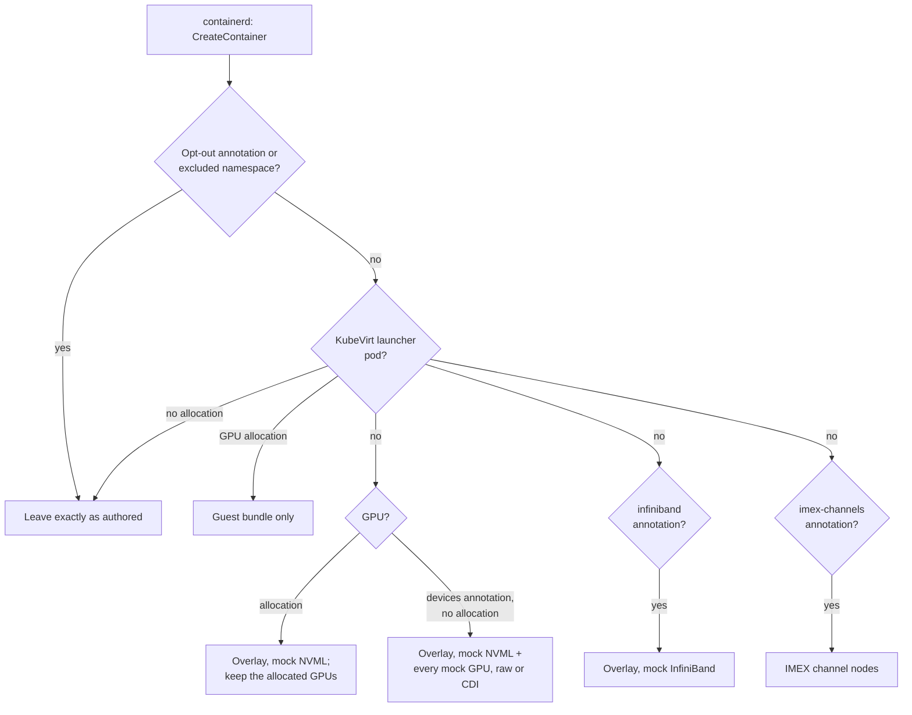
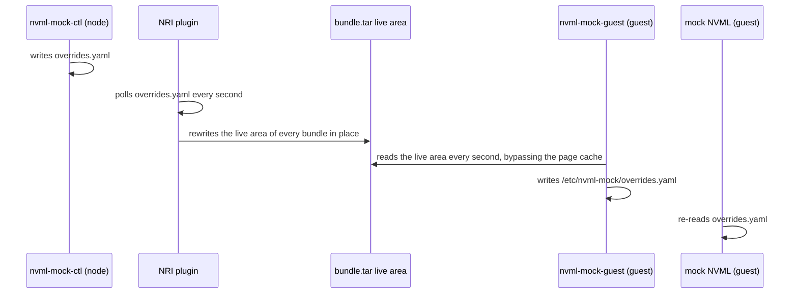

# NRI Plugin

The component that puts mock GPUs inside a container the pod author never
changed.

The [node daemon](node-daemon.md) stages a GPU tree on the host, but a container
sees only what its runtime gives it. Without help, a workload would need
Mokka-specific pod spec changes — a `hostPath` mount, some `MOCK_*`
environment. The NRI plugin removes that step: it registers with containerd's
Node Resource Interface and edits containers as they are created, so a workload
that was allocated GPUs the usual way comes up with the mock driver, unchanged.

!!! note "What NRI is"
    The **Node Resource Interface** is a framework for plugging extensions into
    OCI-compatible container runtimes. A plugin registers with the runtime, is
    notified as containers are created, and may make limited adjustments to a
    container's OCI spec — mounts, devices, environment — before it starts.

    It sits *below* the Container Runtime Interface, so it is a runtime feature
    rather than a Kubernetes API: there is no NRI object in the Kubernetes API
    and nothing on kubernetes.io describing it. containerd 1.7 or later is
    required. See the
    [NRI project](https://github.com/containerd/nri) and
    [containerd's NRI documentation](https://github.com/containerd/containerd/blob/main/docs/NRI.md).

For where it sits in the wider system, see the
[architecture overview](../architecture.md).

## Which containers are injected

The plugin injects only containers that were given GPUs or explicitly asked for
a mock surface. Everything else on the node is left exactly as authored, just as
a real GPU node gives nothing to a pod that requested no GPU.

It makes three independent selections — GPU, InfiniBand and IMEX — and adds only
the surfaces that were selected. None of them brings another along.

| Container | Receives |
|---|---|
| Holds a GPU allocation from the device plugin or the NVIDIA DRA driver | The overlay with mock NVML active. The allocated GPUs stay exactly as the scheduler assigned them |
| Holds a GPU allocation in a pod annotated `kubevirt.io/domain` | A guest bundle for the VM, and nothing else; see [KubeVirt launchers](#kubevirt-launchers) |
| Pod annotated `nvml-mock.nvidia.com/devices: "true"`, no allocation | The overlay with mock NVML active, and every mock GPU on the node |
| Pod annotated `nvml-mock.nvidia.com/infiniband: "true"` | The overlay with the mock InfiniBand tools active |
| Pod annotated `nvml-mock.nvidia.com/imex-channels: "true"` | The mock IMEX channel nodes, and nothing else |
| Anything else | Nothing |

A container that matches several rows gets each of their surfaces, except a
KubeVirt launcher, which gets only its bundle.

The **overlay** is the mock driver tree mounted at `/opt/nvml-mock`, plus the
`PATH`, `LD_LIBRARY_PATH` and `LD_PRELOAD` shims that point at it. The GPU and
InfiniBand selections share it, because the InfiniBand tools and shims are
staged beside the mock driver. The environment turns on only what was selected:

| Selected | Environment |
|---|---|
| GPU | `MOCK_NVML_CONFIG`, `MOCK_PCI_ROOT`, `GFD_MACHINE_TYPE_FILE` and, when staged, the ComputeDomain topology |
| GPU, not InfiniBand | `MOCK_IB=off`, so the preloaded InfiniBand shims do nothing |
| InfiniBand | `MOCK_IB=full`, `MOCK_IB_ROOT` and `MOCK_IB_PING_SOCKET` |
| InfiniBand, not GPU | `MOCK_NVML_VISIBLE_DEVICES=none`, so the staged `nvidia-smi` reports no GPUs |

When the container already sets one of these variables, its own value wins,
except against `MOCK_IB=off` and `MOCK_NVML_VISIBLE_DEVICES=none`: the
annotations decide what a container gets, not an environment baked into its
image.

A process that loses `MOCK_NVML_CONFIG`, such as a Slurm job, which inherits
the environment of whoever ran `srun`, still loads the node's profile from the
overlay mount; see [how the library finds its configuration](../configuration.md#environment-variables).
The shims' variables have no such fallback, so `libmockfs.so` is not loaded in
that process.

The `devices` annotation is the management path: it gives a pod the whole node,
such as a monitoring agent, without scheduler accounting. Like the other
annotations, it applies to every container in the pod.

!!! note "Privileged pods and `NVIDIA_VISIBLE_DEVICES`"
    On a real GPU node, a privileged container that requested no GPU sees every
    GPU, and so does a container that sets `NVIDIA_VISIBLE_DEVICES=all` when the
    NVIDIA container runtime handles it. The plugin injects neither: inherited
    device nodes do not identify an allocation, and the plugin cannot tell which
    runtime runs a container. Where the node runs the NVIDIA container runtime,
    that runtime still acts on the variable. Otherwise, give such a pod the
    `devices` annotation.

## What happens to a container

Adjustment runs as a fixed sequence, and no step blocks container creation:

When no branch selects anything, the container is left exactly as authored.

### When a container is left alone

Any of these leaves the container exactly as authored:

- the pod carries `nvml-mock.nvidia.com/inject: "false"`;
- its namespace is in the excluded list;
- its pod is a [KubeVirt launcher](#kubevirt-launchers) and it holds no GPU
  allocation, whatever its annotations;
- it holds no GPU allocation and carries none of the `devices`, `infiniband`
  and `imex-channels` annotations;
- it already mounts the overlay at the destination path.

That last check is what makes re-adjustment safe. A container that already has
the overlay has been through here before, so re-running would double-apply.

## Recognising a GPU allocation

The kubelet applies a device plugin's or DRA driver's allocation before the
runtime asks this plugin to adjust the container, so the allocation is visible
in the incoming container spec. Only these count as evidence:

| Evidence | Produced by |
|---|---|
| A numbered `/dev/nvidiaN` character device **and** a cgroup rule allowing exactly that device | device plugin with `--pass-device-specs=true` |
| A CDI device `k8s.device-plugin.nvidia.com/gpu=<id>` | device plugin with the `cdi-cri` device list strategy; `<id>` is the GPU UUID, or its index with `--device-id-strategy=index` |
| A CDI device `k8s.gpu.nvidia.com/claim=<id>` | NVIDIA DRA driver |

The rules are strict so that a container is never mistaken for an allocated
one:

- A privileged container inherits every host device under a wildcard cgroup
  rule. Its `/dev/nvidiaN` nodes were not allocated, so they do not count.
- Control devices such as `/dev/nvidiactl` or `/dev/nvidia-uvm` accompany an
  allocation but do not identify a GPU.
- Other CDI kinds do not count. That includes the device plugin's
  `k8s.device-plugin.nvidia.com/gdrcopy=all` and `…/mofed=all`, which come with
  every allocation, the container toolkit's `nvidia.com/gpu`, and Mokka's own
  `nvml-mock.nvidia.com/gpu=all`.

An allocation always wins over the `devices` annotation: the container keeps
exactly the GPUs it was allocated, and `nvidia-smi` reports that subset, not
the whole node. This is the rule from
[MEP-0002](https://github.com/NVIDIA/k8s-test-infra/tree/main/enhancements/meps/0002-device-plugin-nri-composition):
whatever the scheduler allocated is never widened.

!!! warning "The device plugin must leave evidence of the allocation"
    A device plugin that only sets `NVIDIA_VISIBLE_DEVICES` (the default
    `envvar` strategy) or delivers CDI devices only through pod annotations
    (`cdi-annotations`) leaves no evidence in the container spec. Its pods are
    treated as unallocated and receive nothing. Run the device plugin with
    `--pass-device-specs=true`, as the
    [device plugin guide](../guides/device-plugin.md) does, or with the
    `cdi-cri` strategy, as the GPU Operator does when CDI is enabled.

!!! note "IMEX sits outside this rule"
    IMEX channels are requested by their own annotation and never suppressed,
    except in a [KubeVirt launcher](#kubevirt-launchers). Neither the device
    plugin nor the DRA driver delivers mock IMEX channels, so there is nothing
    to defer to.

## Selecting InfiniBand

Only the `infiniband` annotation selects InfiniBand. A privileged container
inherits every host `/dev/infiniband/*` node under a wildcard cgroup rule
without asking for RDMA, so device paths are not evidence. The plugin does not
yet recognise an allocation from an RDMA device plugin or DRA driver; that needs
a signal that inherited nodes cannot produce, and none has been validated.

The annotation never adds or removes real `/dev/infiniband/*` nodes. It points
the InfiniBand tools at the mock sysfs tree the node agent renders. On a profile
without InfiniBand that tree holds no HCA: the pod still starts, its tools find
nothing, and the plugin logs a warning.

## KubeVirt launchers

A KubeVirt VM runs inside a virt-launcher pod, whose `compute` container runs
libvirt and QEMU. When the VM requests `nvidia.com/gpu`, that container holds
the allocation, but the GPU belongs to the guest. The overlay would be wrong
there: its `LD_PRELOAD` shims and mock library would load into libvirt and QEMU,
and none of it would reach the guest's filesystem.

The plugin therefore treats a container as a **launcher** when its pod carries
the `kubevirt.io/domain` annotation, which KubeVirt sets on virt-launcher pods,
and the container holds a GPU allocation by the rules in
[Recognising a GPU allocation](#recognising-a-gpu-allocation). A launcher gets
no overlay, environment or devices, only its **guest bundle**: a directory
holding `bundle.tar`, an archive laid out at the guest's own paths:

| Path in the bundle | Content |
|---|---|
| `etc/nvml-mock/config.yaml` | The node's GPU profile, copied from the staged overlay with every GPU set to passthrough virtualization mode, which is what NVML reports inside a VFIO guest |
| `etc/nvml-mock/config.mig.yaml` | The board's [MIG profile table](../mig.md), only when the node agent staged one |
| `etc/nvml-mock/allocation` | The allocated GPU minor numbers, one per line |
| `usr/local/lib64/libnvidia-ml.so.1`, `usr/local/bin/nvidia-smi` | The mock NVML library and `nvidia-smi` |
| `etc/ld.so.conf.d/nvml-mock.conf` | Adds `/usr/local/lib64` to the loader's search path |
| `usr/local/bin/nvml-mock-guest`, `etc/systemd/system/nvml-mock-guest.service` | A static program and its systemd unit that mirror the node's runtime overrides into the guest; see [Runtime changes in a guest](#runtime-changes-in-a-guest) |
| `dev/nvidiaN`, one per allocated GPU | Empty files. The mock library shows only the GPUs whose device file exists, so the guest sees exactly its allocation |

Extracting the archive at `/` is the install: the mock library finds
`/etc/nvml-mock/config.yaml` without `MOCK_NVML_CONFIG`, and after `ldconfig`
any program loading `libnvidia-ml.so.1` finds it. Starting the
`nvml-mock-guest` unit keeps the guest's overrides in step with the node.

The guest sees none of the launcher container's files: QEMU's devices come from
the libvirt domain that virt-launcher defines after the container starts. The
bundle therefore reaches the guest as a disk the VM itself declares, a KubeVirt
`hostDisk` volume at the **guest placeholder** path,
`/run/nvml-mock-guest/bundle.tar`. The placeholder is an empty directory the
chart creates on every node. In a launcher, the plugin replaces each mount of
it with a read-only bind of that launcher's bundle directory, so libvirt
attaches the launcher's own `bundle.tar`. Every VM spec names the same path,
and a VM on a node without the plugin finds no bundle rather than another VM's.
A VM declares three things:

- `nvidia.com/gpu: N` under `spec.domain.resources.limits`, the number of GPUs
  its guest sees. KubeVirt's `spec.domain.devices.gpus` does not work with mock
  GPUs: it attaches the allocation through VFIO PCI passthrough, which needs a
  real PCI device.
- The `hostDisk` volume at the placeholder, with `type: Disk`, attached as a
  read-only disk. KubeVirt accepts it only with the `HostDisk` feature gate
  enabled.
- A guest that extracts that disk at `/`, runs `ldconfig` and starts the
  `nvml-mock-guest` unit, for example from cloud-init.

The
[`--kubevirt` Tilt scenario](https://github.com/NVIDIA/k8s-test-infra/blob/main/local/kubevirt/README.md)
is a complete example.

Before a VM starts, virt-handler changes a `hostDisk` directory's owner to
KubeVirt's `qemu` user (UID and GID 107) unless it already belongs to it. The
bind is read-only, so the plugin writes the bundle directory and file owned by
that user.

The bundle is written when the launcher container is created. Only its
[live area](#runtime-changes-in-a-guest) changes afterwards: a later profile or
MIG table change on the node reaches a guest only after a VM restart, which
creates a new launcher and a new bundle.

### Runtime changes in a guest

Runtime changes on the node, such as an Xid injected with
`nvml-mock-ctl fail --xid`, a pinned temperature, or the memory use
`watch-allocations` publishes, all land in one file: the node's
`overrides.yaml`. A guest mirrors that file, so `nvidia-smi` and NVML events in
the guest report the same changes a container on the node would see.

Every `bundle.tar` ends in a 1 MiB **live area** after the archive. `tar` stops
at the archive's end and never reads it. The area holds a header with a
checksum, followed by the node's `overrides.yaml` verbatim. The plugin rewrites
the area in place when the node's file changes. QEMU keeps no cache of its own
for the disk, so it serves the new bytes to the guest. In the guest, the
`nvml-mock-guest` service polls the area and writes a changed document to
`/etc/nvml-mock/overrides.yaml` under the lock the mock library's own writers
take, and logs `applied host overrides` with the document's SHA-256 on the
serial console. A change reaches the guest's NVML within about three seconds.

The guest applies the node's document unchanged. Overrides are keyed by the
profile's device index, which a guest shares with the node, so an override for
a GPU the guest does not hold has no effect there.

- The node is the source of truth. An override set inside the guest lasts until
  the next change on the node replaces it.
- Removing the node's file, as the node agent does on restart, removes the
  guest's.
- An Xid reaches the guest as an NVML event only. The guest's kernel log never
  shows it.
- A document larger than the area's 1020 KiB, or a bundle written by a plugin
  version without a live area, is logged once per change and left as it was.

Edge cases:

- The `devices`, `infiniband` and `imex-channels` annotations have no effect on
  a launcher. The opt-out annotation and excluded namespaces still apply.
- A launcher with no mount of the placeholder is left unmodified, because its VM
  declares no bundle disk. That includes a launcher whose placeholder was
  already replaced.
- Every container in the pod that holds no GPU allocation is left exactly as
  authored, even when the pod carries the `devices`, `infiniband` or
  `imex-channels` annotation.
- When no allocated `/dev/nvidiaN` carries its own cgroup grant, the launcher is
  left unmodified with a warning: a bundle without device files would show the
  guest every GPU on the node.
- When the bundle cannot be written, the launcher is left unmodified with a
  warning rather than failing its creation, as described in
  [Failing open](#failing-open).

A launcher left without a bundle still declares the disk, which then names the
empty placeholder, so its VM cannot start. [A KubeVirt VM with a GPU never
starts](../troubleshooting.md#a-kubevirt-vm-with-a-gpu-never-starts) lists the
causes and the error.

Nodes with SELinux enforcing are untested: a confined QEMU may be denied the
bundle file on the host path.

Bundles live on the node under the
[`nri.guest.hostPath` chart value](../helm-chart.md#values), one directory per
container ID. The plugin deletes a container's directory when containerd
reports the container removed. Each time it registers with containerd, it also
removes the directories of containers the runtime no longer reports, which
covers containers removed while the plugin was not running. That sweep removes
only directories named like a containerd container ID, 64 lowercase hex
characters, and leaves every other entry alone.

## Device injection modes

When the plugin delivers GPUs to a `devices`-annotated pod with no allocation,
`deviceInjectionMode` picks the mechanism. It changes *how*, never *whether*,
and never touches an allocated container.

| Mode            | Delivers                                                                            | Use when                                                                                                                                                     |
|-----------------|-------------------------------------------------------------------------------------|--------------------------------------------------------------------------------------------------------------------------------------------------------------|
| `raw` (default) | The mock `/dev/nvidiaN` nodes, staged directly into the adjustment                  | Always works. Required by MEP-0002 to stay reachable, and the only mode that works where CDI is off or absent                                                |
| `cdi`           | A CDI device reference the runtime resolves from the spec the `cri` simulator wrote | containerd 2.1 or later, or 1.7.30 or later. containerd 2.0.x drops a CDI device requested through NRI without an error, so the container starts with no GPU |

An unknown value is rejected rather than coerced. A typo that silently fell back
to `raw` would look identical to a working CDI deployment, and the difference is
only visible in the OCI spec of an already-running pod.

## Annotations

| Annotation | Effect |
|---|---|
| `nvml-mock.nvidia.com/inject: "false"` | Opt out of adjustment entirely |
| `nvml-mock.nvidia.com/devices: "true"` | Without an allocation: receive the overlay and every mock GPU. With an allocation: no effect |
| `nvml-mock.nvidia.com/infiniband: "true"` | Receive the overlay with the mock InfiniBand tools active. Adds no GPUs |
| `nvml-mock.nvidia.com/imex-channels: "true"` | Receive the mock IMEX channels. Adds no overlay and no GPUs |

## Failing open

Every step degrades rather than blocks.

Before each adjustment, the plugin checks the node agent in its pod. It takes
the shared side of a staging lock, which the agent holds exclusively while it
stages or tears down the driver tree, and asks the agent's `/stagedz` endpoint
whether the tree is staged. `/stagedz` follows the agent's Stage wave only, so
a failed Apply, such as a failed write of the NFD feature file, does not close
it. In `cdi` mode, Stage also withdraws the plugin's CDI spec until Apply
republishes it, so a container created in between gets raw device nodes from
the new tree rather than a spec naming nodes a smaller profile removed. While
the agent is restarting, restaging or not yet staged, the plugin
leaves the container unmodified, logs a warning naming its namespace, pod and
container, and fails `/readyz` with the reason. Containers the plugin skips
anyway, such as those in an excluded namespace, are not reported.

The lock file lives in a memory-backed `emptyDir` mounted only into the node
agent and the plugin, so no workload can hold it and stall staging. It covers
the plugin's decision, not the runtime applying it, so a teardown that starts
in between can still race one container. During pod termination the agent
waits at most half of its shutdown timeout for the lock, then tears down
without it.

Once the agent is serving, individual missing device surfaces can still reduce
injection to overlay-only instead of blocking container creation.

The alternative would be worse: a plugin that errors on a missing surface blocks
every container on the node, including the daemon that would have created the
surface.

That choice has a consequence worth knowing about. **A plugin containerd has
unregistered stays alive and silently stops injecting** — nothing crashes, pods
just quietly come up without GPUs. The plugin therefore reports whether
injection is actually happening, rather than merely whether the process is
running.

It also watches for wedged requests. If an in-flight adjustment exceeds the
timeout containerd told the plugin it is applying, the runtime has already
abandoned that request and the container was created without injection. The
threshold is a multiple of the runtime's own timeout, so a single slow request
cannot trigger a restart, but a genuinely stuck plugin gets replaced.

## Mount propagation

The overlay arrives as two bind mounts: the driver tree read-only, and its
`config` directory writable on top of it, because `nvidia-smi --gpu-reset`
writes there. Both are `rprivate`, the propagation a `hostPath` volume without
`mountPropagation` gets.

A container with a `Bidirectional` volume, such as a DRA kubelet plugin, has a
shared root. Without the option, the writable bind was copied onto the node at
`/var/lib/nvml-mock/driver/config`, doubling there with every such container
and staying after the pod was gone. `rslave` would also stop that, but
containerd accepts it only when the node mount holding the overlay is shared or
slave, and otherwise fails container creation. For nodes that already have the
copies, see
[troubleshooting](../troubleshooting.md#mounts-pile-up-on-a-node-with-nri-enabled).

## How the code is split

| Package | Role |
|---|---|
| `internal/nri` | The runtime-coupled half: registers with containerd, translates its container types, writes KubeVirt guest bundles, reports health |
| `internal/nri/inject` | The decision: what to add to a container. No containerd types cross this boundary, so every rule above is exercisable as a plain table test |

## Related

| To read about | See |
|---|---|
| How the whole system fits together | [Architecture](../architecture.md) |
| What stages the tree this plugin mounts | [Node Daemon](node-daemon.md) |
| Its chart values | [Installation](../helm-chart.md) |
| Checking that it injects | [Set up NRI injection](../guides/nri-injection.md) |
