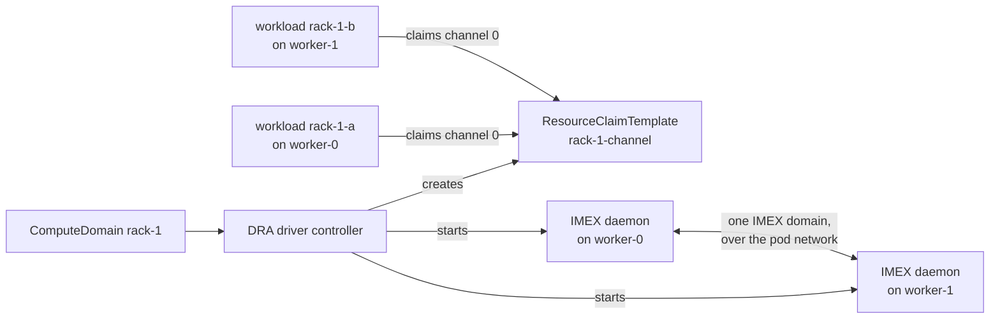

# ComputeDomains with the NVIDIA DRA Driver

Run ComputeDomains through the unmodified NVIDIA DRA driver on mock GB200
racks, on a Kind cluster with no GPUs.

A **ComputeDomain** is the NVIDIA DRA driver's resource for a group of pods on
different nodes that share GPU memory over a multi-node NVLink fabric, such as
a GB200 NVL72 rack. For each ComputeDomain the driver starts an IMEX
(Internode Memory Exchange) daemon on every node a workload of the domain lands
on. The daemons of one NVLink **clique**, the set of nodes one NVLink fabric
connects, join one IMEX domain. Each workload gets an **IMEX channel**, the
device node that authorizes it to share memory within that domain.

The driver (chart `0.5.0`) runs its upstream images unmodified. Mokka gives
each node what a real GB200 node has:

- **NVLink fabric identity.** The mock NVML library answers
  `nvmlDeviceGetGpuFabricInfo` and `nvmlDeviceGetGpuFabricInfoV` with the
  cluster UUID, clique ID and registration state that a cluster-level topology,
  set in the chart's `topology` values, assigns to the node. The driver's
  kubelet plugin reads each node's clique from there.
- **The IMEX kernel surface.** A substitute `/proc/devices` with the
  `nvidia-caps-imex-channels` major, the `fabric-imex-mgmt` capability file, and
  the `channel0` device node, as a real driver loaded with
  `NVreg_CreateImexChannel0=1` creates them.
- **The IMEX node software.** `nvidia-imex` and `nvidia-imex-ctl`, from the
  NVIDIA archive Mokka pins, staged in the mock driver tree where the driver
  looks for them. Mokka's `nvidia-imex` is a shim that runs the real daemon,
  `nvidia-imex.real`, in NO GPU mode, so the daemons speak the real IMEX
  protocol over the pod network. See [Providing IMEX](#providing-imex).



No GPU memory is shared and no NVLink traffic flows: the guide exercises the
control path — scheduling, claims, daemon lifecycle, IMEX domain formation and
readiness — not the data path.

## Prerequisites

The guide creates its own Kind cluster of four workers in two racks, from
[`tests/e2e/kind-compute-domain-racks.yaml`](https://github.com/NVIDIA/k8s-test-infra/blob/main/tests/e2e/kind-compute-domain-racks.yaml).
It keeps the cluster's credentials in a kubeconfig file of its own and never
uses your current kubectl context.

| Tool | Version | Used for |
|---|---|---|
| `docker` | 24+, with `buildx` | Kind nodes, and building the nvml-mock and IMEX binaries images |
| `kind` | v0.31+ | The cluster, on the Kubernetes 1.35 node image the Makefile pins |
| `kubectl` | v1.30+ | Waiting on and checking the cluster |
| `helm` | 3.8+ | nvml-mock from this checkout, and the DRA driver from NVIDIA's Helm repository |
| `go` | the version in `go.mod` | `make imex-binaries-image`, which downloads and verifies the IMEX archive |
| `make` | any | `make imex-binaries-image` |
| `bash` | 3.2+ | `run.sh` |

ComputeDomains need nvml-mock's NRI plugin (`nri.enabled`, on by default), which
hands the driver's IMEX daemon the real `nvidia-imex`; the guide keeps it on.

The first run needs internet access: it downloads the IMEX archive from
`developer.download.nvidia.com`, the DRA driver chart from
`helm.ngc.nvidia.com`, and the driver and workload images.

New to Mokka? The [quick start](../../quickstart.md) is the fastest way to see
simulated GPUs before running this guide.

## What run.sh does

1. Creates the Kind cluster `mokka-compute-domain`, or reuses it when its four
   workers carry the two-rack labels. It writes the cluster's kubeconfig to
   `~/.kube/mokka-compute-domain.kubeconfig`, and every `kubectl` and `helm`
   call names that file and the `kind-mokka-compute-domain` context.
2. Builds the `nvml-mock:compute-domain` image and loads it into Kind.
3. Provides IMEX. By default it builds the IMEX binaries image with
   `make imex-binaries-image` and loads it into Kind; the node agents then never
   contact NVIDIA. With `IMEX_SOURCE=download` it skips that, and each node
   agent downloads the archive itself.
4. Installs nvml-mock with the `gb200` profile, the
   [rack topology](./topology.yaml) and the IMEX source, and restarts the node
   pods so a rerun stages the rebuilt image and current topology.
5. **Scenario 1 — per-node fabric identity.** Runs `check-fabric` in the node
   pod on each worker and asserts that every GPU reports clique 0 of rack-1
   (`00000000-0000-0000-0000-0000000000a1`) on `worker-0` and `worker-1`, and
   clique 0 of rack-2 (`00000000-0000-0000-0000-0000000000b2`) on `worker-2` and
   `worker-3`, with state `completed`.
6. **Scenario 2 — topology rebinding.** A `helm upgrade --reuse-values` with
   another topology puts every node in clique 99 of a new domain; after the node
   pods restart, `check-fabric` reports it on every worker, with no image
   rebuild. The script then restores the rack topology and asserts Scenario 1
   again. It runs before the DRA driver is installed, so no ComputeDomain sits
   on a node whose topology changes.
7. Waits until every node agent has staged IMEX, installs the DRA driver with
   [`dra-driver.values.yaml`](./dra-driver.values.yaml), and restarts its
   kubelet plugin, which reads the clique and the IMEX binaries when it starts.
8. **Scenario 3 — a ComputeDomain.** Applies
   [`compute-domain.yaml`](./compute-domain.yaml): ComputeDomain `rack-1` with
   `numNodes: 2`, and workloads `rack-1-a` on `worker-0` and `rack-1-b` on
   `worker-1`. It asserts that both workloads run, the ComputeDomain is `Ready`
   with both nodes in rack-1's clique, an IMEX daemon is ready on each, and each
   workload sees `channel0` and no other channel.

The cluster and the ComputeDomain are left running for inspection.

## Quick start

```bash
./docs/guides/compute-domain/run.sh
```

The script finds the repository itself, so it works from any directory. A first
run takes 15–25 minutes, most of it building images and pulling the DRA driver.
Reruns reuse the cluster, the Docker build cache and the downloaded IMEX
archive.

| Variable | Default | Effect |
|---|---|---|
| `CLUSTER_NAME` | `mokka-compute-domain` | Kind cluster name. Node names do not depend on it |
| `FORCE_RECREATE` | `false` | `true` deletes an existing cluster of that name and creates it again |
| `IMEX_SOURCE` | `image` | `image` builds and loads the IMEX binaries image; `download` lets each node agent download IMEX from NVIDIA |
| `IMEX_BINARIES_IMAGE` | `mokka-imex:<IMEX version>` | Binaries image to build and load |
| `DEMO_KUBECONFIG` | `~/.kube/<cluster name>.kubeconfig` | Kubeconfig file for the cluster |
| `KIND_NODE_IMAGE` | the Makefile's `KIND_NODE_IMAGE` | Kind node image |
| `HELM_TIMEOUT` | `10m` | How long each Helm install waits |

The script stops with an error when a cluster of that name exists but was not
created from the two-rack config, for example the Tilt `compute-domain`
cluster, which has the same name. Set `FORCE_RECREATE=true` to replace it, or
pick another `CLUSTER_NAME`.

## Manual reproduction

The steps below do what the script does, without the topology rebind. Run them
from the repository root. The first line keeps the cluster's credentials in a
file of its own, so every later `kubectl` and `helm` command reaches only this
cluster:

```bash
export KUBECONFIG="${HOME}/.kube/mokka-compute-domain.kubeconfig"
```

### 1. Create the cluster

```bash
make cluster-create PROFILE=compute-domain \
  KIND_CLUSTER_CONFIG=tests/e2e/kind-compute-domain-racks.yaml
```

That is `kind create cluster --name mokka-compute-domain` with the config above
and the node image the Makefile pins. The config turns on DRA and names the
workers `worker-0` to `worker-3`, labeled with their rack's clique and with
`mokka.nvidia.com/type: sgpu`, which nvml-mock and the DRA kubelet plugin select
on.

### 2. Build and load the nvml-mock image

```bash
docker build -t nvml-mock:compute-domain \
  --build-arg GOLANG_VERSION="$(hack/golang-version.sh)" \
  -f deployments/nvml-mock/Dockerfile .
kind load docker-image nvml-mock:compute-domain --name mokka-compute-domain
```

### 3. Build and load the IMEX binaries image

```bash
IMEX_VERSION=$(sed -n 's/^ *"version": *"\([^"]*\)".*/\1/p' internal/agent/imex/imex.lock.json)
make imex-binaries-image IMEX_BINARIES_IMAGE="mokka-imex:${IMEX_VERSION}" \
  IMEX_BINARIES_ARCH="$(docker version --format '{{.Server.Arch}}')"
kind load docker-image "mokka-imex:${IMEX_VERSION}" --name mokka-compute-domain
```

`IMEX_BINARIES_ARCH` follows the Docker daemon, whose architecture the Kind nodes
share. [Providing IMEX](#providing-imex) covers what the image holds and the
other ways to provide IMEX.

### 4. Install nvml-mock

```bash
helm upgrade --install nvml-mock deployments/nvml-mock/helm/nvml-mock \
  --namespace mokka --create-namespace \
  -f docs/guides/compute-domain/topology.yaml \
  --set image.repository=nvml-mock \
  --set image.tag=compute-domain \
  --set gpu.profile=gb200 \
  --set 'nodeSelector.mokka\.nvidia\.com/type=sgpu' \
  --set imex.binaries.image.repository=mokka-imex \
  --set imex.binaries.image.tag="${IMEX_VERSION}" \
  --set featureGates.IMEXDownload=false \
  --wait --timeout 10m
```

| Setting | Why |
|---|---|
| `gpu.profile=gb200` | A multi-node NVLink profile, as `gb300` is; the node agent stages IMEX only on such profiles |
| `-f topology.yaml` | The two racks; pass it with `-f`, not `--set-file`, so Helm parses the list |
| `nodeSelector` | Workers only: the topology gives the control plane no clique |
| `imex.binaries.image.*` | The binaries image from step 3 |
| `featureGates.IMEXDownload=false` | The binaries image is the only IMEX source, so no node contacts NVIDIA |

Check that every node agent staged IMEX. Each line should end in `staged`:

```bash
for pod in $(kubectl -n mokka get pods -l app.kubernetes.io/name=nvml-mock -o name); do
  kubectl -n mokka exec "${pod}" -c node-agent -- \
    test -f /var/lib/nvml-mock/driver/usr/bin/nvidia-imex.real && echo "${pod} staged"
done
```

### 5. Check the fabric identity

```bash
for node in worker-0 worker-1 worker-2 worker-3; do
  pod=$(kubectl -n mokka get pods -l app.kubernetes.io/name=nvml-mock \
    --field-selector "spec.nodeName=${node}" -o jsonpath='{.items[0].metadata.name}')
  echo "=== ${node}"
  kubectl -n mokka exec "${pod}" -c node-agent -- check-fabric | head -6
done
```

`worker-0` and `worker-1` report `clusterUuid : 00000000-0000-0000-0000-0000000000a1`,
`worker-2` and `worker-3` report `00000000-0000-0000-0000-0000000000b2`; all
report `cliqueId : 0` and `state : completed (3)`.

### 6. Install the DRA driver

```bash
helm repo add nvidia https://helm.ngc.nvidia.com/nvidia && helm repo update
helm upgrade --install nvidia-dra-driver nvidia/dra-driver-nvidia-gpu \
  --version 0.5.0 \
  --namespace nvidia --create-namespace \
  -f docs/guides/compute-domain/dra-driver.values.yaml \
  --wait --timeout 10m
```

| Setting in `dra-driver.values.yaml` | Why |
|---|---|
| `nvidiaDriverRoot: /var/lib/nvml-mock/driver` | The mock driver tree, where the node agent stages the driver files and IMEX |
| `gpuResourcesEnabledOverride: true` | The driver otherwise gates GPU resources on NFD finding NVIDIA hardware |
| `resources.computeDomains.enabled: true` | Turns ComputeDomains on |
| `altProcDevices: /var/lib/nvml-mock/imex/proc-devices` | The node agent's substitute `/proc/devices`; the compute-domain kubelet plugin aborts at startup without the IMEX majors it lists |
| `kubeletPlugin.affinity` on `mokka.nvidia.com/type In [sgpu]` | The default affinity requires NFD or GFD labels, which nothing in this cluster writes |

The kubelet plugin reads each node's clique and the IMEX binaries when it
starts. If you reinstalled nvml-mock or changed its topology after installing
the driver, restart the node pods so they stage the change at once, then the
plugin:

```bash
kubectl -n mokka rollout restart daemonset/nvml-mock
kubectl -n mokka rollout status daemonset/nvml-mock
kubectl -n nvidia delete pods -l dra-driver-nvidia-gpu-component=kubelet-plugin
```

The plugin logs the clique it read from NVML for every GPU:

```bash
kubectl -n nvidia logs -l dra-driver-nvidia-gpu-component=kubelet-plugin \
  -c compute-domains --prefix | grep 'identified fabric clique'
```

### 7. Create a ComputeDomain and its workloads

```bash
kubectl apply -f docs/guides/compute-domain/compute-domain.yaml
kubectl -n compute-domain-demo wait --for=condition=Ready \
  pod/rack-1-a pod/rack-1-b --timeout=5m
```

[`compute-domain.yaml`](./compute-domain.yaml) holds the `compute-domain-demo`
namespace, ComputeDomain `rack-1`, and the two workloads:

```yaml
apiVersion: resource.nvidia.com/v1beta1
kind: ComputeDomain
metadata:
  name: rack-1
  namespace: compute-domain-demo
spec:
  numNodes: 2
  channel:
    resourceClaimTemplate:
      name: rack-1-channel
    allocationMode: Single
```

The driver's controller creates the ResourceClaimTemplate `rack-1-channel`.
Each workload, a `debian:bookworm-slim` pod pinned to its node with
`nodeSelector: kubernetes.io/hostname`, claims a channel from it:

```yaml
  resourceClaims:
    - name: imex-channel
      resourceClaimTemplateName: rack-1-channel
```

A workload starts only once the IMEX daemon on its node is ready, because until
then the kubelet cannot prepare its claim.

### 8. Verify

The ComputeDomain is `Ready`, with both rack-1 nodes in the same clique:

```bash
kubectl -n compute-domain-demo get computedomain rack-1 -o jsonpath='{.status.status}{"\n"}'
# Ready
kubectl -n compute-domain-demo get computedomain rack-1 \
  -o jsonpath='{range .status.nodes[*]}{.name}{"  "}{.cliqueID}{"\n"}{end}'
# worker-0  00000000-0000-0000-0000-0000000000a1.0
# worker-1  00000000-0000-0000-0000-0000000000a1.0
```

The driver runs one IMEX daemon pod per node, in its own namespace, labeled with
the ComputeDomain's UID:

```bash
kubectl -n nvidia get pods -l resource.nvidia.com/computeDomain -o wide
```

Both are `Running` and ready, one on `worker-0` and one on `worker-1`.

Each workload sees IMEX channel 0 and no other:

```bash
kubectl -n compute-domain-demo exec rack-1-a -- ls /dev/nvidia-caps-imex-channels
# channel0
```

## Allocation modes

`spec.channel.allocationMode` sets which IMEX channels a workload gets:

| Mode | The workload's `/dev/nvidia-caps-imex-channels` |
|---|---|
| `Single` | `channel0` only |
| `All` | Every channel of the IMEX domain, `channel0` to `channel2047` |

The driver's CDI spec carries the channels' device numbers, and the container
runtime creates the devices inside the container, so `All` needs no channel
files on the host; the node agent stages only `channel0`, as a real driver
does. To see it, create a one-node ComputeDomain with `numNodes: 1` and
`allocationMode: All`, put a workload of it on a free node such as `worker-2`,
and count its channels:

```bash
kubectl -n compute-domain-demo exec <workload> -- ls /dev/nvidia-caps-imex-channels | wc -l
# 2048
```

## A second workload on a busy node

A node has one IMEX channel 0, and a workload's claim holds it. A second
workload pinned to a node whose channel is in use, of the same ComputeDomain or
another one, stays `Pending` until the first workload leaves. To see it, copy
`rack-1-a` in [`compute-domain.yaml`](./compute-domain.yaml) under another name
and apply it: it waits for `worker-0` until you delete `rack-1-a`, then starts.

## Providing IMEX

On multi-node NVLink profiles, such as `gb200`, the node agent stages the IMEX
node software into the mock driver tree, `/var/lib/nvml-mock/driver` on each
node:

| File | What it is |
|---|---|
| `usr/bin/nvidia-imex` | Mokka's shim. It runs `nvidia-imex.real` beside it with `--nogpu` appended |
| `usr/bin/nvidia-imex.real` | NVIDIA's IMEX daemon |
| `usr/bin/nvidia-imex-ctl` | NVIDIA's IMEX control and status tool |
| `etc/nvidia-imex/config.cfg` | The daemon's default configuration |
| `usr/share/doc/nvidia-imex/` | NVIDIA's license and third-party notices |

The GPU CDI spec mounts `nvidia-imex` and `nvidia-imex-ctl` into containers
that get mock GPUs, as the NVIDIA Container Toolkit does on a real GB200 node,
with `nvidia-imex.real` beside the shim. The DRA driver mounts `nvidia-imex`
into its IMEX daemon container itself, and the NRI plugin adds
`nvidia-imex.real`.
The shim exists because the driver's daemon starts `nvidia-imex` with a fixed
command line, to which `--nogpu` cannot be added from outside. See
[nvidia-imex-shim](../../components/libraries-and-shims.md#nvidia-imex-shim).

The files come from the IMEX archive pinned in
[`internal/agent/imex/imex.lock.json`](https://github.com/NVIDIA/k8s-test-infra/blob/main/internal/agent/imex/imex.lock.json):
one version, NVIDIA's file name for each architecture, and its SHA-256. The node
agent looks for that file in three places, in order:

1. **The provided directory**, `/opt/mokka/imex` in the node agent's container,
   which the chart fills from `imex.binaries.image`.
2. **The node cache**, `/var/lib/nvml-mock/cache/imex` on the node.
3. **A download from NVIDIA** into the node cache, while the `IMEXDownload`
   [feature gate](../../feature-gates.md) is on. It is a beta gate, on by
   default, and is to be deprecated once Mokka publishes the binaries image. The
   node agent retries for about a minute, then not again until it restarts.

It stages an archive only if it matches the pinned SHA-256, and ignores any
other with a warning.

### The IMEX binaries image

The binaries image carries the pinned archive under `/imex`. When
`imex.binaries.image` is set, a copy-only init container in the node pod copies
it to the provided directory before the node agent starts. Build it with:

```bash
make imex-binaries-image
```

The target downloads the archive from NVIDIA into a local cache, verifies its
SHA-256, and builds the image from
[`deployments/imex-binaries/Dockerfile`](https://github.com/NVIDIA/k8s-test-infra/blob/main/deployments/imex-binaries/Dockerfile)
with `docker buildx build --load`. Once the cache holds a verified archive, the
build needs no network.

| Variable | Default | Effect |
|---|---|---|
| `IMEX_ARCHIVE_DIR` | `mokka/imex` in your user cache directory | Where the downloaded archives are kept |
| `IMEX_BINARIES_ARCH` | the Go toolchain's architecture | `amd64` or `arm64`; match your nodes |
| `IMEX_BINARIES_IMAGE` | `mokka-imex:<IMEX version>` | The image reference to build |

Then point the chart at it:

```yaml
imex:
  binaries:
    image:
      repository: mokka-imex
      tag: "<IMEX version>"   # or digest: sha256:...
```

Mokka does not publish the binaries image yet: publishing it redistributes
NVIDIA's IMEX binaries, which awaits approval. Until Mokka publishes it, build
the image yourself and keep it private, in one of the ways below.

An image the node cannot pull holds the whole node pod in `ImagePullBackOff`,
like any other image in the pod. Make sure every node can pull it before you set
`imex.binaries.image`.

**Kind.** Load it into the cluster, as step 3 above does:

```bash
kind load docker-image "mokka-imex:${IMEX_VERSION}" --name <cluster>
```

**CI pipelines.** Cache `IMEX_ARCHIVE_DIR` keyed on the IMEX version, so NVIDIA
is contacted once per version, and build the image in each job that needs it.
Never upload the image or the archive as a workflow artifact: anyone can
download the artifacts of a public repository. Mokka's own
[e2e workflow](https://github.com/NVIDIA/k8s-test-infra/blob/main/.github/workflows/nvml-mock-e2e-go.yaml)
does this; its cache key is the hash of `imex.lock.json`:

```yaml
- uses: actions/cache@v6
  with:
    path: .imex-archives
    key: imex-archives-${{ hashFiles('internal/agent/imex/imex.lock.json') }}
- run: |
    make imex-binaries-image IMEX_ARCHIVE_DIR="${PWD}/.imex-archives" \
      IMEX_BINARIES_IMAGE=mokka-imex:ci
    kind load docker-image mokka-imex:ci --name <cluster>
```

**Private registry.** Build the image under your registry's name and push it:

```bash
make imex-binaries-image IMEX_BINARIES_ARCH=amd64 \
  IMEX_BINARIES_IMAGE="registry.example.com/team/mokka-imex:${IMEX_VERSION}"
docker push "registry.example.com/team/mokka-imex:${IMEX_VERSION}"
```

Set `imex.binaries.image.repository` and `tag` to match, and add a pull secret
with the chart's `imagePullSecrets` if the registry needs one.

**Air-gapped clusters.** Build the image where NVIDIA's download site is
reachable, mirror it with the nvml-mock image into the registry the cluster
uses, and turn downloads off so no node tries to reach NVIDIA:

```yaml
imex:
  binaries:
    image:
      repository: <mirror>/mokka-imex
      tag: "<IMEX version>"
featureGates:
  IMEXDownload: false
```

### Downloading on the node

Until Mokka publishes the binaries image, a node that can reach
`developer.download.nvidia.com` can fetch IMEX itself. Leave
`imex.binaries.image` unset and `IMEXDownload` on, its default. Each node agent
downloads the archive into its node cache, so the download happens once per
node and IMEX version. `IMEX_SOURCE=download ./docs/guides/compute-domain/run.sh`
runs the guide this way.

## Without IMEX

Mokka fails open. A multi-node NVLink node that has no IMEX archive, from any
of the sources above, behaves as a real node without the IMEX package:

- The node agent stays ready and keeps simulating everything else: GPUs, NVML,
  the fabric identity, the IMEX kernel surface, and DRA GPU claims.
- It stages no IMEX node software and logs once what to provide: the archive's
  file name and path, its SHA-256, and NVIDIA's URL. On a node that had IMEX,
  it removes only `nvidia-imex.real`: GPU claims the DRA driver prepared
  meanwhile mount the shim and `nvidia-imex-ctl`, and their containers could
  not restart without them.
- The IMEX daemon of a ComputeDomain never becomes ready on that node, and the
  ComputeDomain stays `NotReady`.
- Its workloads wait in `ContainerCreating`, with `FailedPrepareDynamicResources`
  events.

```bash
kubectl -n mokka logs <nvml-mock pod> -c node-agent | grep 'IMEX node software'
kubectl -n compute-domain-demo describe pod rack-1-a
```

Providing IMEX later is enough. Setting `imex.binaries.image`, or turning
`IMEXDownload` on, restarts the node pods, which then stage it. Restart the DRA
kubelet plugin afterwards, as in step 6, so it reads the IMEX binaries again.

> [!WARNING]
> **Not supported: host-managed IMEX**
>
> The DRA driver can also leave IMEX to the node,
> `resources.computeDomains.imex.mode=hostManaged`, where the node operator
> runs the IMEX daemon on the host. Mokka does not support that mode: it
> stages IMEX for the driver's own daemon pods and runs no IMEX daemon on the
> host. Keep the driver's default mode.

## Topology layout

```text
domain "rack-1"   uuid 00000000-0000-0000-0000-0000000000a1
  clique 0: worker-0, worker-1
domain "rack-2"   uuid 00000000-0000-0000-0000-0000000000b2
  clique 0: worker-2, worker-3
```

[`topology.yaml`](./topology.yaml) holds it as chart values. Each worker of
`kind-compute-domain-racks.yaml` carries the same `<cluster UUID>.<clique ID>` in
`mokka.nvidia.com/clique`, and in `nvidia.com/gpu.clique` as GFD would set it on
a real node. The DRA driver itself reads the clique from NVML, not from the
labels. The node names are set in the cluster config, so the topology fits any
Kind cluster name.

## Rebinding the topology

The topology is a chart value, so a `helm upgrade` changes a node's fabric
identity with no image rebuild. Scenario 2 of `run.sh` moves every node into
clique 99 of a new domain:

```bash
cat > rebind.yaml <<'EOF'
topology:
  enabled: true
  domains:
    - name: rebinder
      uuid: "00000000-0000-0000-0000-0000000000ff"
      cliques:
        - id: 99
          nodes: [worker-0, worker-1, worker-2, worker-3]
EOF
helm upgrade nvml-mock deployments/nvml-mock/helm/nvml-mock \
  --namespace mokka --reuse-values -f rebind.yaml --wait
kubectl -n mokka rollout restart daemonset/nvml-mock
kubectl -n mokka rollout status daemonset/nvml-mock
```

`check-fabric` then reports `cliqueId : 99` and the new UUID on every worker.
For the driver to see the new cliques, restart its kubelet plugin as in step 6
and recreate the workloads of any ComputeDomain that was already running. Pass
`-f docs/guides/compute-domain/topology.yaml` the same way to go back.

## Troubleshooting

**The workloads stay in `ContainerCreating` with `FailedPrepareDynamicResources`.**
The IMEX daemon on their node is not ready. Check what the node agent staged,
then the daemon's log:

```bash
kubectl -n mokka logs -l app.kubernetes.io/name=nvml-mock -c node-agent \
  --prefix --tail=200 | grep -i imex
kubectl -n nvidia logs -l resource.nvidia.com/computeDomain --all-containers --tail=100
```

**The node agent logs `IMEX node software not provided`.** No source holds the
pinned archive. Provide it as in [Providing IMEX](#providing-imex). The message
names the file it expects and NVIDIA's URL for it.

**The node agent logs `IMEX archive does not match the pinned SHA-256`.** The
archive comes from another IMEX version, for example a binaries image built
from an older checkout. Rebuild the image with `make imex-binaries-image` from
the checkout whose chart you install.

**The node pod is in `ImagePullBackOff` on its `imex-binaries` init container.**
The node cannot pull `imex.binaries.image`. On Kind, load the image with
`kind load docker-image`; elsewhere, check the registry and pull secret.

**The DRA kubelet plugin crashes with `error parsing '/proc/devices'`.** It
cannot find the IMEX majors. Check that `altProcDevices` is set and that
nvml-mock runs a multi-node NVLink profile, such as `gb200`.

**The node agent logs `cannot simulate the IMEX kernel surface`.** The node
runs no ComputeDomains, and the error says why. A device major the node already
uses is not the cause: the agent then logs `configured IMEX device majors are
taken on this node; staging free ones` and uses free ones.

**The ComputeDomain lists a node in the wrong clique.** The kubelet plugin
started before the node agent staged the current topology. A topology change
alone does not restart the node pods, and the node agent picks it up only at its
next resync, within a minute or so. Restart the node pods and then the plugin as
in step 6, then recreate the ComputeDomain's workloads.

**The kubelet plugin's own log.** It runs the compute-domain plugin in the
`compute-domains` container:

```bash
kubectl -n nvidia logs -l dra-driver-nvidia-gpu-component=kubelet-plugin \
  -c compute-domains --tail=100
```

The e2e suite runs the same flow as an executable reference:
[`scenario_compute_domain_test.go`](https://github.com/NVIDIA/k8s-test-infra/blob/main/tests/e2e/go/scenario_compute_domain_test.go),
with `make e2e-compute-domain`.

## Clean up

```bash
kind delete cluster --name mokka-compute-domain \
  --kubeconfig ~/.kube/mokka-compute-domain.kubeconfig
rm -f ~/.kube/mokka-compute-domain.kubeconfig
# Optional: also remove the locally built images.
docker rmi nvml-mock:compute-domain "mokka-imex:${IMEX_VERSION}"
```

## Related

| To read about | See |
|---|---|
| Mock GPUs through the DRA driver, without ComputeDomains | [NVIDIA DRA Driver](../dra.md) |
| The `IMEXDownload` gate | [Feature Gates](../../feature-gates.md) |
| What the node agent stages | [Node Daemon](../../components/node-daemon.md) |
| What the NRI plugin gives the IMEX daemon | [NRI Plugin](../../components/nri-plugin.md) |
| Reading the fabric identity | [check-fabric](../../tools/check-fabric.md) |
