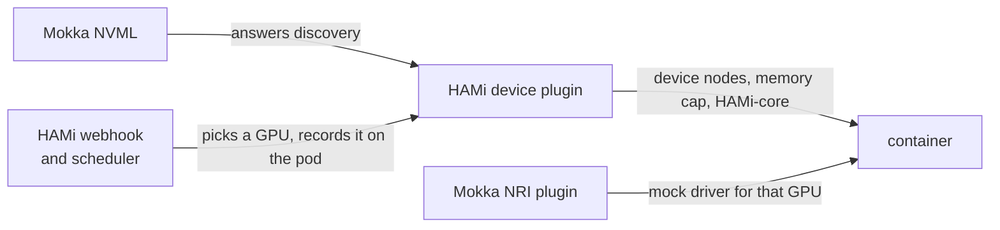

# HAMi (GPU sharing)

Share one mock GPU between two pods with [HAMi](https://project-hami.io/docs),
each capped to its own slice of the GPU's memory, and read the cap back with
`nvidia-smi` inside each pod.

HAMi lets several pods use the same GPU. A pod still asks for `nvidia.com/gpu`,
and adds how much of the board it wants: `nvidia.com/gpumem` in MiB and
`nvidia.com/gpucores` as a percentage. Mokka lets you exercise that path, from
scheduling to the limit a container sees, without hardware.

## How it fits together

HAMi brings its own scheduler and its own device plugin, and both run
unmodified:



- The **device plugin** discovers GPUs through NVML, which Mokka answers, and
  advertises each one ten times, so ten pods can hold a slice of it.
- The **admission webhook** routes a pod that requests those resources to
  `hami-scheduler`, which picks a GPU with enough free memory and records the
  choice in pod annotations.
- **HAMi-core** is a library the device plugin mounts into the container and
  preloads into every process. It intercepts NVML, so the container sees its
  slice instead of the whole board.

## Prerequisites

- [Docker](https://docs.docker.com/get-started/get-docker/) and
  [Kind](https://kind.sigs.k8s.io/)
- [Helm 3.8 or newer](https://helm.sh/docs/intro/install/)
- [kubectl](https://kubernetes.io/docs/reference/kubectl/)
- [jq](https://jqlang.github.io/jq/) for the verification steps

Takes about 10 minutes.

## Step 1 — Create a cluster and install Mokka

```bash
kind create cluster --name mokka-hami

helm install nvml-mock oci://ghcr.io/nvidia/k8s-test-infra/chart/nvml-mock \
  --version 0.7.0 \
  --namespace mokka --create-namespace \
  --wait --timeout 120s
kubectl -n mokka rollout status ds/nvml-mock --timeout=120s
```

Mokka's [NRI plugin](../components/nri-plugin.md), on by default, gives a
container that holds a GPU allocation the mock driver, so the pods in Step 4
can run `nvidia-smi` without a Mokka-specific pod spec. It needs containerd's
Node Resource Interface (NRI), which containerd 2.x, the version Kind nodes
run, turns on by default.

## Step 2 — Install HAMi

HAMi's device plugin runs on nodes labelled `gpu=on`:

```bash
kubectl label node --all gpu=on
```

Then install the chart:

```bash
helm upgrade --install hami hami \
  --repo https://project-hami.github.io/HAMi/ \
  --version 2.11.0 \
  --namespace kube-system \
  --set devicePlugin.nvidiaDriverRoot=/var/lib/nvml-mock/driver \
  --set scheduler.defaultSchedulerPolicy.gpuSchedulerPolicy=binpack \
  --wait --timeout 300s
```

| Setting | Why |
|---|---|
| `devicePlugin.nvidiaDriverRoot` | Points the device plugin at Mokka's staged tree instead of a real driver root. The default, `auto`, expects either the GPU Operator or a driver installed on the host |
| `scheduler.defaultSchedulerPolicy.gpuSchedulerPolicy` | `binpack` fills one GPU before starting the next. The default, `spread`, gives each pod its own GPU while any is free, which schedules fine and shares nothing |

!!! warning "HAMi must be the only NVIDIA device plugin on the node"
    HAMi's device plugin registers `nvidia.com/gpu` itself. Do not install it
    next to the [NVIDIA device plugin](device-plugin.md) or a
    [GPU Operator](gpu-operator.md) that deploys one.

## Step 3 — Check the GPUs HAMi registered

The device plugin writes what it found to a node annotation, which is where
the scheduler reads GPU inventory from:

```bash
kubectl get nodes -o json | jq -r '
  .items[].metadata.annotations["hami.io/node-nvidia-register"] | fromjson
  | .[] | "\(.id) \(.type) \(.devmem)MiB x\(.count)"'
# GPU-b300b300-0000-0000-0000-000000000000 NVIDIA GB300 NVL 284672MiB x10
# GPU-b300b300-0000-0000-0000-000000000001 NVIDIA GB300 NVL 284672MiB x10
# GPU-b300b300-0000-0000-0000-000000000002 NVIDIA GB300 NVL 284672MiB x10
# GPU-b300b300-0000-0000-0000-000000000003 NVIDIA GB300 NVL 284672MiB x10
```

Model, memory and UUIDs come from the profile: `gb300` is the default and
carries four devices. Each is advertised ten times, so the node reports 40
`nvidia.com/gpu`:

```bash
kubectl wait \
  --for=jsonpath='{.status.allocatable.nvidia\.com/gpu}'=40 \
  node --all --timeout=120s
```

## Step 4 — Schedule two pods onto one GPU

The first pod asks for 10 GiB of a GPU. The second asks for 20 GiB and 30% of
its compute:

```bash
kubectl apply -f - <<'EOF'
apiVersion: v1
kind: Pod
metadata:
  name: share-a
spec:
  restartPolicy: Never
  containers:
    - name: app
      image: ubuntu:22.04
      command: ["sleep", "infinity"]
      resources:
        limits:
          nvidia.com/gpu: 1
          nvidia.com/gpumem: 10240
---
apiVersion: v1
kind: Pod
metadata:
  name: share-b
spec:
  restartPolicy: Never
  containers:
    - name: app
      image: ubuntu:22.04
      command: ["sleep", "infinity"]
      resources:
        limits:
          nvidia.com/gpu: 1
          nvidia.com/gpumem: 20480
          nvidia.com/gpucores: 30
EOF

kubectl wait --for=condition=ready pod/share-a pod/share-b --timeout=120s
```

The image is ubuntu because the injected `nvidia-smi` and HAMi-core are glibc
binaries, which `busybox` cannot run.

## Step 5 — Check both pods share the GPU

The scheduler records each allocation on the pod as GPU UUID, vendor, memory
in MiB and compute share:

```bash
kubectl get pods share-a share-b -o custom-columns=\
'POD:.metadata.name,SCHEDULER:.spec.schedulerName,ALLOCATED:.metadata.annotations.hami\.io/vgpu-devices-allocated'
# POD       SCHEDULER        ALLOCATED
# share-a   hami-scheduler   GPU-b300b300-0000-0000-0000-000000000003,NVIDIA,10240,0:;
# share-b   hami-scheduler   GPU-b300b300-0000-0000-0000-000000000003,NVIDIA,20480,30:;
```

Both pods hold the same UUID. Which of the four GPUs it is can differ on your
cluster.

Then ask each pod what it sees:

```bash
kubectl exec share-a -- nvidia-smi --query-gpu=uuid,memory.total --format=csv,noheader
# GPU-b300b300-0000-0000-0000-000000000003, 10240 MiB

kubectl exec share-b -- nvidia-smi --query-gpu=uuid,memory.total --format=csv,noheader
# GPU-b300b300-0000-0000-0000-000000000003, 20480 MiB
```

Each pod lists one GPU, the one it was allocated, and reports its own
`nvidia.com/gpumem` limit as the GPU's total memory, not the board's 284672
MiB. The `[HAMI-core Msg ...]` lines printed next to the result are HAMi-core
announcing itself: the cap is applied by that library, on top of Mokka's NVML.

!!! note "The limits are reported, not exercised"
    Mokka has no CUDA, so nothing in the pod allocates GPU memory or launches
    kernels. The memory cap is visible through NVML but never hit, and the
    `nvidia.com/gpucores` share is scheduled and handed to the container as
    `CUDA_DEVICE_SM_LIMIT` with nothing to throttle.

## Troubleshooting

**The pods fail with `lstat /dev/nvidiactl: no such file or directory`.**
`devicePlugin.nvidiaDriverRoot` is still `auto`. Without the GPU Operator it
falls back to `/`, and the device plugin hands the kubelet device paths the
node does not have. Set it as in Step 2, then delete and recreate the pods.

**The pods stay `Pending`.** Check which scheduler holds them:

```bash
kubectl get pods share-a share-b -o custom-columns='POD:.metadata.name,SCHEDULER:.spec.schedulerName'
```

`default-scheduler` means the pod was created before HAMi's webhook was
serving, and the default scheduler cannot place it: no node advertises
`nvidia.com/gpumem`. Wait for `kubectl -n kube-system rollout status
deployment/hami-scheduler`, then delete and recreate the pods. With
`hami-scheduler`, describe the pod: its events name the reason no GPU fits.

**The pods land on different GPUs.** `gpuSchedulerPolicy` is `spread`, the
chart default. Set it as in Step 2, or annotate a pod with
`hami.io/gpu-scheduler-policy: binpack`.

**`nvidia-smi` is not found in the pod.** The NRI plugin did not inject it.
Check that the nvml-mock pods run an `nvml-mock-nri` container and are Ready,
and that containerd has NRI enabled. See
[A pod gets no mock GPUs even though NRI is enabled](../troubleshooting.md#a-pod-gets-no-mock-gpus-even-though-nri-is-enabled).
The plugin only injects a container as it is created, so delete and recreate
the pod after fixing it.

## Clean up

```bash
kind delete cluster --name mokka-hami
```

## Related

| To read about | See |
|---|---|
| Every chart value | [Installation](../helm-chart.md) |
| Which containers the NRI plugin injects | [NRI Plugin](../components/nri-plugin.md#which-containers-are-injected) |
| Whole GPUs through the NVIDIA device plugin | [NVIDIA Device Plugin](device-plugin.md) |
| Splitting a board into MIG slices instead | [MIG partitioning](mig/README.md) |
| Driving this from CI | [Use in CI/CD](ci-cd.md) |
