# Run Mokka on Amazon EKS

Install Mokka on CPU-only Amazon Elastic Kubernetes Service (EKS) workers,
advertise simulated GPUs, and run an unmodified `nvidia-smi` from a neutral
workload image.

This guide starts from an existing EKS cluster and needs no source checkout. To
create a disposable cluster that matches the validated configuration, use the
[reference Terraform](https://github.com/NVIDIA/k8s-test-infra/tree/main/docs/guides/install/aws/eks/terraform).

## Validation scope

The procedure validates:

- Mokka's container runtime setup on standard managed CPU nodes, which carry no
  NVIDIA software and no physical GPUs;
- the integration between the NVIDIA device plugin, NVIDIA runtime, Container
  Device Interface (CDI), and Mokka;
- Mokka placement on a dedicated managed node group; and
- simulated GPU injection into a normal application container.

| Component | Validated value | Why |
|---|---|---|
| Kubernetes | EKS `1.35` | Matches the current Mokka Kind test target |
| Workers | 2 × on-demand `t3.large`, in private subnets across two availability zones | CPU-only, enough memory for system and Mokka pods, and one Mokka pod per worker |
| Worker image | EKS-optimized standard AL2023 x86_64, `1.35.7-20260911` | Plain containerd under systemd and no NVIDIA software, so Mokka sets up the NVIDIA runtime itself |
| Mokka | chart and image `0.5.0`, `gb300` profile | The newest compatible published chart and image pair |
| Device plugin | `nvcr.io/nvidia/k8s-device-plugin:v0.18.2` (chart `0.18.2`) | Advertises `nvidia.com/gpu` through Mokka's NVML implementation |
| Container toolkit | `1.19.1`, shipped in the Mokka image | Mokka installs the NVIDIA runtime and CDI hook on each worker and registers the runtime with containerd |

These versions record a reproducible Mokka validation target; they are not an
AWS support statement. When updating Kubernetes or the AL2023 release, repeat
the neutral-workload test rather than assuming the runtime configuration is
unchanged.

## Prerequisites

Install these tools locally:

- [kubectl](https://kubernetes.io/docs/tasks/tools/)
- [Helm](https://helm.sh/docs/intro/install/) 3.8 or newer
- `jq`

You also need an EKS cluster with at least one dedicated Linux x86_64 CPU
worker whose image runs containerd under systemd, as the standard AL2023 image
does. Mokka requires privileged pods and `hostPath` volumes. It installs the
NVIDIA container runtime on each worker and makes it containerd's default
runtime handler, `nvidia`, in CDI mode, so the worker needs neither a physical
GPU nor NVIDIA software.
[Container runtime setup](../../../../components/node-daemon.md#container-runtime-setup)
lists what that changes on the node.

A worker image that already installs NVIDIA Container Toolkit, such as the
accelerated AL2023 image, is left as it is. Its runtime must then already be in
CDI mode, because the default `auto` mode tries to initialize a physical GPU.

Point the commands below at your cluster:

```bash
export MOKKA_CONTEXT=<your-kubeconfig-context>
```

## 1. Label the workers

Select the dedicated CPU workers and label each one. Do not label real GPU
nodes or a shared general-purpose pool:

```bash
kubectl --context "${MOKKA_CONTEXT}" get nodes -o wide
kubectl --context "${MOKKA_CONTEXT}" label node \
  <worker-name> mokka.nvidia.com/type=sgpu
```

Mokka restarts containerd on each labelled node when it sets up the runtime and
again when its pod stops, which is one more reason to keep the label off shared
nodes. The values files below scope Mokka and the device plugin to this label.

## 2. Install Mokka

Save the Mokka values. They keep Mokka off other nodes and point it at the
containerd drop-in directory that the AL2023 `config.toml` already imports:

```yaml title="mokka-values.yaml"
image:
  tag: 0.5.0

# Keep Mokka away from real GPU nodes and unrelated managed node groups.
nodeSelector:
  mokka.nvidia.com/type: sgpu

# The dedicated EKS node group is untainted. Do not inherit the chart's broad
# default toleration, which would otherwise admit the DaemonSet onto any taint.
tolerations: []

nodeAgent:
  containerRuntime:
    containerd:
      # nodeadm rewrites /etc/containerd/config.toml at every boot, and the
      # file it writes already imports this directory, so the setup does not
      # depend on an imports entry the next boot would remove.
      configDir: /etc/containerd/config.d
```

Install the chart:

```bash
helm upgrade --install nvml-mock \
  oci://ghcr.io/nvidia/k8s-test-infra/chart/nvml-mock \
  --version 0.5.0 \
  --kube-context "${MOKKA_CONTEXT}" \
  --namespace mokka \
  --create-namespace \
  --values mokka-values.yaml \
  --wait --timeout 5m

kubectl --context "${MOKKA_CONTEXT}" \
  --namespace mokka get daemonset,pods -o wide
kubectl --context "${MOKKA_CONTEXT}" \
  --namespace mokka exec daemonset/nvml-mock -- nvidia-smi -L
```

There should be one Ready Mokka pod per worker. The command reports four
`NVIDIA GB300 NVL` devices. It proves that Mokka staged its mock driver tree,
configuration, device nodes, and CDI specification on a node.

A Mokka pod becomes Ready only once containerd on its worker serves the
`nvidia` runtime handler as its default, and getting there restarts containerd
on the worker once.

## 3. Advertise the simulated GPUs

Mokka provides the device behavior; the unmodified NVIDIA device plugin tells
the kubelet that the devices are schedulable resources. Save the values below.
They point the plugin at Mokka's staged driver tree, select the simulated-GPU
workers, and remove the chart's physical-GPU node affinity:

```yaml title="device-plugin-values.yaml"
nvidiaDriverRoot: /var/lib/nvml-mock/driver

# Physical-GPU affinity would exclude the CPU-only Mokka workers.
affinity: null

nodeSelector:
  mokka.nvidia.com/type: sgpu
```

Install the official chart with them:

```bash
helm repo add nvdp https://nvidia.github.io/k8s-device-plugin
helm repo update nvdp

helm upgrade --install nvidia-device-plugin \
  nvdp/nvidia-device-plugin \
  --version 0.18.2 \
  --kube-context "${MOKKA_CONTEXT}" \
  --namespace nvidia-device-plugin \
  --create-namespace \
  --values device-plugin-values.yaml \
  --wait --timeout 5m

kubectl --context "${MOKKA_CONTEXT}" \
  --namespace nvidia-device-plugin rollout status \
  daemonset/nvidia-device-plugin --timeout=5m

kubectl --context "${MOKKA_CONTEXT}" get nodes -o json | jq -r '
  .items[] |
  [.metadata.name,
   .metadata.labels["mokka.nvidia.com/type"],
   .status.allocatable["nvidia.com/gpu"]] |
  @tsv'
```

Expect `sgpu` and `4` beside each labelled worker.

The request path is:

```mermaid
flowchart LR
    Pod[Pod declares nvidia.com/gpu: 1]
    Scheduler[Kubernetes scheduler selects a node]
    Kubelet[Kubelet selects an advertised GPU UUID]
    Plugin[NVIDIA device plugin returns NVIDIA_VISIBLE_DEVICES=UUID]
    Handler[containerd starts the container<br/>through its default handler, nvidia]
    Runtime[NVIDIA runtime resolves nvidia.com/gpu=UUID]
    Spec[Mokka-generated /run/cdi/nvidia.yaml]
    OCI[Runtime applies the spec's container edits]
    App[Unmodified application sees one simulated GPU]

    Pod --> Scheduler
    Scheduler --> Kubelet
    Kubelet -->|Allocate UUID| Plugin
    Plugin --> Handler
    Handler --> Runtime
    Runtime --> Spec
    Spec --> OCI
    OCI --> App
```



The default device-plugin discovery and environment-allocation strategies are
intentional. The plugin discovers the simulated devices through Mokka's driver
root and advertises their UUIDs to the kubelet. When a pod requests
`nvidia.com/gpu`, the kubelet selects an advertised UUID and the plugin returns
it through `NVIDIA_VISIBLE_DEVICES`. containerd starts the container under its
default handler, the NVIDIA runtime Mokka installed in CDI mode, which resolves
that UUID against the `nvidia.com/gpu` specification generated by Mokka and
applies its container edits. This guide validates the device plugin's default
`envvar` allocation strategy. CDI-native device-plugin strategies use a
different, device-plugin-owned specification and are outside the scope of this
guide.

## 4. Test from a neutral workload

The verification image is plain Ubuntu. It contains neither `nvidia-smi` nor
Mokka, so a successful run proves that the NVIDIA runtime injected both:

```yaml title="verify-workload.yaml"
apiVersion: v1
kind: Pod
metadata:
  name: mokka-verify
spec:
  restartPolicy: Never
  nodeSelector:
    mokka.nvidia.com/type: sgpu
  containers:
    - name: nvidia-smi
      image: ubuntu:24.04
      command: [nvidia-smi]
      args: [-L]
      resources:
        limits:
          nvidia.com/gpu: 1
```

Run it:

```bash
kubectl --context "${MOKKA_CONTEXT}" delete pod mokka-verify \
  --ignore-not-found
kubectl --context "${MOKKA_CONTEXT}" apply -f verify-workload.yaml
kubectl --context "${MOKKA_CONTEXT}" wait \
  --for=jsonpath='{.status.phase}'=Succeeded \
  pod/mokka-verify --timeout=3m
kubectl --context "${MOKKA_CONTEXT}" logs mokka-verify
```

Expected output contains one allocated GB300, not all four:

```text
GPU 0: NVIDIA GB300 NVL (UUID: GPU-b300b300-...)
```

This validates three separate outcomes: Kubernetes scheduled a GPU request,
the NVIDIA runtime injected the mock driver into an ordinary image, and the
selected GB300 configuration reached the consumer.

## Troubleshooting

### The device plugin reports no GPUs

Confirm that Mokka is Ready first, then inspect the plugin:

```bash
kubectl --context "${MOKKA_CONTEXT}" --namespace mokka get pods -o wide
kubectl --context "${MOKKA_CONTEXT}" --namespace nvidia-device-plugin logs \
  daemonset/nvidia-device-plugin --tail=100
```

Warnings about optional graphics libraries are expected because Mokka stages
the NVML/CUDA management surface, not a complete physical GPU driver.

### The workload says `nvidia-smi: not found`

containerd on that worker did not run the pod under the NVIDIA runtime: the
setup failed, and the worker's Mokka pod is not Ready.
[Troubleshooting](../../../../troubleshooting.md#pods-get-no-mock-driver-or-the-node-pod-is-not-ready)
shows where the Mokka pod logs why.

## Clean up

```bash
kubectl --context "${MOKKA_CONTEXT}" delete -f verify-workload.yaml
helm --kube-context "${MOKKA_CONTEXT}" uninstall nvidia-device-plugin \
  --namespace nvidia-device-plugin
helm --kube-context "${MOKKA_CONTEXT}" uninstall nvml-mock --namespace mokka
```

Uninstalling Mokka removes the `nvidia` handler from containerd on each worker,
which returns to its own default handler, and restarts containerd there. Remove
the `mokka.nvidia.com/type` label from the workers if you no longer need it.
