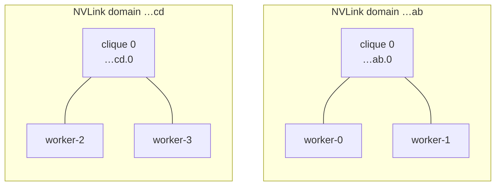
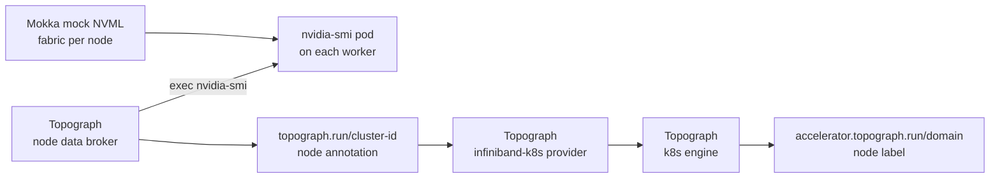

# Topograph

Run [Topograph](https://github.com/dsx-ai-factory/topograph) against a
four-node GB200 fleet that Mokka simulates. Topograph discovers which nodes
share an NVLink domain and labels each node with it, so a topology-aware
scheduler such as KAI or Kueue can keep a multi-node job inside one domain. All
of it runs on a cluster with no GPUs.

## How it fits together

On a GB200 system, GPUs in different trays reach each other over NVLink when
they sit in the same **NVLink domain**: one NVSwitch fabric, identified by a
cluster UUID. A domain can be split into partitions called **cliques**. Only
GPUs in the same clique can use NVLink with each other. NVML reports both
values per GPU, and `nvidia-smi` prints them as `fabric.clusterUuid` and
`fabric.cliqueId`.

This guide builds two domains, each with one clique of two nodes:



Mokka's topology overlay, the chart's `topology` values, makes the mock NVML
report this fabric on each node. Topograph discovers it the way it does on real
GB200 nodes. Its node data broker, a DaemonSet, runs `nvidia-smi` in a GPU pod
on its own node, and records the result as the node annotation
`topograph.run/cluster-id`. The `infiniband-k8s` provider turns each distinct
value into one accelerator domain, and the `k8s` engine writes it back as the
`accelerator.topograph.run/domain` node label:



No node carries a clique label: the only source of the topology is the fabric
Mokka reports.

<Note>
**Why a separate `nvidia-smi` DaemonSet**

On a real cluster the broker runs `nvidia-smi` in the GPU Operator's device
plugin pod. Here a one-container DaemonSet takes that role, so the guide needs
neither the GPU Operator nor the DRA driver. Mokka's own pod does not work as
the target: Topograph's exec names no container, so it lands in the
[NRI plugin](../../components/nri-plugin.md) container, which has no mock
driver and reports `[N/A]`.
</Note>

## Prerequisites

- [Docker](https://docs.docker.com/get-started/get-docker/) and
  [Kind](https://kind.sigs.k8s.io/)
- [Helm 3.8 or newer](https://helm.sh/docs/intro/install/)
- [kubectl](https://kubernetes.io/docs/reference/kubectl/)

Takes about 10 minutes.

## Step 1 — Create a four-worker cluster

Each worker gets a fixed node name, so the topology in Step 2 can refer to it.

```bash
cat > kind.yaml <<'EOF'
kind: Cluster
apiVersion: kind.x-k8s.io/v1alpha4
nodes:
  - role: control-plane
  - role: worker
    labels:
      mokka.nvidia.com/type: sgpu
    kubeadmConfigPatches:
      - |
        kind: JoinConfiguration
        nodeRegistration:
          name: worker-0
  - role: worker
    labels:
      mokka.nvidia.com/type: sgpu
    kubeadmConfigPatches:
      - |
        kind: JoinConfiguration
        nodeRegistration:
          name: worker-1
  - role: worker
    labels:
      mokka.nvidia.com/type: sgpu
    kubeadmConfigPatches:
      - |
        kind: JoinConfiguration
        nodeRegistration:
          name: worker-2
  - role: worker
    labels:
      mokka.nvidia.com/type: sgpu
    kubeadmConfigPatches:
      - |
        kind: JoinConfiguration
        nodeRegistration:
          name: worker-3
EOF

kind create cluster --name topograph --config kind.yaml
```

`mokka.nvidia.com/type=sgpu` marks the simulated-GPU workers. Mokka and
Topograph both select on it, which keeps them off the control plane.

## Step 2 — Install Mokka with the NVLink topology

```bash
cat > mokka-values.yaml <<'EOF'
gpu:
  profile: gb200 # (1)!
nodeSelector:
  mokka.nvidia.com/type: sgpu
topology:
  enabled: true
  domains: # (2)!
    - name: spine-1
      uuid: "00000000-0000-0000-0000-0000000000ab"
      cliques:
        - id: 0
          nodes: [worker-0, worker-1]
    - name: spine-2
      uuid: "00000000-0000-0000-0000-0000000000cd"
      cliques:
        - id: 0
          nodes: [worker-2, worker-3]
EOF

helm install nvml-mock oci://ghcr.io/nvidia/k8s-test-infra/chart/nvml-mock \
  --version 0.5.0 \
  --namespace mokka --create-namespace \
  -f mokka-values.yaml \
  --wait --timeout 300s
```

1. A GB200 profile reports NVLink fabric identity through
   `nvmlDeviceGetGpuFabricInfo`.
2. Every worker appears in exactly one clique, by node name.

## Step 3 — Give each worker an `nvidia-smi` pod

This DaemonSet is the pod Topograph's broker runs `nvidia-smi` in. It asks
Mokka for the mock driver by annotation instead of a GPU allocation:

```bash
cat > nvidia-smi.yaml <<'EOF'
apiVersion: v1
kind: Namespace
metadata:
  name: topograph
---
apiVersion: apps/v1
kind: DaemonSet
metadata:
  name: nvidia-smi
  namespace: topograph # (1)!
spec:
  selector:
    matchLabels:
      app.kubernetes.io/name: nvidia-smi
  template:
    metadata:
      labels:
        app.kubernetes.io/name: nvidia-smi
      annotations:
        nvml-mock.nvidia.com/devices: "true" # (2)!
    spec:
      nodeSelector:
        mokka.nvidia.com/type: sgpu
      terminationGracePeriodSeconds: 1
      containers:
        - name: nvidia-smi
          image: ubuntu:24.04 # (3)!
          command: ["sleep", "infinity"]
EOF

kubectl apply -f nvidia-smi.yaml
kubectl -n topograph rollout status ds/nvidia-smi
```

1. Mokka injects nothing into its own release namespace, `mokka`, or into
   `kube-system`.
2. Without a GPU allocation, the NRI plugin mounts the mock driver, including
   `nvidia-smi`, and every mock GPU on the node into the container.
3. Any glibc-based image works; the driver comes from Mokka.

Run the query the broker will run, on every worker:

```bash
for node in worker-0 worker-1 worker-2 worker-3; do
  pod=$(kubectl -n topograph get pod -l app.kubernetes.io/name=nvidia-smi \
    --field-selector spec.nodeName=$node -o jsonpath='{.items[0].metadata.name}')
  printf '%s: ' $node
  kubectl -n topograph exec $pod -- \
    nvidia-smi --query-gpu=fabric.clusterUuid,fabric.cliqueId --format=csv,noheader \
    | sort -u
done
# worker-0: 00000000-0000-0000-0000-0000000000ab, 0
# worker-1: 00000000-0000-0000-0000-0000000000ab, 0
# worker-2: 00000000-0000-0000-0000-0000000000cd, 0
# worker-3: 00000000-0000-0000-0000-0000000000cd, 0
```

Each node prints one line per GPU; `sort -u` folds the four GPUs into one,
since they all sit in the same clique.

## Step 4 — Install Topograph

```bash
cat > topograph-values.yaml <<'EOF'
provider:
  name: infiniband-k8s # (1)!
  params:
    accelerator:
      source: nvidia-smi # (2)!
      nvidiaSmi:
        gpuOperatorNamespace: topograph
        devicePluginDaemonSet: nvidia-smi
    nodeSelector:
      mokka.nvidia.com/type: sgpu
engine:
  name: k8s # (3)!
config:
  requestAggregationDelay: 2s # (4)!
nodeObserver:
  topograph:
    trigger:
      nodeSelector:
        mokka.nvidia.com/type: sgpu # (5)!
EOF

helm install topograph topograph \
  --repo https://dsx-ai-factory.github.io/topograph --version 1.1.0 \
  --namespace topograph \
  -f topograph-values.yaml \
  --wait --timeout 300s
```

1. One accelerator domain per distinct `topograph.run/cluster-id` annotation.
2. The broker execs `nvidia-smi` in the pod of the `nvidia-smi` DaemonSet on
   its node. The keys keep their GPU Operator names.
3. Writes the topology back as node labels. Topograph's other engines feed
   Slurm or Slinky instead.
4. The chart's 15-second default only delays the first result.
5. Regenerate the topology whenever a simulated-GPU worker joins or leaves.

## Step 5 — Verify

```bash
kubectl get nodes -L accelerator.topograph.run/domain
# NAME                      STATUS   ...   DOMAIN
# topograph-control-plane   Ready    ...
# worker-0                  Ready    ...   00000000-0000-0000-0000-0000000000ab.0
# worker-1                  Ready    ...   00000000-0000-0000-0000-0000000000ab.0
# worker-2                  Ready    ...   00000000-0000-0000-0000-0000000000cd.0
# worker-3                  Ready    ...   00000000-0000-0000-0000-0000000000cd.0
```

The label can take a few seconds to appear after Topograph starts. Two workers
share each domain, so a scheduler reading `accelerator.topograph.run/domain`
can place a two-node job inside one of them.

## What is not simulated

**InfiniBand switch tiers.** The `infiniband-k8s` provider also runs
`ibnetdiscover` in the broker's own pod, which Mokka does not inject. It fails,
Topograph logs `failed to run ibnetdiscover` once per node, and the topology
carries the accelerator domains only.

**NVLink carries no traffic.** Mokka reports fabric identity, not a data path,
so a job placed inside one domain runs no faster than one spread across both.
See [Use real hardware for](../../index.md#use-real-hardware-for).

## Troubleshooting

**No `accelerator.topograph.run/domain` label.** Check what the broker
recorded on each node:

```bash
kubectl get nodes \
  -o custom-columns='NODE:.metadata.name,CLUSTER-ID:.metadata.annotations.topograph\.run/cluster-id'
```

A worker with no value had no `nvidia-smi` pod when its broker started; the
broker queries once, at startup. With the DaemonSet from Step 3 running,
restart the broker:

```bash
kubectl -n topograph rollout restart ds/topograph-node-data-broker
```

**The annotation reads `[N/A].[N/A]`.** The broker ran `nvidia-smi` in a
container without the mock driver, typically because `devicePluginDaemonSet`
points at Mokka's own DaemonSet. Point it at `nvidia-smi` in namespace
`topograph`, as in Step 4. Topograph cannot write `[N/A].[N/A]` as a label and
retries in its log with `Invalid value`.

**`nvidia-smi: not found` in Step 3.** The NRI plugin injects only at container
creation, into annotated pods outside the `mokka` and `kube-system`
namespaces. Check the annotation and namespace, then recreate the pods with
`kubectl -n topograph rollout restart ds/nvidia-smi`.

**Step 3 prints a different clique than expected.** The worker names in
`topology.domains` must match the node names exactly; a node missing from the
topology reports the profile's default fabric.

A warning about a missing `topograph.run/instance` annotation on the control
plane is expected: the broker does not tolerate the control-plane taint and
never runs there.

More symptoms in [Troubleshooting](../../troubleshooting.md).

## Running it from a checkout

With the repository cloned, the Tilt environment builds Mokka from source and
runs this same stack on the `compute-domain` Kind cluster:

```bash
make cluster-create PROFILE=compute-domain
tilt up -- --topograph
```

See [Local Development](https://github.com/NVIDIA/k8s-test-infra/blob/main/docs/contributing/local-development.md).

## Clean up

```bash
kind delete cluster --name topograph
```

## Related

| To read about | See |
|---|---|
| How Mokka simulates NVLink fabric identity and IMEX | [ComputeDomain](https://github.com/NVIDIA/k8s-test-infra/blob/main/docs/guides/compute-domain/README.md) |
| Which containers receive the mock driver, and the annotations | [NRI plugin](../../components/nri-plugin.md) |
| The `topology` chart values | [Helm Chart Values](../../helm-chart-values.md) |
| Topograph's providers, engines and chart values | [Topograph](https://github.com/dsx-ai-factory/topograph) |
