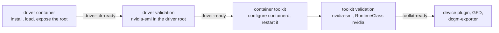
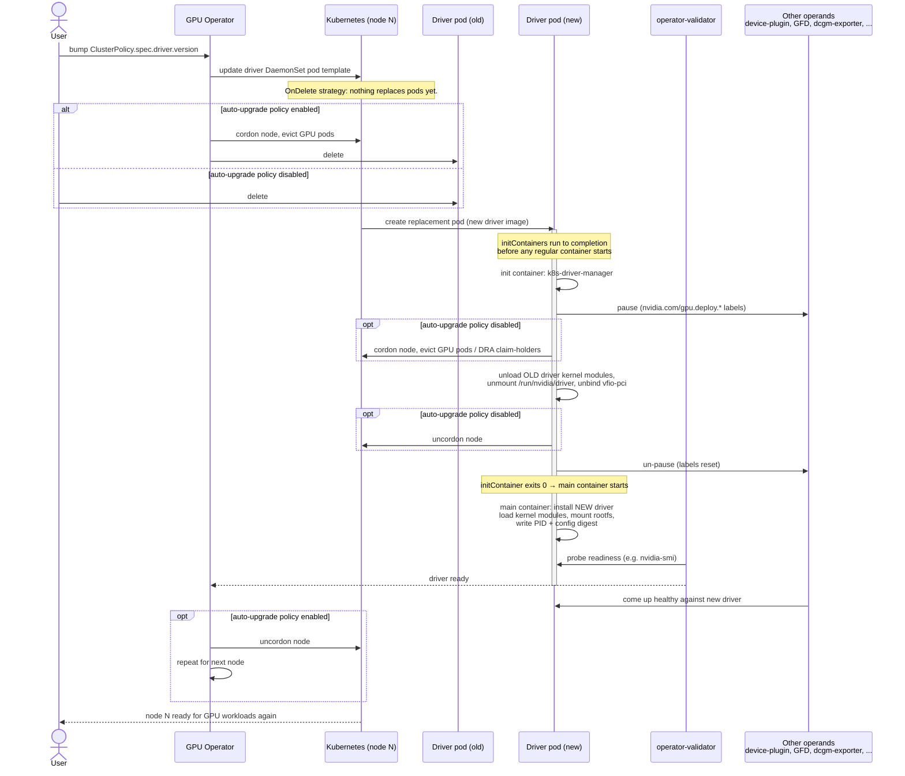
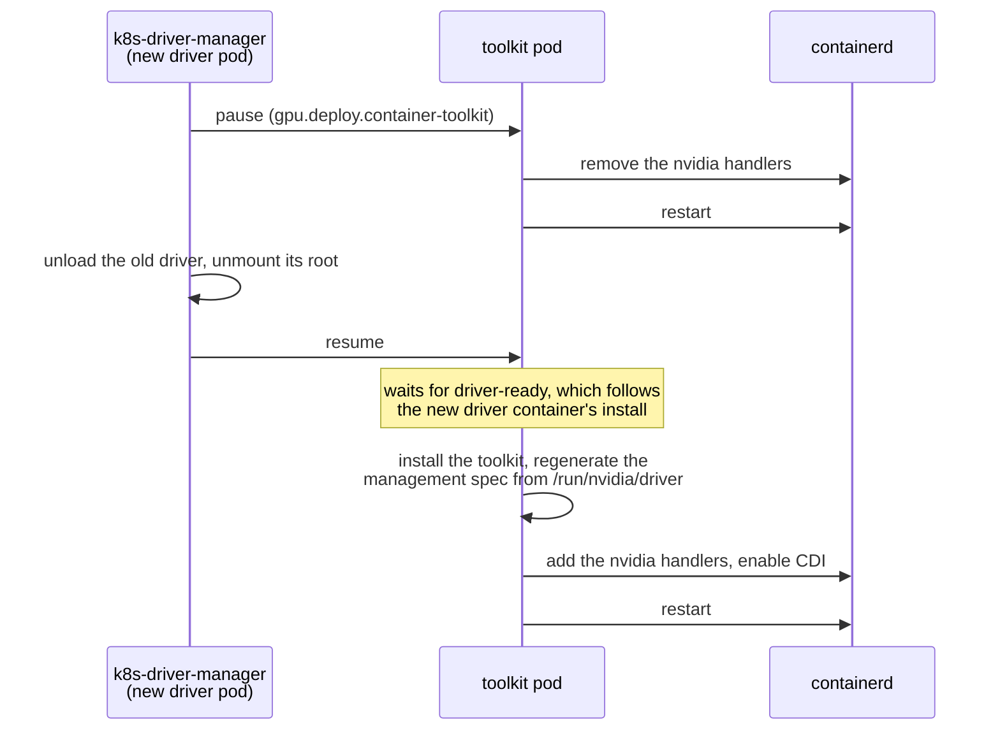
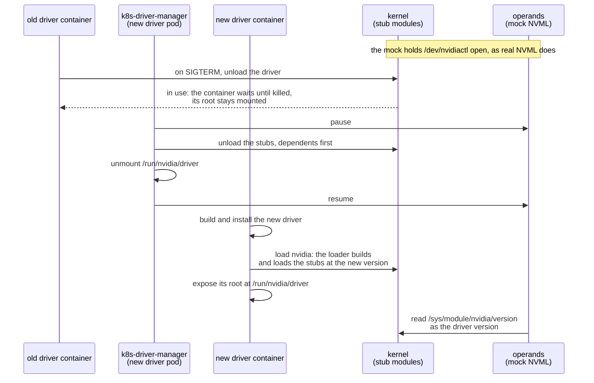

# MEP-0004: Deeper Support for GPU Operator

Author: [Roman Hlushko](https://github.com/roma-glushko)

<!-- toc -->
- [Summary](#summary)
- [Background](#background)
  - [GPU Operator](#gpu-operator)
  - [GPU Setup](#gpu-setup)
  - [Driver Installer](#driver-installer)
  - [Driver Upgrade](#driver-upgrade)
  - [Container Toolkit](#container-toolkit)
  - [`vfio-manage`](#vfio-manage)
- [Motivation](#motivation)
  - [Goals](#goals)
  - [Non-Goals](#non-goals)
- [Proposal](#proposal)
  - [User Stories](#user-stories)
    - [Story 1](#story-1)
    - [Story 2](#story-2)
    - [Story 3](#story-3)
  - [Risks and Mitigations](#risks-and-mitigations)
- [Design Details](#design-details)
  - [Analysis](#analysis)
  - [Proposed Mechanisms](#proposed-mechanisms)
    - [Driver Installer Integration](#driver-installer-integration)
    - [Container Toolkit Integration](#container-toolkit-integration)
- [Drawbacks](#drawbacks)
- [Alternatives](#alternatives)
- [Appendix](#appendix)
  - [Emulation Surface](#emulation-surface)
<!-- /toc -->

## Summary

This proposal explores how Mokka can allow running the original, unmodified 
driver installer, container-toolkit, k8s-driver-manager components of the GPU operator.
Specifically, the GPU driver upgrade workflow should work as close as possible to the real cluster upgrade in a GPU cluster.

Mokka's existing simulators were built to satisfy discovery and allocation consumers.

They were not built against the real driver *lifecycle* surface described below. 
Hence, as of today, Mokka suggests to disable driver and container-toolkit daemonset,
so they are not compatible with today's state of Mokka's node daemon.

## Background

### GPU Operator

This section gives the end-to-end picture to the readers who have not worked with GPU Operator before.

**What GPU Operator manages.** GPU Operator is a Kubernetes operator that
installs and manages the full NVIDIA GPU software stack on GPU nodes from a
single `ClusterPolicy` custom resource. 

Each piece of that stack runs as its own DaemonSet:
- the driver installer, 
- the container toolkit, 
- the device plugin, 
- GPU Feature Discovery (GFD), 
- the Data Center GPU Manager (DCGM) and its `dcgm-exporter`, 
- the Multi-Instance GPU (MIG) manager, 
- an operator-validator, 
- and (on newer clusters) the Dynamic Resource Allocation (DRA) driver

Every one of these DaemonSets schedules only onto GPU nodes,
gated by a node label of the form `nvidia.com/gpu.deploy.<component>=true`.

Those are exactly the labels `k8s-driver-manager` flips to pause and resume components (see
`nvidiaDriverDeployLabel` and friends in `cmd/driver-manager/main.go`).

> **What "pause" means here.** Kubernetes has no per-node "suspend this
> DaemonSet's pod" verb, so `k8s-driver-manager` fakes one with the label
> above. Each operand's DaemonSet has a `nodeSelector` requiring its label to
> equal exactly `"true"`. To pause a component on one node,
> `k8s-driver-manager` rewrites that node's label value from `"true"` to the
> sentinel `paused-for-driver-upgrade`; the node stops matching the
> `nodeSelector`, and the DaemonSet controller tears down that component's
> pod there — the same effect as scaling it to zero on that one node, done
> purely by breaking scheduler affinity. Resuming just writes `"true"` back,
> which makes the node match again and the pod get rescheduled. No process is
> ever literally suspended.

### GPU Setup

On a fresh node, the driver and the operands that need it come up in a chain.
Each link waits for a file under `/run/nvidia/validations` that the link
before it writes:

- The driver container installs and loads the driver, and exposes its own root
  at `/run/nvidia/driver` ([Driver Installer](#driver-installer)). Its startup
  probe writes `.driver-ctr-ready` once `nvidia-smi` works.
- The driver validation, the first init container of the validator and
  toolkit pods, runs `nvidia-smi` in the driver root and writes
  `driver-ready`.
- The container toolkit then sets up containerd from the driver root
  ([Container Toolkit](#container-toolkit)). The validator runs `nvidia-smi`
  in a container of the `nvidia` RuntimeClass and writes `toolkit-ready`,
  which the device plugin, GFD and `dcgm-exporter` wait for.



MEP-0006's
[What the GPU Operator does](../0006-automatic-cdi-setup/README.md#what-the-gpu-operator-does)
diagrams the toolkit's part in more detail.

### Driver Installer

The driver DaemonSet runs a pod on every GPU node whose
`nvidia.com/gpu.deploy.driver` label is `true`. The pod's init container runs
`k8s-driver-manager`, which cleans up after the previous driver
([Driver Upgrade](#driver-upgrade)), and its main container, the driver
container, runs NVIDIA's installer script for the node's OS, from
[`gpu-driver-container`](https://github.com/NVIDIA/gpu-driver-container). The
driver container builds the driver's kernel modules, installs the driver's
userspace, loads the modules, and exposes its own root, driver included, at
`/run/nvidia/driver`. It records a digest of the driver's settings, which the
operator computes, in `/run/nvidia/nvidia-driver.state`, and runs until the
pod stops.

A start over a loaded driver with an unchanged digest takes the fast path: the
container reinstalls only the userspace, and running workloads keep the
driver. `k8s-driver-manager`, which runs before it in a new driver pod, checks
the same digest and leaves such a driver loaded. Any other start, on a fresh
node or after an upgrade, takes the full path. A step that fails ends the
container.


The pod's startup probe waits until the `nvidia` module is loaded and
`nvidia-smi` works, then writes `.driver-ctr-ready`, which its `preStop` hook
removes. What a stopped container leaves behind, loaded modules and a mounted
root, falls to the next pod's `k8s-driver-manager`
([Driver Upgrade](#driver-upgrade)).

The DaemonSet, trimmed to the fields that matter here:

```yaml
apiVersion: apps/v1
kind: DaemonSet
metadata:
  name: nvidia-driver-daemonset
  namespace: gpu-operator
spec:
  template:
    spec:
      hostPID: true
      nodeSelector:
        nvidia.com/gpu.deploy.driver: "true"
      initContainers:
        - name: k8s-driver-manager
          image: nvcr.io/nvidia/cloud-native/k8s-driver-manager:v0.12.0
          command: ["driver-manager"]
          args: ["uninstall_driver"]
          securityContext:
            privileged: true
          env:
            - name: NODE_NAME
              valueFrom: { fieldRef: { fieldPath: spec.nodeName } }
            - name: ENABLE_GPU_POD_EVICTION
              value: "true"
            - name: ENABLE_AUTO_DRAIN
              value: "false"
            - name: DRIVER_CONFIG_DIGEST
              value: "886542011"
          volumeMounts:
            - { name: run-nvidia, mountPath: /run/nvidia, mountPropagation: Bidirectional }
            - { name: host-root, mountPath: /host, mountPropagation: HostToContainer, readOnly: true }
            - { name: host-sys, mountPath: /sys }
            - { name: run-mellanox-drivers, mountPath: /run/mellanox/drivers, mountPropagation: HostToContainer }
      containers:
        - name: nvidia-driver-ctr
          image: nvcr.io/nvidia/driver:550.90.07-ubuntu22.04
          command: ["nvidia-driver"]
          args: ["init"]
          securityContext:
            privileged: true
          env:
            - name: DRIVER_CONFIG_DIGEST
              value: "886542011"
          lifecycle:
            preStop:
              exec:
                command: ["/bin/sh", "-c", "rm -f /run/nvidia/validations/.driver-ctr-ready /run/nvidia/validations/.driver-daemons-status"]
          volumeMounts:
            - { name: run-nvidia, mountPath: /run/nvidia, mountPropagation: Bidirectional }
      volumes:
        - { name: run-nvidia, hostPath: { path: /run/nvidia, type: DirectoryOrCreate } }
        - { name: host-root, hostPath: { path: / } }
        - { name: host-sys, hostPath: { path: /sys, type: Directory } }
        - { name: run-mellanox-drivers, hostPath: { path: /run/mellanox/drivers, type: DirectoryOrCreate } }
  updateStrategy:
    type: OnDelete
```

Both containers are privileged and get the same settings digest. `/run/nvidia`
is shared with the host in both directions, so the root the driver container
mounts there reaches the host and the other pods, and the next pod's
`k8s-driver-manager` can unmount it. `k8s-driver-manager` also sees the host's
root at `/host`, where it looks for a driver installed on the host, and the
host's `/sys`, so every `/sys/module` and `/sys/bus/pci` path in this MEP is
the host's own.

### Driver Upgrade

Every other operand that GPU Operator deploys is a normal container
that can be killed and restarted independently. The driver is not: it loads
kernel modules that are node-wide, shared state — every GPU workload's CUDA
context, DCGM's NVML handle, and the device plugin's advertised
`nvidia.com/gpu` capacity all depend on those modules staying loaded and
consistent. Swapping the driver version means nothing on the node can safely
keep using the GPU, or keep depending on the driver being present, while the
swap happens. That is what forces a driver upgrade to be a coordinated,
multi-step node drain-and-requiesce rather than an ordinary rolling update.

**The end-to-end lifecycle.** A driver version bump — an edit to
`ClusterPolicy.spec.driver.version`, applied with `kubectl apply` or `kubectl
patch` against the cluster's `ClusterPolicy` object — is what starts this.
Trimmed to the fields this MEP cares about (based on GPU Operator's own
`config/samples/v1_clusterpolicy.yaml`):

```yaml
apiVersion: nvidia.com/v1
kind: ClusterPolicy
metadata:
  name: cluster-policy
spec:
  driver:
    enabled: true
    repository: nvcr.io/nvidia
    image: driver
    version: "550.90.07"     # bumping this is what starts an upgrade
    upgradePolicy:
      autoUpgrade: true      # false/unset: driver pods must be deleted manually
      maxParallelUpgrades: 1 # nodes upgraded at once; 0 = unlimited
      maxUnavailable: "25%"  # cap on simultaneously-unavailable driver nodes
```

A new `version` rolls out like this, node by node:

1. GPU Operator updates the driver DaemonSet to the new image. That alone
   replaces no pod: the operator keeps the DaemonSet's update strategy at
   `OnDelete`, so a driver pod is replaced only once it is deleted.
2. With `autoUpgrade` on, the operator's upgrade-controller picks the nodes,
   within `maxParallelUpgrades` and `maxUnavailable`, and tracks each one on
   its `nvidia.com/gpu-driver-upgrade-state` label. It cordons the node,
   evicts the pods that use GPUs and deletes the driver pod. With
   `autoUpgrade` off, someone deletes the driver pod by hand. The DaemonSet
   then creates a replacement with the new image.
3. The new pod's init container, `k8s-driver-manager`, cleans up after the old
   driver, whose modules and root at `/run/nvidia/driver` outlive the old pod.
   It pauses the other GPU Operator components, unloads the old modules,
   unmounts the old root, unbinds GPUs from `vfio-pci` and resumes the
   components. With `autoUpgrade` off, it also cordons the node and evicts the
   GPU pods before the unload, and uncordons the node after it.
4. Only then does the pod's driver container start and install the new driver
   ([Driver Installer](#driver-installer)).
5. The validator and the other operands come back as on a fresh node
   ([GPU Setup](#gpu-setup)). With `autoUpgrade` on, the upgrade-controller
   waits for the validator, uncordons the node and moves on to the next one.

The same sequence, per node, as a diagram:



`k8s-driver-manager` and
`vfio-manage` own step 3 only — the new pod's `initContainer`, making it safe
to remove the old driver; neither touches step 4, the main container's
install. That split matters for Mokka: emulating step 3 alone is not
sufficient to observe "the upgrade completed and the new driver is in
place" — something also has to play step 4's role, or a simulated upgrade
test will correctly tear down and then simply stall.

### Container Toolkit

The toolkit operand waits for `driver-ready`, then runs the toolkit's
installer, which:

1. copies the toolkit into `/usr/local/nvidia/toolkit`;
2. generates a management CDI spec (`management.nvidia.com/gpu`) from the
   driver root, `/run/nvidia/driver`;
3. adds `nvidia` handlers with CDI enabled to containerd through a drop-in, and
   restarts containerd;
4. waits for a signal, then removes the handlers and restarts containerd again.

The operator makes the management spec the runtime's default CDI kind, so its
own operands, which run with the `nvidia` RuntimeClass and request all GPUs,
get the driver from that spec. MEP-0006's
[What the GPU Operator does](../0006-automatic-cdi-setup/README.md#what-the-gpu-operator-does)
covers the install and what the installer needs from the node. What matters
for upgrades is that `k8s-driver-manager` pauses the toolkit before it unloads
the old driver, so each upgrade reconfigures and restarts containerd twice,
and the spec is regenerated from the new driver's root:



### `vfio-manage`

`vfio-manage`, from the `k8s-driver-manager` repository, moves GPUs between
the `nvidia` driver and `vfio-pci`, the kernel driver that passes a device
through to a VM. It finds NVIDIA's PCI functions and rebinds each through the
device's `driver_override` file and the drivers' `bind` and `unbind` files
under `/sys/bus/pci`. To bind, it picks the best VFIO variant driver for the
device from the kernel's `modules.alias`, and loads it from the host's root.

It runs in two places:

- `k8s-driver-manager` has it unbind every GPU from `vfio-pci` before each
  driver install, to hand the GPUs back to the `nvidia` driver
  ([Driver Upgrade](#driver-upgrade), step 3).
- On nodes that pass GPUs through to VMs, the vfio-manager DaemonSet's pod
  runs `k8s-driver-manager` first, to clear what a previous driver left, then
  binds every GPU to `vfio-pci` and holds them until the pod stops, when its
  `preStop` hook unbinds them.

## Motivation

- **GPU Operator scale testing**. We would like to use Mokka to help GPU operator team to accurately test how the Operator behaves in very big clusters without having proportionally big expenses on this experiment. This includes the driver upgrade workflow.
- **GPU Operator Compatibility**. Mokka does work with [the latest version of GPU operator after some changes to how validator daemon works](https://github.com/NVIDIA/k8s-test-infra/issues/911). This proposal addresses the issue (partially, because the fully simulated GPU driver mocking won't work still).
- **GPU Operator CI/CD**. This can potentially open up the door to discussions around using Mokka in the GPU Operator CI pipelines in order to enable cheaper test suite runs.

### Goals

- Run the GPU Operator's driver installer and container toolkit from NVIDIA's
  original images on a Mokka node, so that a driver installation and upgrade run the
  operator's whole sequence like in the real GPU cluster.

### Non-Goals

- Covering installation of Mellanox OpenFabrics Enterprise Distribution
  (MOFED), NVIDIA's GPU Direct RDMA driver stack for InfiniBand/RoCE NICs,
  itself — only the presence and readiness checks `k8s-driver-manager`
  performs against it (`GPU_DIRECT_RDMA_ENABLED`, `waitForMofedDriver`).

## Proposal

### User Stories

#### Story 1

As a GPU Operator engineer, I want to bump a `ClusterPolicy`'s driver version
against a Mokka-simulated cluster and watch the real `k8s-driver-manager` run the full upgrade sequence — drain, evict, unload,
unmount, reinstall, reschedule — without modifying either binary, so that a
green run is evidence the upgrade logic itself works, not just that Mokka's
API surface looks right.

#### Story 2

As a GPU Operator engineer, I want to enable the operator's driver and
toolkit operands, from their release images, on a CPU-only `kind` cluster, so
that a change to the installer's lifecycle or to the toolkit's runtime setup
runs through the same install and upgrade sequence as on a GPU cluster.

### Risks and Mitigations

- There is always a risk that some new updates of GPU Operator would invalidate Mokka (https://github.com/NVIDIA/k8s-test-infra/issues/911 is a good example of that). With this proposal, the risk becomes even more important as we allow much more GPU Operator code to run.

## Design Details

### Analysis

A few things make this workflow different from what Mokka is built for today:

- GPU Operator's driver containers are purposely disabled when Mokka is deployed,
  since Mokka replaces the real driver install with simulation. 
- Mokka mimics the surface that driver daemonset establishes like creation of `/run/nvidia/driver` mount.
- Mokka's supported shape is install → stage from a profile → serve
  consumers. A driver upgrade needs two more events layered on top: a *target* driver version arriving from
  `ClusterPolicy`, and a *completion signal* from `k8s-driver-manager` saying
  when it is safe to apply that target — neither of which the current
  reconcile loop has a notion of.
- The driver daemonset issues a real `load_module()` syscall,  `k8s-driver-manager` issues a real `delete_module(2)` syscall. Both only a
  real kernel module stub can satisfy.
- Several other surfaces listed under
  [Emulation Surface](#emulation-surface) are missing or only partially
  simulated in ways that would not hold up under this workflow.

These items show that Mokka's current approach is based on assumption that Mokka replaces GPU operator's driver and container toolkit workflows.
This problem brings up back to that decision. 

### Proposed Mechanisms

Instead of fighting the GPU Operator, we should find a way to integrate with. 
The key problem is the original NVIDIA drivers. They won't load on a node that doesn't have a real GPU PCIe device.
What if we replace the original driver with a custom one that let the driver daemonset workflows run without issues.
That's the essence of the proposal.

#### Driver Installer Integration

The installer runs unmodified: the proof of concept keeps NVIDIA's driver
image, pinned by digest, and adapts its container at creation, through Mokka's
NRI plugin. It adds a driver mode to Mokka, `driver.mode`:

- **`userspace`**, the default, is today's simulation: `gpudriver` fakes the
  files of the driver's kernel modules and publishes `/run/nvidia/driver`.
- **`kernel`** has a driver installer load Mokka's stub kernel modules. The
  node daemon's `nvidiakmod` stages them in place of `gpudriver` and leaves
  `/run/nvidia/driver` to the installer. The kernel then serves `/sys/module`,
  `/proc/modules` and `/proc/driver/nvidia` live, so libmockfs and Mokka's CDI
  specs stop serving copies of them. PCI sysfs stays simulated, as the modules
  bind no PCI device.

`nvml`, split out of `gpudriver`, stages the mock NVML, CUDA and `nvidia-smi`
in both modes ([MEP-0003](../0003-node-agent/README.md)). The stub modules
(`shims/nvidia-kmod`) are `nvidia`, `nvidia_uvm`, `nvidia_modeset` and
`nvidia_peermem`. They register the device majors, serve `/proc/driver/nvidia`
and answer the ioctls a client enumerates GPUs with, from GPU records the node
daemon renders, but implement no RM. With `nri.gpuOperator.driver` on, the NRI
plugin recognizes the installer by its pod's
`app.kubernetes.io/component=nvidia-driver` label and its `nvidia-driver-ctr`
container, and closes the installer's rows:

| Surface                                   | Mechanism                                                                                                                                                                                                                                        |
|-------------------------------------------|--------------------------------------------------------------------------------------------------------------------------------------------------------------------------------------------------------------------------------------------------|
| Kernel build tree                         | The host's own: a stock distro kernel, on macOS in an opt-in Colima VM (`make colima-cluster-create`).                                                                                                                                           |
| `modprobe nvidia` and its kernel surfaces | `install` directives in `/etc/modprobe.d` route the installer's `modprobe` to a loader, which builds the stubs against the node's kernel, at the version of the driver just installed, and loads them.                                           |
| `nvidia-persistenced`                     | A stand-in, first on the container's `PATH`. The real daemon needs RM, and its failure aborts the installer's fast path.                                                                                                                         |
| NVML in the installer's root              | The mock NVML bound at `/usr/lib64/libnvidia-ml.so.1`, the first path the operands search, plus a directive in `/etc/ld.so.conf.d` that ranks it first in the installer's own `ldconfig`; the node's profile at `/config`; the GPU device nodes. |
| `/run/nvidia/driver`                      | Left to the installer: the kernel mode runs no `gpudriver`.                                                                                                                                                                                      |

Driver upgrades then run the operator's sequence unchanged:



The order keeps operands off a dead root. A driver container cannot fully
unmount its own root, and `k8s-driver-manager` both pauses the operands and
unmounts the root only when it finds the driver loaded: with no driver loaded,
version 0.11.0 leaves the root mounted, and 0.12.0 leaves the operands running.
Holding `/dev/nvidiactl`, as real NVML does, keeps the stubs loaded until
`k8s-driver-manager` has paused the operands; it then unloads the stubs and
unmounts the root before it reschedules anything. The mock reports
the loaded module's version, so the device plugin's CDI spec and GFD follow the
upgrade. A restart with an unchanged configuration takes the installer's fast
path and keeps the stubs loaded.

Limits:

- **One kernel, one driver.** Modules are not namespaced: every Kind node on a
  host shares the stubs, so a host has one simulated GPU node.
- **Images.** The operator names a driver image `<version>-<os>` after the
  node's OS, and Kind nodes report Debian 12, for which NVIDIA publishes no
  image, so the scenario pins `driver.version` to the Ubuntu image's digest.
  Only Ubuntu images are exercised. Precompiled images install no headers, so
  the loader cannot build in them, and OpenShift's Driver Toolkit is not
  covered.
- **Features.** The kernel mode serves neither MIG nor IMEX yet.
- **NRI.** A driver container the NRI plugin misses comes up unadapted and
  fails to load the real modules. containerd drops the plugin's connection on
  every restart, so the plugin registers again by itself, within about 2 s.

#### Container Toolkit Integration

The toolkit operand runs from its original image too, with the
`ClusterPolicy`'s toolkit settings at the operator's defaults. In the kernel
mode the stubs give its installer the `nvidia` entries it needs in
`/proc/modules` and `/proc/devices`, which leaves the toolkit's two rows:

- **The management CDI spec.** With `nri.gpuOperator.toolkit` on, the NRI
  plugin sets `NVIDIA_CONTAINER_RUNTIME_MODES_CDI_DEFAULT_KIND=nvidia.com/gpu`
  in the installer's container (`nvidia-container-toolkit-ctr`). The runtime it
  configures then resolves the operator's operands against Mokka's spec, which
  serves the mock NVML with the node's profile, instead of the management
  spec, which names the real NVML in the driver root. The installer still
  generates that spec; its probes of the real NVML show up in the kernel log
  as unsimulated ioctls, and it falls back.
- **containerd's `nvidia` handlers.** The operand and the node daemon's `cri`
  simulator ([MEP-0006](../0006-automatic-cdi-setup/README.md)) would both
  configure them. MEP-0006 keeps the operand off (`toolkit.enabled: false`),
  and the proof of concept ran on the custom Kind image MEP-0006 replaces,
  where the operand's drop-in replaced the image's runtime section and reset
  the default handler to `runc`: harmless for the operator's operands, which
  name the `nvidia` RuntimeClass. The direction proposed here is that the
  `cri` simulator leaves containerd to the operand where it runs, as it leaves
  a node another installer prepared, and keeps publishing its spec. Either way
  the operand restarts containerd whenever it starts or stops, which is why
  Mokka's NRI plugin registers again by itself.

## Drawbacks

- With the userspace mode's watcher, Mokka Control Plane gets tied to GPU Operator's `ClusterPolicy` CRD.
- In the userspace mode, the real driver container (and potentially other setup containers) doesn't involve so GPU operator installation and upgrade flows don't have much fidelity.
- The rows above that require a real kernel module or a real mounted (not
  shimmed) filesystem tree raise the privilege bar for a Mokka node —
  `CAP_SYS_MODULE`, kernel-version-matched builds, and/or mount capabilities
  it does not need today for discovery/allocation simulation alone.
- The kernel mode needs a host kernel that can build modules, which on macOS
  means a VM: OrbStack's and Docker Desktop's kernels ship no build tree. And a
  host runs one simulated GPU node, since modules are not namespaced.
- The kernel mode ties Mokka to the GPU Operator's naming: the NRI plugin
  recognizes the installer and the toolkit by their pods' labels and their
  containers' names.

## Alternatives

- **A custom driver container** that signals Mokka to re-stage the simulation
  once `k8s-driver-manager` has finished. It would provide the reconcile
  trigger without kernel modules, but a run would test the replacement rather
  than NVIDIA's installer: its fast path, the module reload and the handoff of
  `/run/nvidia/driver` would go unexercised, and so would the toolkit, which
  sets up the runtime from the installer's root.

## Appendix

### Emulation Surface

The table below maps every host/kernel/PCI/API
surface the real workflow above touches (left column) against what Mokka
stages today (middle) and what is missing (right), ordered roughly by how
much of `k8s-driver-manager`'s teardown depends on it. Design Details proposes how to
close each row.

| Surface                                                                                                                                 | Staged by Mokka today                                                                                         | Gap                                                                                                                                  |
|-----------------------------------------------------------------------------------------------------------------------------------------|---------------------------------------------------------------------------------------------------------------|--------------------------------------------------------------------------------------------------------------------------------------|
| `/sys/module/{nvidia,nvidia_uvm,nvidia_modeset,nvidia_peermem,nvidia_fs,nvidia_vgpu_vfio,gdrdrv,nouveau}/refcnt`                        | `kmod` stages it for the simulated modules; CDI mounts it at `/sys/module` in GPU containers only             | Full gap. Tells `k8s-driver-manager` whether a driver is loaded, which picks its path.                                               |
| `delete_module(2)`, the system call that unloads a module                                                                               | Nothing                                                                                                       | Full gap, and not shimmable in userspace — needs a real (dummy) loaded kernel module to respond correctly.                           |
| `/proc/modules`                                                                                                                         | `kmod` stages one, served only through `libmockfs`                                                            | Full gap. Only used for diagnostic listing on unload failure; low priority.                                                          |
| `/run/nvidia/driver` mount + recursive unmount                                                                                          | `gpudriver.Apply` bind-mounts the staged driver tree there                                                    | Covered.                                                                                                                             |
| `/run/nvidia/nvidia-driver.pid`, `/run/nvidia/nvidia-driver.state` (digest)                                                             | Nothing                                                                                                       | Full gap. Decides whether `k8s-driver-manager` keeps a loaded driver — without it, every run is treated as a config change.          |
| `chroot /host nvidia-smi ...` (pre-installed host driver check)                                                                         | `nvidia-smi` staged only under the containerized driver path (`h.Root/driver/usr/bin`)                        | Gap, likely intentional — leaves the host-driver branch permanently false, which may be the desired default for a simulated cluster. |
| `/sys/bus/pci/devices/<bdf>/{vendor,device,subsystem_vendor,subsystem_device,class,config}`                                             | `pcisysfs.Render` writes these                                                                                | Covered.                                                                                                                             |
| `/sys/bus/pci/devices/<bdf>/{driver,driver_override,modalias}`, `/sys/bus/pci/drivers/<name>/{bind,unbind}`                             | `pcisysfs.Render` links each GPU under `/sys/bus/pci/drivers/nvidia/`                                         | Full gap — the entire surface `vfio-manage` operates on.                                                                             |
| `/lib/modules/<kernel>/modules.alias` (VFIO variant lookup)                                                                             | Nothing                                                                                                       | Full gap, low priority unless vGPU/passthrough scenarios are in scope.                                                               |
| PCI vendor `0x15b3` (Mellanox) detection, `/run/mellanox/drivers/.driver-ready` or `mlx5_core` in `/proc/modules` (MOFED readiness)     | `internal/ib` writes vendor `0x15b3` under `/sys/class/infiniband` only; `kmod` lists `mlx5_core` on IB nodes | Full gap for the `GPU_DIRECT_RDMA_ENABLED` path.                                                                                     |
| The new driver version itself (what `ClusterPolicy.spec.driver.version` changed to)                                                     | `system.driver_version` in the profile or `DRIVER_VERSION` env var, re-read when the profile changes          | Full gap — nothing watches `ClusterPolicy`, so Mokka's reported version never reflects an upgrade.                                   |
| Node labels/annotations, cordon/drain, DRA `ResourceClaim`s, the `nvidia.com/gpu-driver-upgrade-state` upgrade-controller state machine | Real apiserver + real GPU Operator/DRA driver, external to Mokka                                              | Not a gap — out of scope by design; Mokka fakes the node's device/driver footprint, not the control plane.                           |

Running the driver installer and the container toolkit adds these rows:

| Surface                                                                                                                                                                                                             | Staged by Mokka today                                                           | Gap                                                                                                                                                                                                                        |
|---------------------------------------------------------------------------------------------------------------------------------------------------------------------------------------------------------------------|---------------------------------------------------------------------------------|----------------------------------------------------------------------------------------------------------------------------------------------------------------------------------------------------------------------------|
| A build tree for the node's kernel (`/lib/modules/$(uname -r)/build`), from the distribution's archive                                                                                                              | Nothing: Kind nodes share the host's kernel                                     | Outside Mokka: the host needs a stock distro kernel. OrbStack's and Docker Desktop's ship no build tree.                                                                                                                   |
| `modprobe nvidia`, `nvidia-uvm` and `nvidia-modeset`, and what loaded modules provide: the `nvidia` majors in `/proc/devices`, `/proc/driver/nvidia`, the version handshake and GPU enumeration on `/dev/nvidiactl` | `gpudriver` creates the device nodes and stages copies of `/proc/driver/nvidia` | Full gap: the real `nvidia.ko` refuses to load without a GPU (`ENODEV`), and nothing answers on the device nodes (`ENXIO`). The toolkit's installer needs the `nvidia` entries in `/proc/modules` and `/proc/devices` too. |
| `nvidia-persistenced`, and the fabric manager on NVSwitch systems                                                                                                                                                   | Nothing                                                                         | Full gap: both need the Resource Manager (RM), and a failure can abort the install.                                                                                                                                        |
| NVML in the installer's root: the startup probe's `nvidia-smi`, the validator's `chroot /run/nvidia/driver nvidia-smi`, the operands' library lookups under `/run/nvidia/driver`                                    | The mock NVML, in Mokka's own driver tree                                       | Full gap: the root holds the real NVML the installer has just installed.                                                                                                                                                   |
| `/run/nvidia/driver` as the installer's own root                                                                                                                                                                    | `gpudriver.Apply` bind-mounts Mokka's driver tree there                         | Conflict: both claim the path.                                                                                                                                                                                             |
| The toolkit's management CDI spec, generated from `/run/nvidia/driver`, as its runtime's default CDI kind                                                                                                           | Mokka's `nvidia.com/gpu` spec, with the mock NVML and the node's profile        | Gap: the operator's operands would get the real NVML.                                                                                                                                                                      |
| containerd's `nvidia` handlers, which the toolkit adds with a restart and removes with another                                                                                                                      | The custom Kind image's configuration; the node daemon's, with MEP-0006         | Overlap: two installers own the handlers, and every restart drops the NRI plugin's connection to containerd.                                                                                                               |

Two findings constrain *how* these rows can be closed, not just whether:

- **Syscall interception.** `k8s-driver-manager` and `vfio-manage` are Go
  programs that make system calls directly, not through libc, so
  `LD_PRELOAD`-based interposition — Mokka's current strategy for `lspci` and
  NVML/CUDA consumers — has nothing to attach to.
  Closing any row above that these binaries read or write therefore requires
  a real filesystem the kernel serves (a bind mount, a FUSE-backed tree, or,
  for `/sys/module` and `delete_module`, an actual loaded kernel module)
  rather than a shim.
- **Reconciler vs. imperative handoff.** Even once the surface above exists,
  something has to repopulate it after `k8s-driver-manager` tears it down.
  In production this is a new container starting and running its own
  install script; Mokka's node daemon only re-stages when its GPU profile
  changes. Closing the table's rows without also deciding how the
  daemon learns "the upgrade's uninstall phase finished, re-stage now" would
  leave a simulated node permanently driver-less after the first upgrade
  test.
