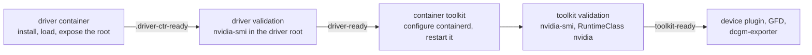
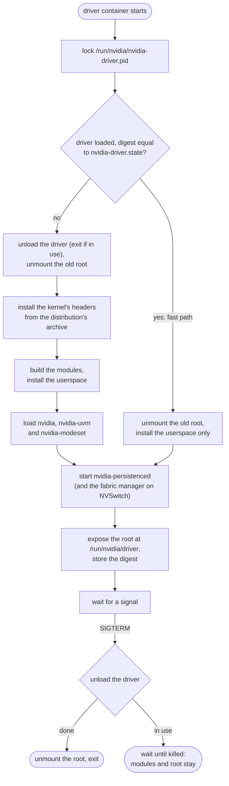
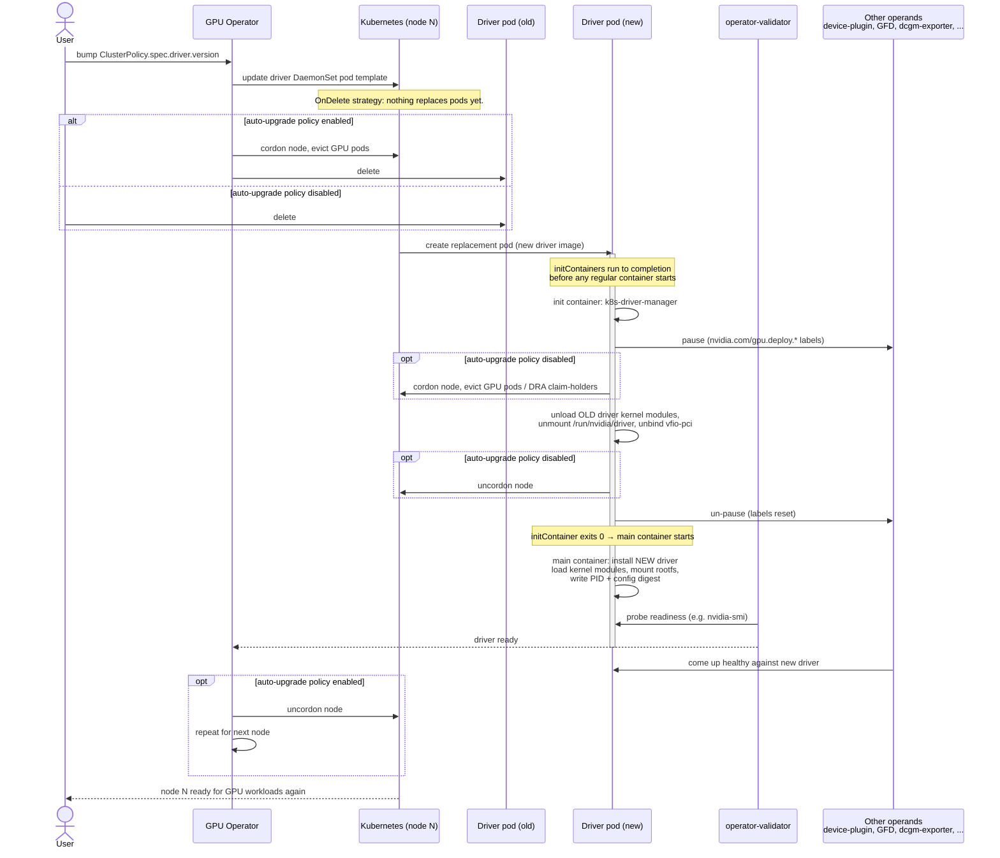
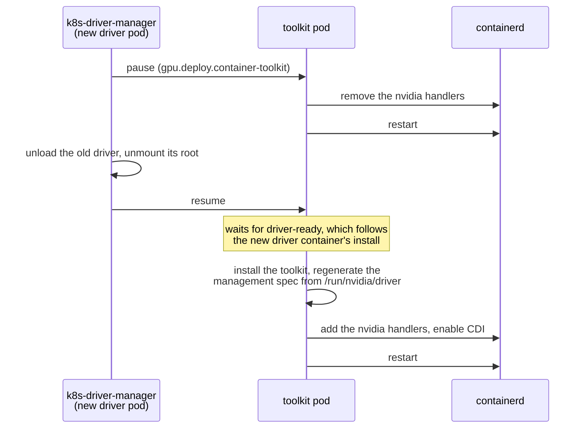
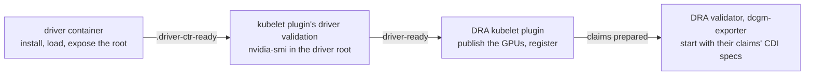
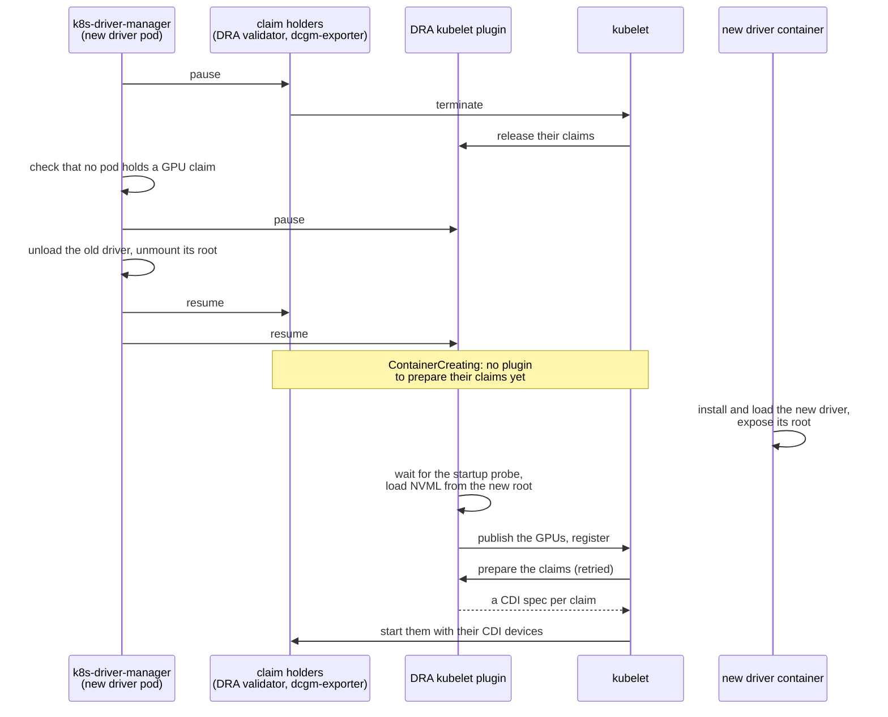
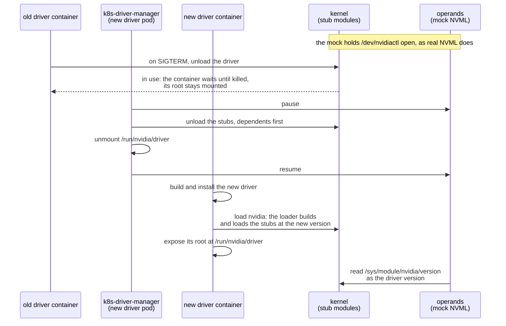

# MEP-0004: Deeper Support for GPU Operator

Author: [Roman Hlushko](https://github.com/roma-glushko)

<!-- toc -->
- [Summary](#summary)
- [Background](#background)
  - [GPU Operator](#gpu-operator)
  - [ClusterPolicy Workflow](#clusterpolicy-workflow)
    - [GPU Setup](#gpu-setup)
    - [Driver Installer](#driver-installer)
    - [Driver Upgrade](#driver-upgrade)
    - [Container Toolkit](#container-toolkit)
    - [MIG Manager](#mig-manager)
    - [`vfio-manage`](#vfio-manage)
  - [GPUCluster Workflow](#gpucluster-workflow)
    - [GPUCluster Setup](#gpucluster-setup)
    - [GPUCluster Upgrade](#gpucluster-upgrade)
- [Motivation](#motivation)
  - [Goals](#goals)
  - [Non-Goals](#non-goals)
- [Proposal](#proposal)
  - [User Stories](#user-stories)
    - [Story 1](#story-1)
    - [Story 2](#story-2)
  - [Risks and Mitigations](#risks-and-mitigations)
- [Design Details](#design-details)
  - [Analysis](#analysis)
  - [Proposed Mechanisms](#proposed-mechanisms)
    - [Kernel Modules](#kernel-modules)
    - [Driver Installer Integration](#driver-installer-integration)
    - [Container Toolkit Integration](#container-toolkit-integration)
    - [MIG Manager Integration (Not PoC Yet)](#mig-manager-integration-not-poc-yet)
    - [GPUCluster Integration](#gpucluster-integration)
- [Drawbacks](#drawbacks)
- [Alternatives](#alternatives)
- [Appendix](#appendix)
  - [Emulation Surface](#emulation-surface)
- [Relation to Other Work](#relation-to-other-work)
<!-- /toc -->

## Summary

This proposal explores how Mokka can allow running the original, unmodified 
driver installer, container-toolkit, k8s-driver-manager and MIG manager components of the GPU operator.
Specifically, the GPU driver upgrade workflow should work as close as possible to the real cluster upgrade in a GPU cluster.

Mokka's existing simulators were built to satisfy discovery and allocation consumers.

They were not built against the real driver *lifecycle* surface described below. 
Hence, as of today, Mokka suggests to disable driver and container-toolkit daemonset,
so they are not compatible with today's state of Mokka's node daemon.

## Background

### GPU Operator

This section gives the end-to-end picture to the readers who have not worked with GPU Operator before.

**What GPU Operator manages.** GPU Operator is a Kubernetes operator that
installs and manages the full NVIDIA GPU software stack on GPU nodes from a
single custom resource: 

- the classic `ClusterPolicy`
- or, since v26.7.0, the experimental `GPUCluster`.

Each piece of that `ClusterPolicy` stack runs as its own DaemonSet:
- the driver installer, 
- the container toolkit, 
- the device plugin, 
- GPU Feature Discovery (GFD), 
- the Data Center GPU Manager (DCGM) and its `dcgm-exporter`, 
- the Multi-Instance GPU (MIG) manager, 
- an operator-validator, 
- and (on newer clusters) the Dynamic Resource Allocation (DRA) driver

Every one of these DaemonSets schedules only onto GPU nodes,
gated by a node label of the form `nvidia.com/gpu.deploy.<component>=true`.

Those are exactly the labels `k8s-driver-manager` flips to pause and resume components (see
`nvidiaDriverDeployLabel` and friends in `cmd/driver-manager/main.go`).

> **What "pause" means here.** Kubernetes has no per-node "suspend this
> DaemonSet's pod" verb, so `k8s-driver-manager` fakes one with the label
> above. Each operand's DaemonSet has a `nodeSelector` requiring its label to
> equal exactly `"true"`. To pause a component on one node,
> `k8s-driver-manager` rewrites that node's label value from `"true"` to the
> sentinel `paused-for-driver-upgrade`; the node stops matching the
> `nodeSelector`, and the DaemonSet controller tears down that component's
> pod there — the same effect as scaling it to zero on that one node, done
> purely by breaking scheduler affinity. Resuming just writes `"true"` back,
> which makes the node match again and the pod get rescheduled. No process is
> ever literally suspended.

**Two workflows.** The two resources run different stacks around the same
driver. Under a `ClusterPolicy`, the container toolkit sets up the container
runtime for the GPUs and the device plugin advertises them
([ClusterPolicy Workflow](#clusterpolicy-workflow)). Under a `GPUCluster`, the
DRA driver advertises them instead, and pods get them through resource claims,
which containerd sets up from the DRA driver's CDI specs
([GPUCluster Workflow](#gpucluster-workflow)). The driver installer,
`k8s-driver-manager` and `vfio-manage` serve both: the `ClusterPolicy` workflow
describes them, and the `GPUCluster` workflow what changes around them.

### ClusterPolicy Workflow

#### GPU Setup

On a fresh node, the driver and the operands that need it come up in a chain.
Each link waits for a file under `/run/nvidia/validations` that the link
before it writes:

- The driver container installs and loads the driver, and exposes its own root
  at `/run/nvidia/driver` ([Driver Installer](#driver-installer)). Its startup
  probe writes `.driver-ctr-ready` once `nvidia-smi` works.
- The driver validation, the first init container of the validator and
  toolkit pods, runs `nvidia-smi` in the driver root and writes
  `driver-ready`.
- The container toolkit then sets up containerd from the driver root
  ([Container Toolkit](#container-toolkit)). The validator runs `nvidia-smi`
  in a container of the `nvidia` RuntimeClass and writes `toolkit-ready`,
  which the device plugin, GFD and `dcgm-exporter` wait for.



MEP-0006's
[What the GPU Operator does](../0006-automatic-cdi-setup/README.md#what-the-gpu-operator-does)
diagrams the toolkit's part in more detail.

#### Driver Installer

Both workflows run the same driver pod. The driver DaemonSet runs it on every
GPU node whose `nvidia.com/gpu.deploy.driver` label is `true`; under a
`GPUCluster`, an `NVIDIADriver` resource creates that DaemonSet, one per OS.
The pod's init container runs `k8s-driver-manager`, which cleans up after the
previous driver ([Driver Upgrade](#driver-upgrade)), and its main container, the driver
container, runs NVIDIA's installer script for the node's OS, from
[`gpu-driver-container`](https://github.com/NVIDIA/gpu-driver-container). The
driver container builds the driver's kernel modules, installs the driver's
userspace, loads the modules, and exposes its own root, driver included, at
`/run/nvidia/driver`. It records a digest of the driver's settings, which the
operator computes, in `/run/nvidia/nvidia-driver.state`, and runs until the
pod stops.

A start over a loaded driver with an unchanged digest takes the fast path: the
container reinstalls only the userspace, and running workloads keep the
driver. `k8s-driver-manager`, which runs before it in a new driver pod, checks
the same digest and leaves such a driver loaded. Any other start, on a fresh
node or after an upgrade, takes the full path. A step that fails ends the
container.



The pod's startup probe waits until the `nvidia` module is loaded and
`nvidia-smi` works, then writes `.driver-ctr-ready`, which its `preStop` hook
removes. What a stopped container leaves behind, loaded modules and a mounted
root, falls to the next pod's `k8s-driver-manager`
([Driver Upgrade](#driver-upgrade)).

The DaemonSet, trimmed to the fields that matter here:

```yaml
apiVersion: apps/v1
kind: DaemonSet
metadata:
  name: nvidia-driver-daemonset
  namespace: gpu-operator
spec:
  template:
    spec:
      hostPID: true
      nodeSelector:
        nvidia.com/gpu.deploy.driver: "true"
      initContainers:
        - name: k8s-driver-manager
          image: nvcr.io/nvidia/cloud-native/k8s-driver-manager:v0.12.0
          command: ["driver-manager"]
          args: ["uninstall_driver"]
          securityContext:
            privileged: true
          env:
            - name: NODE_NAME
              valueFrom: { fieldRef: { fieldPath: spec.nodeName } }
            - name: ENABLE_GPU_POD_EVICTION
              value: "true"
            - name: ENABLE_AUTO_DRAIN
              value: "false"
            - name: DRIVER_CONFIG_DIGEST
              value: "886542011"
          volumeMounts:
            - { name: run-nvidia, mountPath: /run/nvidia, mountPropagation: Bidirectional }
            - { name: host-root, mountPath: /host, mountPropagation: HostToContainer, readOnly: true }
            - { name: host-sys, mountPath: /sys }
            - { name: run-mellanox-drivers, mountPath: /run/mellanox/drivers, mountPropagation: HostToContainer }
      containers:
        - name: nvidia-driver-ctr
          image: nvcr.io/nvidia/driver:550.90.07-ubuntu22.04
          command: ["nvidia-driver"]
          args: ["init"]
          securityContext:
            privileged: true
          env:
            - name: DRIVER_CONFIG_DIGEST
              value: "886542011"
          lifecycle:
            preStop:
              exec:
                command: ["/bin/sh", "-c", "rm -f /run/nvidia/validations/.driver-ctr-ready /run/nvidia/validations/.driver-daemons-status"]
          volumeMounts:
            - { name: run-nvidia, mountPath: /run/nvidia, mountPropagation: Bidirectional }
      volumes:
        - { name: run-nvidia, hostPath: { path: /run/nvidia, type: DirectoryOrCreate } }
        - { name: host-root, hostPath: { path: / } }
        - { name: host-sys, hostPath: { path: /sys, type: Directory } }
        - { name: run-mellanox-drivers, hostPath: { path: /run/mellanox/drivers, type: DirectoryOrCreate } }
  updateStrategy:
    type: OnDelete
```

Both containers are privileged and get the same settings digest. `/run/nvidia`
is shared with the host in both directions, so the root the driver container
mounts there reaches the host and the other pods, and the next pod's
`k8s-driver-manager` can unmount it. `k8s-driver-manager` also sees the host's
root at `/host`, where it looks for a driver installed on the host, and the
host's `/sys`, so every `/sys/module` and `/sys/bus/pci` path in this MEP is
the host's own.

#### Driver Upgrade

Every other operand that GPU Operator deploys is a normal container
that can be killed and restarted independently. The driver is not: it loads
kernel modules that are node-wide, shared state — every GPU workload's CUDA
context, DCGM's NVML handle, and the device plugin's advertised
`nvidia.com/gpu` capacity all depend on those modules staying loaded and
consistent. Swapping the driver version means nothing on the node can safely
keep using the GPU, or keep depending on the driver being present, while the
swap happens. That is what forces a driver upgrade to be a coordinated,
multi-step node drain-and-requiesce rather than an ordinary rolling update.

**The end-to-end lifecycle.** A driver version bump — an edit to
`ClusterPolicy.spec.driver.version`, applied with `kubectl apply` or `kubectl
patch` against the cluster's `ClusterPolicy` object — is what starts this.
Trimmed to the fields this MEP cares about (based on GPU Operator's own
`config/samples/v1_clusterpolicy.yaml`):

```yaml
apiVersion: nvidia.com/v1
kind: ClusterPolicy
metadata:
  name: cluster-policy
spec:
  driver:
    enabled: true
    repository: nvcr.io/nvidia
    image: driver
    version: "550.90.07"     # bumping this is what starts an upgrade
    upgradePolicy:
      autoUpgrade: true      # false/unset: driver pods must be deleted manually
      maxParallelUpgrades: 1 # nodes upgraded at once; 0 = unlimited
      maxUnavailable: "25%"  # cap on simultaneously-unavailable driver nodes
```

A new `version` rolls out like this, node by node:

1. GPU Operator updates the driver DaemonSet to the new image. That alone
   replaces no pod: the operator keeps the DaemonSet's update strategy at
   `OnDelete`, so a driver pod is replaced only once it is deleted.
2. With `autoUpgrade` on, the operator's upgrade-controller picks the nodes,
   within `maxParallelUpgrades` and `maxUnavailable`, and tracks each one on
   its `nvidia.com/gpu-driver-upgrade-state` label. It cordons the node,
   evicts the pods that use GPUs and deletes the driver pod. With
   `autoUpgrade` off, someone deletes the driver pod by hand. The DaemonSet
   then creates a replacement with the new image.
3. The new pod's init container, `k8s-driver-manager`, cleans up after the old
   driver, whose modules and root at `/run/nvidia/driver` outlive the old pod.
   It pauses the other GPU Operator components, unloads the old modules,
   unmounts the old root, unbinds GPUs from `vfio-pci` and resumes the
   components. With `autoUpgrade` off, it also cordons the node and evicts the
   GPU pods before the unload, and uncordons the node after it.
4. Only then does the pod's driver container start and install the new driver
   ([Driver Installer](#driver-installer)).
5. The validator and the other operands come back as on a fresh node
   ([GPU Setup](#gpu-setup)). With `autoUpgrade` on, the upgrade-controller
   waits for the validator, uncordons the node and moves on to the next one.

The same sequence, per node, as a diagram:



`k8s-driver-manager` and
`vfio-manage` own step 3 only — the new pod's `initContainer`, making it safe
to remove the old driver; neither touches step 4, the main container's
install. That split matters for Mokka: emulating step 3 alone is not
sufficient to observe "the upgrade completed and the new driver is in
place" — something also has to play step 4's role, or a simulated upgrade
test will correctly tear down and then simply stall.

#### Container Toolkit

The toolkit operand waits for `driver-ready`, then runs the toolkit's
installer, which:

1. copies the toolkit into `/usr/local/nvidia/toolkit`;
2. generates a management CDI spec (`management.nvidia.com/gpu`) from the
   driver root, `/run/nvidia/driver`;
3. adds `nvidia` handlers with CDI enabled to containerd through a drop-in, and
   restarts containerd;
4. waits for a signal, then removes the handlers and restarts containerd again.

The operator makes the management spec the runtime's default CDI kind, so its
own operands, which run with the `nvidia` RuntimeClass and request all GPUs,
get the driver from that spec. MEP-0006's
[What the GPU Operator does](../0006-automatic-cdi-setup/README.md#what-the-gpu-operator-does)
covers the install and what the installer needs from the node. What matters
for upgrades is that `k8s-driver-manager` pauses the toolkit before it unloads
the old driver, so each upgrade reconfigures and restarts containerd twice,
and the spec is regenerated from the new driver's root:



#### MIG Manager

The MIG manager partitions a node's GPUs into MIG slices. It applies the layout
that the node's `nvidia.com/mig.config` label names, from a ConfigMap of
layouts, and reports progress on the `nvidia.com/mig.config.state` label:
`pending`, then `success` or `failed`, or `rebooting` when a MIG mode change
needs a reboot. For a new layout it:

1. pauses the GPU clients the way `k8s-driver-manager` does: the device plugin,
   GFD, DCGM and `dcgm-exporter`, and deletes the validator's pods;
2. switches MIG mode where the layout needs it, rebooting the node if the
   change does not take effect and rebooting is allowed;
3. creates the GPU and compute instances with `nvidia-mig-parted`, through NVML;
4. with CDI on, runs `nvidia-smi` in the driver root, creates the driver's
   control device nodes and regenerates the management CDI spec;
5. resumes the clients. The device plugin then advertises the slices, which it
   finds through `/proc/driver/nvidia-caps/mig-minors` and the
   `/dev/nvidia-caps` device nodes.

`k8s-driver-manager` pauses the MIG manager when it replaces a loaded driver,
and GPU and compute instances do not survive a driver reload, so after an
upgrade the MIG manager finds its layout gone and applies it again.

#### `vfio-manage`

`vfio-manage`, from the `k8s-driver-manager` repository, moves GPUs between
the `nvidia` driver and `vfio-pci`, the kernel driver that passes a device
through to a VM. It finds NVIDIA's PCI functions and rebinds each through the
device's `driver_override` file and the drivers' `bind` and `unbind` files
under `/sys/bus/pci`. To bind, it picks the best VFIO variant driver for the
device from the kernel's `modules.alias`, and loads it from the host's root.

It runs in two places:

- `k8s-driver-manager` has it unbind every GPU from `vfio-pci` before each
  driver install, in both workflows, to hand the GPUs back to the `nvidia`
  driver ([Driver Upgrade](#driver-upgrade), step 3).
- On nodes that pass GPUs through to VMs, the pod of the `ClusterPolicy`'s
  vfio-manager DaemonSet runs `k8s-driver-manager` first, to clear what a
  previous driver left, then binds every GPU to `vfio-pci` and holds them until
  the pod stops, when its `preStop` hook unbinds them.

### GPUCluster Workflow

GPU Operator [v26.7.0](https://docs.nvidia.com/datacenter/cloud-native/gpu-operator/26.7/release-notes.html) added a second custom resource, `GPUCluster`, an
experimental stack in which pods get their GPUs through Dynamic Resource
Allocation (DRA). A cluster runs either a `ClusterPolicy` or a `GPUCluster`,
never both. The driver installer and `k8s-driver-manager` are the same under
both; the rest differs:

|                            | `ClusterPolicy`                                                               | `GPUCluster`                                                                                   |
|----------------------------|-------------------------------------------------------------------------------|------------------------------------------------------------------------------------------------|
| Driver                     | the `ClusterPolicy`'s driver settings, or `NVIDIADriver` resources            | `NVIDIADriver` resources, one driver DaemonSet per OS; the chart creates a default one         |
| What a node advertises     | a count of `nvidia.com/gpu`, from the device plugin                           | one device per GPU in a ResourceSlice, from the DRA driver's kubelet plugin                    |
| How a pod gets a GPU       | it requests `nvidia.com/gpu`; the operands run with the `nvidia` RuntimeClass | it holds a ResourceClaim, the operands too; `dcgm-exporter` claims every GPU with admin access |
| What sets up the container | the `nvidia` runtime the toolkit adds to containerd                           | containerd itself, from a CDI spec the kubelet plugin writes for each claim                    |
| Operands                   | toolkit, device plugin, GFD, DCGM, `dcgm-exporter`, MIG manager, validator    | the DRA kubelet plugin, a DRA validator, `dcgm-exporter`; optionally DCGM and compute domains  |
| What operands wait for     | `toolkit-ready` and, since v26.7.1, an `nvidia` line in `/proc/modules`       | the kubelet plugin for the driver container's startup probe; the others for their claims       |

Here is an example of the `GPUCluster` resource:

```yaml
apiVersion: nvidia.com/v1alpha1
kind: GPUCluster
metadata:
  name: gpu-cluster          # a singleton: the only name the operator accepts
spec:
  draDriver:
    repository: nvcr.io/nvidia
    image: dra-driver-nvidia-gpu
    version: v0.5.1
    computeDomains:
      enabled: true          # multi-node NVLink domains; the PoC turns them off
  dcgmExporter:
    enabled: true
  dcgm:
    enabled: false           # a standalone host engine; dcgm-exporter embeds one
  hostPaths:
    driverInstallDir: /run/nvidia/driver
```

#### GPUCluster Setup

On a fresh node the chain is shorter than under a `ClusterPolicy`, with no
toolkit in it:

- The driver container installs and loads the driver and exposes its root, as
  under a `ClusterPolicy` ([GPU Setup](#gpu-setup)); its startup probe writes
  `.driver-ctr-ready`.
- The init container of the DRA driver's kubelet plugin waits for that file,
  runs `nvidia-smi` in the driver root and writes `driver-ready`. The plugin
  then loads NVML from the driver root, publishes the node's GPUs in a
  ResourceSlice and registers with the kubelet.
- The DRA validator and `dcgm-exporter` start once their claims are prepared:
  for each claim the kubelet plugin writes a CDI spec, built from the driver
  root, with the device nodes, the driver's libraries and the hooks that link
  them, and containerd applies it to the container. The `GPUCluster` turns
  ready when all of them run.



#### GPUCluster Upgrade

A `GPUCluster` has no driver settings. The driver's version, and the upgrade
policy, live on the `NVIDIADriver` instead:

```yaml
apiVersion: nvidia.com/v1alpha1
kind: NVIDIADriver
metadata:
  name: default
spec:
  default: true              # for the GPU nodes no other NVIDIADriver selects
  repository: nvcr.io/nvidia
  image: driver
  version: "595.91.07"       # bumping this is what starts an upgrade
  upgradePolicy:
    autoUpgrade: true
    maxParallelUpgrades: 1
    maxUnavailable: "25%"
```

A new `version` rolls out node by node as in [Driver Upgrade](#driver-upgrade),
and the upgrade-controller evicts the pods that hold GPU claims along with the
GPU pods. `k8s-driver-manager` orders its teardown around the kubelet plugin,
because a pod that holds a claim cannot finish terminating until the plugin has
released the claim:

- With the old driver loaded, it pauses the operands, the DRA validator and
  `dcgm-exporter` among them, and checks that no pod on the node still holds a
  GPU claim, evicting such pods itself when auto-upgrade is off. Only then does
  it pause the kubelet plugin, unload the driver and unmount its root.
- With no driver loaded, on a fresh node or after a reboot, it evicts nothing:
  the claim holders would wait for the plugin, and the plugin for the driver.
  It still restarts the plugin, which stays bound to the root it started with,
  and unmounts any root a previous driver left.

When it resumes the operands, the claim holders wait in `ContainerCreating`:
the kubelet cannot prepare their claims until the plugin is back, after the new
driver's startup probe, and it retries on its own back-off.



## Motivation

- **GPU Operator scale testing**. We would like to use Mokka to help GPU operator team to accurately test how the Operator behaves in very big clusters without having proportionally big expenses on this experiment. This includes the driver upgrade workflow.
- **GPU Operator Compatibility**. Mokka doesn't work with [the latest version of GPU operator, whose operands now wait for a loaded `nvidia` kernel module](https://github.com/NVIDIA/k8s-test-infra/issues/911). This proposal addresses the issue (partially, because the fully simulated GPU driver mocking won't work still).
- **GPU Operator CI/CD**. This can potentially open up the door to discussions around using Mokka in the GPU Operator CI pipelines in order to enable cheaper test suite runs.
- **Improve fidelity of GPU driver simulation**. Although Mokka is developed around specific use cases, our goal is to serve broad ecosystem including infrastructure tooling that we have no access to like proprietary NCP infrastructure. In order to do that, we should aim for a high-fidelity simulation that allows to ultimately cover even unknown use cases. Custom kernel modules are the ultimate way to simulate GPU drivers with high fidelity.

### Goals

- Run the GPU Operator's driver installer, container toolkit and MIG manager from NVIDIA's
  original images on a Mokka node, so that a driver installation, upgrade and MIG reconfiguration run the
  operator's whole sequence like in the real GPU cluster.

### Non-Goals

- Covering installation of Mellanox OpenFabrics Enterprise Distribution
  (MOFED), NVIDIA's GPU Direct RDMA driver stack for InfiniBand/RoCE NICs,
  itself — only the presence and readiness checks `k8s-driver-manager`
  performs against it (`GPU_DIRECT_RDMA_ENABLED`, `waitForMofedDriver`).
- IMEX and ComputeDomains in the `kernel` mode: IMEX spans the nodes of an
  NVLink domain, and the `kernel` mode runs one simulated GPU node per kernel
  ([Drawbacks](#drawbacks)).

## Proposal

### User Stories

#### Story 1

As a GPU Operator engineer, I want to bump a `ClusterPolicy`'s driver version
against a Mokka-simulated cluster and watch the real `k8s-driver-manager` and driver installer run the full upgrade sequence — drain, evict, unload,
unmount, reinstall, reschedule — without modifying either, so that a
green run is evidence the upgrade logic itself works, not just that Mokka's
API surface looks right.

#### Story 2

As a GPU Operator engineer, I want to enable the operator's driver and
toolkit operands, from their release images, on a CPU-only `kind` cluster, so
that a change to the installer's lifecycle or to the toolkit's runtime setup
runs through the same install and upgrade sequence as on a GPU cluster.

### Risks and Mitigations

- There is always a risk that some new updates of GPU Operator would invalidate Mokka (https://github.com/NVIDIA/k8s-test-infra/issues/911 is a good example of that; runc refuses to add mounts to `/proc/*` where the file to mock is located). With this proposal, the risk becomes even more important as we allow much more GPU Operator code to run.
  Mitigation: in the `kernel` mode the kernel itself serves the module surfaces, like the `/proc/modules` line
  #911's gate needs, so fewer of the operator's checks depend on Mokka mimicking them. Pinning the GPU Operator
  version in CI keeps an upstream change from breaking runs unannounced.

## Design Details

### Analysis

A few things make this workflow different from what Mokka is built for today:

- GPU Operator's driver, container toolkit and MIG manager DaemonSets are
  disabled when Mokka is deployed, since Mokka replaces the real driver install
  with simulation.
- Mokka's node daemon stages what the driver container would leave on the node
  instead, such as the driver root at `/run/nvidia/driver`, from the node's
  profile, and re-stages only when the profile changes. Playing the installer's
  part in an upgrade would need two events it has no notion of: a *target*
  driver version from the `ClusterPolicy`, and a *completion signal* from
  `k8s-driver-manager` that the teardown is done.
- NVIDIA's own modules refuse to load without a GPU, so the installer fails at
  `modprobe nvidia`.
- Some surfaces are out of userspace's reach: `k8s-driver-manager` unloads
  modules with a direct system call from Go, and the operator's containers read
  `/proc` and open device nodes. GPU Operator v26.7.1 broke the `userspace`
  mode at one of them ([#911](https://github.com/NVIDIA/k8s-test-infra/issues/911)).
- Several other surfaces listed under [Emulation Surface](#emulation-surface)
  are missing or only partially simulated.

These items show that Mokka's current approach assumes it replaces the GPU
Operator's driver, toolkit and MIG workflows. This problem brings us back to revisiting
that decision.

### Proposed Mechanisms

Instead of fighting the GPU Operator, we should find a way to integrate with it.
The key problem is the original NVIDIA kernel modules. They won't load on a node that doesn't have a real GPU PCIe device.
What if we replace the original NVIDIA kernel modules with custom ones that let the driver daemonset workflows run without issues?
The [PoC](https://github.com/NVIDIA/k8s-test-infra/pull/856) shows that this and a few other things are enough to get it all working end-to-end.

Let's introduce a notion of driver simulation mode:

- `userspace` (enabled by default) will be Mokka's current way of GPU driver simulation purely based on mimicking certain filesystem trees.
- `kernel` will be based on custom kernel module objects loaded either via GPU Operator driver daemonset or custom loader. The kernel then serves `/sys/module`,
  `/proc/modules` and `/proc/driver/nvidia` live.

These modes are mutually exclusive. 

Now with `kernel` mode on, we could properly inject the custom kernel modules into the GPU Operator driver daemonset,
and set up the GPU Operator container toolkit, via Mokka's NRI.

That's the essence of the proposal.

The kernel modules and the driver installer's integration serve both
workflows. The container toolkit's and the MIG manager's belong to the
`ClusterPolicy` workflow, the only one that runs those operands, and the
`GPUCluster` workflow needs one more step, for the containers that hold claims.

#### Kernel Modules

Mokka's kernel modules stand in for NVIDIA's under the same names: `nvidia`, `nvidia_uvm`, `nvidia_modeset` and
`nvidia_peermem`. They register the device numbers, serve `/proc/driver/nvidia` and answer the calls a client lists GPUs
with, from the node's GPU profile, but drive no hardware. Like any kernel module, they are built for the running kernel.

On MacOS, we should use a Linux VM like [Colima](https://colima.run/) in order to let GPU Operator's driver daemonset correctly identify the underlying kernel (via `uname -r`),
install its headers, and compile and install drivers.

The process looks like this:

- create a new Ubuntu VM via Colima
- point docker context to that VM
- create a KIND cluster against VM
- deploy the system via Tilt

Practically speaking, the process is as involved as the current cluster creation (just one makefile command).

However, a dedicated VM takes more local resources as you need to give VM some CPU and RAM resources to use. 
The default resource requests that we set in the PoC:
- 4x CPU cores
- 8GB RAM
- 60 GiB disk

#### Driver Installer Integration

The installer runs unmodified in the `kernel` driver mode: the PoC keeps NVIDIA's driver
image, pinned by digest, and adapts its container at creation, through Mokka's
NRI plugin.

NRI gets its own flag e.g. `nri.gpuOperator.driver` that enables patching of the GPU Operator driver daemonset
by its pod's `app.kubernetes.io/component=nvidia-driver` label and its `nvidia-driver-ctr` container name.

The installer builds NVIDIA's modules for the node's kernel, then loads them
with `modprobe`. NRI mounts Mokka's loader and the stubs' sources at
`/opt/mokka/nvidia-kmod`, and adds `install` rules to the container's
`/etc/modprobe.d/mokka-nvidia.conf` that make `modprobe` run the loader instead,
for `nvidia` and its `nvidia_uvm`, `nvidia_modeset` and `nvidia_peermem`
siblings:

```text
install nvidia /opt/mokka/nvidia-kmod/load nvidia $CMDLINE_OPTS
install nvidia_uvm /opt/mokka/nvidia-kmod/load nvidia_uvm $CMDLINE_OPTS
install nvidia_modeset /opt/mokka/nvidia-kmod/load nvidia_modeset $CMDLINE_OPTS
install nvidia_peermem /opt/mokka/nvidia-kmod/load nvidia_peermem $CMDLINE_OPTS
```

`modprobe` runs the command in place of inserting the module, and fills in
`$CMDLINE_OPTS` with the module's options. The loader builds the stubs against
the same kernel, with the headers the installer has just installed, and gives
them the version of the driver the installer built. NVIDIA's userspace
libraries, NVML among them, tell the kernel module their version when they open
it and refuse to work with a different one, which `nvidia-smi` reports as
"Driver/library version mismatch"; the stubs run the same check. The rest of
the install, NVIDIA's own build included, runs as on a GPU node.

After the load, the installer starts `nvidia-persistenced`, which keeps the
GPUs initialized through the driver's Resource Manager. The stubs implement no
Resource Manager, so the daemon cannot start, and on a restart over a loaded
driver the installer treats that as fatal: it unloads the driver, or
crash-loops while a workload holds it. NRI therefore puts a stand-in first on
the container's `PATH`, which needs no driver: a simulated GPU has no state to
keep, and the mock NVML reports persistence mode itself.

In the `userspace` mode, Mokka's `gpudriver` mounts its own driver tree, mock
NVML included, at `/run/nvidia/driver`, where the validator and the operands
look for the driver. In the `kernel` mode the installer mounts its own root
there, so the two would claim the same path. The `kernel` mode therefore runs
no `gpudriver` and leaves the path to the installer.

That root holds the real NVML the installer has just installed. NRI binds the
mock NVML into it at `/usr/lib64/libnvidia-ml.so.1`, the directory the
operands search first, along with the node's GPU profile at `/config`, where
the mock looks for it, and the GPU device nodes. A linker directive in
`/etc/ld.so.conf.d` makes the installer's own `ldconfig` rank the mock first as
well, so the validator's `nvidia-smi`, run inside the root, loads the mock.

Driver upgrades then run the operator's sequence unchanged. Neither event that
[Analysis](#analysis) names needs Mokka: the new driver pod brings the new
version, and its installer is the handoff.



The order keeps operands off a dead root. A driver container cannot fully
unmount its own root, and `k8s-driver-manager` both pauses the operands and
unmounts the root only when it finds the driver loaded: with no driver loaded,
version 0.11.0 leaves the root mounted, and 0.12.0 leaves the operands running.
Holding `/dev/nvidiactl`, as real NVML does, keeps the stubs loaded until
`k8s-driver-manager` has paused the operands; it then unloads the stubs and
unmounts the root before it reschedules anything. The mock reports
the loaded module's version, so the device plugin's CDI spec and GFD follow the
upgrade. A restart with an unchanged configuration takes the installer's fast
path and keeps the stubs loaded.

#### Container Toolkit Integration

The toolkit operand runs from its original image too, with the
`ClusterPolicy`'s toolkit settings at the operator's defaults. Its installer
relies on a loaded driver in two places, which the stubs satisfy in the
`kernel` mode: it creates the driver's control device nodes, such as
`/dev/nvidiactl`, from the device numbers in `/proc/devices`, and the wrapper it
installs around its runtime checks `/proc/modules` for `nvidia`, running
containers on plain `runc` without it. The same `/proc/modules` line is what
GPU Operator v26.7.1's operands wait for ([Motivation](#motivation)).

The one thing NRI changes is the CDI spec the toolkit's runtime defaults to.
The installer generates a management spec from the driver root, and the
operator makes it the default for its own operands, which request all GPUs. In
the `kernel` mode the driver root is the installer's, so that spec names the
real NVML. With `nri.gpuOperator.toolkit` on, NRI recognizes the toolkit's
container by its pod's `app=nvidia-container-toolkit-daemonset` label and its
`nvidia-container-toolkit-ctr` name, and sets
`NVIDIA_CONTAINER_RUNTIME_MODES_CDI_DEFAULT_KIND=nvidia.com/gpu` in it. The
default then is the spec Mokka publishes, `/var/run/cdi/nvidia.yaml`, which
serves the mock NVML with the node's GPU profile. The installer still generates
its own spec; its probes of the real NVML fail on the stubs, show up in the
kernel log as unsimulated requests, and it carries on.

The installer also adds `nvidia` handlers to containerd, which MEP-0006's `cri`
simulator does too ([MEP-0006](../0006-automatic-cdi-setup/README.md)).
MEP-0006 keeps the operand off (`toolkit.enabled: false`); integrating instead,
the `cri` simulator should leave containerd to the operand where it runs, as it
leaves a node another installer prepared, and keep publishing its spec. The
operand restarts containerd whenever it starts or stops, which drops the
connection of Mokka's NRI plugin until it registers again by itself.

#### MIG Manager Integration (Not PoC Yet)

The MIG manager runs from its original image too, and the `kernel` mode already
gives it most of what it needs. The operator runs it with the `nvidia`
RuntimeClass, so with NRI's default CDI kind, `nvidia-mig-parted` loads the
mock NVML, which carries each board's MIG profiles and creates instances; its
`nvidia-smi` in the driver root loads the mock through the linker directive;
and the stubs give `nvidia-ctk` the device numbers for the control device
nodes.

Two pieces are missing, and neither is in the PoC yet:

- **MIG's kernel files.** The stubs have to register the `nvidia-caps` device
  type and serve `/proc/driver/nvidia-caps/mig-minors`, which the device plugin
  reads at a fixed path and without which it advertises no slice. The real
  driver builds that table from fixed lists of every possible GPU, GPU
  instance and compute instance, so the stubs can serve the same table, and
  Mokka can create every `/dev/nvidia-caps` node up front. Any layout the MIG
  manager applies is then allocatable, unlike with the copies Mokka stages once
  today.
- **Instances that do not outlive the driver.** The mock records its layout on
  the node, so instances would survive a driver upgrade, which they do not on a
  GPU. The mock has to drop GPU and compute instances when the stubs reload,
  so that the MIG manager's re-apply after an upgrade runs as on a GPU node.

#### GPUCluster Integration

[Driver Installer Integration](#driver-installer-integration) carries over
unchanged: the driver pods an `NVIDIADriver` creates are the ones NRI already
adapts, and the DRA kubelet plugin loads the mock NVML from the driver root.
Compute domains stay off ([Non-Goals](#non-goals)).

The DRA driver builds their CDI spec from the driver root, which in the `kernel` mode holds
NVIDIA's real userspace, so the spec mounts the real NVML into them. Mokka's
overlay adds the mock next to it, but not every library finds the mock first:
DCGM's looks in its own directory, where the spec put the real NVML, so
`dcgm-exporter` loaded that one and failed on the stubs. 

NRI helps here by swapping the real NVML the spec mounts for the mock. 

## Drawbacks

- Kernel modules load only into the exact kernel they were built for, so
  NVIDIA's installer and Mokka's loader both compile on the node, against the
  kernel's headers, which the installer downloads from the distribution's
  archive. That takes a stock distribution kernel. On macOS, Docker and similar
  engines run containers on their own Linux kernel (`uname -r` shows e.g.
  `6.12.54-linuxkit`), for which no distribution publishes headers, so the
  installer cannot build there, and Kind clusters have to run in a VM like
  Lima or Colima, at the cost [Kernel Modules](#kernel-modules) lists.
- Modules are kernel-wide, so the nodes of a cluster on one VM share one copy
  of the stubs, and the cluster gets one simulated GPU node in this mode. That
  is generally okay for local runs and CI, but scale testing the driver
  workflow would need a kernel, so a VM, per simulated GPU node.
- The operator names a driver image `<version>-<os>` after the node's OS, and
  Kind nodes report Debian 12, for which NVIDIA publishes no image, so the PoC
  pins `driver.version` to an Ubuntu image's digest. Only Ubuntu images are
  exercised. Precompiled images install no headers, so the loader cannot build
  in them, and OpenShift's Driver Toolkit is not covered.
- The stubs run inside the kernel: a bug in them can crash the host, and they
  can stay loaded after the cluster is deleted. Running the cluster in a VM
  contains both, on Linux hosts too.
- Every full install, so every upgrade, compiles NVIDIA's modules and the stubs
  on the node, as on a GPU node, which makes a run slower and heavier than in
  the `userspace` mode.
- The stubs mimic parts of NVIDIA's kernel interface, such as the version
  handshake, the requests that list GPUs and `/proc/driver/nvidia`, and build
  against the kernel's internal API, so new driver branches or kernels can need
  changes to them.

## Alternatives

- **Emulating each surface in the `userspace` mode**, as an earlier draft of
  this MEP proposed: stub modules loaded by the node daemon, staged PID and
  digest files, a sysfs watcher for `vfio-manage`, and a `ClusterPolicy`
  watcher with a re-stage trigger for upgrades. It needs the stub modules all
  the same, plus both events [Analysis](#analysis) names, and leaves Mokka
  imitating whatever the installer produces, release after release, while the
  installer and the toolkit stay disabled.
- **A custom driver container** that signals Mokka to re-stage the simulation
  once `k8s-driver-manager` has finished. It replaces the very image the
  [Goals](#goals) want to run: the installer's fast path, the module reload and
  the handoff of `/run/nvidia/driver` would go untested, and so would the
  toolkit, which sets up the runtime from the installer's root. Without a loaded
  module, GPU Operator v26.7.1's operands would not even start
  ([Motivation](#motivation)).
- Could we just shim kernel module operations? Yes, if we wanted to bypass driver installer. Driver Manager emits direct syscalls, so there is nothing to shim there (see [Appendix](#appendix)).

## Appendix

### Emulation Surface

The table below maps every host/kernel/PCI/API
surface the real workflow above touches (left column) against what Mokka
stages today (middle) and what is missing (right), ordered roughly by how
much of `k8s-driver-manager`'s teardown depends on it. The `kernel` driver mode
closes the module, driver-root and driver-version rows by letting the installer
run ([Driver Installer Integration](#driver-installer-integration)); the VFIO and
MOFED rows stay open.

| Surface                                                                                                                                 | Staged by Mokka today                                                                                                         | Gap                                                                                                                                                          |
|-----------------------------------------------------------------------------------------------------------------------------------------|-------------------------------------------------------------------------------------------------------------------------------|--------------------------------------------------------------------------------------------------------------------------------------------------------------|
| `/sys/module/{nvidia,nvidia_uvm,nvidia_modeset,nvidia_peermem,nvidia_fs,nvidia_vgpu_vfio,gdrdrv,nouveau}/refcnt`                        | `kmod` stages it for the simulated modules; CDI mounts it at `/sys/module` in GPU containers only                             | Full gap. Tells `k8s-driver-manager` whether a driver is loaded, which picks its path.                                                                       |
| `delete_module(2)`, the system call that unloads a module                                                                               | Nothing                                                                                                                       | Full gap, and not shimmable in userspace — needs a real loaded kernel module, such as a stub, to respond correctly.                                          |
| `/proc/modules`                                                                                                                         | `kmod` stages one, served only through `libmockfs`                                                                            | Full gap. GPU Operator v26.7.1's operands and the toolkit's runtime wrapper look for `nvidia` in it, out of `libmockfs`'s reach ([Motivation](#motivation)). |
| `/run/nvidia/driver` mount + recursive unmount                                                                                          | `gpudriver` bind-mounts its driver tree there                                                                                 | Covered.                                                                                                                                                     |
| `/run/nvidia/nvidia-driver.pid`, `/run/nvidia/nvidia-driver.state` (digest)                                                             | Nothing                                                                                                                       | Full gap. Decides whether `k8s-driver-manager` keeps a loaded driver — without it, every run is treated as a config change.                                  |
| `chroot /host nvidia-smi ...` (pre-installed host driver check)                                                                         | `nvidia-smi` staged only in Mokka's driver tree                                                                               | Intended: `k8s-driver-manager` never finds a host driver, the right default for a simulated node.                                                            |
| `/sys/bus/pci/devices/<bdf>/{vendor,device,subsystem_vendor,subsystem_device,class,config}`                                             | `pcisysfs` writes these                                                                                                       | Covered.                                                                                                                                                     |
| `/sys/bus/pci/devices/<bdf>/{driver,driver_override,modalias}`, `/sys/bus/pci/drivers/<name>/{bind,unbind}`                             | `pcisysfs` links each GPU under `/sys/bus/pci/drivers/nvidia/`                                                                | Full gap — the entire surface `vfio-manage` operates on.                                                                                                     |
| `/lib/modules/<kernel>/modules.alias` (VFIO variant lookup)                                                                             | Nothing                                                                                                                       | Full gap, low priority unless vGPU/passthrough scenarios are in scope.                                                                                       |
| PCI vendor `0x15b3` (Mellanox) detection, `/run/mellanox/drivers/.driver-ready` or `mlx5_core` in `/proc/modules` (MOFED readiness)     | Mokka's InfiniBand simulation writes vendor `0x15b3` under `/sys/class/infiniband` only; `kmod` lists `mlx5_core` on IB nodes | Full gap when GPUDirect RDMA is on.                                                                                                                          |
| The new driver version itself (what `ClusterPolicy.spec.driver.version` changed to)                                                     | `system.driver_version` in the profile or `DRIVER_VERSION` env var, re-read when the profile changes                          | Full gap — nothing watches `ClusterPolicy`, so Mokka's reported version never reflects an upgrade.                                                           |
| Node labels/annotations, cordon/drain, DRA `ResourceClaim`s, the `nvidia.com/gpu-driver-upgrade-state` upgrade-controller state machine | Real apiserver + real GPU Operator/DRA driver, external to Mokka                                                              | Not a gap — out of scope by design; Mokka fakes the node's device/driver footprint, not the control plane.                                                   |

Running the driver installer and the container toolkit adds these rows, and a
`GPUCluster` the last one:

| Surface                                                                                                                                                                                                             | Staged by Mokka today                                                              | Gap                                                                                                                                                                                                                        |
|---------------------------------------------------------------------------------------------------------------------------------------------------------------------------------------------------------------------|------------------------------------------------------------------------------------|----------------------------------------------------------------------------------------------------------------------------------------------------------------------------------------------------------------------------|
| A build tree for the node's kernel (`/lib/modules/<kernel>/build`), from the distribution's archive                                                                                                                 | Nothing: Kind nodes share the host's kernel                                        | Outside Mokka: the host needs a stock distribution kernel; Docker Desktop's and OrbStack's have no published headers ([Drawbacks](#drawbacks)).                                                                            |
| `modprobe nvidia`, `nvidia-uvm` and `nvidia-modeset`, and what loaded modules provide: the `nvidia` majors in `/proc/devices`, `/proc/driver/nvidia`, the version handshake and GPU enumeration on `/dev/nvidiactl` | `gpudriver` creates the device nodes and stages copies of `/proc/driver/nvidia`    | Full gap: the real `nvidia.ko` refuses to load without a GPU (`ENODEV`), and nothing answers on the device nodes (`ENXIO`). The toolkit's installer needs the `nvidia` entries in `/proc/modules` and `/proc/devices` too. |
| `nvidia-persistenced`, and the fabric manager on NVSwitch systems                                                                                                                                                   | Nothing                                                                            | Full gap: both need the Resource Manager (RM), and a failure can abort the install.                                                                                                                                        |
| NVML in the installer's root: the startup probe's `nvidia-smi`, the validator's `chroot /run/nvidia/driver nvidia-smi`, the operands' library lookups under `/run/nvidia/driver`                                    | The mock NVML, in Mokka's own driver tree                                          | Full gap: the root holds the real NVML the installer has just installed.                                                                                                                                                   |
| `/run/nvidia/driver` as the installer's own root                                                                                                                                                                    | `gpudriver` bind-mounts Mokka's driver tree there                                  | Conflict: both claim the path.                                                                                                                                                                                             |
| The toolkit's management CDI spec, generated from `/run/nvidia/driver`, as its runtime's default CDI kind                                                                                                           | Mokka's `nvidia.com/gpu` spec, with the mock NVML and the node's profile           | Gap: the operator's operands would get the real NVML.                                                                                                                                                                      |
| containerd's `nvidia` handlers, which the toolkit adds with a restart and removes with another                                                                                                                      | The custom Kind image's configuration; the node daemon's, with MEP-0006            | Overlap: two installers own the handlers, and every restart drops the NRI plugin's connection to containerd.                                                                                                               |
| A claim's CDI spec, which the DRA driver's kubelet plugin generates from `/run/nvidia/driver`                                                                                                                       | The mock NVML, which Mokka's driver tree gives such a spec in the `userspace` mode | Gap in the `kernel` mode: the spec mounts the installer's real NVML, which DCGM's library loads ahead of Mokka's overlay.                                                                                                  |

Two findings constrain *how* these rows can be closed, not just whether:

- **Syscall interception.** `k8s-driver-manager` and `vfio-manage` are Go
  programs that make system calls directly, not through libc, so
  `LD_PRELOAD`-based interposition — Mokka's current strategy for `lspci` and
  NVML/CUDA consumers — has nothing to attach to.
  Closing any row above that these binaries read or write therefore requires
  a real filesystem the kernel serves (a bind mount, a FUSE-backed tree, or,
  for `/sys/module` and `delete_module`, an actual loaded kernel module)
  rather than a shim. `/proc` rules out even a bind mount, since runc refuses
  mounts inside it, so `/proc/modules` needs the loaded module too.
- **Reconciler vs. imperative handoff.** Even once the surface above exists,
  something has to repopulate it after `k8s-driver-manager` tears it down.
  In production this is a new container starting and running its own
  install script; Mokka's node daemon only re-stages when its GPU profile
  changes. Closing the table's rows without also deciding how the
  daemon learns "the upgrade's uninstall phase finished, re-stage now" would
  leave a simulated node permanently driver-less after the first upgrade
  test. The `kernel` mode sidesteps this: the installer is the handoff.

## Relation to Other Work

|                                                                                          | Approach                                                                                                         | Driver installation                                                                                       | Driver upgrade                                                                                                                        | GPU Operator Testing (estimated) | `/proc` file system                                                                                                                        | char device `ioctl()`        | Single host machine                                                                                                              | Simulation fidelity                                                                                             | Cognitive burdern                       | Weak Points                                                                                  |
|------------------------------------------------------------------------------------------|------------------------------------------------------------------------------------------------------------------|-----------------------------------------------------------------------------------------------------------|---------------------------------------------------------------------------------------------------------------------------------------|----------------------------------|--------------------------------------------------------------------------------------------------------------------------------------------|------------------------------|----------------------------------------------------------------------------------------------------------------------------------|-----------------------------------------------------------------------------------------------------------------|-----------------------------------------|----------------------------------------------------------------------------------------------|
| MEP-0004                                                                                 | Stub kernel modules stand in for NVIDIA's, so the kernel serves the driver's surfaces                            | ✅ NVIDIA's installer runs from its original image; `modprobe` loads the stubs instead of NVIDIA's modules | ✅ The operator's sequence runs unchanged: `k8s-driver-manager` unloads the stubs, and the new installer loads them at the new version | ✅ high usefulness                | ✅ The kernel serves `/proc/modules`, `/proc/devices` and `/proc/driver/nvidia` live, to the host and every container                       | ✅ can reply to ioctl()       | ❌ One simulated GPU node per kernel, which must be a stock distribution kernel, so a Linux VM on macOS ([Drawbacks](#drawbacks)) | ✅ High: real kernel modules, so module state, refcounts and unloading behave as on a GPU node, for any consumer | ✅ straightforward mocking of GPU driver | Kernel Module DevX, Observability                                                            |
| [MEP-0005](https://github.com/NVIDIA/k8s-test-infra/pull/916)                            | The node daemon stages copies of the driver's `/proc` and `/sys` files, and NRI mounts them into every container | ❌ the driver DaemonSet stays disabled, and the node daemon stages a driver tree in its place              | ❌ copies cannot be unloaded, and the driver version follows only the node's profile                                                   | ❌ low usefulness                 | ✅ Copies of `/proc/modules` and `/proc/driver/nvidia`, mounted into each container by a hook that runc runs as root; the host sees neither | ❌                            | ✅ Many simulated GPU nodes per kernel, Docker Desktop's included                                                                 | ❌ Limited: hole punch specific issues                                                                           | ❌ logic scattered around layers         | fighting the CRI that intentionally don't want to allow /proc mounting (the security reason) |
| [GPU Operator Scale Test Workaround](https://github.com/NVIDIA/k8s-test-infra/pull/1136) | Stubs  the driver image completely, uses seccomp filters (the `PTRACE` capability) to intercept kernel syscalls  | ❌ Completely stubs away the driver image                                                                  | ✅ Works with the stock driver-manager image                                                                                           | ⚠️ somewhat usefulness           | ❌ don't try to solve this problem                                                                                                          | ✅ seccomp filtering can help | ✅ Works in the incus vnode setup                                                                                                 | ❌ Limited: hole punch specific issues                                                                           | ❌ logic scattered around components     |                                                                                              |
