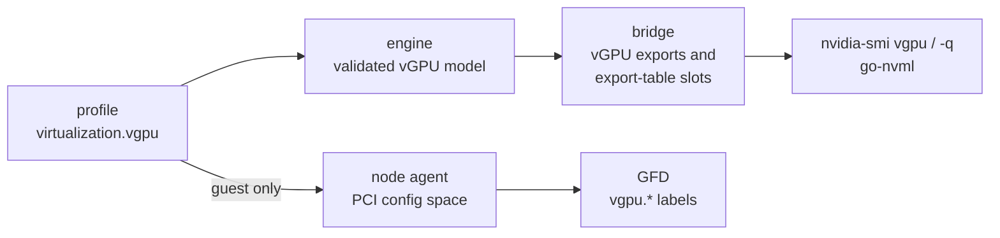

# MEP-0007: Simulate vGPU hosts and guests

Author: [Giulio Calzolari](https://github.com/giuliocalzo)

<!-- toc -->
- [Summary](#summary)
- [Motivation](#motivation)
  - [Background: vGPU is a software partition, like MIG](#background-vgpu-is-a-software-partition-like-mig)
  - [Background: the two sides of vGPU](#background-the-two-sides-of-vgpu)
  - [What Mokka does today](#what-mokka-does-today)
  - [Goals](#goals)
  - [Non-Goals](#non-goals)
- [Proposal](#proposal)
  - [User Stories](#user-stories)
  - [Notes/Constraints/Caveats](#notesconstraintscaveats)
  - [Risks and Mitigations](#risks-and-mitigations)
- [Design Details](#design-details)
  - [Profile configuration](#profile-configuration)
  - [Validation](#validation)
  - [Identity](#identity)
  - [NVML surface](#nvml-surface)
  - [nvidia-smi's private entry points](#nvidia-smis-private-entry-points)
  - [Guest PCI capability](#guest-pci-capability)
  - [Helm values](#helm-values)
  - [Compatibility](#compatibility)
  - [Test plan](#test-plan)
  - [Implementation](#implementation)
- [Drawbacks](#drawbacks)
- [Alternatives](#alternatives)
<!-- /toc -->

## Summary

This MEP lets a GPU profile declare its GPUs either a **vGPU host**, the
hypervisor's physical GPU running vGPU instances, or a **vGPU guest**, the
virtual GPU a VM is handed. The mock NVML library answers the vGPU calls from
that declaration, and for a guest the node agent writes the PCI capability a
real guest carries. `nvidia-smi vgpu`, `nvidia-smi -q`, go-nvml clients and
GPU Feature Discovery (GFD) then report the host or the guest unmodified, on a
CPU node with no hypervisor and no VM.

vGPU is a software construct on the physical GPU, very similar to MIG: the
host driver carves one GPU into smaller virtual GPUs of fixed types, where MIG
carves it into GPU instances of fixed profiles. The design follows Mokka's MIG
support accordingly, with the same profile placement, chart merge and derived
identities.

The model is static. An install declares the vGPU types and how many instances
run; nothing creates or destroys them at runtime. The chart turns it on with a
new `gpu.vgpu` block, off by default.

## Motivation

NVIDIA vGPU is how GPUs reach virtualized deployments, and the software that
runs there branches on it: the GPU Operator deploys a different driver and
licensing stack on a vGPU guest, GFD labels guest nodes so workloads can select
them, and monitoring reads host-side instance state. None of it can be
exercised on Mokka today, because the vGPU calls are generated stubs.

[#376](https://github.com/NVIDIA/k8s-test-infra/issues/376) asks for core
`nvmlVgpu*` and `nvmlDeviceGetVgpu*` calls backed by configuration, and an
end-to-end test in which a vGPU-aware consumer enumerates configured
instances. It is also one of the two prerequisites of the StratumSim
integration ([#1056](https://github.com/NVIDIA/k8s-test-infra/issues/1056));
the other is running Mokka under KubeVirt.

### Background: vGPU is a software partition, like MIG

Multi-Instance GPU (MIG) and vGPU answer the same question, how to split one
physical GPU into several smaller ones, at different layers. MIG does it in
hardware: each GPU instance gets dedicated streaming multiprocessors, memory
slices and caches. vGPU does it in software: the vGPU manager in the host
driver gives each instance a fixed slice of the framebuffer and shares compute
between instances by time-slicing. On MIG-capable boards a vGPU type can
instead be backed by a MIG GPU instance, which is why a type carries a GPU
instance profile ID.

To NVML the two look alike. Both hang a fixed catalogue off the board, MIG
profiles such as `1g.10gb` and vGPU types such as `NVIDIA A100-4C`, and both
enumerate the running slices from the parent device, each with an identity of
its own. Mokka already simulates MIG, so this MEP models vGPU the same way
wherever the two agree, and departs from it only where vGPU differs:

| | MIG in Mokka | vGPU in this MEP |
|---|---|---|
| What splits the GPU | The hardware | The host driver's vGPU manager |
| Catalogue | The board's MIG profiles | The vGPU types of the board and vGPU software release |
| A running slice | A GPU instance, used by a container | A vGPU instance, handed to a VM |
| Declared in | `device_defaults.mig`, the layout applied to every GPU | `device_defaults.virtualization.vgpu`, the instances applied to every GPU |
| Chart value | `gpu.mig`, merged into the profile | `gpu.vgpu`, merged the same way |
| Identity | MIG UUIDs derived from the parent GPU's UUID | vGPU and VM UUIDs derived from the parent GPU's UUID |
| Shipped catalogue | A profile table per MIG-capable board | None: the types depend on the software release, not the board |
| Runtime changes | Instances created and destroyed through NVML | Static; a non-goal |

### Background: the two sides of vGPU

A vGPU deployment has two drivers, and each sees something different.

- **The host** runs the vGPU manager on the physical GPU. NVML reports the GPU
  in `HOST_VGPU` mode, lists the vGPU *types* it supports (a type fixes the
  framebuffer size, class, license and instance limit, such as
  `NVIDIA A100-4C`) and the *instances* running, one per VM. `nvidia-smi vgpu`
  and the host part of `nvidia-smi -q` read this.
- **The guest** is the VM. Its GPU reports `VGPU` mode and the vGPU software
  license it holds. Which host driver it runs on is not an NVML fact: the
  host writes it into a vendor-specific capability in the virtual GPU's PCI
  config space. GFD reads that capability through sysfs to label the node
  `nvidia.com/vgpu.present`, `nvidia.com/vgpu.host-driver-version` and
  `nvidia.com/vgpu.host-driver-branch`.

So a guest is only convincing if both NVML and the PCI config space agree.

### What Mokka does today

Profiles already carry a `virtualization` block. `mode` accepts `none`,
`passthrough` and `vgpu`, and `nvmlDeviceGetVirtualizationMode` reports it.
That is the whole of it: there is no host mode, every other vGPU call is a
generated stub returning `NVML_ERROR_NOT_SUPPORTED`, the vGPU structs in the
bridge's C header are opaque, and the node agent's PCI config space has no
capability list. A profile set to `vgpu` claims to be a guest and then fails
every question a guest is asked.

### Goals

- A host profile makes `nvidia-smi vgpu` list the declared instances, and
  `nvidia-smi -q` report `Host VGPU` mode, the host vGPU mode and the active
  instances with their type, UUID and license state.
- A guest profile makes `nvidia-smi -q` report `VGPU` mode and the license,
  and makes an unmodified GFD label the node with the declared host driver.
- The real `nvidia-smi` binary drives the scope: every call it makes for these
  views is either answered or deliberately left `N/A`.
- Identities are deterministic and stable across restarts with no persisted
  state, so a 100k-node fleet is reproducible from its profiles.
- A mistake in the declaration fails at load with the field named, not at the
  first NVML call.
- Profiles that do not opt in are unchanged, in NVML and in PCI config space.

### Non-Goals

- The host's mdev and SR-IOV sysfs surfaces (`mdev_supported_types`,
  `creatable_vgpu_types`), which the GPU Operator's vGPU Device Manager and
  KubeVirt's mediated-device plugin read. They are a separate surface from
  NVML and a natural follow-up.
- Creating or destroying instances at runtime.
- Shipped per-board type catalogues. Which types a board offers depends on the
  vGPU software release, not the silicon.
- Charging instance framebuffer against the physical GPU's reported memory.
- Scheduler, placement and heterogeneous-mode APIs; `nvmlGetVgpuVersion` and
  `nvmlSetVgpuVersion`; metadata and migration compatibility; every `Set*`
  call; `nvmlDeviceGetGridLicensableFeatures` v1–v3.
- KubeVirt or any other VM manager.

## Proposal

`virtualization.mode` picks the side, with a new `host_vgpu` value next to
`vgpu`. A new `virtualization.vgpu` block carries the data for the chosen side
only: types and running instances for a host, the host driver and license for
a guest. The engine validates the block at load and builds a static model the
bridge's vGPU exports answer from. For a guest, the node agent adds the vGPU
capability to each GPU's synthetic PCI config space. The chart maps a
`gpu.vgpu` value onto the profile, as `gpu.mig` does for MIG.



### User Stories

1. **Host monitoring.** A team building a vGPU exporter installs the chart with
   `gpu.vgpu.mode: host`, two `NVIDIA A100-4C` instances per GPU. In a pod,
   `nvidia-smi vgpu` lists two instances on every GPU, and their go-nvml
   client enumerates the same instance IDs and UUIDs on every restart.
2. **Guest scheduling.** A platform team tests workloads that select vGPU
   nodes. They install with `gpu.vgpu.mode: guest` and a host driver of
   `550.163.01` on branch `r550_00`. GFD, unmodified, labels the node
   `nvidia.com/vgpu.present=true` with that version and branch, and
   `nvidia-smi -q` reports `Virtualization Mode : VGPU` and
   `Licensed (Expiry: Permanent)`.
3. **License expiry.** The same team checks how their tooling reacts to an
   unlicensed guest. They run

   ```bash
   nvml-mock-ctl set --gpu 0 virtualization.vgpu.guest.license.state=unlicensed
   ```

   and the next `nvidia-smi -q` reports GPU 0 unlicensed.
4. **A wrong declaration.** An install asks for eleven instances of a type
   whose `max_instances` is ten. The node agent refuses the config, names the
   field in its log and stays not ready, instead of serving a GPU that
   contradicts itself.

### Notes/Constraints/Caveats

- **The guest's host driver lives in two places.** NVML carries the license;
  the PCI capability carries the host driver version and branch. The node
  agent writes the capability from the profile, so a runtime override of
  `virtualization` changes what NVML reports but not what GFD reads.
- **The capability's fields are 10 bytes wide.** The host driver version and
  branch are each limited to 10 bytes, the width of the record GFD parses.
- **The branch is required, not derived.** A real branch such as `r550_70`
  cannot be computed from the version, so a guest block names both.
- **vGPU is set in `device_defaults` only.** Per-device overrides do not merge
  `virtualization`, so every GPU on a node starts on the same side. Only a
  runtime override can move one GPU to another.
- **`mode: vgpu` without a `guest` block keeps loading,** as it does today: it
  reports `VGPU` mode and nothing else. Making the block mandatory would break
  any existing config that sets the mode.
- **Instances are idle.** No guest runs, so every instance reports no
  framebuffer used, no encoder or frame buffer capture sessions, accounting
  off and a permanent license.
- **`nvidia-smi pmon` declines a host GPU,** printing `The feature is not
  supported in this configuration`, as it does on a real hypervisor. It is a
  consequence of the host answering the private "is a vGPU host" query.

### Risks and Mitigations

| Risk | Mitigation |
|---|---|
| The C layouts of the vGPU structs drift from NVML's, and a consumer reads garbage | Each struct the exports fill gets a full definition in the bridge header and a size test against go-nvml's Go struct. The header's `nvmlVgpuInstance_t` and `nvmlVgpuVmIdType_t` are corrected to upstream's integer and enum |
| `nvidia-smi` depends on undocumented entry points that change between driver releases | The two private slots are pinned to the traced 580.65.06 table and named in the bridge, next to the slots Mokka already answers. A new driver is re-traced the same way |
| A guest's PCI config space breaks consumers that read it on bare-metal profiles | The capability is written only for a guest with a `guest` block. A test pins that any other render leaves the status register, capability pointer and device-specific region empty, as today |
| Large fleets get colliding or unstable identities | IDs and UUIDs are pure functions of the GPU's physical index, UUID and slot, with no state to persist or coordinate |
| An install declares types no real release ships | Nothing prevents it, by design; the reference documents taking IDs, names and sizes from the release's documentation |

## Design Details

### Profile configuration

`mode` picks the side: `host_vgpu` for a host, `vgpu` for a guest, next to the
existing `none` and `passthrough`. The `vgpu` block then carries that side's
fields only. A host declares its types and running instances:

```yaml
device_defaults:
  virtualization:
    mode: host_vgpu
    host_vgpu_mode: sriov           # sriov | non_sriov
    vgpu:
      types:
        - id: 474
          name: "NVIDIA A100-4C"
          class: "Compute"
          framebuffer_mib: 4096
          max_instances: 10
          max_instances_per_vm: 1
          license: "NVIDIA-Virtual-Compute-Server,9.0"
          # optional: num_display_heads, resolution {width, height},
          #           frame_rate_limit, gpu_instance_profile_id
      instances:                    # applied to every GPU, like MIG gpu_instances
        - type: "NVIDIA A100-4C"
          count: 2
```

A guest declares the host driver it runs on and its license:

```yaml
device_defaults:
  virtualization:
    mode: vgpu
    vgpu:
      guest:
        host_driver_version: "550.163.01"
        host_driver_branch: "r550_00"
        license:
          product: "NVIDIA Virtual Compute Server"
          state: licensed                   # licensed | unlicensed
          expiry: "2027-01-01T00:00:00Z"    # optional; absent means permanent
```

A type's device and subsystem IDs are the board's own PCI IDs, the identity a
vGPU presents to its guest. A type with no `gpu_instance_profile_id` is not
MIG-backed. An instance's guest driver version is the host's own driver
version, since no guest driver runs.

### Validation

The block is checked when the config loads, and each failure names the field:

- `host_vgpu` needs `host_vgpu_mode` (`sriov` or `non_sriov`) and at least one
  type.
- Every type has a non-zero `id`, a `name`, a non-zero `framebuffer_mib` and
  `max_instances` between 1 and 999. IDs and names are unique.
- Every instance names a declared type. All instances name the same type, as
  real time-sliced vGPU does without heterogeneous mode, and their total count
  stays within that type's `max_instances`.
- When the profile sets `memory.total_bytes`, the instances' framebuffer fits.
- `guest` is refused under `host_vgpu`; `types` and `instances` under `vgpu`.
- A `guest` block names `host_driver_version` and `host_driver_branch`, each at
  most 10 bytes. `license.state` is `licensed` or `unlicensed`,
  `license.product` at most 127 bytes, `license.expiry` RFC 3339.
- Any other mode ignores the block. That keeps the `host_vgpu_mode: "N/A"`
  every shipped profile carries loading.

The node agent refuses an invalid block and stays not ready. The library
rejects the same config and falls back to its built-in defaults with a
warning, as for any other invalid profile.

### Identity

An instance's ID is `(GPU index + 1) × 1000 + slot + 1`, where the slot counts
the GPU's instances from zero in declaration order and the GPU index is the
physical index on the node. GPU 0's first instance is `1001`, GPU 1's second
`2002`. The ID encodes its GPU, so every process, including a container given
only one GPU, sees the same number; the 999-instance cap keeps slots inside
the GPU's thousand.

The instance's vGPU UUID and VM UUID are SHA-256 derivations of its GPU's UUID
and slot, with a different salt for each. They are stable across restarts
whenever the profile declares GPU UUIDs, which every shipped profile does.
This is the constraint MIG device UUIDs already meet: every process that loads
the library derives the same identities with nothing shared between them. The
derivation differs, MIG splicing its instance IDs into the parent UUID where
vGPU hashes, but the property is the same.

### NVML surface

The bridge replaces 28 generated stubs with exports that answer from the
engine's model:

| Scope | Calls |
|---|---|
| Device, host | `nvmlDeviceGetHostVgpuMode`, `GetSupportedVgpus`, `GetCreatableVgpus`, `GetActiveVgpus` |
| Type | `nvmlVgpuTypeGet{Name, Class, License, FramebufferSize, MaxInstances, MaxInstancesPerVm, DeviceID, NumDisplayHeads, Resolution, FrameRateLimit, GpuInstanceProfileId}` |
| Instance | `nvmlVgpuInstanceGet{UUID, VmID, VmDriverVersion, Type, GpuInstanceId, FrameRateLimit, EccMode, AccountingMode, FbUsage, EncoderStats, FBCStats, LicenseInfo_v2}` |
| Device, guest | `nvmlDeviceGetGridLicensableFeatures_v4`, which the unversioned name resolves to |

`nvmlDeviceGetVirtualizationMode` additionally reports `HOST_VGPU`.

Behaviour:

- **Off-side calls.** A host call on a GPU not in `host_vgpu` mode returns
  `NVML_ERROR_NOT_SUPPORTED`, as a driver without the vGPU manager does;
  `nvidia-smi vgpu` then prints `No supported devices in vGPU mode`. Guest
  licensing on anything but a guest with a `guest` block does the same.
- **Unknown IDs.** An unknown type or instance ID returns
  `NVML_ERROR_INVALID_ARGUMENT`.
- **Creatable types.** Every declared type while the GPU runs no instance,
  then only the running type until it holds `max_instances`, then none.
- **Failure injection.** The calls answer from configuration and do not
  advance failure injection's call counter, but a GPU that failure injection
  has made lost still reports the loss.
- **Left `N/A`.** The trace showed `nvidia-smi` calling a few more entry points
  whose answer belongs to a running guest or to out-of-scope APIs: an
  instance's placement ID, mdev UUID, accounting PIDs, utilization and guest
  PCI bus ID; a type's BAR1 info, capabilities, placements and maximum
  instances per GPU instance; the device's vGPU and vGPU driver capabilities
  and heterogeneous mode. They stay stubs and render `N/A`.

### nvidia-smi's private entry points

`nvidia-smi` fetches a private export table from the library and calls some
entry points by slot. Mokka already answers several of them. Two more decide
the vGPU views, recovered by giving every slot its own trampoline and logging
which slots each view of `nvidia-smi` 580.65.06 hits:

- **Slot 72, "is this a vGPU host".** `nvidia-smi vgpu` lists nothing unless it
  answers 1. It answers 1 for a GPU in `host_vgpu` mode.
- **Slot 189, guest license state.** `nvidia-smi -q` takes the guest's
  `License Status` from here, not from the licensable-features struct. It
  answers from the guest's `license.state`.

### Guest PCI capability

For a GPU in `vgpu` mode with a `guest` block, the node agent's PCI sysfs
renderer extends the synthetic 256-byte config space it already writes:

- the status register's capability-list bit (`0x10` at `0x06`) is set;
- the capabilities pointer (`0x34`) points at `0xd0`;
- at `0xd0`, a 27-byte vendor-specific capability (`0x09`, last in the chain)
  with the `VF` signature, followed by the host driver record: record type 0,
  length 22, the version and the branch each NUL-padded to 10 bytes.

That is the layout GFD's parser walks on a real guest. The host driver reaches
the renderer as an optional field of the agent's device spec, set only from a
`guest` block.

### Helm values

```yaml
gpu:
  vgpu:
    mode: ""            # "" (off) | host | guest
    hostVgpuMode: sriov # host only
    types: []           # host: type entries, in the profile's snake_case form
    instances: []       # host: [{type, count}]
    guest: {}           # guest: the profile's guest block
```

The chart renders `host` as `mode: host_vgpu` and `guest` as `mode: vgpu`, and
merges the side's fields into the profile's `device_defaults.virtualization`,
the same path `gpu.mig` takes; the other side's fields are dropped. An empty
`guest` renders the mode alone. The schema enumerates `mode`, and the chart
refuses to render `host` with no types, which would otherwise leave the node
agent not ready with no hint at install time. Every other rule is the
engine's, so it lives in one place. With `gpu.customConfig` set, the custom
config is the base and `gpu.vgpu` is merged on top of it, as `gpu.mig` is.

### Compatibility

| Requirement | Supported |
|---|---|
| Existing profiles | Unchanged. No shipped profile opts in, and `host_vgpu_mode: "N/A"` keeps loading |
| `mode: vgpu` configs without a `guest` block | Load and behave as before |
| `nvidia-smi` | Traced against 580.65.06 |
| GFD | Unmodified; guest detection reads the PCI tree the node agent renders |
| go-nvml | Struct layouts pinned against the module version in `go.mod` |

### Test plan

- **Unit.**
  - Engine: one case per validation rule, each asserting the field it names;
    host and guest getters, including the off-side and unknown-ID errors and
    the creatable-type progression; identities identical across two loads.
  - Bridge: C struct sizes against go-nvml; slots 72 and 189 for host, guest
    and bare-metal GPUs.
  - Node agent: a guest render parsed back by a copy of GFD's capability
    parser returns the declared version and branch; any other render has no
    capability list; only `mode: vgpu` with a `guest` block sets the device
    spec's host driver.
  - Chart: rendering for both modes, the empty-guest case, the host-without-
    types refusal and the schema's mode enum.
- **E2E**, a `vgpu` scenario with `vgpu-host` and `vgpu-guest` labels, run by
  `make e2e-vgpu` and its own CI job. The host specs reinstall the release in
  host mode and assert `nvidia-smi vgpu` and `nvidia-smi -q`; the guest specs
  reinstall it in guest mode and assert `nvidia-smi -q`, and, gated on
  `E2E_RUN_NGC` like the existing GFD scenario, run GFD over the rendered PCI
  tree and assert its three labels.

### Implementation

1. This MEP.
2. Engine model, validation and the bridge exports, the two export-table
   slots, the guest PCI capability, the chart values, the e2e scenario and the
   documentation, in
   [#1070](https://github.com/NVIDIA/k8s-test-infra/pull/1070).
3. Follow-up: the host's mdev and SR-IOV sysfs surfaces, for the vGPU Device
   Manager and KubeVirt.

## Drawbacks

- Mokka answers two undocumented `nvidia-smi` entry points. A driver release
  that renumbers them breaks the vGPU views until the table is re-traced.
- The model cannot express what real vGPU operators do day to day: creating
  and destroying instances, mixing types under heterogeneous mode, placing
  instances.
- No catalogue ships, so every install writes its own type list and can write
  one no release offers.
- The guest's identity is split between NVML and the PCI config space, and a
  runtime override reaches only the first.

## Alternatives

**Simulate the driver's dynamic lifecycle.** Instances created through mdev
or SR-IOV sysfs and reported by NVML as they appear would match a hypervisor
more closely. It needs the sysfs surfaces this MEP leaves out, a writable
state shared between the node agent and every process that loads the library,
and an answer to what a restart does to running instances. None of the
consumers in scope create instances; a static model answers them all.

**Leave the calls as stubs that return empty lists.** Cheap, and enough to
stop consumers erroring, but `nvidia-smi vgpu` would list nothing and the
issue's end-to-end test would have nothing to enumerate.

**Ship per-board type catalogues.** Profiles would work without a type list,
but the list depends on the vGPU software release rather than the board, so a
shipped catalogue would be wrong for most installs. The schema leaves room to
layer one on later.

**Detect a guest through NVML alone.** GFD does not ask NVML whether it runs on
a guest; it reads the PCI capability. Changing GFD would defeat the point of
simulating below the consumers.

**A dedicated profile per side,** such as `a100-vgpu-host`. It would double the
profile set for every board that supports vGPU and still need per-install
types. A chart value merged into any profile, as MIG does, composes with every
board.
