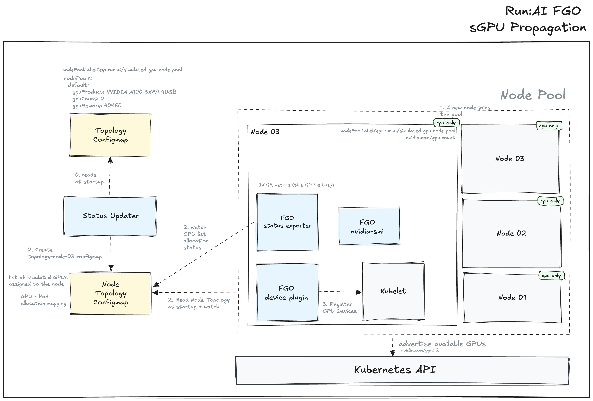
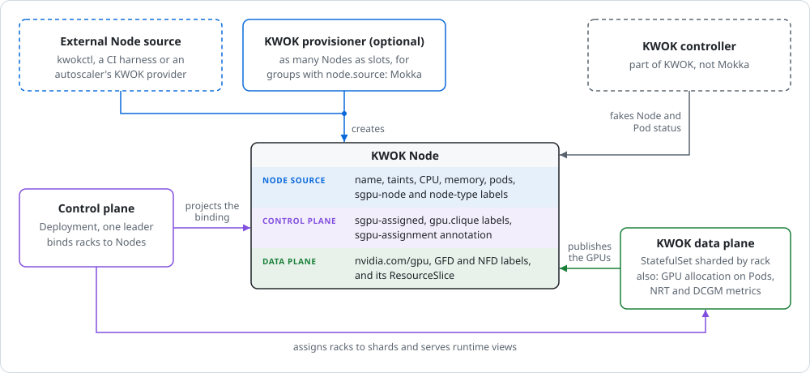
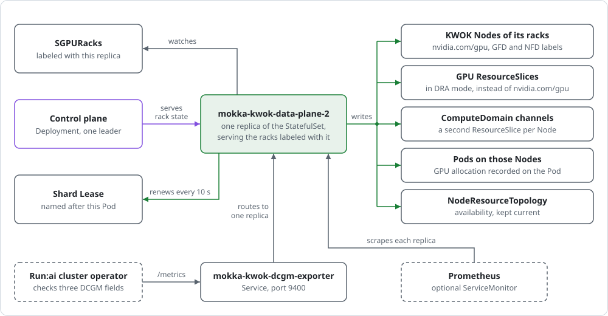
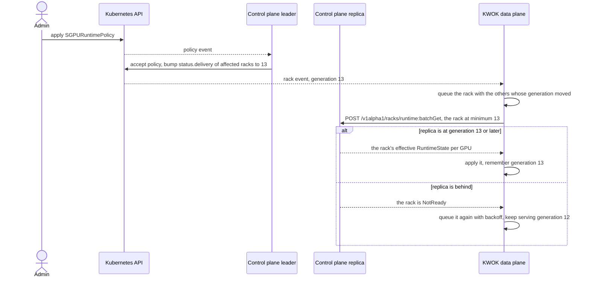
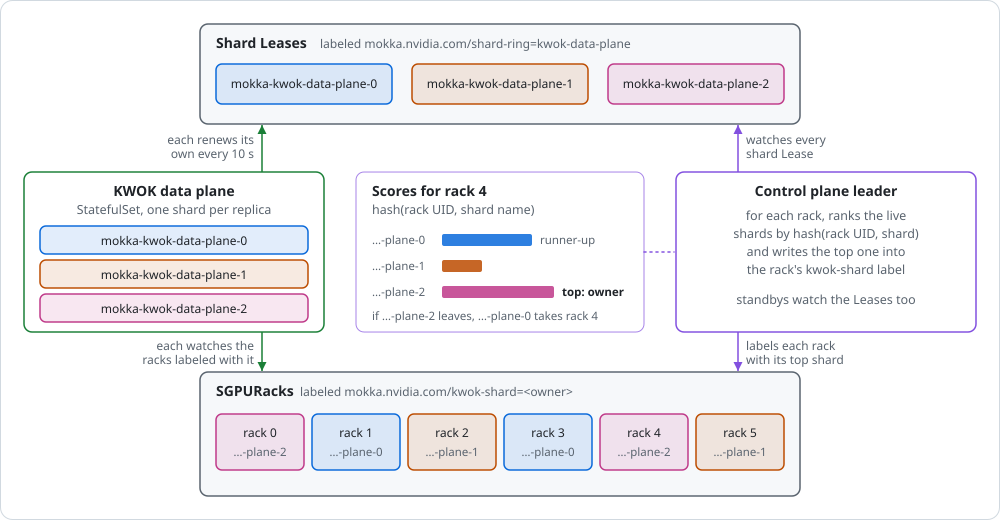
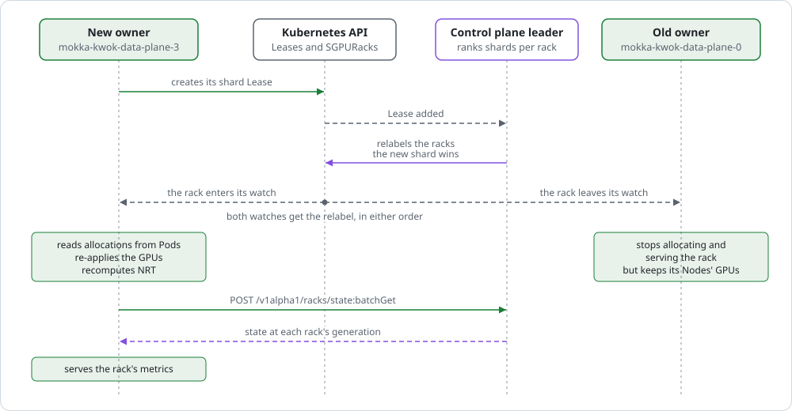
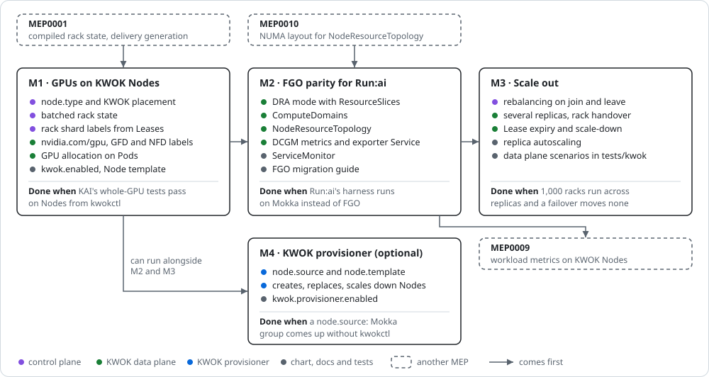

# MEP-0008: KWOK Integration

Author: [Roman Hlushko](https://github.com/roma-glushko)

<!-- toc -->
- [Summary](#summary)
- [Motivation](#motivation)
  - [Background](#background)
    - [Fake Backend](#fake-backend)
    - [KWOK](#kwok)
    - [Run:ai x Mokka Integration (Mock Backend)](#runai-x-mokka-integration-mock-backend)
    - [NVIDIA Ecosystem Integrations](#nvidia-ecosystem-integrations)
  - [Goals](#goals)
  - [Non-Goals](#non-goals)
- [Proposal](#proposal)
  - [User Stories](#user-stories)
  - [Risks and Mitigations](#risks-and-mitigations)
- [Design Details](#design-details)
  - [KWOK Integration](#kwok-integration)
    - [KWOK Components](#kwok-components)
    - [KWOK Nodes](#kwok-nodes)
    - [KWOK Provisioner](#kwok-provisioner)
    - [KWOK Data Plane](#kwok-data-plane)
    - [Sharding](#sharding)
    - [Separating CPU and KWOK Racks](#separating-cpu-and-kwok-racks)
    - [GPU Footprint in KWOK Virtual Nodes](#gpu-footprint-in-kwok-virtual-nodes)
    - [KWOK Installation](#kwok-installation)
    - [KAI Use Cases](#kai-use-cases)
  - [Milestones](#milestones)
- [Drawbacks](#drawbacks)
- [Alternatives](#alternatives)
<!-- /toc -->

## Summary

The proposal explores how to incorporate the relevant portion of
[Run:ai Fake GPU Operator (FGO)](https://github.com/run-ai/fake-gpu-operator) functionality directly into Mokka.
This MEP covers KWOK support; [MEP0009](../0009-workload-aware-dynamic-metrics/README.md) and [MEP0010](../0010-numa-aware-scheduling/README.md) cover the other parts.

## Motivation

The integration will enable Mokka to:
- consolidate the Mokka and Run:ai teams' efforts in one project, saving time and effort on FGO maintenance.
- replace FGO in Run:ai and KAI Scheduler CI/CD pipelines.
- extend Mokka's functionality with optional KWOK (no kubelet, virtual nodes) support for cheap, massive load testing where access to `nvidia-smi` and other on-host tools and libraries isn't needed.

### Background

[Fake GPU Operator (FGO)](https://github.com/run-ai/fake-gpu-operator) is a Kubernetes operator for testing Run:ai's GPU scheduling capabilities
without wasting real, expensive GPUs on that activity.

FGO supports two backends:

- `fake` - the primary FGO mode. It uses custom, fake instances of `nvidia-smi`, the device driver, the DRA plugin, etc. to simulate the presence of GPUs on the node.
- `mock` - the prior integration with Mokka during the early days of the Mokka project.

#### Fake Backend

The idea behind the `fake` backend is to fake the NVIDIA GPU infrastructure to propagate simulated GPUs to Kubernetes:

- FGO is deployed to the `gpu-operator` namespace to mimic the presence of the real GPU Operator
- FGO comes with a custom device plugin that propagates the node's GPU capacity
- FGO comes with the `status-exporter` DaemonSet that mimics DCGM metrics
- FGO installs a custom `nvidia-smi` binary that supports a subset of commands and flags of the original `nvidia-smi`.

This gives GPU simulation at the Kubernetes API level.

##### Node Lifecycle



#### KWOK

FGO reaches fleet scale with [KWOK](https://kwok.sigs.k8s.io/) (Kubernetes
WithOut Kubelet), which creates Node objects and drives the lifecycle of the
pods bound to them, with no kubelet and no containers behind either.

KWOK resources are just `Node` resources:

```yaml
apiVersion: v1
kind: Node
metadata:
  name: kwok-node-1
  annotations:
    kwok.x-k8s.io/node: fake
    node.alpha.kubernetes.io/ttl: "0"
  labels:
    fgo-lab/managed: "true"
    kubernetes.io/role: worker
    node.kubernetes.io/instance-type: gpu-node
    run.ai/simulated-gpu-node-pool: g1
    type: kwok # KWOK label
spec:
  taints: 
    - effect: NoSchedule
      key: kwok.x-k8s.io/node # regular pods won't be scheduled on kwok nodes
      value: fake
status:
  allocatable:
    cpu: "32"
    memory: 128Gi
    pods: "110"
  capacity:
    cpu: "32"
    memory: 128Gi
    pods: "110"
  nodeInfo:
    architecture: amd64
    containerRuntimeVersion: fake
    kernelVersion: fake
    kubeProxyVersion: fake
    kubeletVersion: fake
    operatingSystem: linux
    osImage: fake
```

Then, a test workload looks like this:

```yaml
apiVersion: v1
kind: Pod
metadata:
  name: kwok-pod
  namespace: fgo-lab-07
  annotations:
    run.ai/simulated-gpu-utilization: "40"
spec:
  nodeSelector:
    type: kwok
  tolerations:
    - key: kwok.x-k8s.io/node
      operator: Equal
      value: fake
      effect: NoSchedule
  containers:
    - name: main
      image: ubuntu:22.04
      command: ["sleep", "infinity"]
      resources:
        limits:
          nvidia.com/gpu: 2
```

FGO comes with a few KWOK plugins that are deployed as a Deployment per cluster:

| Deployment                                           | On by default                                 | Watches                                                                       | Writes                                                                                                            | Replaces                                              | Lab |
|------------------------------------------------------|-----------------------------------------------|-------------------------------------------------------------------------------|-------------------------------------------------------------------------------------------------------------------|-------------------------------------------------------|-----|
| `kwok-gpu-device-plugin`                             | yes                                           | Nodes' GPU state ConfigMaps (`topology-<node>`), **only when one is created** | Merge-patch of `Node.status` capacity and allocatable: `nvidia.com/gpu` = number of GPUs, plus any `otherDevices` | device-plugin DaemonSet, which reports to the kubelet | 07  |
| `nvidia-dcgm-exporter-kwok` (`status-exporter-kwok`) | yes, whenever `statusExporter.enabled` is set | Nodes' GPU state ConfigMaps: add, update, delete                              | One `:9400` for every KWOK node, `nvidia.com/gpu.*` node labels, and an NRT if enabled                            | per-node exporter DaemonSet                           | 07  |
| `kwok-dra-plugin`                                    | no                                            | Nodes' GPU state ConfigMaps: add, update, delete                              | ResourceSlice `kwok-<node>-gpu`, driver `gpu.nvidia.com`, one device per GPU (UUID, model, memory)                | `dra-plugin-gpu` DaemonSet                            | 08  |
| `kwok-compute-domain-dra-plugin`                     | no                                            | **Nodes**, not ConfigMaps                                                     | ResourceSlice `kwok-<node>-compute-domain-channel` with one device, `channel-0`                                   | compute-domain kubelet plugin                         | 09  |

The node topology `ConfigMaps` of KWOK nodes are no different from those of normal CPU nodes.

The KWOK plugins are nothing but servers that update Kubernetes objects based on FGO's node topology `ConfigMaps`.

FGO doesn't use any experimental KWOK CRDs like `ClusterExec`, `ClusterAttach`, `ClusterLogs`, etc.

#### Run:ai x Mokka Integration (Mock Backend)

FGO creates Mokka's profiles as `ConfigMaps` and uses some information from them in the `fake` backend mode, such as:

- product name
- memory
- GPU count
- driver and CUDA versions

When the node pool is defined to be `mock`, FGO actually deploys a Mokka instance on the nodes it manages:

```yaml
cluster:
  nodePoolLabelKey: run.ai/simulated-gpu-node-pool
  migStrategy: none
  nodePools:
    a100-pool:
      gpu:
        backend: mock
        profile: a100
        overrides:
          device_count: 2
```

On the Mokka end, with [integrations.fakeGpuOperator.enabled](../../../deployments/nvml-mock/helm/nvml-mock/templates/integrations-fgo.yaml),
the Mokka chart publishes one ConfigMap per Mokka GPU profile, such as `gb300`, `h100` or `a100`, in the form FGO expects
(e.g. named `gpu-profile-<profile>`, with the profile under the `profile.yaml` key, in `integrations.fakeGpuOperator.targetNamespace`).
That's the only place Mokka knows about FGO.

#### NVIDIA Ecosystem Integrations

FGO mocks or uses the following NVIDIA components:

- device-plugin
- DRA
- compute domains
- nvidia-smi
- DCGM
- MIG Manager

### Goals

- Propose an actionable plan for FGO incorporation into Mokka.
- Reach the feature parity required to migrate Run:ai and KAI Scheduler off FGO.

### Non-Goals

- Mokka remains a generic project, so functionality specific to Run:ai and KAI won't be included directly.
- MIG support is out of scope for this MEP.
- Fault injection in KWOK mode is out of scope for this MEP.
- Making SSH into a virtual pod (e.g. a pod scheduled to a KWOK virtual node) work is out of scope for this MEP.

## Proposal

Looking through the list of FGO features, there are three that Mokka should support:

- [KWOK Integration](#kwok-integration). Completely new functionality and the biggest piece of work.
- Workload-aware dynamic metrics, proposed in [MEP0009](../0009-workload-aware-dynamic-metrics/README.md).
- NUMA-aware scheduling, proposed in [MEP0010](../0010-numa-aware-scheduling/README.md).

The [NVIDIA component mocks](#nvidia-ecosystem-integrations) should be replaced by
Mokka and the real NVIDIA components on top of it.

### User Stories

1. **A scheduler load test.** A scheduler team adds a KWOK rack group of 1,000 `gb300-nvl72` racks with `node.source: Mokka` to an inventory. The KWOK provisioner creates 18,000 Nodes, the control plane binds each Node to a rack slot, the KWOK data plane gives it GPU capacity, labels and a ResourceSlice, and the team runs its load test on a cluster with a few CPU Nodes and no GPUs.
2. **Run:ai on virtual Nodes.** Run:ai's test harness keeps creating KWOK Nodes for its node pools, as it does for FGO, and adds Mokka's two labels to them. A KWOK rack group selects each pool. Run:ai's cluster operator finds the `mokka-kwok-dcgm-exporter` Service with the metrics it checks, and an `SGPURuntimePolicy` with a `Bursty` pattern moves the GPUs' utilization, as on CPU Nodes.
3. **Two kinds of Node in one inventory.** An inventory has a CPU rack group for tests that run `nvidia-smi` in Pods and a KWOK rack group for scale, both with the same profile. GPUs on both keep stable UUIDs, PCI addresses and NUMA placement. A test reads the Node bound to rack 0, Node 0 from the rack's `nodeRef` and pins a Pod to it with `kubernetes.io/hostname`.

### Risks and Mitigations

- **Large inventories load the API server.** Each KWOK Node adds a projection patch from the control plane, and a status patch, a label patch, a ResourceSlice and an NRT from the data plane. The provisioner adds the Node itself in groups that ask Mokka for their Nodes. Each GPU Pod adds an allocation patch and an NRT update. KWOK mode is off by default, the provisioner creates Nodes at a limited rate, and Mokka writes only when slot counts, bindings or Pods change. Metrics stay in memory.
- **DaemonSets that tolerate every taint run on KWOK Nodes.** KWOK fakes their Pods, but each such DaemonSet adds a Pod object per KWOK Node. Mokka keeps its node daemon off them with node affinity on `mokka.nvidia.com/node-type`, and the GPU Operator's operands with `nvidia.com/gpu.deploy.operands=false`. Cluster admins add the same affinity to their own DaemonSets, such as CNI or log agents.
- **DCGM metrics load Prometheus.** The example inventory's 72,000 GPUs serve 216,000 series. The `ServiceMonitor` is optional, and `kwok.dataPlane.metrics.enabled: false` leaves metrics out of tests that don't need them.
- **Node sources set GPU keys themselves.** A Node template written for FGO may already carry `nvidia.com/gpu` capacity or `nvidia.com/gpu.*` labels. The data plane doesn't force ownership of those keys: it reports the conflict as an Event on the Node, and the migration guide tells sources to drop them.

## Design Details

### KWOK Integration

A rack group's Nodes are one of two types:

- `CPU` (default): real Nodes with a kubelet. The control plane binds racks to them, and the node daemon simulates the GPUs on them.
- `KWOK`: virtual Nodes that [KWOK](#kwok) runs. The control plane binds racks to them the same way, and the [KWOK data plane](#kwok-data-plane) stands in for the daemons that would run on them.

They come from one of two sources:

- `External` (default): created outside Mokka. That's every CPU Node, and KWOK Nodes from `kwokctl`, a CI harness or [an autoscaler's KWOK provider](https://github.com/kubernetes-sigs/karpenter/tree/main/kwok) ([KWOK Nodes](#kwok-nodes)).
- `Mokka`: KWOK Nodes that Mokka's [KWOK provisioner](#kwok-provisioner) creates, as many as the group has rack slots.

A rack group sets both in its `node` block in `SGPUInventory`, so one inventory can mix CPU and KWOK rack groups:

```yaml
apiVersion: mokka.nvidia.com/v1alpha1
kind: SGPUInventory
metadata:
  name: dev
spec:
  rackGroups:
    - id: training
      node:
        type: CPU # the default
      count: 10
      profileRef:
        name: gb300-nvl72

      placement:
        nodeSelector:
          matchLabels:
            mokka.nvidia.com/sgpu: training

    - id: ci
      node:
        type: KWOK # with the default source: External
      count: 1000 # a thousand gb300-nvl72 racks
      profileRef:
        name: gb300-nvl72

      placement: # selects KWOK Nodes, whoever created them
        nodeSelector:
          matchLabels:
            run.ai/simulated-gpu-node-pool: ci
```

The KWOK group `ci` binds up to `rackGroup.count` × `profile.nodesPerRack` KWOK Nodes (18,000 in this example). A group with `node.source: Mokka` gets that many from the [KWOK provisioner](#kwok-provisioner) instead.

The CRD validation enforces these rules on a rack group:

- `node.type` is `CPU` or `KWOK`, defaults to `CPU`, and can't change, so a rack is simulated by the same component for its whole life. To change a group's node type, replace the group with one under a new `id`.
- `node.source` is `External` or `Mokka`, defaults to `External`, and can't change, since a change would leave open whether the Nodes already there are deleted or left behind. `Mokka` requires `node.type: KWOK`.
- `node.template` is allowed only with `node.source: Mokka`.
- `node` defaults to an empty block, so a group that leaves it out still stores `type: CPU` and `source: External`.
- `placement.nodeSelector` can't reference `mokka.nvidia.com/node-type`, which the node type already decides (see [Separating CPU and KWOK Racks](#separating-cpu-and-kwok-racks)).

The Mokka Control Plane ([MEP0001](../0001-mokka-control-plane/README.md)) watches `SGPUInventory` and creates `SGPURacks` as usual, and copies `node.type` from the rack group into each rack's `spec.nodeType`. The field stays flat on the rack, where `spec.nodes` lists the slots. `node.source` and `node.template` stay in the inventory, since only the [KWOK provisioner](#kwok-provisioner) reads them. A KWOK rack looks like this:

```yaml
apiVersion: mokka.nvidia.com/v1alpha1
kind: SGPURack
metadata:
  name: dev-ci-0-3f9c2a17b04e
  labels:
    mokka.nvidia.com/inventory: dev
    mokka.nvidia.com/rack-group: ci
    mokka.nvidia.com/rack-index: "0"
    mokka.nvidia.com/kwok-shard: mokka-kwok-data-plane-2 # the data plane replica that serves the rack
  annotations:
    mokka.nvidia.com/inventory-uid: <inventory UID>
  finalizers:
    - mokka.nvidia.com/rack-cleanup
  ownerReferences:
    - apiVersion: mokka.nvidia.com/v1alpha1
      kind: SGPUInventory
      name: dev
      uid: <inventory UID>
      controller: true
      blockOwnerDeletion: false
spec:
  nodeType: KWOK # copied from the rack group's node.type
  inventoryRef:
    name: dev
    uid: <inventory UID>
  profileRef:
    name: gb300-nvl72
    uid: <profile UID>
    generation: 1
    revision: <profile revision>
  identity:
    rackGroup: ci
    rackIndex: 0
    fabricUUID: <fabric UUID>
    cliqueID: 0
  nodes:
    - index: 0
      nodeRef: # the KWOK Node bound to the slot, as on CPU racks
        name: kwok-node-17
        uid: <Node UID>
      gpus:
        - index: 0
          uuid: GPU-<UUID>
          serial: "<serial>"
          minorNumber: 0
          pciAddress: "0008:01:00.0"
          rootComplex: pci0008:00
          numaNode: 0
          hostProcessorIndex: 0
        # GPUs 1-3
    # Nodes 1-17
```

KWOK racks are rendered and bound exactly like CPU racks, so their simulated GPUs keep stable UUIDs, serials, PCI addresses, and NUMA placement, and their Nodes get the same projection: `mokka.nvidia.com/sgpu-assigned`, `nvidia.com/gpu.clique` and the `mokka.nvidia.com/sgpu-assignment` annotation. The `mokka.nvidia.com/kwok-shard` label names the data plane replica that serves the rack ([Sharding](#sharding)).

#### KWOK Components

A KWOK Node involves three parties: its Node source, the control plane, and the KWOK data plane. KWOK mode always adds the data plane, and the [KWOK provisioner](#kwok-provisioner) is an optional Node source for groups that ask Mokka for their Nodes:



|               | Node source                                                                             | Control plane                                     | [KWOK data plane](#kwok-data-plane)                                                                         |
|---------------|-----------------------------------------------------------------------------------------|---------------------------------------------------|-------------------------------------------------------------------------------------------------------------|
| Owns          | the machine                                                                             | rack slots and shards                             | what the Node's daemons would publish                                                                       |
| Writes        | the Node: name, taints, CPU, memory and pod capacity, Mokka's two labels                | `nodeRef`, the Node projection, rack shard labels | `nvidia.com/gpu` capacity, GFD and NFD labels, ResourceSlices, GPU allocation on Pods, NodeResourceTopology |
| Serves        | nothing                                                                                 | runtime views                                     | DCGM metrics                                                                                                |
| Load follows  | the test                                                                                | inventories, Nodes and shard Leases               | Pods, scrapes and runtime views                                                                             |
| Runs as       | anything that creates Nodes, such as the optional [KWOK provisioner](#kwok-provisioner) | `Deployment` with leader election                 | `StatefulSet` sharded by rack                                                                               |
| Stands in for | Node registration                                                                       | nothing: it does what it does for CPU Nodes       | the device plugin, GFD, NFD, the DRA driver and dcgm-exporter                                               |

The split follows load and ownership:

- **Load.** The control plane's work follows inventories, Node registrations and shard membership, which change rarely, so one leader is enough. The data plane's work grows with the test: the GPUs of every bound Node, an allocation and a NodeResourceTopology update for every GPU Pod, and 216,000 metric series for the example inventory's 72,000 GPUs. It scales by sharding racks across replicas.
- **Ownership.** Per-Node state needs one writer per Node, not one for the whole cluster. Sharding gives each Node exactly one owning replica, as a real cluster runs one set of daemons per Node, so only cluster-wide decisions need the control plane leader.
- **Failures.** A Pod burst or a slow scrape can't stall binding, and a control plane failover doesn't interrupt allocation or metrics.
- **Sources.** Node creation stays out of the control plane, even when Mokka does it. The control plane binds a provisioned Node exactly as it binds one from `kwokctl`, so binding never depends on who created a Node.
- **Future surfaces.** GPU health, MIG reconfiguration, ComputeDomain readiness and InfiniBand counters all change while a Node runs, so they'll join the data plane instead of adding components.

#### KWOK Nodes

Mokka uses KWOK Nodes whoever creates them: `kwokctl scale` with a Node template, a CI harness's own manifests, as FGO's users write them today, [an autoscaler's KWOK provider](https://github.com/kubernetes-sigs/karpenter/tree/main/kwok), or, for groups with `node.source: Mokka`, the [KWOK provisioner](#kwok-provisioner). The docs give a Node template and a `kwokctl` command for the other sources. A Node joins with two labels next to the ones its rack group selects:

```yaml
apiVersion: v1
kind: Node
metadata:
  name: kwok-node-17 # any name the source picks
  annotations:
    kwok.x-k8s.io/node: fake # matched by KWOK's default annotation selector
  labels:
    mokka.nvidia.com/sgpu-node: "true" # asks for a rack slot, as on CPU Nodes
    mokka.nvidia.com/node-type: KWOK # keeps CPU groups and the node daemon off the Node
    run.ai/simulated-gpu-node-pool: ci # matched by the KWOK group's placement
    nvidia.com/gpu.deploy.operands: "false" # keeps the GPU Operator from scheduling its DaemonSets on the virtual Node
spec:
  taints:
    - key: kwok.x-k8s.io/node # keeps regular pods off the virtual Nodes
      value: fake
      effect: NoSchedule
status:
  capacity:
    cpu: "144" # the profile's node.host values make a realistic Node
    memory: 960Gi
    pods: "250"
  allocatable:
    cpu: "144"
    memory: 960Gi
    pods: "250"
```

The source owns the Node: its name, taints, and CPU, memory and pod capacity. The control plane and the data plane never change or delete them. Once the control plane binds the Node to a rack slot, two components add to it:

- the control plane projects the binding, exactly as on a CPU Node: `mokka.nvidia.com/sgpu-assigned`, `nvidia.com/gpu.clique` and the `mokka.nvidia.com/sgpu-assignment` annotation;
- the [KWOK data plane](#kwok-data-plane) publishes the GPUs: `nvidia.com/gpu` in capacity and allocatable, GFD and NFD labels, and a ResourceSlice ([Publishing the GPUs](#publishing-the-gpus)).

The control plane binds KWOK Nodes as it binds CPU Nodes: valid bindings stay, and new Nodes are ordered by creation time, name and UID and fill free slots in rack and index order. A Node's name says nothing about its slot, so tests find the Node bound to a slot through the rack's `nodeRef`. Nodes beyond the group's capacity stay pending without GPUs, and the inventory reports them as `pendingNodes`. When a binding goes away, the Node loses its GPUs and stays with its source. When a source deletes a bound Node, the control plane releases its slot, and the next pending Node takes it.

#### KWOK Provisioner

We will introduce an optional component, the KWOK provisioner, as a `Deployment` named `mokka-kwok-provisioner`. It creates the Nodes of the KWOK rack groups that set `node.source: Mokka`, as Cluster API or a cloud's node groups create the machines of a real cluster. It's a Node source like any other: it writes only Nodes, the control plane binds them as it binds Nodes from `kwokctl`, and the [KWOK data plane](#kwok-data-plane) publishes their GPUs.

```yaml
apiVersion: mokka.nvidia.com/v1alpha1
kind: SGPUInventory
metadata:
  name: load-test
spec:
  rackGroups:
    - id: scale
      node:
        type: KWOK
        source: Mokka # External, the default, uses Nodes others create
        template: # only with source: Mokka
          labels:
            topology.kubernetes.io/zone: zone-a
          taints:
            - key: kwok.x-k8s.io/node # keeps regular pods off the virtual Nodes
              value: fake
              effect: NoSchedule
          maxPods: 250 # the pod capacity a kubelet would report
      count: 100
      profileRef:
        name: gb300-nvl72

      placement:
        nodeSelector:
          matchLabels:
            run.ai/simulated-gpu-node-pool: scale # the provisioner puts these on its Nodes
```

A group opts in because its slot count means something different for each source. For Nodes from elsewhere, it's a ceiling: the group binds up to that many. For the provisioner, it's a target. Free slots alone can't tell a harness that hasn't created its Nodes yet from one that never will.

For each such group, the provisioner keeps as many Nodes as the group has slots, `status.rackGroups[].capacity.nodes`, so it follows the racks the control plane materialized instead of computing them. Its Nodes look like this:

```yaml
apiVersion: v1
kind: Node
metadata:
  name: load-test-scale-x7k2p # <inventory>-<rack group>-<random suffix>
  annotations:
    kwok.x-k8s.io/node: fake # matched by KWOK's default annotation selector
  labels:
    app.kubernetes.io/managed-by: mokka-kwok-provisioner
    mokka.nvidia.com/inventory: load-test # the group the Node was made for, not a slot
    mokka.nvidia.com/rack-group: scale
    mokka.nvidia.com/sgpu-node: "true"
    mokka.nvidia.com/node-type: KWOK
    run.ai/simulated-gpu-node-pool: scale # from the group's placement
    topology.kubernetes.io/zone: zone-a # from node.template
    nvidia.com/gpu.deploy.operands: "false"
    kubernetes.io/hostname: load-test-scale-x7k2p
    kubernetes.io/os: linux
    kubernetes.io/arch: arm64 # from the profile's node.host.cpu.architecture
  ownerReferences:
    - apiVersion: mokka.nvidia.com/v1alpha1
      kind: SGPUInventory
      name: load-test
      uid: <inventory UID>
      blockOwnerDeletion: false
spec:
  taints: # from node.template
    - key: kwok.x-k8s.io/node
      value: fake
      effect: NoSchedule
status:
  capacity:
    cpu: "144" # from the profile's node.host.cpu.cores
    memory: 960Gi # from the profile's node.host.memory.capacity
    pods: "250" # from node.template.maxPods
  allocatable:
    cpu: "144"
    memory: 960Gi
    pods: "250"
  nodeInfo:
    architecture: arm64
    operatingSystem: linux
    kubeletVersion: fake
```

- **Counting.** It counts the Nodes it made for a group by their labels and owner, and creates more until there are as many as the group has slots. Nodes from other sources that match the same placement compete for the slots and show up as `pendingNodes`, as usual.
- **Names.** A Node's name is the inventory, the group and a random suffix. The provisioner picks the suffix itself instead of using `generateName`, so `kubernetes.io/hostname` carries the name from the start. If the name is taken, it picks another. Names never point at a slot: the control plane picks the slot and can later bind the Node elsewhere.
- **Nothing about slots or GPUs.** It never writes `nodeRef`, a projection key or a GPU key. Those come from the control plane and the data plane, as on any other KWOK Node.
- **Shape.** CPU, memory and architecture come from the profile's `node.host`, and pod capacity from `node.template.maxPods`, since there's no kubelet to report it. A group whose profile has no host CPU cores or memory gets no Nodes, and the provisioner reports why as an Event on the inventory.
- **Replacement.** When a Node it created is deleted, it creates another, as a cloud's node group replaces a terminated instance, and the control plane binds the new Node to the free slot. A test that needs a host gone for good cordons it or marks it NotReady with a KWOK `Stage` instead.
- **Changes.** The provisioner never updates a Node after creating it, so tests can change its labels, taints and conditions. A template change applies to Nodes created after it, and deleting a Node replaces it with one from the current template.
- **Scale-down.** When a group has fewer slots, it deletes surplus Nodes that aren't bound, those without `mokka.nvidia.com/sgpu-assigned`, and waits for the control plane to release the rest. It deletes every Node of a group that leaves the inventory. When the inventory itself is deleted, the garbage collector deletes its Nodes through their owner reference.

The CRD validation adds these rules for groups with `node.source: Mokka`:

- `placement.nodeSelector` uses `matchLabels` only, so the provisioner can put those labels on its Nodes.
- `node.template.labels` can't set a key that `placement` sets, or keys under `mokka.nvidia.com/`, `nvidia.com/` or `feature.node.kubernetes.io/`, which Mokka writes.
- `node.template.maxPods` is at least 1 and defaults to 110, the kubelet's default.
- The inventory name and the group ID have at most 56 characters together, so a Node name fits the 63-character limit of the `kubernetes.io/hostname` label.

The provisioner runs one active replica under leader election and creates Nodes at a rate the Helm chart sets. It watches `SGPUInventory` and `SGPURackProfile` objects and the metadata of the Nodes it created. It reads no racks, shard Leases or runtime views.

#### KWOK Data Plane

We will introduce a new component, the KWOK data plane, as an optional `StatefulSet` named `mokka-kwok-data-plane`. It stands in for the daemons of a GPU Node for as long as a KWOK Node is bound: it publishes the Node's GPUs, allocates them to the Pods bound to the Node, keeps the Node's NodeResourceTopology current, and serves DCGM metrics for them. It takes over FGO's KWOK plugins: `kwok-gpu-device-plugin`, `nvidia-dcgm-exporter-kwok` and `kwok-dra-plugin`. Each replica serves the racks the control plane assigns to it, as [Sharding](#sharding) describes.



##### Publishing the GPUs

There's no device plugin, GFD, NFD or DRA driver on a KWOK Node, so the data plane publishes what they would once the control plane serves the Node's assignment with its [runtime views](#runtime-state):

- `nvidia.com/gpu` in the Node's capacity and allocatable, as a merge patch of that key only, as FGO's `kwok-gpu-device-plugin` does. `allocatable` stays at the total as Pods come and go: the scheduler subtracts requests itself, so lowering it would count them twice.
- GFD and NFD labels, such as `nvidia.com/gpu.product`, `nvidia.com/gpu.count`, `nvidia.com/gpu.memory`, `nvidia.com/mig.strategy` and `feature.node.kubernetes.io/pci-10de.present`, with server-side apply.
- A DRA `ResourceSlice` per Node, owned by the Node, with one device per GPU in the slot, carrying its UUID, model and memory.

All replicas apply with the same field manager, so a rack that moves to another replica keeps its Nodes' GPUs: the new owner's apply takes over the same fields. The data plane removes the GPUs when a binding is released or its rack is deleted. A rack that leaves a replica's watch but still exists has moved to another replica, so its Nodes keep their GPUs. The data plane doesn't force ownership of keys a source already set; it reports the conflict as an Event on the Node.

##### GPU Allocation

There's no kubelet on a KWOK Node, so the data plane allocates GPUs to the Pods bound to the Nodes of its racks, as the kubelet's device manager would, and records the allocation on the Pod:

```yaml
apiVersion: v1
kind: Pod
metadata:
  name: train-0
  namespace: team-a
  annotations:
    mokka.nvidia.com/gpu-allocation: '{"main":["GPU-<UUID>","GPU-<UUID>"]}' # GPU UUIDs per container
spec:
  nodeName: kwok-node-17
```

`NodeResourceTopology` availability and the `pod` labels on DCGM metrics both come from this record. It covers `nvidia.com/gpu` requests and DRA claims alike, as the kubelet's PodResources API does: for a DRA claim, the data plane copies the devices the scheduler allocated. The record lives on the Pod rather than in memory, so a replica that restarts or takes over a rack reads the allocations back instead of recomputing them, which could move a running Pod to another GPU once earlier Pods are gone.

##### NodeResourceTopology

The data plane creates a `NodeResourceTopology` for each Node of its racks and keeps each zone's available GPUs current from the allocations, as NFD's topology updater does on a real Node. Zones and their capacity come from the rack's NUMA placement and the profile, so they match what NFD reports for a CPU Node with the same profile ([MEP0010](../0010-numa-aware-scheduling/README.md#numa-setup)).

##### Runtime State

The data plane applies the effective runtime view, as the node daemon does on CPU racks, but it doesn't compute it. The effective runtime view is a GPU's profile defaults with the accepted `SGPURuntimePolicy` overrides applied. [MEP0001](../0001-mokka-control-plane/README.md#runtime-view-computation-and-delivery) gives policy acceptance and this computation to the control plane, which computes the view on request and never stores it. The data plane reads the view for telemetry settings now, and for GPU health once fault injection is in scope. It publishes a Node's GPUs only once the control plane serves the Node's assignment with the views, as the node daemon waits for its assignment on a CPU Node.

The data plane takes each input from where it's published:

- **Stored state comes from Kubernetes.** Racks, including their delivery status, and the profiles they use arrive through the watches listed in [Separating CPU and KWOK Racks](#separating-cpu-and-kwok-racks). Profiles contribute static facts such as GPU model and memory, never `defaults.runtime`.
- **The effective runtime view comes from the control plane API**, for many racks per request.
- **Policy objects aren't watched.** No KWOK component watches `SGPUInventory` or `SGPURuntimePolicy`. The data plane could compile policies with `internal/sgpu/policy`, which makes no API calls, but it would then be a second component deciding which policies apply. While the two caches disagree, it could apply a policy the control plane reports as rejected, or one already deleted.

The control plane API serves the views of many racks in one request, so the data plane's requests don't grow with its rack count:

```http
POST /v1alpha1/racks/runtime:batchGet
```

```json
{
  "racks": [
    {"name": "dev-ci-0-3f9c2a17b04e", "uid": "<rack UID>", "minRackDeliveryGeneration": 13},
    {"name": "dev-ci-7-9b1e04c2a6d1", "uid": "<rack UID>", "minRackDeliveryGeneration": 4}
  ]
}
```

The response has one entry per requested rack, in request order:

```json
{
  "apiVersion": "v1alpha1",
  "racks": [
    {
      "rack": {"name": "dev-ci-0-3f9c2a17b04e", "uid": "<rack UID>"},
      "rackDeliveryGeneration": 13,
      "nodes": [
        {
          "index": 0,
          "node": {"name": "kwok-node-17", "uid": "<Node UID>"},
          "assignmentRevision": 3,
          "gpus": [
            {
              "index": 0,
              "runtime": {
                "deviceState": "Healthy",
                "telemetry": {
                  "utilization": {
                    "mode": "Pattern",
                    "pattern": {"type": "Bursty", "gpuPercent": {"minimum": 20, "maximum": 90}}
                  }
                }
              }
            }
          ]
        }
      ]
    },
    {
      "rack": {"name": "dev-ci-7-9b1e04c2a6d1", "uid": "<rack UID>"},
      "status": "NotReady"
    }
  ]
}
```

It's a `POST` because a request names up to 100 racks, more than fits in a URL, but it only reads. A view holds the effective `RuntimeState` of every GPU in the rack, grouped by logical Node (one of each is shown), and the delivery generation it was computed from. For each rack, the data plane passes the generation it last saw on the rack as the minimum. A rack the replica can't serve at that generation yet, because its cache is behind, comes back `NotReady`, and a rack it doesn't know under that name and UID comes back `NotFound`, without failing the rest of the batch. Only a replica that isn't ready at all answers `503`, and the data plane retries the batch with backoff. This is MEP0001's publication-floor check, applied per rack. Each Node entry names the Kubernetes Node bound to the slot and its assignment revision, and the data plane applies the node daemon's ordering to each Node: it accepts a view only if the pair of assignment revision and rack delivery generation doesn't go backwards. The control plane includes a Node only once its projection is published, so the data plane never publishes GPUs for an unsettled binding. The endpoint is a batch form of the per-Node one the node daemon polls.

Batching keeps both sides cheap:

- **The data plane queues racks.** A rack whose generation in Kubernetes is ahead of the one applied joins a queue once, however many events arrive for it. The queue goes out as one request when it holds 100 racks or a second after its first rack arrived, with at most two requests in flight per replica. `NotReady` racks rejoin the queue with backoff while the replica keeps the values it applied last, and `NotFound` racks leave it. The Helm chart makes these limits configurable.
- **Bursts turn into a few requests.** A replica that starts with 125 racks fetches them in two requests. A policy that selects all 1,000 racks of the example inventory costs each of eight replicas two requests, 16 in total instead of 1,000.
- **The control plane shares work.** Any ready control plane replica serves batches, as it serves the node daemon's polls, so the load spreads across replicas. A replica looks up what racks share, such as the policies selecting their inventory or rack group, once per request, compresses responses with gzip, and answers `429` with `Retry-After` when it already serves its limit of concurrent batches.

The rack tells the data plane when to fetch. The control plane leader bumps a rack's delivery generation whenever anything feeding its views changes: a slot is bound or released, a policy that selects the rack is added, edited or deleted, the set of accepted policies changes, or the profile's runtime defaults change. For each rack UID, the data plane keeps the generation it last applied and queues the rack for the next batch whenever the generation in Kubernetes is ahead. The check compares two numbers, so a missed watch event only delays a fetch, and after a restart a replica fetches each of its racks once, in batches. A rack recreated under the same name has a new UID and starts a new generation sequence, so it counts as a new rack.



Values that change on their own never trigger a fetch. The view carries settings, such as a `Bursty` utilization pattern and its range, and [DCGM Metrics](#dcgm-metrics) describes how the data plane turns them into values.

This puts one requirement on the control plane: a batch endpoint for racks next to the per-Node one. Both serve views from the same computation. KWOK racks go through allocation like CPU racks, so their delivery generation advances with bindings and policies without extra work.

Publishing the GPUs and policy-driven telemetry depend on that endpoint. GPU allocation and NodeResourceTopology follow Pods and don't wait for it.

##### DCGM Metrics

The data plane serves DCGM metrics for the GPUs of its racks through a `Service` named `mokka-kwok-dcgm-exporter` on port `9400`. The Service keeps a DCGM exporter's name because consumers look for one, as the [Run:ai cluster operator](#kai-use-cases) does. The metrics are the three fields that check needs:

| Metric                 | Value                                                                   |
|------------------------|-------------------------------------------------------------------------|
| `DCGM_FI_DEV_GPU_UTIL` | GPU utilization in percent, generated from the GPU's telemetry settings |
| `DCGM_FI_DEV_FB_USED`  | Frame buffer memory in use, in MiB                                      |
| `DCGM_FI_DEV_FB_FREE`  | Frame buffer memory free, in MiB                                        |

Each series carries the labels dcgm-exporter uses. `gpu`, `UUID`, `device`, `pci_bus_id` and `modelName` come from the rack and its profile, `Hostname` from the KWOK Node, and `namespace`, `pod` and `container` from the [GPU allocation](#gpu-allocation) while a Pod holds the GPU:

```prometheus
DCGM_FI_DEV_GPU_UTIL{gpu="0",UUID="GPU-<UUID>",device="nvidia0",pci_bus_id="00000008:01:00.0",modelName="NVIDIA GB300 NVL",Hostname="kwok-node-17",namespace="team-a",pod="train-0",container="main"} 87
```

`Hostname` is the GPU's KWOK Node name. On a GPU Node, all series from one dcgm-exporter instance share a `Hostname`, because the instance serves only that Node. The data plane serves many Nodes, so it keeps one value per Node by using the Node name. The chart's optional `ServiceMonitor` also sets `instance` from `Hostname`, which gives each KWOK Node its own `instance`, as with per-Node exporters.

`DCGM_FI_DEV_GPU_UTIL` follows the GPU's telemetry settings from the [runtime view](#runtime-state). The settings say how the value moves, such as a `Bursty` pattern between 20 and 90 percent, and the data plane's metrics generator turns them into values, as the NVML engine does on CPU Nodes. Both use one generator package, so a policy produces the same series on both kinds of Node. Today the generator is internal to `pkg/gpu/mocknvml/engine`, which uses cgo, and it implements `steady`, `idle`, `busy` and `burst` rather than the `Steady`, `Bursty` and `Wave` patterns the CRD defines. Moving it into its own package, with the CRD's patterns, is part of this work.

TODO: Is the current way we simulate dynamic metrics flexible/extensible enough to build upon it?

`DCGM_FI_DEV_FB_USED` and `DCGM_FI_DEV_FB_FREE` split the GPU memory in the profile and stay constant, as on CPU Nodes, where the NVML engine reports the profile's memory figures unchanged. The data plane generates values for every GPU, with or without a Pod, as the NVML engine does. [MEP0009](../0009-workload-aware-dynamic-metrics/README.md) covers values that follow the Pod.

The data plane computes values when it's scraped, at most once per 10-second step, configurable in the Helm chart, much as `dcgm-exporter` serves its last 30-second sample to every scrape. A replica keeps each series' labels and the frame-buffer lines rendered, since those change only when a Pod's allocation or workload telemetry does. The first scrape in a step computes `DCGM_FI_DEV_GPU_UTIL` for the replica's GPUs, compresses the response once and caches it for the rest of the step, and nothing runs while nobody scrapes. Compressing the text is the main cost: about 6 MB per replica with eight replicas, or 50 MB for one replica serving all 72,000 GPUs, so large inventories need more replicas.

**Open question: one DCGM exporter Service.** The Run:ai cluster operator expects exactly one DCGM exporter Service. An inventory that mixes CPU and KWOK racks has two: the GPU Operator's for CPU Nodes and this one.

#### Sharding

KWOK virtual nodes are cheap. We can have a gigantic number of KWOK nodes to care about, much more than a typical, real Kubernetes CPU cluster can afford. KWOK data plane needs to emit K8s resources and then metrics for every single sGPU node it owns. So we need a way to distibute that ownership load across multiple KWOK Data Plane replicas. We propose to use sharding here.

Each rack has exactly one owning data plane replica, so the data plane needs no leader election even though it writes. The rack is the shard unit because it's also the unit of the runtime view and the delivery generation, so everything about a rack stays in one replica. With eight replicas, each owns 2,250 Nodes and 9,000 GPUs of the example inventory and serves 27,000 series.

Which replica owns a rack is an assignment, so the control plane makes it, as it assigns Nodes to slots. It labels each KWOK rack with its owner, `mokka.nvidia.com/kwok-shard: mokka-kwok-data-plane-2`, and each replica watches only the racks labeled with its own name. The control plane learns which replicas exist from their shard Leases rather than from a replica count, so an autoscaler can change the count without telling it. A similar idea is employed by [kubernetes-controller-sharding](https://github.com/timebertt/kubernetes-controller-sharding).



##### Shard Leases

Each replica holds a `Lease` while it serves:

```yaml
apiVersion: coordination.k8s.io/v1
kind: Lease
metadata:
  name: mokka-kwok-data-plane-2 # the replica's Pod name, stable across restarts
  namespace: mokka
  labels:
    mokka.nvidia.com/shard-ring: kwok-data-plane # what the control plane watches
  ownerReferences: # removed with the StatefulSet
    - apiVersion: apps/v1
      kind: StatefulSet
      name: mokka-kwok-data-plane
      uid: <StatefulSet UID>
spec:
  holderIdentity: mokka-kwok-data-plane-2
  leaseDurationSeconds: 30 # this long without a renewal, and the shard is gone
  renewTime: "2026-11-09T10:04:10.000000Z" # renewed every 10 seconds
```

A replica:

- **joins** once its caches sync. It creates its Lease, or renews the one its previous incarnation left, since the name is the same.
- **renews** every 10 seconds. If it can't renew for 20 seconds, it stops serving, since the control plane may already be moving its racks.
- **leaves** on purpose. On SIGTERM it reads its StatefulSet. If its ordinal is at or above `spec.replicas`, it's being scaled away, so it stops serving and deletes its Lease. Otherwise it's restarting and leaves the Lease for its replacement.

The control plane watches Leases with the `mokka.nvidia.com/shard-ring=kwok-data-plane` label. For each one, it notes on its own clock when it last saw `renewTime` change and schedules a check one `leaseDurationSeconds` later, since a dead replica sends no events. A Lease is live if it has a holder and a renewal was seen within its duration, and the live Leases are the shards. A new Lease, a deleted one or an expired timer triggers a rebalance, batched over a couple of seconds; renewals only reset timers. The control plane deletes Leases that stay expired for several durations. The Helm chart makes the durations configurable.

Every control plane replica watches the shard Leases, so a standby takes over with a warm view, but only the leader computes owners and writes rack labels. Timing renewals on its own clock, as client-go's leader election does, keeps clock skew between Nodes from expiring a live shard. A new leader starts with fresh timers, so it never drops a shard early, and it computes the same labels, so a failover moves no racks.

##### Rebalancing

The control plane assigns racks to shards with [rendezvous hashing](https://en.wikipedia.org/wiki/Rendezvous_hashing), also called highest random weight hashing. It gives the guarantee consistent hashing is known for, that a membership change only moves racks to or from the shard that joined or left, without a ring. For each KWOK rack, the leader scores every live shard and labels the rack with the highest:

```text
score(rack, shard) = xxHash64("<rack UID>/<shard name>")
owner(rack)        = the live shard with the highest score; equal scores go to the lower shard name
```

The hash only supplies the scores. Movement stays small because a rack's score for a shard doesn't depend on which other shards exist, so a membership change only moves racks whose top shard changed:

- when a shard joins, the racks that rank it first move to it, about 1 in N, taken evenly from the others;
- when a shard leaves, only its racks move, each to its runner-up.

No rack moves between two shards that stay, and a new owner fetches the views of the racks it gains in a few batches. Replacing the hash or its input string is a different kind of change: it changes every score, so it relabels nearly every rack once, and both are part of the contract between control plane versions. A rack moves through its label:



The old owner keeps the Nodes' GPUs because the binding hasn't changed, and the new owner re-applies them with the same field manager. Allocations live on Pods, so the new owner reads them back instead of recomputing them. Metric series keep their identity, since the `ServiceMonitor` sets `instance` from the KWOK Node name.

| Event                           | The replica's Lease                                                                              | What the control plane does                                                     |
|---------------------------------|--------------------------------------------------------------------------------------------------|---------------------------------------------------------------------------------|
| An autoscaler adds a replica    | The new Pod creates its Lease once its caches sync                                               | Adds the shard and relabels the racks it now wins                               |
| An autoscaler removes a replica | The Pod finds its ordinal at or above `spec.replicas` and deletes its Lease                      | Relabels the shard's racks at once, while the Pod finishes its grace period     |
| A rolling update or eviction    | The Pod's ordinal is below `spec.replicas`, so it keeps its Lease, and its replacement renews it | Nothing: the racks wait for the replica                                         |
| A crash or a lost Node          | Renewals stop                                                                                    | Drops the shard 30 seconds after the last renewal it saw and relabels its racks |
| A control plane failover        | Unchanged                                                                                        | The new leader computes the same labels                                         |

The scheme accepts three limits:

- **Overlap on join.** Until the old owner's watch delivers the relabel, both replicas may act on the rack. The data plane writes an allocation only if the Pod has none, with the Pod's `resourceVersion` as a precondition: the first write wins. NodeResourceTopology is recomputed from the allocations, so it converges. Two Pods bound in that window could still be recorded on one GPU, and the new owner reassigns the later one. A leaving replica stops serving before it deletes its Lease, so a leave can't overlap.
- **Gaps on restart.** While a replica restarts, new Pods on its racks wait for an allocation, their NodeResourceTopology goes stale, and their GPUs have no metrics, as on a real Node whose kubelet, topology updater or dcgm-exporter restarts.
- **No empty replicas.** A replica without racks serves no DCGM series, and a Run:ai check that reaches it through the `Service` fails. The chart defaults to one replica, and an autoscaler's maximum should stay well below the number of racks.

#### Separating CPU and KWOK Racks

Each service lists and watches only the objects it needs, and the API server applies the selectors, so little else reaches the service's cache.

The control plane's first two filters exist today, and the Lease watch is new:

| Resource                                       | Server-side selector                          | Result                                                |
|------------------------------------------------|-----------------------------------------------|-------------------------------------------------------|
| `SGPUInventory`, `SGPURackProfile`, `SGPURack` | none                                          | creates and retires every rack                        |
| `Node`                                         | `mokka.nvidia.com/sgpu-node=true`             | receives every Node that asks for a slot, CPU or KWOK |
| `Lease`                                        | `mokka.nvidia.com/shard-ring=kwok-data-plane` | the data plane's shard Leases                         |

The [KWOK provisioner](#kwok-provisioner) reads its groups and sees only the Nodes it created:

| Resource                           | Server-side selector                                  | Result                                                              |
|------------------------------------|-------------------------------------------------------|---------------------------------------------------------------------|
| `SGPUInventory`, `SGPURackProfile` | none                                                  | groups with `node.source: Mokka`, their slot counts and host values |
| `Node`, metadata only              | `app.kubernetes.io/managed-by=mokka-kwok-provisioner` | only the Nodes it created                                           |

The [KWOK data plane](#kwok-data-plane) sees only its own racks. Its Pod watch is the exception: a field selector matches one Node name, not a set:

| Resource          | Server-side selector                         | Result                                                    |
|-------------------|----------------------------------------------|-----------------------------------------------------------|
| `SGPURack`        | `mokka.nvidia.com/kwok-shard=<its Pod name>` | only the racks it owns                                    |
| `SGPURackProfile` | none                                         | a handful of small objects                                |
| `Pod`             | `spec.nodeName!=`                            | receives every bound Pod, keeps those on its racks' Nodes |
| `ResourceClaim`   | none                                         | keeps the claims allocated on its racks' Nodes            |
| `StatefulSet`     | `metadata.name=mokka-kwok-data-plane`        | its replica count, read when it shuts down                |

- **The node type picks the path.** The group's `node.type`, copied into each rack's `spec.nodeType`, is the source of truth. A KWOK group's compiled placement selector requires `mokka.nvidia.com/node-type=KWOK`, and a CPU group's excludes it, which unlabeled CPU Nodes still match. A Node with KWOK's `kwok.x-k8s.io/node` annotation also counts as a KWOK Node, so a source that forgets the label can't put a virtual Node in a CPU group.
- **Each field has one writer.** The Node source writes the Node, and for groups with `node.source: Mokka` that's the KWOK provisioner. The control plane writes `SGPURack`, including its status and shard label, and the Node projection. The KWOK data plane writes the GPUs on its Nodes, their ResourceSlices, the GPU allocation on Pods, the NodeResourceTopology of its Nodes, and its own shard Lease. Server-side apply field managers keep the writers of a Node's fields apart.
- **KWOK groups use placement like CPU groups.** They go through allocation, Node event routing and usage reporting, so the inventory reports bound, pending and available KWOK Nodes. They count towards capacity and the rack group limit.
- **The node daemon stays off KWOK Nodes.** Its DaemonSet tolerates every taint, so the chart adds the node affinity `mokka.nvidia.com/node-type NotIn [KWOK]`, which unlabeled CPU nodes still match.

#### GPU Footprint in KWOK Virtual Nodes

KWOK nodes are completely virtual entities. In most cases, the real NVIDIA components can't run on them or interact with them.
Still, we would like to simulate a few surfaces based on `SGPURackProfile` information to make them look like real GPU nodes from the outside:

- Add NFD/GFD labels e.g. `nvidia.com/gpu.*`, `nvidia.com/mig.strategy`, `feature.node.kubernetes.io/pci-10de.present`
- DRA ResourceSlices
- NodeResourceTopology resources for NUMA-aware workload placement
- DCGM metrics

The [KWOK data plane](#kwok-data-plane) simulates all four. It publishes the labels and ResourceSlices once a Node is bound ([Publishing the GPUs](#publishing-the-gpus)), and keeps the NodeResourceTopology resources and the DCGM metrics current while the Node runs.

We should put generation of CRs under feature gates,
so cluster admins don't need to install all CRDs just to try out KWOK integration.

#### KWOK Installation

The KWOK functionality in Mokka should be disabled by default.
The Mokka Helm chart will get a new flag, `kwok.enabled`, that decides whether to deploy the [KWOK data plane](#kwok-data-plane) and lets the control plane watch shard Leases. `kwok.dataPlane.replicas` sets its starting number of [shards](#sharding), which an autoscaler can change later. `kwok.dataPlane.metrics.enabled: false` turns the DCGM metrics off for tests that don't need them, and `kwok.dataPlane.serviceMonitor.enabled` adds a Prometheus Operator `ServiceMonitor` for them.
`kwok.provisioner.enabled` also deploys the [KWOK provisioner](#kwok-provisioner), which groups with `node.source: Mokka` need. Without it, such a group gets no Nodes, and its status shows free slots and no requested Nodes.

Cluster admins are expected to install KWOK before enabling Mokka's KWOK functionality, and the docs will say so.
The KWOK chart won't be included in the Mokka Helm chart. The docs also give a KWOK Node template with Mokka's two labels and a `kwokctl` command that creates Nodes from it, for groups whose Nodes come from elsewhere.

#### KAI Use Cases

| Consumer                | Required resources or behavior                                                                                                                                                                                                                       | How Mokka Can Help?                                                                                                                                                    |
|-------------------------|------------------------------------------------------------------------------------------------------------------------------------------------------------------------------------------------------------------------------------------------------|------------------------------------------------------------------------------------------------------------------------------------------------------------------------|
| Run:ai installer        | The `clusterpolicies.nvidia.com` CRD and a `gpu.*operator` Deployment in `gpu-operator`. No `ClusterPolicy` instance is necessary.                                                                                                                   | ✅KAI Test Setup should install GPU Operator CRD                                                                                                                        |
| Run:ai cluster operator | Exactly one DCGM exporter Service. Its `/metrics` must contain `DCGM_FI_DEV_GPU_UTIL`, `DCGM_FI_DEV_FB_USED`, and `DCGM_FI_DEV_FB_FREE`. A failed check sets `DependenciesFulfilled=False`. This does not apply when dependency checks are disabled. | In KWOK mode, the [KWOK data plane](#kwok-data-plane)'s DCGM exporter Service. A mixed CPU and KWOK inventory has two (open question)                                  |
| KAI whole-GPU           | `nvidia.com/gpu` and the node labels `nvidia.com/gpu.count` and `nvidia.com/gpu.memory`                                                                                                                                                              | Mokka + real device plugin and GFD. In KWOK mode, the KWOK data plane sets the `nvidia.com/gpu` capacity and the labels from the profile                               |
| KAI fractions           | A GPU UUID in `run.ai/reserve_for_gpu_index` on each reservation pod. `NvFractions` mode also requires a ready `GpuFractioningConfig` named `default` (fractional GPU documentation).                                                                | ✅Should work with Mokka out of the box                                                                                                                                 |
| KAI NUMA                | A current `NodeResourceTopology` for each node. It contains policy, scope, zones, and per-zone availability. Availability changes with allocation and release.                                                                                       | Mokka node daemon does [NUMA setup](../0010-numa-aware-scheduling/README.md#numa-setup) + real NFD deployment. In KWOK mode, the KWOK data plane creates NRT resources |
| DRA                     | Claims with the same behavior on KWOK nodes and nodes that use the GPU Operator's DRA driver.                                                                                                                                                        | Mokka + real DRA deployment. In KWOK mode, the KWOK data plane creates `ResourceSlice` resources                                                                       |

### Milestones

We propose four milestones, each ending with something users can run. The FGO migration comes first and scale second. The KWOK provisioner is optional and can run alongside both:



- **M1: GPUs on KWOK Nodes.** The control plane binds KWOK Nodes into KWOK groups by `node.type`, serves runtime views for racks in batches, and labels racks from shard Leases. One data plane replica holds a shard Lease, publishes `nvidia.com/gpu` and the GFD and NFD labels, and allocates GPUs to Pods. The chart gets `kwok.enabled`, and the docs get the Node template and the `kwokctl` command. Done when KAI's whole-GPU tests pass on Nodes from `kwokctl`. Control Plane [MEP0001](../0001-mokka-control-plane/README.md) should be in a sufficient state to incorporate most of the KWOK nodes. It lacks REST API, though, so that part is better be implement first.
- **M2: FGO parity for Run:ai.** The data plane adds ResourceSlices and DRA claims, NodeResourceTopology from the NUMA layout of [MEP0010](../0010-numa-aware-scheduling/README.md), and DCGM metrics behind the `mokka-kwok-dcgm-exporter` Service. The chart gets the `ServiceMonitor`, and the docs get an FGO migration guide. Done when Run:ai's harness runs on Mokka instead of FGO. The workload metrics on KWOK Nodes in [MEP0009](../0009-workload-aware-dynamic-metrics/README.md#kwok-nodes-data-plane) build on this milestone.
- **M3: Scale out.** Several data plane replicas share the racks: rebalancing on join and leave, the rack handover, Lease expiry, scale-down and autoscaling. The `tests/kwok` harness, which already exercises control plane binding with up to 100,000 KWOK Nodes, gets data plane scenarios. Done when 1,000 racks run across replicas and a control plane failover moves no racks.
- **M4: KWOK provisioner.** `node.source`, `node.template`, the provisioner and `kwok.provisioner.enabled`. It needs only M1's `node` block and binding, so it can run alongside M2 and M3. Done when a `node.source: Mokka` group comes up without `kwokctl`.

## Drawbacks

- **Components need wider permissions.** The [data plane](#kwok-data-plane) needs permission to patch any Pod to record its GPU allocation, and to patch Nodes, Node status and ResourceSlices to publish their GPUs. The control plane needs to watch Leases in its namespace.
- **The data plane can write any Lease in its namespace.** RBAC can't restrict `create` by object name, so the permission behind shard Leases also covers the control plane's leader-election Lease. A namespace of their own for shard Leases removes that, at the cost of the owner reference to the StatefulSet.
- **The provisioner can delete any Node.** It needs permission to create and delete Nodes, and RBAC can't limit `delete` to Nodes with a label, so only its code keeps it to the Nodes it created. It's off by default, and on Kubernetes 1.30 and later a ValidatingAdmissionPolicy can enforce the limit.

## Alternatives

- **The provisioner creates a Node for each rack slot.** It could name each Node by its slot's coordinates, such as `dev-ci-0-0`, make the rack its owner, and have the control plane bind each slot to the Node made for it. Names would point at slots, and the garbage collector would delete a rack's Nodes with it. But the control plane would need a second way to bind, one for Mokka's Nodes and one for everyone else's, and tests on Mokka's Nodes would no longer cover the path that harness Nodes take.
- **The provisioner fills every KWOK group's free slots.** No group would need `node.source`. But free slots look the same whether a harness hasn't created its Nodes yet or never will, so a harness that brings 100 Nodes to a 1,000-rack group would get 17,900 more.
- **A third node type.** A value such as `node.type: KWOKProvisioned` could replace `node.source`. But every component that reads the node type, from the selector compiler to the data plane and the node daemon's affinity, would have to learn a value that means nothing to it.
- **The control plane creates the Nodes.** A controller in the control plane could share its Node cache. But the control plane would need permission to create and delete Nodes, and the code that binds Nodes would sit next to code that knows which Nodes Mokka created, which makes it easy to bind those differently.
- **Replicas pick their own racks.** Each data plane replica could hash rack UIDs against its ordinal and the StatefulSet's `spec.replicas`, as kube-state-metrics does. Nothing in the API would show which replica serves a rack, `spec.replicas` counts Pods that aren't serving yet or are already leaving, and replicas that see a new count at different moments can leave a rack with two owners or none.
- **A hash ring.** The control plane could place the shards on a consistent hash ring, as [kubernetes-controller-sharding](https://github.com/timebertt/kubernetes-controller-sharding) does with xxHash and 100 virtual nodes per shard. It moves racks just as little, but it spreads them evenly only through the virtual nodes. Rendezvous hashing needs no extra state and costs one hash per shard and rack, which stays small with tens of shards.
- **The control plane publishes the GPUs.** It could write `nvidia.com/gpu`, GFD and NFD labels and ResourceSlices with the projection. But on a CPU Node they come from daemons on the Node, part of them follows runtime state such as GPU health, and every write would go through the single control plane leader, which would also need the DRA API.
