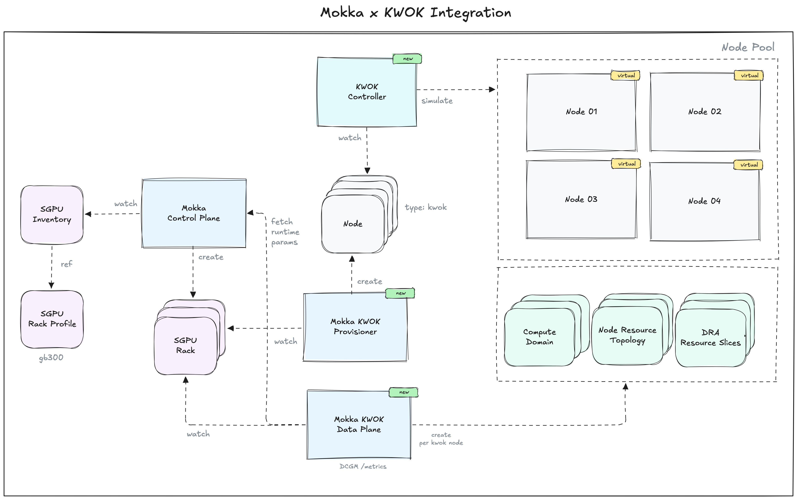
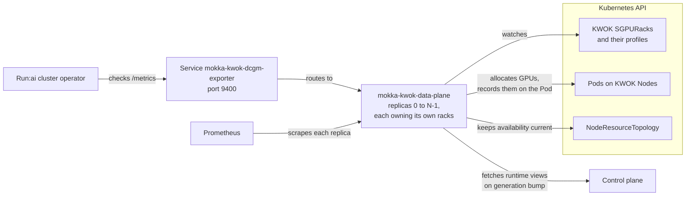
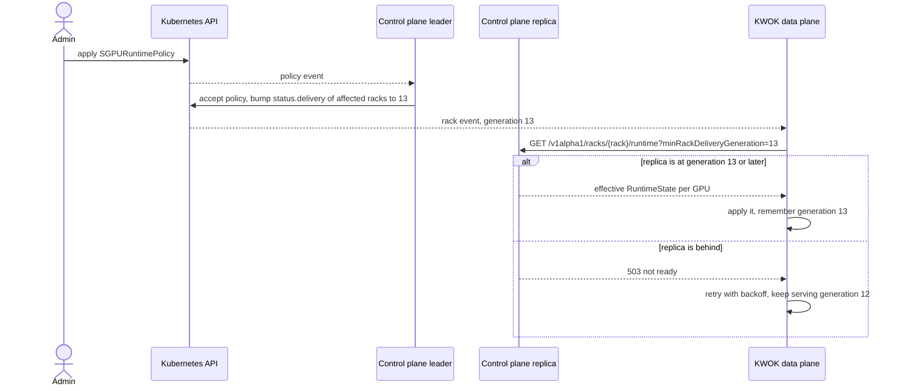

# MEP-0008: KWOK Integration

Author: [Roman Hlushko](https://github.com/roma-glushko)

<!-- toc -->
- [Summary](#summary)
- [Motivation](#motivation)
  - [Background](#background)
    - [Fake Backend](#fake-backend)
    - [KWOK](#kwok)
    - [Run:ai x Mokka Integration (Mock Backend)](#runai-x-mokka-integration-mock-backend)
    - [NVIDIA Ecosystem Integrations](#nvidia-ecosystem-integrations)
  - [Goals](#goals)
  - [Non-Goals](#non-goals)
- [Proposal](#proposal)
  - [User Stories](#user-stories)
  - [Notes/Constraints/Caveats (Optional)](#notesconstraintscaveats-optional)
  - [Risks and Mitigations](#risks-and-mitigations)
- [Design Details](#design-details)
  - [KWOK Integration](#kwok-integration)
    - [KWOK Components](#kwok-components)
    - [KWOK Provisioner](#kwok-provisioner)
    - [KWOK Data Plane](#kwok-data-plane)
    - [Separating CPU and KWOK Racks](#separating-cpu-and-kwok-racks)
    - [GPU Footprint in KWOK Virtual Nodes](#gpu-footprint-in-kwok-virtual-nodes)
    - [KWOK Installation](#kwok-installation)
    - [KAI Use Cases](#kai-use-cases)
- [Drawbacks](#drawbacks)
- [Alternatives](#alternatives)
<!-- /toc -->

## Summary

The proposal explores how to incorporate the relevant portion of
[Run:ai Fake GPU Operator (FGO)](https://github.com/run-ai/fake-gpu-operator) functionality directly into Mokka.
This MEP covers KWOK support; [MEP0009](../0009-workload-aware-dynamic-metrics/README.md) and [MEP0010](../0010-numa-aware-scheduling/README.md) cover the other parts.

## Motivation

The integration will enable Mokka to:
- consolidate the Mokka and Run:ai teams' efforts in one project, saving time and effort on FGO maintenance.
- replace FGO in Run:ai and KAI Scheduler CI/CD pipelines.
- extend Mokka's functionality with optional KWOK (no kubelet, virtual nodes) support for cheap, massive load testing where access to `nvidia-smi` and other on-host tools and libraries isn't needed.

### Background

[Fake GPU Operator (FGO)](https://github.com/run-ai/fake-gpu-operator) is a Kubernetes operator for testing Run:ai's GPU scheduling capabilities
without wasting real, expensive GPUs on that activity.

FGO supports two backends:

- `fake` - the primary FGO mode. It uses custom, fake instances of `nvidia-smi`, the device driver, the DRA plugin, etc. to simulate the presence of GPUs on the node.
- `mock` - the prior integration with Mokka during the early days of the Mokka project.

#### Fake Backend

The idea behind the `fake` backend is to fake the NVIDIA GPU infrastructure to propagate simulated GPUs to Kubernetes:

- FGO is deployed to the `gpu-operator` namespace to mimic the presence of the real GPU Operator
- FGO comes with a custom device plugin that propagates the node's GPU capacity
- FGO comes with the `status-exporter` DaemonSet that mimics DCGM metrics
- FGO installs a custom `nvidia-smi` binary that supports a subset of commands and flags of the original `nvidia-smi`.

This gives GPU simulation at the Kubernetes API level.

##### Node Lifecycle


#### KWOK

FGO reaches fleet scale with [KWOK](https://kwok.sigs.k8s.io/) (Kubernetes
WithOut Kubelet), which creates Node objects and drives the lifecycle of the
pods bound to them, with no kubelet and no containers behind either.

KWOK resources are just `Node` resources:

```yaml
apiVersion: v1
kind: Node
metadata:
  name: kwok-node-1
  annotations:
    kwok.x-k8s.io/node: fake
    node.alpha.kubernetes.io/ttl: "0"
  labels:
    fgo-lab/managed: "true"
    kubernetes.io/role: worker
    node.kubernetes.io/instance-type: gpu-node
    run.ai/simulated-gpu-node-pool: g1
    type: kwok # KWOK label
spec:
  taints: 
    - effect: NoSchedule
      key: kwok.x-k8s.io/node # regular pods won't be scheduled on kwok nodes
      value: fake
status:
  allocatable:
    cpu: "32"
    memory: 128Gi
    pods: "110"
  capacity:
    cpu: "32"
    memory: 128Gi
    pods: "110"
  nodeInfo:
    architecture: amd64
    containerRuntimeVersion: fake
    kernelVersion: fake
    kubeProxyVersion: fake
    kubeletVersion: fake
    operatingSystem: linux
    osImage: fake
```

Then, a test workload looks like this:

```yaml
apiVersion: v1
kind: Pod
metadata:
  name: kwok-pod
  namespace: fgo-lab-07
  annotations:
    run.ai/simulated-gpu-utilization: "40"
spec:
  nodeSelector:
    type: kwok
  tolerations:
    - key: kwok.x-k8s.io/node
      operator: Equal
      value: fake
      effect: NoSchedule
  containers:
    - name: main
      image: ubuntu:22.04
      command: ["sleep", "infinity"]
      resources:
        limits:
          nvidia.com/gpu: 2
```

FGO comes with a few KWOK plugins that are deployed as a Deployment per cluster:

| Deployment                                           | On by default                                 | Watches                                                                       | Writes                                                                                                            | Replaces                                              | Lab |
|------------------------------------------------------|-----------------------------------------------|-------------------------------------------------------------------------------|-------------------------------------------------------------------------------------------------------------------|-------------------------------------------------------|-----|
| `kwok-gpu-device-plugin`                             | yes                                           | Nodes' GPU state ConfigMaps (`topology-<node>`), **only when one is created** | Merge-patch of `Node.status` capacity and allocatable: `nvidia.com/gpu` = number of GPUs, plus any `otherDevices` | device-plugin DaemonSet, which reports to the kubelet | 07  |
| `nvidia-dcgm-exporter-kwok` (`status-exporter-kwok`) | yes, whenever `statusExporter.enabled` is set | Nodes' GPU state ConfigMaps: add, update, delete                              | One `:9400` for every KWOK node, `nvidia.com/gpu.*` node labels, and an NRT if enabled                            | per-node exporter DaemonSet                           | 07  |
| `kwok-dra-plugin`                                    | no                                            | Nodes' GPU state ConfigMaps: add, update, delete                              | ResourceSlice `kwok-<node>-gpu`, driver `gpu.nvidia.com`, one device per GPU (UUID, model, memory)                | `dra-plugin-gpu` DaemonSet                            | 08  |
| `kwok-compute-domain-dra-plugin`                     | no                                            | **Nodes**, not ConfigMaps                                                     | ResourceSlice `kwok-<node>-compute-domain-channel` with one device, `channel-0`                                   | compute-domain kubelet plugin                         | 09  |

The node topology `ConfigMaps` of KWOK nodes are no different from those of normal CPU nodes.

The KWOK plugins are nothing but servers that update Kubernetes objects based on FGO's node topology `ConfigMaps`.

FGO doesn't use any experimental KWOK CRDs like `ClusterExec`, `ClusterAttach`, `ClusterLogs`, etc.

#### Run:ai x Mokka Integration (Mock Backend)

FGO creates Mokka's profiles as `ConfigMaps` and uses some information from them in the `fake` backend mode, such as:

- product name
- memory
- GPU count
- driver and CUDA versions

When the node pool is defined to be `mock`, FGO actually deploys a Mokka instance on the nodes it manages:

```yaml
cluster:
  nodePoolLabelKey: run.ai/simulated-gpu-node-pool
  migStrategy: none
  nodePools:
    a100-pool:
      gpu:
        backend: mock
        profile: a100
        overrides:
          device_count: 2
```

On the Mokka end, with [integrations.fakeGpuOperator.enabled](../../../deployments/nvml-mock/helm/nvml-mock/templates/integrations-fgo.yaml),
the Mokka chart publishes one ConfigMap per Mokka GPU profile, such as `gb300`, `h100` or `a100`, in the form FGO expects
(e.g. named `gpu-profile-<profile>`, with the profile under the `profile.yaml` key, in `integrations.fakeGpuOperator.targetNamespace`).
That's the only place Mokka knows about FGO.

#### NVIDIA Ecosystem Integrations

FGO mocks or uses the following NVIDIA components:

- device-plugin
- DRA
- compute domains
- nvidia-smi
- DCGM
- MIG Manager

### Goals

- Propose an actionable plan for FGO incorporation into Mokka.
- Reach the feature parity required to migrate Run:ai and KAI Scheduler off FGO.

### Non-Goals

- Mokka remains a generic project, so functionality specific to Run:ai and KAI won't be included directly.
- MIG support is out of scope for this MEP.
- Fault injection in KWOK mode is out of scope for this MEP.
- Making SSH into a virtual pod (e.g. a pod scheduled to a KWOK virtual node) work is out of scope for this MEP.

## Proposal

Looking through the list of FGO features, there are three that Mokka should support:

- [KWOK Integration](#kwok-integration). Completely new functionality and the biggest piece of work.
- Workload-aware dynamic metrics, proposed in [MEP0009](../0009-workload-aware-dynamic-metrics/README.md).
- NUMA-aware scheduling, proposed in [MEP0010](../0010-numa-aware-scheduling/README.md).

The [NVIDIA component mocks](#nvidia-ecosystem-integrations) should be replaced by
Mokka and the real NVIDIA components on top of it.

### User Stories

1. **A scheduler load test.** A scheduler team adds a KWOK rack group of 1,000 `gb300-nvl72` racks to an inventory. The KWOK provisioner creates 18,000 Nodes with GPU capacity, labels and ResourceSlices, and the team runs its load test on a cluster with a few CPU Nodes and no GPUs.
2. **Run:ai on virtual Nodes.** Run:ai runs on a cluster whose GPU Nodes are all KWOK Nodes. Its cluster operator finds the `mokka-kwok-dcgm-exporter` Service with the metrics it checks, and an `SGPURuntimePolicy` with a `Bursty` pattern moves the GPUs' utilization, as on CPU Nodes.
3. **Two kinds of Node in one inventory.** An inventory has a CPU rack group for tests that run `nvidia-smi` in Pods and a KWOK rack group for scale, both with the same profile. GPUs on both keep stable UUIDs, PCI addresses and NUMA placement, and a test pins a Pod to a virtual Node with `kubernetes.io/hostname: dev-ci-0-0`.

### Notes/Constraints/Caveats (Optional)

<!--
What are the caveats to the proposal?
What are some important details that didn't come across above?
Go in to as much detail as necessary here.
This might be a good place to talk about core concepts and how they relate.
-->

### Risks and Mitigations

- **Large inventories load the API server.** Each KWOK Node adds a Node, a ResourceSlice and an NRT, and each GPU Pod an allocation patch and an NRT update. KWOK mode is off by default, and the KWOK components write only when racks or Pods change. Metrics stay in memory.
- **DaemonSets that tolerate every taint run on KWOK Nodes.** KWOK fakes their Pods, but each such DaemonSet adds a Pod object per KWOK Node. Mokka keeps its node daemon off them with node affinity on `mokka.nvidia.com/provisioner`, and the GPU Operator's operands with `nvidia.com/gpu.deploy.operands=false`. Cluster admins add the same affinity to their own DaemonSets, such as CNI or log agents.
- **DCGM metrics load Prometheus.** The example inventory's 72,000 GPUs serve 216,000 series. The `ServiceMonitor` is optional, and `kwok.dataPlane.enabled: false` leaves metrics out of tests that don't need them.
- **KWOK Nodes drift from real ones.** The data plane stands in for the kubelet's device manager, NFD and dcgm-exporter, so a test can pass on a KWOK Node and fail on a real one. e2e tests compare a KWOK Node's labels, ResourceSlices, NRT and metric labels with those of a CPU Node with the same profile.

## Design Details

### KWOK Integration

Mokka can frame KWOK support as an alternative provisioning path for sGPU nodes, so we will end up having two modes:

- `CPU` (default), the current deployment mode that expects real CPU nodes. The control plane binds racks to existing CPU nodes, and the node daemon simulates the GPUs on them.
- `KWOK`, the new deployment mode based on KWOK virtual nodes. The KWOK provisioner creates a virtual Node for each logical rack Node, the KWOK data plane simulates what runs on it, and the GPUs exist only in the Kubernetes API.

The provisioner is set per rack group in `SGPUInventory`, so one inventory can mix CPU and KWOK rack groups:

```yaml
apiVersion: mokka.nvidia.com/v1alpha1
kind: SGPUInventory
metadata:
  name: dev
spec:
  rackGroups:
    - id: training
      provisioner: CPU # the default
      count: 10
      profileRef:
        name: gb300-nvl72

      placement: # CPU only: the existing Nodes that may host the racks
        nodeSelector:
          matchLabels:
            mokka.nvidia.com/sgpu: training

    - id: ci
      provisioner: KWOK
      count: 1000 # a thousand gb300-nvl72 racks
      profileRef:
        name: gb300-nvl72

      kwok: # KWOK only: settings for the Nodes the KWOK provisioner creates
        kubelet: # the configuration of the kubelet the Nodes simulate
          maxPods: 250
        nodeTemplate:
          labels:
            run.ai/simulated-gpu-node-pool: ci
          taints:
            - key: kwok.x-k8s.io/node # keeps regular pods off the virtual Nodes
              value: fake
              effect: NoSchedule
```

The KWOK group `ci` creates `rackGroup.count` × `profile.nodesPerRack` virtual Nodes (18,000 in this example).

There's no kubelet on a KWOK Node, so the KWOK provisioner reports what one would. `kwok.kubelet` holds the configuration it simulates, starting with `maxPods`, which sets each Node's pod capacity. These settings stay out of the profile because the same profile also backs CPU groups, where the real kubelet decides them.

The CRD validation enforces these rules on a rack group:

- `provisioner` is `CPU` or `KWOK`, defaults to `CPU`, and can't change, so a rack is handled by the same service for its whole life. To change a group's provisioner, replace the group with one under a new `id`.
- `placement` is allowed only on `CPU` groups, and `kwok` only on `KWOK` groups.
- `kwok.nodeTemplate.labels` can't set `mokka.nvidia.com/sgpu-node`, which would make the virtual Nodes eligible for CPU racks, or `mokka.nvidia.com/provisioner`, which Mokka sets itself.
- `kwok.kubelet.maxPods` is at least 1 and defaults to 110, the kubelet's default.

The Mokka Control Plane ([MEP0001](../0001-mokka-control-plane/README.md)) watches `SGPUInventory` and creates `SGPURacks` as usual. It copies `provisioner` and the `kwok` block from the rack group into each rack, and mirrors `provisioner` into a label (see [Separating CPU and KWOK Racks](#separating-cpu-and-kwok-racks)).

For KWOK provisioning, `SGPURack` would look like this:

```yaml
apiVersion: mokka.nvidia.com/v1alpha1
kind: SGPURack
metadata:
  name: dev-ci-0-3f9c2a17b04e
  labels:
    mokka.nvidia.com/inventory: dev
    mokka.nvidia.com/rack-group: ci
    mokka.nvidia.com/rack-index: "0"
    mokka.nvidia.com/provisioner: KWOK # new: mirrors spec.provisioner
  annotations:
    mokka.nvidia.com/inventory-uid: <inventory UID>
  finalizers:
    - mokka.nvidia.com/rack-cleanup
  ownerReferences:
    - apiVersion: mokka.nvidia.com/v1alpha1
      kind: SGPUInventory
      name: dev
      uid: <inventory UID>
      controller: true
      blockOwnerDeletion: false
spec:
  provisioner: KWOK # new: copied from the rack group
  kwok: # new: copied from the rack group
    kubelet:
      maxPods: 250
    nodeTemplate:
      labels:
        run.ai/simulated-gpu-node-pool: ci
      taints:
        - key: kwok.x-k8s.io/node
          value: fake
          effect: NoSchedule
  inventoryRef:
    name: dev
    uid: <inventory UID>
  profileRef:
    name: gb300-nvl72
    uid: <profile UID>
    generation: 1
    revision: <profile revision>
  identity:
    rackGroup: ci
    rackIndex: 0
    fabricUUID: <fabric UUID>
    cliqueID: 0
  nodes:
    - index: 0 # no nodeRef: KWOK racks are never bound to existing Nodes
      gpus:
        - index: 0
          uuid: GPU-<UUID>
          serial: "<serial>"
          minorNumber: 0
          pciAddress: "0008:01:00.0"
          rootComplex: pci0008:00
          numaNode: 0
          hostProcessorIndex: 0
        # GPUs 1-3
    # Nodes 1-17
```

KWOK racks are rendered exactly like CPU racks, so their simulated GPUs keep stable UUIDs, serials, PCI addresses, and NUMA placement.
Because the `kwok` block is in the rack, [the KWOK provisioner](#kwok-provisioner) doesn't need to watch inventories: a change to it re-renders the racks, and the provisioner sees the rack updates.

#### KWOK Components

KWOK mode adds two components, split by whether what they simulate is fixed for a Node's life or changes while the Node runs:



|               | [KWOK provisioner](#kwok-provisioner)                     | [KWOK data plane](#kwok-data-plane)                                                         |
|---------------|-----------------------------------------------------------|---------------------------------------------------------------------------------------------|
| Owns          | what's fixed for a Node's life, derived from its rack     | what changes while the Node runs                                                            |
| Writes        | Nodes (labels, taints, capacity) and their ResourceSlices | GPU allocation on Pods, NodeResourceTopology                                                |
| Serves        | nothing                                                   | DCGM metrics                                                                                |
| Load follows  | rack and profile changes                                  | Pods, scrapes and runtime views                                                             |
| Runs as       | `Deployment` with leader election                         | `StatefulSet` sharded by rack                                                               |
| Stands in for | Node registration                                         | the per-Node agents: the kubelet's device manager, NFD's topology updater and dcgm-exporter |

The split follows load and ownership:

- **Load.** The provisioner's work follows racks and profiles, which change rarely, so one replica under leader election is enough. The data plane's work grows with the test: an allocation and a NodeResourceTopology update for every GPU Pod, and 216,000 metric series for the example inventory's 72,000 GPUs. It scales by sharding racks across replicas.
- **Ownership.** Per-Node state needs one writer per Node, not one for the whole cluster. Sharding gives each Node exactly one owning replica, as a real cluster runs one kubelet and one topology updater per Node, so only cluster-wide work needs a leader.
- **Failures.** A Pod burst or a slow scrape can't stall Node creation, and a provisioner failover doesn't interrupt allocation or metrics.
- **Future surfaces.** GPU health, MIG reconfiguration, ComputeDomain readiness and InfiniBand counters all change while a Node runs, so they'll join the data plane instead of adding components.

#### KWOK Provisioner

We will introduce a new component called the KWOK provisioner as an optional `Deployment` named `mokka-kwok-provisioner`.

The responsibility will be:

- watching `SGPURack` resources that belong to KWOK provisioning
- creating KWOK `Node` resources like:

```yaml
apiVersion: v1
kind: Node
metadata:
  name: dev-ci-0-0 # format: {inventory_name}-{rack_group_id}-{rack_index}-{node_index}
  annotations:
    kwok.x-k8s.io/node: fake # matched by KWOK's default annotation selector
  labels:
    kubernetes.io/hostname: dev-ci-0-0
    kubernetes.io/os: linux
    kubernetes.io/arch: arm64 # from profile node.host.cpu.architecture
    mokka.nvidia.com/provisioner: KWOK
    mokka.nvidia.com/inventory: dev
    mokka.nvidia.com/rack-group: ci
    mokka.nvidia.com/rack-index: "0"
    mokka.nvidia.com/node-index: "0"
    nvidia.com/gpu.clique: <fabric UUID> # the value the control plane distributes
    run.ai/simulated-gpu-node-pool: ci # from spec.kwok.nodeTemplate
    nvidia.com/gpu.deploy.operands: "false" # keeps the GPU Operator from scheduling its DaemonSets on the virtual Node
    # Plus, NFD/GFD labels
    # ...
  ownerReferences:
    - apiVersion: mokka.nvidia.com/v1alpha1
      kind: SGPURack
      name: dev-ci-0-3f9c2a17b04e
      uid: <rack UID>
      controller: true
      blockOwnerDeletion: false
spec:
  taints:
    - key: kwok.x-k8s.io/node
      value: fake
      effect: NoSchedule
status:
  capacity:
    cpu: "144" # from profile node.host.cpu.cores
    memory: 960Gi # from profile node.host.memory.capacity
    pods: "250" # from spec.kwok.kubelet.maxPods
    nvidia.com/gpu: "4" # from profile node.gpus.count
  allocatable:
    cpu: "144"
    memory: 960Gi
    pods: "250"
    nvidia.com/gpu: "4"
  nodeInfo:
    architecture: arm64
    operatingSystem: linux
    kubeletVersion: fake
```

- creating each Node's DRA `ResourceSlice`, owned by the Node, with one device per GPU in the rack
- leaving Node deletion to the Kubernetes garbage collector: each Node is owned by its `SGPURack`, so the Nodes go away with the rack.

Node names are the rack coordinates joined by hyphens, `<inventory>-<rack group>-<rack index>-<node index>`, as in `dev-ci-0-0`:

```
dev-ci-0-0
│   │  │ └─ node index within the rack (0–17 for an 18-Node rack)
│   │  └─── rack index within the group (0–999 in this example)
│   └────── rack group ID
└────────── inventory name
```

Unlike rack names, Node names carry no hash suffix: users see them in `kubectl get nodes` and scheduler logs, and tests can pin a pod with `kubernetes.io/hostname: dev-ci-0-0` without looking anything up. Three rules keep the names valid and unique:

- **Length.** The name is also the `kubernetes.io/hostname` label, which the fractional-GPU `podAffinity` in MEP0009's [Resource Reservation & GPU Fractions](../0009-workload-aware-dynamic-metrics/README.md#resource-reservation--gpu-fractions) uses as its topology key, so it must fit in 63 characters. Rack indexes have at most 5 digits and node indexes at most 4, so the CRD rejects a KWOK group whose inventory name and group ID together exceed 51 characters.
- **Uniqueness.** The control plane rejects a KWOK group whose `<inventory>-<rack group>` matches that of another KWOK group in any inventory, as `dev` with group `ci-x` and `dev-ci` with group `x` would. The last two parts of every name are numbers, so different prefixes always give different names.
- **Replacement.** If a Node with the name already exists and isn't owned by the rack, the KWOK provisioner waits for it to be deleted. That happens when an inventory is recreated under the same name before its old Nodes are gone. The provisioner never takes over a Node it didn't create, such as a real Node with the same name, and emits an Event on the rack instead.

Because inventory names and group IDs can contain hyphens, tools identify a Node by its `mokka.nvidia.com/*` labels or its owner reference rather than by parsing the name.

Capacity comes from SGPURackProfile's `node.host`, so the profile of a KWOK group must define the host CPU cores and memory.
`allocatable` stays at the total as pods come and go: the scheduler subtracts pod requests itself, so lowering it would count them twice.

#### KWOK Data Plane

We will introduce a second component, the KWOK data plane, as an optional `StatefulSet` named `mokka-kwok-data-plane`. It simulates what runs on a KWOK Node for as long as the Node exists: it allocates GPUs to the Pods bound to the Node, keeps the Node's NodeResourceTopology current, and serves DCGM metrics for its GPUs. It takes over FGO's `nvidia-dcgm-exporter-kwok`, which serves these metrics and writes NodeResourceTopology; the `nvidia.com/gpu.*` labels that exporter also writes come from the [KWOK provisioner](#kwok-provisioner). Each replica owns a share of the racks, as [Sharding](#sharding) describes.



##### GPU Allocation

There's no kubelet on a KWOK Node, so the data plane allocates GPUs to the Pods bound to the Nodes of its racks, as the kubelet's device manager would, and records the allocation on the Pod:

```yaml
apiVersion: v1
kind: Pod
metadata:
  name: train-0
  namespace: team-a
  annotations:
    mokka.nvidia.com/gpu-allocation: '{"main":["GPU-<UUID>","GPU-<UUID>"]}' # GPU UUIDs per container
spec:
  nodeName: dev-ci-0-0
```

`NodeResourceTopology` availability and the `pod` labels on DCGM metrics both come from this record. It covers `nvidia.com/gpu` requests and DRA claims alike, as the kubelet's PodResources API does: for a DRA claim, the data plane copies the devices the scheduler allocated. The record lives on the Pod rather than in memory, so a replica that restarts or takes over a rack reads the allocations back instead of recomputing them, which could move a running Pod to another GPU once earlier Pods are gone.

##### NodeResourceTopology

The data plane creates a `NodeResourceTopology` for each Node of its racks and keeps each zone's available GPUs current from the allocations, as NFD's topology updater does on a real Node. Zones and their capacity come from the rack's NUMA placement and the profile, so they match what NFD reports for a CPU Node with the same profile ([MEP0010](../0010-numa-aware-scheduling/README.md#numa-setup)).

##### Runtime State

The data plane applies the effective runtime view, as the node daemon does on CPU racks, but it doesn't compute it. The effective runtime view is a GPU's profile defaults with the accepted `SGPURuntimePolicy` overrides applied. [MEP0001](../0001-mokka-control-plane/README.md#runtime-view-computation-and-delivery) gives policy acceptance and this computation to the control plane, which computes the view on request and never stores it. The data plane reads the view for telemetry settings now, and for GPU health once fault injection is in scope. The provisioner never needs it: nothing it writes depends on runtime state.

The data plane takes each input from where it's published:

- **Stored state comes from Kubernetes.** Racks, including their delivery status, and the profiles they use arrive through the watches listed in [Separating CPU and KWOK Racks](#separating-cpu-and-kwok-racks). Profiles contribute static facts such as GPU model and memory, never `defaults.runtime`.
- **The effective runtime view comes from the control plane API**, one rack at a time.
- **Policy objects aren't watched.** No KWOK component watches `SGPUInventory` or `SGPURuntimePolicy`. The data plane could compile policies with `internal/sgpu/policy`, which makes no API calls, but it would then be a second component deciding which policies apply. While the two caches disagree, it could apply a policy the control plane reports as rejected, or one already deleted.

The control plane API serves the view per rack:

```http
GET /v1alpha1/racks/{rackName}/runtime?rackUID=<rack UID>&minRackDeliveryGeneration=13
```

```json
{
  "apiVersion": "v1alpha1",
  "rack": {"name": "dev-ci-0-3f9c2a17b04e", "uid": "<rack UID>"},
  "rackDeliveryGeneration": 13,
  "nodes": [
    {
      "index": 0,
      "gpus": [
        {
          "index": 0,
          "runtime": {
            "deviceState": "Healthy",
            "telemetry": {
              "utilization": {
                "mode": "Pattern",
                "pattern": {"type": "Bursty", "gpuPercent": {"minimum": 20, "maximum": 90}}
              }
            }
          }
        }
      ]
    }
  ]
}
```

The response holds the effective `RuntimeState` of every GPU in the rack, grouped by logical Node (one of each is shown), and the delivery generation it was computed from. The data plane passes the generation it last saw on the rack as the minimum. A replica whose cache is behind returns not-ready (`503`), and the data plane retries with backoff while it keeps the values it applied last. This is MEP0001's publication-floor check, applied per rack. KWOK racks are never bound to a Node, so the request carries no assignment revision. For the same reason, the per-Node endpoint the node daemon polls doesn't fit: it serves Nodes the control plane has assigned, and a KWOK Node never has an assignment.

The rack tells the data plane when to fetch. The control plane leader bumps a rack's delivery generation whenever anything feeding its effective view changes: a policy that selects the rack is added, edited or deleted, the set of accepted policies changes, or the profile's runtime defaults change. For each rack UID, the data plane keeps the generation it last applied and fetches the rack whenever the generation in Kubernetes is ahead. The check compares two numbers, so a missed watch event only delays a fetch, and after a restart a replica fetches each of its racks once. A rack recreated under the same name has a new UID and starts a new generation sequence, so it counts as a new rack.



Values that change on their own never trigger a fetch. The view carries settings, such as a `Bursty` utilization pattern and its range, and [DCGM Metrics](#dcgm-metrics) describes how the data plane turns them into values.

This puts two requirements on the control plane:

- **Delivery status covers KWOK racks.** The control plane drops KWOK groups before allocation, but it still maintains `status.delivery` on their racks. Without the generation bump, the data plane has no trigger and would have to poll.
- **A per-rack endpoint** next to the per-Node one. Both serve views from the same computation.

Policy-driven telemetry depends on that endpoint. Node creation, labels, ResourceSlices, GPU allocation and NodeResourceTopology need no runtime state and don't wait for it.

##### DCGM Metrics

The data plane serves DCGM metrics for the GPUs of its racks through a `Service` named `mokka-kwok-dcgm-exporter` on port `9400`. The Service keeps a DCGM exporter's name because consumers look for one, as the [Run:ai cluster operator](#kai-use-cases) does. The metrics are the three fields that check needs:

| Metric                 | Value                                                                   |
|------------------------|-------------------------------------------------------------------------|
| `DCGM_FI_DEV_GPU_UTIL` | GPU utilization in percent, generated from the GPU's telemetry settings |
| `DCGM_FI_DEV_FB_USED`  | Frame buffer memory in use, in MiB                                      |
| `DCGM_FI_DEV_FB_FREE`  | Frame buffer memory free, in MiB                                        |

Each series carries the labels dcgm-exporter uses. `gpu`, `UUID`, `device`, `pci_bus_id` and `modelName` come from the rack and its profile, `Hostname` from the KWOK Node, and `namespace`, `pod` and `container` from the [GPU allocation](#gpu-allocation) while a Pod holds the GPU:

```prometheus
DCGM_FI_DEV_GPU_UTIL{gpu="0",UUID="GPU-<UUID>",device="nvidia0",pci_bus_id="00000008:01:00.0",modelName="NVIDIA GB300 NVL",Hostname="dev-ci-0-0",namespace="team-a",pod="train-0",container="main"} 87
```

`Hostname` is the GPU's KWOK Node name. On a GPU Node, all series from one dcgm-exporter instance share a `Hostname`, because the instance serves only that Node. The data plane serves many Nodes, so it keeps one value per Node by using the Node name. The chart's optional `ServiceMonitor` also sets `instance` from `Hostname`, which gives each KWOK Node its own `instance`, as with per-Node exporters.

`DCGM_FI_DEV_GPU_UTIL` follows the GPU's telemetry settings from the [runtime view](#runtime-state). The settings say how the value moves, such as a `Bursty` pattern between 20 and 90 percent, and the data plane's metrics generator turns them into values, as the NVML engine does on CPU Nodes. Both use one generator package, so a policy produces the same series on both kinds of Node. Today the generator is internal to `pkg/gpu/mocknvml/engine`, which uses cgo, and it implements `steady`, `idle`, `busy` and `burst` rather than the `Steady`, `Bursty` and `Wave` patterns the CRD defines. Moving it into its own package, with the CRD's patterns, is part of this work.

TODO: Is the current way we simulate dynamic metrics flexible/extensible enough to build upon it?

`DCGM_FI_DEV_FB_USED` and `DCGM_FI_DEV_FB_FREE` split the GPU memory in the profile and stay constant, as on CPU Nodes, where the NVML engine reports the profile's memory figures unchanged. The data plane generates values for every GPU, with or without a Pod, as the NVML engine does. [MEP0009](../0009-workload-aware-dynamic-metrics/README.md) covers values that follow the Pod.

The data plane computes values when it's scraped, at most once per 10-second step, configurable in the Helm chart, much as `dcgm-exporter` serves its last 30-second sample to every scrape. A replica keeps each series' labels and the frame-buffer lines rendered, since those change only when a Pod's allocation or workload telemetry does. The first scrape in a step computes `DCGM_FI_DEV_GPU_UTIL` for the replica's GPUs, compresses the response once and caches it for the rest of the step, and nothing runs while nobody scrapes. Compressing the text is the main cost: about 6 MB per replica with eight replicas, or 50 MB for one replica serving all 72,000 GPUs, so large inventories need more replicas.

**Open question: one DCGM exporter Service.** The Run:ai cluster operator expects exactly one DCGM exporter Service. An inventory that mixes CPU and KWOK racks has two: the GPU Operator's for CPU Nodes and this one.

##### Sharding

Each rack has exactly one owning replica, so the data plane needs no leader election even though it writes. Each replica works out its own share of racks, as kube-state-metrics does for its automated sharding:

- A replica takes its ordinal from its Pod name and the replica count from its `StatefulSet`'s `spec.replicas`, which it watches, so `kubectl scale` reshards without a restart.
- For each rack, a replica computes `hash(rack UID, ordinal)` for every ordinal and owns the rack if its own ordinal scores highest. Adding a replica moves only the racks the new one wins, about 1/N of them, where `hash mod N` would move most, and each moved rack costs a runtime fetch.
- It drops other replicas' racks, Pods and claims in its list-watch, before they reach its cache, and fetches runtime views only for its own racks.
- `podManagementPolicy: Parallel` starts all replicas together.

The rack is the shard unit because it's also the unit of the runtime fetch and the delivery generation, so everything about a rack stays in one replica. With eight replicas, each owns 2,250 Nodes and 9,000 GPUs of the example inventory and serves 27,000 series.

The scheme accepts three limits:

- **Overlap while scaling.** Replicas see a new count at slightly different moments, so a few racks are briefly owned twice or not at all. Two owners could both allocate GPUs to a new Pod, so the data plane writes an allocation only if the Pod has none, with the Pod's `resourceVersion` as a precondition: the first write wins. `NodeResourceTopology` is recomputed from the allocations, so it converges.
- **Gaps on restart.** While a replica restarts, new Pods on its racks wait for an allocation, their NodeResourceTopology goes stale, and their GPUs have no metrics, as on a real Node whose kubelet, topology updater or dcgm-exporter restarts.
- **No empty replicas.** A replica without racks serves no DCGM series, and a Run:ai check that reaches it through the `Service` fails. The chart defaults to one replica, and the count should stay well below the number of racks.

#### Separating CPU and KWOK Racks

Each service lists and watches only the objects it needs, and the API server applies the selectors, so little else reaches the service's cache. The KWOK data plane's Pod watch is the exception: a field selector matches one Node name, not a set. The control plane's filters exist today; those of the KWOK components are new:

| Service          | Resource                                       | Server-side selector                  | Result                                                    |
|------------------|------------------------------------------------|---------------------------------------|-----------------------------------------------------------|
| Control plane    | `SGPUInventory`, `SGPURackProfile`, `SGPURack` | none                                  | creates and retires every rack                            |
| Control plane    | `Node`                                         | `mokka.nvidia.com/sgpu-node=true`     | never receives KWOK Nodes, which never carry the label    |
| KWOK provisioner | `SGPURack`                                     | `mokka.nvidia.com/provisioner=KWOK`   | never receives CPU racks                                  |
| KWOK provisioner | `Node`                                         | `mokka.nvidia.com/provisioner=KWOK`   | receives only the Nodes it created                        |
| KWOK provisioner | `SGPURackProfile`                              | none                                  | a handful of small objects                                |
| KWOK data plane  | `SGPURack`                                     | `mokka.nvidia.com/provisioner=KWOK`   | keeps the racks it owns                                   |
| KWOK data plane  | `SGPURackProfile`                              | none                                  | a handful of small objects                                |
| KWOK data plane  | `Pod`                                          | `spec.nodeName!=`                     | receives every bound Pod, keeps those on its racks' Nodes |
| KWOK data plane  | `ResourceClaim`                                | none                                  | keeps the claims allocated on its racks' Nodes            |
| KWOK data plane  | `StatefulSet`                                  | `metadata.name=mokka-kwok-data-plane` | reads its own replica count                               |

- **The label mirrors the spec.** `spec.provisioner` is the source of truth. The control plane copies it to the `mokka.nvidia.com/provisioner` label on every rack and restores the label if someone edits it. The KWOK provisioner skips a rack whose spec says otherwise and ignores racks that leave its watch, since only the garbage collector deletes Nodes.
- **Each object has one writer.** The control plane writes `SGPURack`, including its status. The KWOK provisioner writes the Nodes and ResourceSlices it creates. The KWOK data plane writes the GPU allocation on Pods and the NodeResourceTopology of the Nodes in its racks.
- **KWOK groups skip placement.** A group without `placement` matches every eligible Node, so the control plane drops KWOK groups before allocation, Node event routing, and usage reporting. They still count towards capacity and the rack group limit.
- **The node daemon stays off KWOK Nodes.** Its DaemonSet tolerates every taint, so the chart adds the node affinity `mokka.nvidia.com/provisioner NotIn [KWOK]`, which unlabeled CPU nodes still match.

A CRD field selector on `spec.provisioner` (`selectableFields`) would make the label unnecessary, but field selectors on custom resources are on by default only from Kubernetes 1.31, while the Mokka CRDs support 1.28. Once Mokka's minimum reaches 1.32, where the feature is GA, the label can go.

#### GPU Footprint in KWOK Virtual Nodes

KWOK nodes are completely virtual entities. In most cases, the real NVIDIA components can't run on them or interact with them.
Still, we would like to simulate a few surfaces based on `SGPURackProfile` information to make them look like real GPU nodes from the outside:

- Add NFD/GFD labels e.g. `nvidia.com/gpu.*`, `nvidia.com/mig.strategy`, `feature.node.kubernetes.io/pci-10de.present`
- DRA ResourceSlices
- NodeResourceTopology resources for NUMA-aware workload placement
- DCGM metrics

The KWOK provisioner creates the labels and ResourceSlices with each Node, since they're fixed for its life. The [KWOK data plane](#kwok-data-plane) creates the NodeResourceTopology resources and serves the DCGM metrics, since both change while the Node runs.

We should put generation of CRs under feature gates,
so cluster admins don't need to install all CRDs just to try out KWOK integration.

#### KWOK Installation

The KWOK functionality in Mokka should be disabled by default.
The Mokka Helm chart will get a new flag, `kwok.enabled`, that decides whether to deploy the KWOK provisioner and the [KWOK data plane](#kwok-data-plane). `kwok.dataPlane.enabled: false` leaves the data plane out, so KWOK Nodes carry only their fixed footprint. `kwok.dataPlane.replicas` sets its number of [shards](#sharding), and `kwok.dataPlane.serviceMonitor.enabled` adds a Prometheus Operator `ServiceMonitor` for its DCGM metrics.

Cluster admins are expected to install KWOK before enabling Mokka's KWOK functionality, and the docs will say so.
The KWOK chart won't be included in the Mokka Helm chart.

#### KAI Use Cases

| Consumer                | Required resources or behavior                                                                                                                                                                                                                       | How Mokka Can Help?                                                                                                                                                    |
|-------------------------|------------------------------------------------------------------------------------------------------------------------------------------------------------------------------------------------------------------------------------------------------|------------------------------------------------------------------------------------------------------------------------------------------------------------------------|
| Run:ai installer        | The `clusterpolicies.nvidia.com` CRD and a `gpu.*operator` Deployment in `gpu-operator`. No `ClusterPolicy` instance is necessary.                                                                                                                   | ✅KAI Test Setup should install GPU Operator CRD                                                                                                                        |
| Run:ai cluster operator | Exactly one DCGM exporter Service. Its `/metrics` must contain `DCGM_FI_DEV_GPU_UTIL`, `DCGM_FI_DEV_FB_USED`, and `DCGM_FI_DEV_FB_FREE`. A failed check sets `DependenciesFulfilled=False`. This does not apply when dependency checks are disabled. | In KWOK mode, the [KWOK data plane](#kwok-data-plane)'s DCGM exporter Service. A mixed CPU and KWOK inventory has two (open question)                                  |
| KAI whole-GPU           | `nvidia.com/gpu` and the node labels `nvidia.com/gpu.count` and `nvidia.com/gpu.memory`                                                                                                                                                              | Mokka + real device plugin and GFD. In KWOK mode, the KWOK provisioner sets the `nvidia.com/gpu` capacity and the labels from the profile                              |
| KAI fractions           | A GPU UUID in `run.ai/reserve_for_gpu_index` on each reservation pod. `NvFractions` mode also requires a ready `GpuFractioningConfig` named `default` (fractional GPU documentation).                                                                | ✅Should work with Mokka out of the box                                                                                                                                 |
| KAI NUMA                | A current `NodeResourceTopology` for each node. It contains policy, scope, zones, and per-zone availability. Availability changes with allocation and release.                                                                                       | Mokka node daemon does [NUMA setup](../0010-numa-aware-scheduling/README.md#numa-setup) + real NFD deployment. In KWOK mode, the KWOK data plane creates NRT resources |
| DRA                     | Claims with the same behavior on KWOK nodes and nodes that use the GPU Operator's DRA driver.                                                                                                                                                        | Mokka + real DRA deployment. In KWOK mode, the KWOK provisioner creates `ResourceSlice` resources                                                                      |

## Drawbacks

- **Components need wider permissions.** The [data plane](#kwok-data-plane) needs permission to patch any Pod to record its GPU allocation, and the [provisioner](#kwok-provisioner) to create Nodes.

## Alternatives

<!--
What other approaches did you consider, and why did you rule them out? These do
not need to be as detailed as the proposal, but should include enough
information to express the idea and why it was not acceptable.
-->
