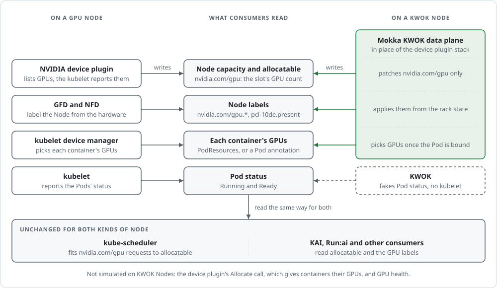
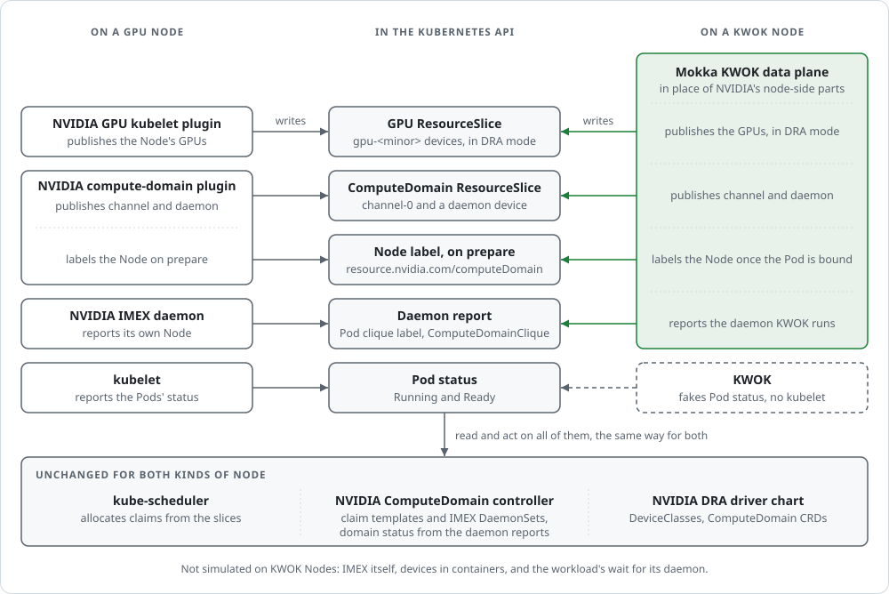
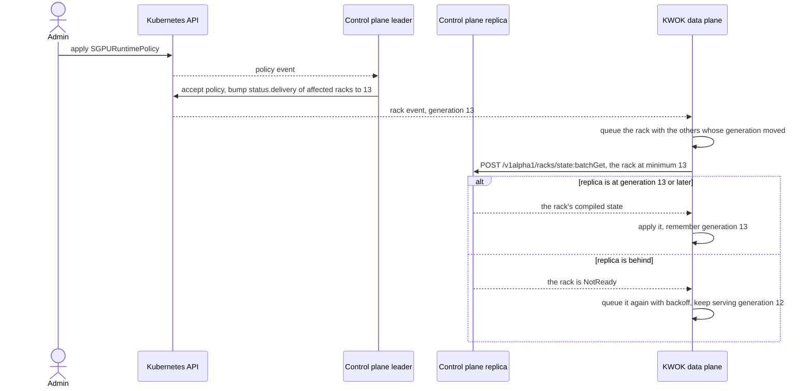

# MEP-0008: KWOK Integration

Author: [Roman Hlushko](https://github.com/roma-glushko)

<!-- toc -->
- [Summary](#summary)
- [Motivation](#motivation)
  - [Background](#background)
    - [Fake Backend](#fake-backend)
    - [KWOK](#kwok)
    - [ResourceSlices and ComputeDomains](#resourceslices-and-computedomains)
    - [Run:ai x Mokka Integration (Mock Backend)](#runai-x-mokka-integration-mock-backend)
    - [NVIDIA Ecosystem Integrations](#nvidia-ecosystem-integrations)
  - [Goals](#goals)
  - [Non-Goals](#non-goals)
- [Proposal](#proposal)
  - [User Stories](#user-stories)
  - [Risks and Mitigations](#risks-and-mitigations)
- [Design Details](#design-details)
  - [KWOK Integration](#kwok-integration)
    - [KWOK Components](#kwok-components)
    - [KWOK Nodes](#kwok-nodes)
    - [KWOK Provisioner](#kwok-provisioner)
    - [KWOK Data Plane](#kwok-data-plane)
    - [Sharding](#sharding)
    - [Separating CPU and KWOK Racks](#separating-cpu-and-kwok-racks)
    - [GPU Footprint in KWOK Virtual Nodes](#gpu-footprint-in-kwok-virtual-nodes)
    - [KWOK Installation](#kwok-installation)
    - [KAI Use Cases](#kai-use-cases)
  - [Milestones](#milestones)
- [Drawbacks](#drawbacks)
- [Alternatives](#alternatives)
- [Decisions](#decisions)
- [Open Questions](#open-questions)
<!-- /toc -->

## Summary

The proposal explores how to incorporate the relevant portion of
[Run:ai Fake GPU Operator (FGO)](https://github.com/run-ai/fake-gpu-operator) functionality directly into Mokka.
This MEP covers [KWOK support](#kwok-integration); [MEP0009](../0009-workload-aware-dynamic-metrics/README.md) and [MEP0010](../0010-numa-aware-scheduling/README.md) cover the other parts.

## Motivation

The integration will enable Mokka to:
- consolidate the Mokka and Run:ai teams' efforts in one project, saving time and effort on FGO maintenance.
- replace FGO in Run:ai and KAI Scheduler CI/CD pipelines.
- extend Mokka's functionality with optional KWOK (no kubelet, virtual nodes) support for cheap, massive load testing where access to `nvidia-smi` and other on-host tools and libraries aren't needed.

### Background

[Fake GPU Operator (FGO)](https://github.com/run-ai/fake-gpu-operator) is a Kubernetes operator for testing Run:ai's GPU scheduling capabilities
without wasting real, expensive GPUs on that activity.

FGO supports two backends:

- `fake` - the primary FGO mode. It uses custom, fake instances of `nvidia-smi`, the device driver, the DRA plugin, etc. to simulate the presence of GPUs on the node.
- `mock` - the prior integration with Mokka during the early days of the Mokka project.

#### Fake Backend

The idea behind the `fake` backend is to fake the NVIDIA GPU infrastructure to propagate simulated GPUs to Kubernetes:

- FGO is deployed to the `gpu-operator` namespace to mimic the presence of the real GPU Operator
- FGO comes with a custom device plugin that propagates the node's GPU capacity
- FGO comes with the `status-exporter` DaemonSet that mimics DCGM metrics
- FGO installs a custom `nvidia-smi` binary that supports a subset of commands and flags of the original `nvidia-smi`.

This gives GPU simulation at the Kubernetes API level.

##### Node Lifecycle


#### KWOK

FGO reaches fleet scale with [KWOK](https://kwok.sigs.k8s.io/) (Kubernetes
WithOut Kubelet), which creates Node objects and drives the lifecycle of the
pods bound to them, with no kubelet and no containers behind either.

KWOK resources are just `Node` resources:

```yaml
apiVersion: v1
kind: Node
metadata:
  name: kwok-node-1
  annotations:
    kwok.x-k8s.io/node: fake
    node.alpha.kubernetes.io/ttl: "0"
  labels:
    fgo-lab/managed: "true"
    kubernetes.io/role: worker
    node.kubernetes.io/instance-type: gpu-node
    run.ai/simulated-gpu-node-pool: g1
    type: kwok # KWOK label
spec:
  taints: 
    - effect: NoSchedule
      key: kwok.x-k8s.io/node # regular pods won't be scheduled on kwok nodes
      value: fake
status:
  allocatable:
    cpu: "32"
    memory: 128Gi
    pods: "110"
  capacity:
    cpu: "32"
    memory: 128Gi
    pods: "110"
  nodeInfo:
    architecture: amd64
    containerRuntimeVersion: fake
    kernelVersion: fake
    kubeProxyVersion: fake
    kubeletVersion: fake
    operatingSystem: linux
    osImage: fake
```

Then, a test workload looks like this:

```yaml
apiVersion: v1
kind: Pod
metadata:
  name: kwok-pod
  namespace: fgo-lab-07
  annotations:
    run.ai/simulated-gpu-utilization: "40"
spec:
  nodeSelector:
    type: kwok
  tolerations:
    - key: kwok.x-k8s.io/node
      operator: Equal
      value: fake
      effect: NoSchedule
  containers:
    - name: main
      image: ubuntu:22.04
      command: ["sleep", "infinity"]
      resources:
        limits:
          nvidia.com/gpu: 2
```

FGO comes with a few KWOK plugins that are deployed as a Deployment per cluster:

| Deployment                                           | On by default                                 | Watches                                                                       | Writes                                                                                                            | Replaces                                              |
|------------------------------------------------------|-----------------------------------------------|-------------------------------------------------------------------------------|-------------------------------------------------------------------------------------------------------------------|-------------------------------------------------------|
| `kwok-gpu-device-plugin`                             | yes                                           | Nodes' GPU state ConfigMaps (`topology-<node>`), **only when one is created** | Merge-patch of `Node.status` capacity and allocatable: `nvidia.com/gpu` = number of GPUs, plus any `otherDevices` (see [Non-Goals](#non-goals)) | device-plugin DaemonSet, which reports to the kubelet |
| `nvidia-dcgm-exporter-kwok` (`status-exporter-kwok`) | yes, whenever `statusExporter.enabled` is set | Nodes' GPU state ConfigMaps: add, update, delete                              | One `:9400` for every KWOK node, `nvidia.com/gpu.*` node labels, and an NRT if enabled                            | per-node exporter DaemonSet                           |
| `kwok-dra-plugin`                                    | no                                            | Nodes' GPU state ConfigMaps: add, update, delete                              | ResourceSlice `kwok-<node>-gpu`, driver `gpu.nvidia.com`, one device per GPU (UUID, model, memory)                | `dra-plugin-gpu` DaemonSet                            |
| `kwok-compute-domain-dra-plugin`                     | no                                            | **Nodes**, not ConfigMaps                                                     | ResourceSlice `kwok-<node>-compute-domain-channel` with one device, `channel-0`                                   | compute-domain kubelet plugin                         |

The node topology `ConfigMaps` of KWOK nodes are no different from those of normal CPU nodes.

The KWOK plugins are nothing but servers that update Kubernetes objects based on FGO's node topology `ConfigMaps`. In Mokka, the [KWOK data plane](#kwok-data-plane) takes their place.

FGO doesn't use any experimental KWOK CRDs like `ClusterExec`, `ClusterAttach`, `ClusterLogs`, etc.

#### ResourceSlices and ComputeDomains

FGO can also publish its simulated GPUs through [Dynamic Resource Allocation (DRA)](https://kubernetes.io/docs/concepts/resource-management/dynamic-resource-allocation/), the `resource.k8s.io` API in which a driver lists each Node's devices in `ResourceSlice` objects and the scheduler allocates them to the `ResourceClaim`s of Pods. FGO uses the driver names of NVIDIA's DRA driver, `gpu.nvidia.com` for GPUs and `compute-domain.nvidia.com` for ComputeDomain channels, so a claim for NVIDIA's `gpu.nvidia.com` DeviceClass gets a simulated GPU. All of FGO's DRA components are off by default.

##### GPU ResourceSlices

A Node's GPU ResourceSlice comes from its topology ConfigMap, `topology-<node>`, which the status-updater creates when a Node with the node pool label appears and deletes with the Node:

- The GPU model, memory and count come from the pool's profile, with its overrides.
- Each GPU's UUID is derived from the Node's name and the GPU's index, so a Node re-created under the same name gets the same UUIDs.
- The ConfigMap is written once per Node, so a change to the pool's profile reaches only Nodes that appear after it.

A plugin for each kind of Node publishes the ConfigMap's GPUs:

|                   | Nodes with a kubelet                                                               | KWOK Nodes                                                                   |
|-------------------|------------------------------------------------------------------------------------|------------------------------------------------------------------------------|
| Plugin            | `dra-plugin-gpu`, a kubelet DRA plugin DaemonSet (`draPlugin.enabled`)             | `kwok-dra-plugin` Deployment (`kwokDraPlugin.enabled`)                       |
| Reads the GPUs    | Once, at startup, from FGO's topology server, which serves the ConfigMap           | From the ConfigMap, on every change                                          |
| Slice owner       | The Node, set by the kubelet plugin library                                        | None: the plugin deletes the slice when it sees the ConfigMap deleted        |
| Preparing a claim | Adds `GPU_DEVICE_*` environment variables and FGO's `nvidia-smi` to the container | Nothing prepares it: there's no kubelet, and KWOK marks the Pod running anyway |

Both publish the same pool and devices: one pool per Node, named after it, with one device per GPU, named by its UUID. For `kwok-node-1` above, with two A100 GPUs in its pool, the KWOK plugin writes:

```yaml
apiVersion: resource.k8s.io/v1
kind: ResourceSlice
metadata:
  name: kwok-kwok-node-1-gpu
spec:
  driver: gpu.nvidia.com
  nodeName: kwok-node-1
  pool:
    name: kwok-node-1
    generation: 0
    resourceSliceCount: 1
  devices:
    - name: gpu-c0d51a86-cacb-55e1-adce-b022f48aaaae # the UUID in lowercase
      attributes:
        uuid: {string: GPU-c0d51a86-cacb-55e1-adce-b022f48aaaae}
        model: {string: "NVIDIA A100-SXM4-40GB"}
        gpu.nvidia.com/type: {string: gpu}
        gpu.nvidia.com/uuid: {string: GPU-c0d51a86-cacb-55e1-adce-b022f48aaaae}
        gpu.nvidia.com/productName: {string: "NVIDIA A100-SXM4-40GB"}
      capacity:
        memory: {value: 40Gi}
    - name: gpu-6f2d2583-ee96-58a3-87f1-c45b296668bb
      # ... the same attributes for the second GPU
```

FGO keeps the unqualified (e.g. have no domain prefix like `gpu.nvidia.com/*`) `uuid` and `model` for compatibility. DRA puts unqualified names in the driver's domain, so `uuid` is the same attribute as `gpu.nvidia.com/uuid`. NVIDIA's driver names its devices `gpu-<minor>`, has no `model`, and adds the brand, architecture, CUDA compute capability, driver and CUDA driver versions, and PCI bus ID.

The chart also creates the `gpu.nvidia.com` DeviceClass, which selects devices of type `gpu`, unless `nvidiaDraDriver.enabled` installs NVIDIA's DRA driver chart, which brings its own. On a cluster that serves `resource.k8s.io/v1`, FGO's class is:

```yaml
apiVersion: resource.k8s.io/v1
kind: DeviceClass
metadata:
  name: gpu.nvidia.com
spec:
  selectors:
    - cel:
        expression: "device.driver == 'gpu.nvidia.com' && device.attributes['gpu.nvidia.com'].type == 'gpu'"
  extendedResourceName: nvidia.com/gpu
```

With the `DRAExtendedResource` Kubernetes feature gate, `extendedResourceName` lets the scheduler serve a Pod's `nvidia.com/gpu` request from this class's devices, but only on a Node whose allocatable has no `nvidia.com/gpu`. `kwok-gpu-device-plugin`, on by default, gives KWOK Nodes that resource, so `nvidia.com/gpu` requests on them still use the Node's capacity rather than the slice. In Mokka's `DRA` mode, KWOK Nodes have no `nvidia.com/gpu`, so these requests use the slice ([Publishing the GPUs](#publishing-the-gpus)).

The status-updater follows DRA Pods as it does Pods that request `nvidia.com/gpu`: it reads the devices allocated to a Pod's claims and records the Pod on the GPUs with those UUIDs in the topology ConfigMap, so their simulated metrics follow the Pod. Mokka's data plane keeps that record on the Pod instead ([GPU Allocation](#gpu-allocation)).

##### ComputeDomains

A ComputeDomain is the NVIDIA DRA driver's object for multi-node NVLink workloads, whose Pods on several Nodes share GPU memory through one IMEX (Internode Memory Exchange) domain. A workload doesn't claim a domain directly. The domain's controller creates a ResourceClaimTemplate, and each Pod that uses the template gets a claim for a channel, a `compute-domain.nvidia.com` device on the Pod's Node:

```yaml
apiVersion: resource.nvidia.com/v1beta1
kind: ComputeDomain
metadata:
  name: training
  namespace: fgo-lab-07
spec:
  numNodes: 2
  channel:
    resourceClaimTemplate:
      name: training-channel # created by the controller
```

To join the domain, the KWOK Pod above would add:

```yaml
spec:
  containers:
    - name: main
      resources:
        claims:
          - name: channel
  resourceClaims:
    - name: channel
      resourceClaimTemplateName: training-channel
```

NVIDIA's controller also runs an IMEX daemon on each Node the workload's Pods land on, and when `numNodes` is set, it reports the domain Ready once that many daemons are ready. 

FGO ships NVIDIA's ComputeDomain CRD and replaces the rest:

- **Controller.** `compute-domain-controller` creates the template. Its claims ask for one device of the `compute-domain-default-channel.nvidia.com` DeviceClass and pass the domain's UID to the driver as opaque config. There are no IMEX daemons, so the controller builds the status from claims instead: it lists each Node where a claim of the domain is allocated as Ready, and marks the domain Ready once `numNodes` Nodes are listed, or right away when `numNodes` is 0.
- **Channels.** `kwok-compute-domain-dra-plugin` publishes a channel for every KWOK Node, and the `compute-domain-dra-plugin` kubelet plugin for Nodes with a kubelet. Like NVIDIA's plugin, each publishes a single channel per Node, `channel-0`, so only one Pod on a Node can hold a channel claim at a time. On a Node with a kubelet, preparing a claim gives the container a channel device backed by `/dev/null`.
- **Chart values.** `computeDomainDraPlugin.enabled` deploys the controller, the channel DeviceClass and the kubelet plugin, so KWOK Nodes need it as well as `kwokComputeDomainDraPlugin.enabled`.

A domain's readiness in FGO depends only on claim allocation: it's Ready once the scheduler has allocated channels on enough Nodes, whether or not their Pods run. Mokka keeps NVIDIA's controller instead, and its data plane makes the reports NVIDIA's IMEX daemons would ([DRA and ComputeDomains](#dra-and-computedomains)).

#### Run:ai x Mokka Integration (Mock Backend)

FGO creates Mokka's profiles as `ConfigMaps` and uses some information from them in the `fake` backend mode, such as:

- product name
- memory
- GPU count
- driver and CUDA versions

When the node pool is defined to be `mock`, FGO actually deploys a Mokka instance on the nodes it manages:

```yaml
cluster:
  nodePoolLabelKey: run.ai/simulated-gpu-node-pool
  migStrategy: none
  nodePools:
    a100-pool:
      gpu:
        backend: mock
        profile: a100
        overrides:
          device_count: 2
```

On the Mokka end, with [integrations.fakeGpuOperator.enabled](../../../deployments/nvml-mock/helm/nvml-mock/templates/integrations-fgo.yaml),
the Mokka chart publishes one ConfigMap per Mokka GPU profile, such as `gb300`, `h100` or `a100`, in the form FGO expects
(e.g. named `gpu-profile-<profile>`, with the profile under the `profile.yaml` key, in `integrations.fakeGpuOperator.targetNamespace`).
That's the only place Mokka knows about FGO.

#### NVIDIA Ecosystem Integrations

FGO mocks or uses the following NVIDIA components:

- device-plugin
- [DRA](#resourceslices-and-computedomains)
- [compute domains](#computedomains)
- nvidia-smi
- DCGM
- MIG Manager

### Goals

- Propose an actionable plan for FGO incorporation into Mokka.
- Reach the feature parity required to migrate Run:ai and KAI Scheduler off FGO.

### Non-Goals

- Mokka remains a generic project, so functionality specific to Run:ai and KAI won't be included directly.
- MIG support is out of scope for this MEP.
- Fault injection in KWOK mode is out of scope for this MEP.
- Making SSH into a virtual pod (e.g. a pod scheduled to a KWOK virtual node) work is out of scope for this MEP.
- FGO tests expects not only GPU device capabilities on the KWOK nodes but also networking devices like `rdma/rdma_shared_device_a`, `vpc.amazonaws.com/efa` and `rdma/hca`. Those device will be covered in a separate technical specifically once we have networking proposal implemented.

## Proposal

Looking through the list of FGO features, there are three that Mokka should support:

- [KWOK Integration](#kwok-integration). Completely new functionality and the biggest piece of work.
- Workload-aware dynamic metrics, proposed in [MEP0009](../0009-workload-aware-dynamic-metrics/README.md).
- NUMA-aware scheduling, proposed in [MEP0010](../0010-numa-aware-scheduling/README.md).

The [NVIDIA component mocks](#nvidia-ecosystem-integrations) should be replaced by
Mokka and the real NVIDIA components on top of it.

### User Stories

1. **A scheduler load test.** A scheduler team adds a [KWOK rack group](#kwok-integration) of 1,000 `gb300-nvl72` racks with `node.source: Mokka` to an inventory. The [KWOK provisioner](#kwok-provisioner) creates 18,000 Nodes, the control plane [binds each Node to a rack slot](#kwok-nodes), the [KWOK data plane](#kwok-data-plane) publishes its GPUs and labels, and the team runs its load test on a cluster with a few CPU Nodes and no GPUs.
2. **Run:ai on virtual Nodes.** Run:ai's test harness keeps creating KWOK Nodes for its node pools, as it does for FGO, and adds [Mokka's two labels](#kwok-nodes) to them. A KWOK rack group selects each pool. Run:ai's cluster operator finds the [`mokka-kwok-dcgm-exporter` Service](#dcgm-metrics) with the metrics it checks, and an [`SGPURuntimePolicy`](../0001-mokka-control-plane/README.md#sgpuruntimepolicy) with a `Bursty` pattern moves the GPUs' utilization, as on CPU Nodes.
3. **Two kinds of Node in one inventory.** An inventory has a CPU rack group for tests that run `nvidia-smi` in Pods and a KWOK rack group for scale, both with the same profile. GPUs on both [keep stable UUIDs, PCI addresses and NUMA placement](#kwok-integration). A test reads the Node bound to rack 0, Node 0 from the rack's `nodeRef` and pins a Pod to it with `kubernetes.io/hostname`.
4. **From the device plugin to DRA.** A platform team moving its GPU Nodes from NVIDIA's device plugin to its DRA driver runs its workloads in two clusters, with [`kwok.dataPlane.gpuPublishing`](#publishing-the-gpus) set to `DevicePlugin` in one and `DRA` in the other. In the first, KWOK Nodes carry `nvidia.com/gpu`, and [the data plane picks each Pod's GPUs](#device-plugin-mode), as the kubelet would. In the second, each KWOK Node has [a ResourceSlice with the devices NVIDIA's DRA driver would publish](#dra-and-computedomains), and the scheduler allocates them to claims and, on Kubernetes 1.36 or later, to Pods that still request `nvidia.com/gpu`. In both, each Pod's [`mokka.nvidia.com/gpu-allocation` annotation](#gpu-allocation) names its GPUs, and their DCGM metrics carry the Pod.
5. **Multi-node NVLink jobs.** A team building a job controller for multi-node NVLink training installs NVIDIA's DRA driver with ComputeDomains and enables [`kwok.dataPlane.computeDomains`](#kwok-installation), which works in either GPU mode. The controller creates a ComputeDomain with `numNodes: 4` and four Pods that claim its channel. Once the scheduler binds them to KWOK Nodes of `gb300-nvl72` racks, the data plane [does what NVIDIA's compute-domain plugin and IMEX daemons would do](#dra-and-computedomains) on those Nodes, and NVIDIA's controller marks the domain Ready, as on GPU Nodes. The team runs the controller's tests on hundreds of racks in a cluster without GPUs.

### Risks and Mitigations

- **Large inventories load the API server.** Each KWOK Node adds a projection patch from the control plane, and a status patch or a ResourceSlice, a label patch and an NRT from the [data plane](#kwok-data-plane). The [provisioner](#kwok-provisioner) adds the Node itself in groups that ask Mokka for their Nodes. Each GPU Pod adds an [allocation patch](#gpu-allocation) and an NRT update. KWOK mode is off by default, the provisioner creates Nodes at a limited rate, and Mokka writes only when slot counts, bindings or Pods change. Metrics stay in memory.
- **DaemonSets that tolerate every taint run on KWOK Nodes.** KWOK fakes their Pods, but each such DaemonSet adds a Pod object per KWOK Node. Mokka keeps its node daemon off them with [node affinity on `mokka.nvidia.com/node-type`](#separating-cpu-and-kwok-racks), and the GPU Operator's operands with [`nvidia.com/gpu.deploy.operands=false`](#kwok-nodes). Cluster admins add the same affinity to their own DaemonSets, such as CNI or log agents.
- **DCGM metrics load Prometheus.** The example inventory's 72,000 GPUs serve 216,000 series. The `ServiceMonitor` is optional, and [`kwok.dataPlane.metrics.enabled: false`](#kwok-installation) leaves metrics out of tests that don't need them.
- **Node sources set GPU keys themselves.** A Node template written for FGO may already carry `nvidia.com/gpu` capacity or `nvidia.com/gpu.*` labels. In `DRA` mode, that capacity would offer the Node's GPUs a second time, next to its ResourceSlice. The data plane doesn't force ownership of those keys: it [reports them as an Event on the Node](#publishing-the-gpus), and the migration guide tells sources to drop them.

## Design Details

### KWOK Integration

A rack group's Nodes are one of two types:

- `CPU` (default): real Nodes with a kubelet. The [control plane](../0001-mokka-control-plane/README.md) binds racks to them, and the [node daemon](../0003-node-agent/README.md) simulates the GPUs on them.
- `KWOK`: virtual Nodes that [KWOK](#kwok) runs. The control plane binds racks to them the same way, and the [KWOK data plane](#kwok-data-plane) stands in for the daemons that would run on them.

They come from one of two sources:

- `External` (default): created outside Mokka. That's every CPU Node, and KWOK Nodes from `kwokctl`, a CI harness or [an autoscaler's KWOK provider](https://github.com/kubernetes-sigs/karpenter/tree/main/kwok) ([KWOK Nodes](#kwok-nodes)).
- `Mokka`: KWOK Nodes that Mokka's [KWOK provisioner](#kwok-provisioner) creates, as many as the group has rack slots.

A rack group sets both in its `node` block in [`SGPUInventory`](../0001-mokka-control-plane/README.md#sgpuinventory), so one inventory can mix CPU and KWOK rack groups:

```yaml
apiVersion: mokka.nvidia.com/v1alpha1
kind: SGPUInventory
metadata:
  name: dev
spec:
  rackGroups:
    - id: training
      node:
        type: CPU # the default
      count: 10
      profileRef:
        name: gb300-nvl72

      placement:
        nodeSelector:
          matchLabels:
            mokka.nvidia.com/sgpu: training

    - id: ci
      node:
        type: KWOK # with the default source: External
      count: 1000 # a thousand gb300-nvl72 racks
      profileRef:
        name: gb300-nvl72

      placement: # selects KWOK Nodes, whoever created them
        nodeSelector:
          matchLabels:
            run.ai/simulated-gpu-node-pool: ci
```

The KWOK group `ci` binds up to `rackGroup.count` × `profile.nodesPerRack` KWOK Nodes (18,000 in this example). A group with `node.source: Mokka` gets that many from the [KWOK provisioner](#kwok-provisioner) instead.

The CRD validation enforces these rules on a rack group:

- `node.type` is `CPU` or `KWOK`, defaults to `CPU`, and can't change, so a rack is simulated by the same component for its whole life. To change a group's node type, replace the group with one under a new `id`.
- `node.source` is `External` or `Mokka`, defaults to `External`, and can't change, since a change would leave open whether the Nodes already there are deleted or left behind. `Mokka` requires `node.type: KWOK`.
- `node.template` is allowed only with `node.source: Mokka`.
- `node` defaults to an empty block, so a group that leaves it out still stores `type: CPU` and `source: External`.
- `placement.nodeSelector` can't reference `mokka.nvidia.com/node-type`, which the node type already decides (see [Separating CPU and KWOK Racks](#separating-cpu-and-kwok-racks)).

The Mokka Control Plane ([MEP0001](../0001-mokka-control-plane/README.md)) watches `SGPUInventory` and creates [`SGPURacks`](../0001-mokka-control-plane/README.md#sgpurack) as usual, and copies `node.type` from the rack group into each SGPURack's `spec.nodeType`. The field stays flat on the rack, where `spec.nodes` lists the slots. `node.source` and `node.template` stay in the inventory, since only the [KWOK provisioner](#kwok-provisioner) reads them. A KWOK rack looks like this:

```yaml
apiVersion: mokka.nvidia.com/v1alpha1
kind: SGPURack
metadata:
  name: dev-ci-0-3f9c2a17b04e
  labels:
    mokka.nvidia.com/inventory: dev
    mokka.nvidia.com/rack-group: ci
    mokka.nvidia.com/rack-index: "0"
    mokka.nvidia.com/kwok-shard: mokka-kwok-data-plane-2 # the data plane replica that serves the rack
  annotations:
    mokka.nvidia.com/inventory-uid: <inventory UID>
  finalizers:
    - mokka.nvidia.com/rack-cleanup
  ownerReferences:
    - apiVersion: mokka.nvidia.com/v1alpha1
      kind: SGPUInventory
      name: dev
      uid: <inventory UID>
      controller: true
      blockOwnerDeletion: false
spec:
  nodeType: KWOK # copied from the rack group's node.type
  inventoryRef:
    name: dev
    uid: <inventory UID>
  profileRef:
    name: gb300-nvl72
    uid: <profile UID>
    generation: 1
    revision: <profile revision>
  identity:
    rackGroup: ci
    rackIndex: 0
    fabricUUID: <fabric UUID>
    cliqueID: 0
  nodes:
    - index: 0
      nodeRef: # the KWOK Node bound to the slot, as on CPU racks
        name: kwok-node-17
        uid: <Node UID>
      gpus:
        - index: 0
          uuid: GPU-<UUID>
          serial: "<serial>"
          minorNumber: 0
          pciAddress: "0008:01:00.0"
          rootComplex: pci0008:00
          numaNode: 0
          hostProcessorIndex: 0
        # GPUs 1-3
    # Nodes 1-17
```

KWOK racks are rendered and bound exactly like CPU racks, so their simulated GPUs keep stable UUIDs, serials, PCI addresses, and NUMA placement, and their Nodes get the same [projection](../0001-mokka-control-plane/README.md#architecture): `mokka.nvidia.com/sgpu-assigned`, `nvidia.com/gpu.clique` and the `mokka.nvidia.com/sgpu-assignment` annotation. The `mokka.nvidia.com/kwok-shard` label names the data plane replica that serves the rack ([Sharding](#sharding)).

#### KWOK Components

A KWOK Node involves three parties: 

- its Node source, 
- the control plane, 
- and the KWOK data plane. 

KWOK mode always adds the data plane, and the [KWOK provisioner](#kwok-provisioner) is an optional Node source for groups that ask Mokka for their Nodes:


|               | Node source                                                                             | Control plane                                     | [KWOK data plane](#kwok-data-plane)                                                                           |
|---------------|-----------------------------------------------------------------------------------------|---------------------------------------------------|---------------------------------------------------------------------------------------------------------------|
| Owns          | the machine                                                                             | rack slots and shards                             | what the Node's daemons would publish                                                                         |
| Writes        | the Node: name, taints, CPU, memory and pod capacity, Mokka's two labels                | `nodeRef`, the Node projection, rack shard labels | `nvidia.com/gpu` capacity or ResourceSlices, GFD and NFD labels, GPU allocation on Pods, NodeResourceTopology |
| Serves        | -                                                                                 | racks' states                                        | DCGM metrics                                                                                                  |
| Load follows  | the test scenario                                                                                | inventories, Nodes and shard Leases               | Pods, scrapes and racks' states                                                                                  |
| Runs as       | anything that creates Nodes, such as the optional [KWOK provisioner](#kwok-provisioner) | `Deployment` with leader election                 | `StatefulSet` sharded by rack                                                                                 |
| Stands in for | Node registration                                                                       | nothing: it does what it does for CPU Nodes       | the device plugin, GFD, NFD, the DRA driver's node-side parts and dcgm-exporter                               |

The split follows load and ownership:

- **Load.** The control plane's work follows inventories, Node registrations and shard membership, which change rarely, so one leader is enough. The data plane's work grows with the test scenario: the GPUs of every bound Node, an allocation and a NodeResourceTopology update for every GPU Pod, and 216,000 metric series for the example inventory's 72,000 GPUs. It scales by sharding racks across replicas.
- **Ownership.** Per-Node state needs one writer per Node, not one for the whole cluster. Sharding gives each Node exactly one owning replica, as a real cluster runs one set of daemons per Node, so only cluster-wide decisions need the control plane leader.
- **Failures.** A Pod burst or a slow scrape can't stall binding, and a control plane failover doesn't interrupt allocation or metrics.
- **Sources.** Node creation stays out of the control plane, even when Mokka does it via KWOK provisioner. The control plane binds a provisioned Node exactly as it binds one from `kwokctl`, so binding never depends on who created a Node.
- **Future surfaces.** GPU health, MIG reconfiguration, ComputeDomain readiness and InfiniBand counters all change while a Node runs, so they'll be added to the data plane instead of adding components (it would be the case with FGO-like archtecture).

#### KWOK Nodes

Mokka uses KWOK Nodes whoever creates them: 
- `kwokctl scale` with a Node template, 
- a CI harness's own manifests, as FGO's users write them today, 
- [an autoscaler's KWOK provider](https://github.com/kubernetes-sigs/karpenter/tree/main/kwok), 
- or, for groups with `node.source: Mokka`, the [KWOK provisioner](#kwok-provisioner). 

The docs give a Node template and a `kwokctl` command for the other sources. A Node joins with two labels next to the ones its rack group selects:

```yaml
apiVersion: v1
kind: Node
metadata:
  name: kwok-node-17 # any name the source picks
  annotations:
    kwok.x-k8s.io/node: fake # matched by KWOK's default annotation selector
  labels:
    mokka.nvidia.com/sgpu-node: "true" # asks for a rack slot, as on CPU Nodes
    mokka.nvidia.com/node-type: KWOK # keeps CPU groups and the node daemon off the Node
    run.ai/simulated-gpu-node-pool: ci # matched by the KWOK group's placement
    nvidia.com/gpu.deploy.operands: "false" # keeps the GPU Operator from scheduling its DaemonSets on the virtual Node
spec:
  taints:
    - key: kwok.x-k8s.io/node # keeps regular pods off the virtual Nodes
      value: fake
      effect: NoSchedule
status:
  capacity:
    cpu: "144" # the profile's node.host values make a realistic Node
    memory: 960Gi
    pods: "250"
  allocatable:
    cpu: "144"
    memory: 960Gi
    pods: "250"
```

The source owns the Node: its name, taints, and CPU, memory and pod capacity. The control plane and the data plane never change or delete them. 

Once the control plane binds the Node to a rack slot, two things happens to it:

- the control plane projects the binding, exactly as on a CPU Node: `mokka.nvidia.com/sgpu-assigned`, `nvidia.com/gpu.clique` and the `mokka.nvidia.com/sgpu-assignment` annotation;
- the [KWOK data plane](#kwok-data-plane) publishes the GPUs, as `nvidia.com/gpu` in Node's capacity and allocatable or as a ResourceSlice, and GFD and NFD labels ([Publishing the GPUs](#publishing-the-gpus)).

The control plane binds KWOK Nodes as it binds CPU Nodes: 
- valid bindings stay, 
- and new Nodes are ordered by creation time, 
- name and UID and fill free slots in rack and index order. 

Nodes beyond the group's capacity stay pending without GPUs, and the inventory reports them as `pendingNodes`. When a binding goes away, the Node loses its GPUs and stays with its source. When a source deletes a bound Node, the control plane releases its slot, and the next pending Node takes it.

#### KWOK Provisioner

We will introduce an optional component, the KWOK provisioner, as a `Deployment` named `mokka-kwok-provisioner`. 

> [!NOTE]
> KWOK provisioner and data plane could be just one binary with two different entrypoint CLI commands and one image `mokka-kwok` for simplicity. They will be deployed as separate Deployments though because they have different reasons to be enabled and scale.

It creates the Nodes of the KWOK rack groups that set `node.source: Mokka`, as Cluster API or a cloud's node groups create the machines of a real cluster. 
It's a Node source like any other:

- it writes only Nodes, 
- the control plane binds them as it binds Nodes from `kwokctl`, 
- and the [KWOK data plane](#kwok-data-plane) publishes their GPUs.

```yaml
apiVersion: mokka.nvidia.com/v1alpha1
kind: SGPUInventory
metadata:
  name: load-test
spec:
  rackGroups:
    - id: scale
      node:
        type: KWOK
        source: Mokka # External, the default, uses Nodes others create
        template: # only with source: Mokka
          labels:
            topology.kubernetes.io/zone: zone-a
          taints:
            - key: kwok.x-k8s.io/node # keeps regular pods off the virtual Nodes
              value: fake
              effect: NoSchedule
          maxPods: 250 # the pod capacity a kubelet would report
      count: 100
      profileRef:
        name: gb300-nvl72

      placement:
        nodeSelector:
          matchLabels:
            run.ai/simulated-gpu-node-pool: scale # the provisioner puts these on its Nodes
```

Rack's slot count means something different for each source. For external Nodes, it's a ceiling: the group binds up to that many. For the provisioner, it's a target.

For each such group, the provisioner keeps as many Nodes as the group has slots, [`status.rackGroups[].capacity.nodes`](../0001-mokka-control-plane/README.md#sgpuinventory), so it follows the racks the control plane materialized instead of computing them. Its Nodes look like this:

```yaml
apiVersion: v1
kind: Node
metadata:
  name: load-test-scale-x7k2p # <inventory>-<rack group>-<random suffix>
  annotations:
    kwok.x-k8s.io/node: fake # matched by KWOK's default annotation selector
  labels:
    app.kubernetes.io/managed-by: mokka-kwok-provisioner
    mokka.nvidia.com/inventory: load-test # the group the Node was made for, not a slot
    mokka.nvidia.com/rack-group: scale
    mokka.nvidia.com/sgpu-node: "true"
    mokka.nvidia.com/node-type: KWOK
    run.ai/simulated-gpu-node-pool: scale # from the group's placement
    topology.kubernetes.io/zone: zone-a # from node.template
    nvidia.com/gpu.deploy.operands: "false"
    kubernetes.io/hostname: load-test-scale-x7k2p
    kubernetes.io/os: linux
    kubernetes.io/arch: arm64 # from the profile's node.host.cpu.architecture
  ownerReferences:
    - apiVersion: mokka.nvidia.com/v1alpha1
      kind: SGPUInventory
      name: load-test
      uid: <inventory UID>
      blockOwnerDeletion: false
spec:
  taints: # from node.template
    - key: kwok.x-k8s.io/node
      value: fake
      effect: NoSchedule
status:
  capacity:
    cpu: "144" # from the profile's node.host.cpu.cores
    memory: 960Gi # from the profile's node.host.memory.capacity
    pods: "250" # from node.template.maxPods
  allocatable:
    cpu: "144"
    memory: 960Gi
    pods: "250"
  nodeInfo:
    architecture: arm64
    operatingSystem: linux
    kubeletVersion: fake
```

- **Counting.** It counts the Nodes it made for a group by their labels and owner, and creates more until there are as many as the group has slots. Nodes from other sources that match the same placement compete for the slots and show up as `pendingNodes`, as usual.
- **Names.** A Node's name is the inventory, the group and a random suffix. The provisioner picks the suffix itself instead of using `generateName`, so `kubernetes.io/hostname` carries the name from the start. If the name is taken, it picks another. Names never point at a slot: the control plane picks the slot and can later bind the Node elsewhere.
- **Nothing about slots or GPUs.** It never writes `nodeRef`, a projection key or a GPU key. Those come from the control plane and the data plane, as on any other KWOK Node.
- **Shape.** CPU, memory and architecture come from the profile's [`node.host`](../0001-mokka-control-plane/README.md#sgpurackprofile), and pod capacity from `node.template.maxPods`, since there's no kubelet to report it. A group whose profile has no host CPU cores or memory gets no Nodes, and the provisioner reports why as an Event on the inventory.
- **Replacement.** When a Node it created is deleted, it creates another, as a cloud's node group replaces a terminated instance, and the control plane binds the new Node to the free slot. A test that needs a host gone for good cordons it or marks it NotReady with a KWOK `Stage` instead.
- **Changes.** The provisioner never updates a Node after creating it, so tests can change its labels, taints and conditions. A template change applies to Nodes created after it, and deleting a Node replaces it with one from the current template.
- **Scale-down.** When a group has fewer slots, it deletes surplus Nodes that aren't bound, those without `mokka.nvidia.com/sgpu-assigned`, and waits for the control plane to release the rest. It deletes every Node of a group that leaves the inventory. When the inventory itself is deleted, the garbage collector deletes its Nodes through their owner reference.

The CRD validation adds the following rules for groups with `node.source: Mokka`:

- `placement.nodeSelector` uses `matchLabels` only, so the provisioner can put those labels on its Nodes.
- `node.template.labels` can't set a key that `placement` sets, or keys under `mokka.nvidia.com/`, `nvidia.com/` or `feature.node.kubernetes.io/`, which Mokka writes.
- `node.template.maxPods` is at least 1 and defaults to 110, the kubelet's default.
- The inventory name and the group ID have at most 56 characters together, so a Node name fits the 63-character limit of the `kubernetes.io/hostname` label.

The provisioner runs one active replica under leader election and creates Nodes at a rate the Helm chart sets. It watches `SGPUInventory` and `SGPURackProfile` objects and the metadata of the Nodes it created. It reads no racks, shard Leases or rack state.

#### KWOK Data Plane

We will introduce a new component, the KWOK data plane, as an `StatefulSet` named `mokka-kwok-data-plane`. It will be enabled when `kwok` integration is on (otherwise, it would be just regular KWOK functionality).

It stands in for the daemons of a GPU Node for as long as a KWOK Node is bound: 

- it [publishes the Node's GPUs](#publishing-the-gpus), 
- [records which of the Pods bound to the Node use them](#gpu-allocation), 
- keeps the Node's [NodeResourceTopology](#noderesourcetopology) current, 
- and serves [DCGM metrics](#dcgm-metrics) for them. 

It takes over [FGO's KWOK plugins](#kwok): `kwok-gpu-device-plugin`, `kwok-dra-plugin`, `kwok-compute-domain-dra-plugin` and `nvidia-dcgm-exporter-kwok`. 

Each replica serves the racks the control plane assigns to it, as [Sharding](#sharding) describes.


##### Publishing the GPUs

There's no device plugin, GFD, NFD or DRA driver on a KWOK Node, so the data plane publishes what they would once the control plane serves the Node's assignment and its [state](#rack-state). It advertises a Node's GPUs in one of two ways, which `kwok.dataPlane.gpuPublishing` [selects](#kwok-installation) for all KWOK Nodes:

- `DevicePlugin`, the default: `nvidia.com/gpu` in the Node's capacity and allocatable, as a merge patch of that key only, as FGO's [`kwok-gpu-device-plugin`](#kwok) does ([Device Plugin Mode](#device-plugin-mode)). `allocatable` stays at the total as Pods come and go: the scheduler subtracts requests itself, so lowering it would count them twice.
- `DRA`: a DRA `ResourceSlice` per Node, owned by the Node, with the devices NVIDIA's GPU kubelet plugin would publish for the slot ([DRA and ComputeDomains](#dra-and-computedomains)).

In both modes, it also publishes:

- GFD and NFD labels, such as `nvidia.com/gpu.product`, `nvidia.com/gpu.count`, `nvidia.com/gpu.memory`, `nvidia.com/mig.strategy` and `feature.node.kubernetes.io/pci-10de.present`, with server-side apply.
- With [`computeDomains` enabled](#kwok-installation), a second `ResourceSlice` for each Node of a rack with an NVLink fabric, with the `compute-domain.nvidia.com` devices NVIDIA's compute-domain kubelet plugin would publish ([DRA and ComputeDomains](#dra-and-computedomains)). NVIDIA's DRA driver enables GPUs and ComputeDomains separately, so these devices don't depend on the mode.

A GPU Node runs either NVIDIA's device plugin or its DRA driver for its GPUs, never both (the scheduler counts `nvidia.com/gpu` capacity and DRA devices separately, so a Node with both would give each GPU out twice). 

In `DRA` mode, Pods that request `nvidia.com/gpu` still schedule from Kubernetes 1.36, where the `DRAExtendedResource` feature is on by default: the [`gpu.nvidia.com` DeviceClass](#gpu-resourceslices) of NVIDIA's DRA driver names `nvidia.com/gpu` as its extended resource, and the scheduler serves those requests from the slice because the Node has no `nvidia.com/gpu` capacity. 

> [!WARNING]
> In DRA mode, if a extenal Node source that sets `nvidia.com/gpu`, then the scheduler will give each GPU out twice, by count and through ResourceClaims. The data plane will warn about that duplication via Events on the Node.

If a Node source already set one of these keys to a different value, the data plane doesn't overwrite it: it applies its other keys and reports the conflict as an Event on the Node.

The data plane removes what it published for a Node when the Node's binding is released or its rack is deleted. A rack that [moves to another replica](#rebalancing) also drops out of the old replica's watch, so the old replica checks that the rack is gone before removing anything. All replicas apply with the same field manager, so the new replica takes over the fields the old one applied, and can change or remove them later.

##### GPU Allocation

There's no kubelet on a KWOK Node, so the data plane records on each Pod bound to the Nodes of its racks which GPUs it got. 

In [`DevicePlugin` mode](#device-plugin-mode), it also picks them, as the kubelet's device manager would. 

In [`DRA` mode](#dra-and-computedomains), the scheduler has already picked every GPU, for claims and `nvidia.com/gpu` requests alike, and the data plane copies its picks from the Pod's claims, including the claim the scheduler creates for `nvidia.com/gpu` requests, which the Pod's `status.extendedResourceClaimStatus` names:

```yaml
apiVersion: v1
kind: Pod
metadata:
  name: train-0
  namespace: team-a
  annotations:
    mokka.nvidia.com/gpu-allocation: '{"main":["GPU-<UUID>","GPU-<UUID>"]}' # GPU UUIDs per container
spec:
  nodeName: kwok-node-17
```

The data plane builds two surfaces from the mokka.nvidia.com/gpu-allocation annotation: 
- each NUMA zone's free GPUs in [NodeResourceTopology](#noderesourcetopology), 
- and the namespace, pod and container labels on [DCGM metrics](#dcgm-metrics). 

The annotation has the same format in both modes, so neither surface depends on the mode. This mirrors a real Node, where one kubelet API, PodResources, reports both device plugin and DRA allocations.

The annotation is stored on the Pod rather than in the replica's memory, so a replica that restarts or [takes over a rack](#rebalancing) reads the allocations back. Picking them again in DevicePlugin mode could move a running Pod: if Pod A got GPU 0 and Pod B got GPU 1, a fresh pick after A ends might give B GPU 0.

##### Device Plugin Mode

In `DevicePlugin` mode, the data plane stands in for a GPU Node's device plugin stack: NVIDIA's device plugin, GFD and NFD, and the kubelet's device manager, which picks each container's GPUs. kube-scheduler and every other reader of the Node's capacity and labels, such as KAI and Run:ai, see the same values as for a GPU Node.



| Step                                                                                             | GPU Node                                    | KWOK Node                                                       |
|--------------------------------------------------------------------------------------------------|---------------------------------------------|-----------------------------------------------------------------|
| Advertise `nvidia.com/gpu` in the Node's capacity and allocatable                                | NVIDIA's device plugin, through the kubelet | **data plane**, as a merge patch of that key                    |
| Label the Node, such as `nvidia.com/gpu.count` and `feature.node.kubernetes.io/pci-10de.present` | GFD and NFD                                 | **data plane**, from the rack state                             |
| Fit `nvidia.com/gpu` requests to allocatable and bind the Pod                                    | kube-scheduler                              | kube-scheduler                                                  |
| Pick each container's GPUs                                                                       | the kubelet's device manager, at admission  | **data plane**, once the Pod is bound                           |
| Make the pick visible to NodeResourceTopology and DCGM metrics                                   | the kubelet's PodResources API              | **data plane**, as `mokka.nvidia.com/gpu-allocation` on the Pod |
| Give containers their GPUs                                                                       | NVIDIA's device plugin                      | not simulated in KWOK mode                                                  |
| Report Pod status                                                                                | kubelet                                     | KWOK                                                            |
| Free the GPUs when the Pod ends                                                                  | the kubelet's device manager                | **data plane**                                                  |

**PodResources.** On a GPU Node, dcgm-exporter and NFD's topology updater learn each container's GPUs from the kubelet's PodResources API, which only components on the Node can reach. A KWOK Node has no kubelet to serve it, so the data plane keeps the record on the Pod ([GPU Allocation](#gpu-allocation)) and builds the Node's NodeResourceTopology and DCGM metrics from it.

**Allocatable.** On a GPU Node, the device plugin drops an unhealthy GPU from allocatable. KWOK Nodes keep allocatable at the slot's GPU count, since GPU health is out of scope until fault injection is ([Non-Goals](#non-goals)).

**Not simulated.** The device plugin's `Allocate` call, which gives containers their GPUs; nothing runs in a KWOK Pod to use them. That also leaves KAI's GPU reservation Pods without the GPU annotation they write for themselves ([Q2](#open-questions)).

##### DRA and ComputeDomains

The data plane stands in only for the parts of NVIDIA's DRA driver that run on a GPU Node: 
- its two kubelet plugins 
- and the report its IMEX daemon makes. 

kube-scheduler, and the DeviceClasses, CRDs and ComputeDomain controller of NVIDIA's DRA driver, run unchanged and read the same objects for a KWOK Node as for a GPU Node, so no [FGO-style ComputeDomain controller](#computedomains) is needed. Claims and ComputeDomains behave on KWOK Nodes as on CPU Nodes that run NVIDIA's DRA driver on Mokka's mock, which Mokka's [DRA](../../../tests/e2e/go/scenario_dra_test.go) and [ComputeDomain](../../../tests/e2e/go/scenario_compute_domain_test.go) end-to-end tests already cover.



| Step                                                                                            | GPU Node                               | KWOK Node                                                                |
|-------------------------------------------------------------------------------------------------|----------------------------------------|--------------------------------------------------------------------------|
| Publish the GPUs as DRA devices                                                                 | NVIDIA's GPU kubelet plugin            | **data plane**, in `DRA` mode                                            |
| Publish `channel-0` and a `daemon` device for ComputeDomains                                    | NVIDIA's compute-domain kubelet plugin | **data plane**, for Nodes of racks with an NVLink fabric                 |
| Create a domain's claim templates and its DaemonSet of IMEX daemons                             | NVIDIA's controller                    | NVIDIA's controller                                                      |
| Allocate devices to claims                                                                      | kube-scheduler                         | kube-scheduler                                                           |
| Prepare a channel claim: label the Node `resource.nvidia.com/computeDomain=<domain UID>`        | NVIDIA's compute-domain kubelet plugin | **data plane**, once the Pod is bound                                    |
| Run the IMEX DaemonSet's Pod on each labeled Node                                               | kubelet                                | KWOK, which marks the Pod Running and Ready without starting a container |
| Report the daemon: a clique label on its Pod and its Node in the domain's `ComputeDomainClique` | IMEX daemon                            | **data plane**, with the rack's clique ID and the Node's slot index      |
| List the Nodes in `status.nodes` and mark the domain Ready once `numNodes` of them are          | NVIDIA's controller                    | NVIDIA's controller                                                      |
| Give containers their devices and hold the workload until its daemon is ready                   | NVIDIA's kubelet plugins               | not simulated                                                            |
| Unprepare: remove the Node label once no Pod on the Node holds the claim                        | NVIDIA's compute-domain kubelet plugin | **data plane**                                                           |

**GPU devices.** In `DRA` mode, the slice holds the devices NVIDIA's GPU kubelet plugin would publish for the slot, so a claim written for GPU Nodes selects the same devices on KWOK Nodes. Each GPU is a device named `gpu-<minor>` with the plugin's attributes and capacity, such as its UUID, product name, architecture, CUDA compute capability, driver versions, memory, PCI bus ID, PCIe root and NUMA node, all from the [rack state](#rack-state). FGO [names its devices by UUID and adds a `model` attribute](#gpu-resourceslices), so the migration guide covers selectors that use them.

**ComputeDomains.** NVIDIA's controller runs an [IMEX daemon](#computedomains) on every Node labeled for a domain and builds the domain's status from what the daemons report. On a KWOK Node, the data plane sets that label when a Pod with an allocated channel claim is bound to the Node, as the plugin does when it prepares the claim. KWOK runs the daemon Pod that follows and reports it Ready, but no daemon process runs, so the data plane makes the daemon's report: it labels the daemon Pod with the rack's clique ID and adds the Node to the domain's `ComputeDomainClique` with the daemon Pod's IP and the Node's slot index. NVIDIA's controller then lists the Node in `status.nodes` and marks the domain Ready once `numNodes` listed Nodes are Ready, as for GPU Nodes. When no Pod on the Node holds the channel claim any more, the data plane removes the label, the DaemonSet deletes the daemon Pod, and the controller drops the Node's entry. A rack is one clique and one replica serves it, so each Node's entry has a single writer.

**Not simulated.** IMEX itself and the devices the plugins give containers. On a GPU Node, the plugin also keeps the workload's containers from starting until the Node's daemon is Ready, while KWOK runs the workload Pod at once, so tests can't observe that wait on KWOK Nodes.

**What the cluster needs.** NVIDIA's DRA driver chart, with its default driver-managed IMEX and `ComputeDomainCliques` feature. `DRA` mode needs the chart's GPUs enabled, which brings the `gpu.nvidia.com` DeviceClass, and `computeDomains` needs its ComputeDomains enabled, which brings the CRDs, DeviceClasses and controller. The chart's kubelet plugin DaemonSet stays off KWOK Nodes through node affinity, as other DaemonSets do ([Risks and Mitigations](#risks-and-mitigations)), while the IMEX DaemonSets its controller creates are meant to run on them.

**NVIDIA's contract.** The data plane follows what NVIDIA's node-side parts write: device names and attributes, the Node label, the daemon's clique label and `ComputeDomainClique`. Mokka's end-to-end suite [pins the DRA driver version](../../../tests/e2e/VERSION-MATRIX.md), 0.5.0 today, and will run its DRA and ComputeDomain scenarios on KWOK racks too, so a change in that contract fails a test before it reaches users.

##### NodeResourceTopology

The data plane creates a `NodeResourceTopology` for each Node of its racks and keeps each zone's available GPUs current from the [allocations](#gpu-allocation), as NFD's topology updater does on a real Node. Zones and their capacity come from the GPUs' NUMA placement in the [rack state](#rack-state), so they match what NFD reports for a CPU Node with the same profile ([MEP0010](../0010-numa-aware-scheduling/README.md#numa-setup)).

##### Rack State

The data plane applies the same compiled state the node daemon applies on CPU racks ([MEP0003](../0003-node-agent/README.md#state)), but it doesn't compile it. The state holds everything the daemons of a GPU Node would report: software versions such as the driver and CUDA, the GPU model, each GPU's identity with its PCIe and NUMA placement, the fabric clique, and each GPU's effective runtime state, its profile defaults with the accepted [`SGPURuntimePolicy`](../0001-mokka-control-plane/README.md#sgpuruntimepolicy) overrides applied. [MEP0001](../0001-mokka-control-plane/README.md#runtime-view-computation-and-delivery) gives policy acceptance and this compilation to the control plane, which compiles the state on request and never stores it. DRA devices, ComputeDomain reports, NodeResourceTopology zones and metric labels need the static part, and the runtime part drives telemetry now and GPU health once fault injection is in scope, so the data plane fetches the whole state instead of reading racks and profiles itself. It publishes a Node's GPUs only once the control plane serves the Node's assignment with its state, as the node daemon waits for its assignment on a CPU Node.

The data plane takes each input from where it's published:

- **Which racks it owns, and when they change, come from Kubernetes.** It watches only the racks labeled with its shard, for their [delivery generation](../0001-mokka-control-plane/README.md#node-agent) ([Separating CPU and KWOK Racks](#separating-cpu-and-kwok-racks)).
- **Everything about a rack's Nodes comes from the control plane API**, for many racks per request: the Node bound to each slot and the compiled state.
- **Profiles and policies aren't watched.** No KWOK component watches `SGPUInventory`, `SGPURackProfile` or `SGPURuntimePolicy`. The data plane could compile the state with [`internal/sgpu/rackrender`](../../../internal/sgpu/rackrender) and [`internal/sgpu/policy`](../../../internal/sgpu/policy), which make no API calls, but it would then be a second compiler of what a GPU Node looks like. While the two caches disagree, it could publish a profile revision the control plane hasn't delivered, apply a policy the control plane reports as rejected, or one already deleted.

The control plane API serves the state of many racks in one request, so the data plane's requests don't grow with its rack count:

```http
POST /v1alpha1/racks/state:batchGet
```

```json
{
  "racks": [
    {"name": "dev-ci-0-3f9c2a17b04e", "uid": "<rack UID>", "minRackDeliveryGeneration": 13},
    {"name": "dev-ci-7-9b1e04c2a6d1", "uid": "<rack UID>", "minRackDeliveryGeneration": 4}
  ]
}
```

The response has one entry per requested rack, in request order. Facts that every Node of the rack shares sit on the rack, and each slot lists its bound Node and its GPUs. One Node and one GPU are shown, and most hardware fields are left out:

```json
{
  "apiVersion": "v1alpha1",
  "racks": [
    {
      "rack": {"name": "dev-ci-0-3f9c2a17b04e", "uid": "<rack UID>"},
      "rackDeliveryGeneration": 13,
      "software": {"driverVersion": "570.124.06", "cudaVersion": "12.8"},
      "gpuModel": {"productName": "NVIDIA GB300 NVL", "architecture": "blackwell", "computeCapability": "10.0", "memory": "288Gi"},
      "fabric": {"fabricUUID": "<fabric UUID>", "cliqueID": 0},
      "nodes": [
        {
          "index": 0,
          "node": {"name": "kwok-node-17", "uid": "<Node UID>"},
          "assignmentRevision": 3,
          "gpus": [
            {
              "index": 0,
              "uuid": "GPU-<UUID>",
              "minorNumber": 0,
              "pciAddress": "0008:01:00.0",
              "rootComplex": "pci0008:00",
              "numaNode": 0,
              "runtime": {
                "deviceState": "Healthy",
                "telemetry": {
                  "utilization": {
                    "mode": "Pattern",
                    "pattern": {"type": "Bursty", "gpuPercent": {"minimum": 20, "maximum": 90}}
                  }
                }
              }
            }
          ]
        }
      ]
    },
    {
      "rack": {"name": "dev-ci-7-9b1e04c2a6d1", "uid": "<rack UID>"},
      "status": "NotReady"
    }
  ]
}
```

It's a `POST` because a request names up to 100 racks, more than fits in a URL, but it only reads. A rack's state is compiled from the delivery generation it names. For each rack, the data plane passes the generation it last saw on the rack as the minimum. A rack the replica can't serve at that generation yet, because its cache is behind, comes back `NotReady`, and a rack it doesn't know under that name and UID comes back `NotFound`, without failing the rest of the batch. Only a replica that isn't ready at all answers `503`, and the data plane retries the batch with backoff. This is [MEP0001's publication-floor check](../0001-mokka-control-plane/README.md#runtime-view-computation-and-delivery), applied per rack. Each Node entry names the Kubernetes Node bound to the slot and its assignment revision, and the data plane applies [the node daemon's ordering](../0001-mokka-control-plane/README.md#node-agent) to each Node: it accepts a Node's state only if the pair of assignment revision and rack delivery generation doesn't go backwards. The control plane includes a Node only once its projection is published, so the data plane never publishes GPUs for an unsettled binding. The endpoint is a batch form of the per-Node one the node daemon polls.

Batching keeps both sides cheap:

- **The data plane queues racks.** A rack whose generation in Kubernetes is ahead of the one applied joins a queue once, however many events arrive for it. The queue goes out as one request when it holds 100 racks or a second after its first rack arrived, with at most two requests in flight per replica. `NotReady` racks rejoin the queue with backoff while the replica keeps the values it applied last, and `NotFound` racks leave it. The Helm chart makes these limits configurable.
- **Bursts turn into a few requests.** A replica that starts with 125 racks fetches them in two requests. A policy that selects all 1,000 racks of the example inventory costs each of eight replicas two requests, 16 in total instead of 1,000.
- **The control plane shares work.** Any ready control plane replica serves batches, as it serves the node daemon's polls, so the load spreads across replicas. A replica looks up what racks share, such as their profile and the policies selecting their inventory or rack group, once per request, compresses responses with gzip, and answers `429` with `Retry-After` when it already serves its limit of concurrent batches.

The rack tells the data plane when to fetch. The control plane leader bumps a rack's delivery generation whenever anything feeding its state changes: a slot is bound or released, a policy that selects the rack is added, edited or deleted, the set of accepted policies changes, or the rack's profile changes. For each rack UID, the data plane keeps the generation it last applied and queues the rack for the next batch whenever the generation in Kubernetes is ahead. The check compares two numbers, so a missed watch event only delays a fetch, and after a restart a replica fetches each of its racks once, in batches. A rack recreated under the same name has a new UID and starts a new generation sequence, so it counts as a new rack.



Values that change on their own never trigger a fetch. The state carries settings, such as a `Bursty` utilization pattern and its range, and [DCGM Metrics](#dcgm-metrics) describes how the data plane turns them into values.

This puts one requirement on the control plane: a batch endpoint for racks next to the per-Node one. Both serve the state from the same compilation, so a KWOK Node and a CPU Node bound to slots of the same profile get the same facts. KWOK racks go through allocation like CPU racks, so their delivery generation advances with bindings, policies and profile changes without extra work.

Everything the data plane publishes for a Node waits for the Node's first state. After that, GPU allocation and NodeResourceTopology availability follow Pods and don't wait for the endpoint.

##### DCGM Metrics

The data plane serves DCGM metrics for the GPUs of its racks through a `Service` named `mokka-kwok-dcgm-exporter` on port `9400`. The Service keeps a DCGM exporter's name because consumers look for one, as the [Run:ai cluster operator](#kai-use-cases) does, so an inventory that mixes CPU and KWOK racks has two such Services ([Q1](#open-questions)). The metrics are the three fields that check needs:

| Metric                 | Value                                                                   |
|------------------------|-------------------------------------------------------------------------|
| `DCGM_FI_DEV_GPU_UTIL` | GPU utilization in percent, generated from the GPU's telemetry settings |
| `DCGM_FI_DEV_FB_USED`  | Frame buffer memory in use, in MiB                                      |
| `DCGM_FI_DEV_FB_FREE`  | Frame buffer memory free, in MiB                                        |

Each series carries the labels dcgm-exporter uses. `gpu`, `UUID`, `device`, `pci_bus_id` and `modelName` come from the [rack state](#rack-state), `Hostname` from the KWOK Node, and `namespace`, `pod` and `container` from the [GPU allocation](#gpu-allocation) while a Pod holds the GPU:

```prometheus
DCGM_FI_DEV_GPU_UTIL{gpu="0",UUID="GPU-<UUID>",device="nvidia0",pci_bus_id="00000008:01:00.0",modelName="NVIDIA GB300 NVL",Hostname="kwok-node-17",namespace="team-a",pod="train-0",container="main"} 87
```

`Hostname` is the GPU's KWOK Node name. On a GPU Node, all series from one dcgm-exporter instance share a `Hostname`, because the instance serves only that Node. The data plane serves many Nodes, so it keeps one value per Node by using the Node name. The chart's optional [`ServiceMonitor`](#kwok-installation) also sets `instance` from `Hostname`, which gives each KWOK Node its own `instance`, as with per-Node exporters.

`DCGM_FI_DEV_GPU_UTIL` follows the GPU's telemetry settings from the [rack state](#rack-state). The settings say how the value moves, such as a `Bursty` pattern between 20 and 90 percent, and the data plane's metrics generator turns them into values, as the NVML engine does on CPU Nodes. Both use one generator package, so a policy produces the same series on both kinds of Node. Today the generator is internal to [`pkg/gpu/mocknvml/engine`](../../../pkg/gpu/mocknvml/engine), which uses cgo, and it implements `steady`, `idle`, `busy` and `burst` rather than the `Steady`, `Bursty` and `Wave` patterns the CRD defines. Moving it into its own package, with the CRD's patterns, is part of this work. Whether the generator is flexible and extensible enough to build on is an open question ([Q4](#open-questions)).

`DCGM_FI_DEV_FB_USED` and `DCGM_FI_DEV_FB_FREE` split the GPU's memory and stay constant, as on CPU Nodes, where the NVML engine reports the profile's memory figures unchanged. The data plane generates values for every GPU, with or without a Pod, as the NVML engine does. [MEP0009](../0009-workload-aware-dynamic-metrics/README.md) covers values that follow the Pod.

The data plane computes values when it's scraped, at most once per 10-second step, configurable in the Helm chart, much as `dcgm-exporter` serves its last 30-second sample to every scrape. A replica keeps each series' labels and the frame-buffer lines rendered, since those change only when a Pod's allocation or workload telemetry does. The first scrape in a step computes `DCGM_FI_DEV_GPU_UTIL` for the replica's GPUs, compresses the response once and caches it for the rest of the step, and nothing runs while nobody scrapes. Compressing the text is the main cost: about 6 MB per replica with eight replicas, or 50 MB for one replica serving all 72,000 GPUs, so large inventories need more replicas.

#### Sharding

KWOK virtual nodes are cheap. We can have a gigantic number of KWOK nodes to care about, much more than a typical, real Kubernetes CPU cluster can afford. KWOK data plane needs to emit K8s resources and then metrics for every single sGPU node it owns. So we need a way to distibute that ownership load across multiple KWOK Data Plane replicas. We propose to use sharding here.

Each rack has exactly one owning data plane replica, so the data plane needs no leader election even though it writes. The rack is the shard unit because it's also the unit of the [rack state](#rack-state) and the delivery generation, so everything about a rack stays in one replica. With eight replicas, each owns 2,250 Nodes and 9,000 GPUs of the example inventory and serves 27,000 series.

Which replica owns a rack is an assignment, so the control plane makes it, as it [assigns Nodes to slots](#kwok-nodes). It labels each KWOK rack with its owner, `mokka.nvidia.com/kwok-shard: mokka-kwok-data-plane-2`, and each replica watches only the racks labeled with its own name. The control plane learns which replicas exist from their [shard Leases](#shard-leases) rather than from a replica count, so an autoscaler can change the count without telling it. A similar idea is employed by [kubernetes-controller-sharding](https://github.com/timebertt/kubernetes-controller-sharding).


##### Shard Leases

Each replica holds a `Lease` while it serves:

```yaml
apiVersion: coordination.k8s.io/v1
kind: Lease
metadata:
  name: mokka-kwok-data-plane-2 # the replica's Pod name, stable across restarts
  namespace: mokka
  labels:
    mokka.nvidia.com/shard-ring: kwok-data-plane # what the control plane watches
  ownerReferences: # removed with the StatefulSet
    - apiVersion: apps/v1
      kind: StatefulSet
      name: mokka-kwok-data-plane
      uid: <StatefulSet UID>
spec:
  holderIdentity: mokka-kwok-data-plane-2
  leaseDurationSeconds: 30 # this long without a renewal, and the shard is gone
  renewTime: "2026-11-09T10:04:10.000000Z" # renewed every 10 seconds
```

A replica:

- **joins** once its caches sync. It creates its Lease, or renews the one its previous incarnation left, since the name is the same.
- **renews** every 10 seconds. If it can't renew for 20 seconds, it stops serving, since the control plane may already be moving its racks.
- **leaves** on purpose. On SIGTERM it reads its StatefulSet. If its ordinal is at or above `spec.replicas`, it's being scaled away, so it stops serving and deletes its Lease. Otherwise it's restarting and leaves the Lease for its replacement.

The control plane watches Leases with the `mokka.nvidia.com/shard-ring=kwok-data-plane` label. For each one, it notes on its own clock when it last saw `renewTime` change and schedules a check one `leaseDurationSeconds` later, since a dead replica sends no events. A Lease is live if it has a holder and a renewal was seen within its duration, and the live Leases are the shards. A new Lease, a deleted one or an expired timer triggers a rebalance, batched over a couple of seconds; renewals only reset timers. The control plane deletes Leases that stay expired for several durations. The Helm chart makes the durations configurable.

Every control plane replica watches the shard Leases, so a standby takes over with a warm view, but only the leader computes owners and writes rack labels. Timing renewals on its own clock, as client-go's leader election does, keeps clock skew between Nodes from expiring a live shard. A new leader starts with fresh timers, so it never drops a shard early, and it computes the same labels, so a failover moves no racks.

##### Rebalancing

The control plane assigns racks to shards with [rendezvous hashing](https://en.wikipedia.org/wiki/Rendezvous_hashing), also called highest random weight hashing. It gives the guarantee consistent hashing is known for, that a membership change only moves racks to or from the shard that joined or left, without a ring. For each KWOK rack, the leader scores every live shard and labels the rack with the highest:

```text
score(rack, shard) = xxHash64("<rack UID>/<shard name>")
owner(rack)        = the live shard with the highest score; equal scores go to the lower shard name
```

The hash only supplies the scores. Movement stays small because a rack's score for a shard doesn't depend on which other shards exist, so a membership change only moves racks whose top shard changed:

- when a shard joins, the racks that rank it first move to it, about 1 in N, taken evenly from the others;
- when a shard leaves, only its racks move, each to its runner-up.

No rack moves between two shards that stay, and a new owner fetches the [state](#rack-state) of the racks it gains in a few batches. Replacing the hash or its input string is a different kind of change: it changes every score, so it relabels nearly every rack once, and both are part of the contract between control plane versions. A rack moves through its label:


The old owner keeps the Nodes' GPUs because the binding hasn't changed, and the new owner re-applies them with [the same field manager](#publishing-the-gpus). [Allocations live on Pods](#gpu-allocation), so the new owner reads them back instead of recomputing them. Metric series keep their identity, since the `ServiceMonitor` [sets `instance` from the KWOK Node name](#dcgm-metrics).

| Event                           | The replica's Lease                                                                              | What the control plane does                                                     |
|---------------------------------|--------------------------------------------------------------------------------------------------|---------------------------------------------------------------------------------|
| An autoscaler adds a replica    | The new Pod creates its Lease once its caches sync                                               | Adds the shard and relabels the racks it now wins                               |
| An autoscaler removes a replica | The Pod finds its ordinal at or above `spec.replicas` and deletes its Lease                      | Relabels the shard's racks at once, while the Pod finishes its grace period     |
| A rolling update or eviction    | The Pod's ordinal is below `spec.replicas`, so it keeps its Lease, and its replacement renews it | Nothing: the racks wait for the replica                                         |
| A crash or a lost Node          | Renewals stop                                                                                    | Drops the shard 30 seconds after the last renewal it saw and relabels its racks |
| A control plane failover        | Unchanged                                                                                        | The new leader computes the same labels                                         |

The scheme accepts three limits:

- **Overlap on join.** Until the old owner's watch delivers the relabel, both replicas may act on the rack. The data plane writes an allocation only if the Pod has none, with the Pod's `resourceVersion` as a precondition: the first write wins. NodeResourceTopology is recomputed from the allocations, so it converges. Two Pods bound in that window could still be recorded on one GPU, and the new owner reassigns the later one. A leaving replica stops serving before it deletes its Lease, so a leave can't overlap.
- **Gaps on restart.** While a replica restarts, new Pods on its racks wait for an allocation, their NodeResourceTopology goes stale, and their GPUs have no metrics, as on a real Node whose kubelet, topology updater or dcgm-exporter restarts.
- **No empty replicas.** A replica without racks serves no DCGM series, and a Run:ai check that reaches it through the `Service` fails. The chart defaults to one replica, and an autoscaler's maximum should stay well below the number of racks.

#### Separating CPU and KWOK Racks

Each service lists and watches only the objects it needs, and the API server applies the selectors, so little else reaches the service's cache.

The control plane's first two filters exist today, and the [Lease](#shard-leases) watch is new:

| Resource                                       | Server-side selector                          | Result                                                |
|------------------------------------------------|-----------------------------------------------|-------------------------------------------------------|
| `SGPUInventory`, `SGPURackProfile`, `SGPURack` | none                                          | creates and retires every rack                        |
| `Node`                                         | `mokka.nvidia.com/sgpu-node=true`             | receives every Node that asks for a slot, CPU or KWOK |
| `Lease`                                        | `mokka.nvidia.com/shard-ring=kwok-data-plane` | the data plane's shard Leases                         |

The [KWOK provisioner](#kwok-provisioner) reads its groups and sees only the Nodes it created:

| Resource                           | Server-side selector                                  | Result                                                              |
|------------------------------------|-------------------------------------------------------|---------------------------------------------------------------------|
| `SGPUInventory`, `SGPURackProfile` | none                                                  | groups with `node.source: Mokka`, their slot counts and host values |
| `Node`, metadata only              | `app.kubernetes.io/managed-by=mokka-kwok-provisioner` | only the Nodes it created                                           |

The [KWOK data plane](#kwok-data-plane) sees only its own racks. Its Pod watch is the exception: a field selector matches one Node name, not a set:

| Resource        | Server-side selector                         | Result                                                                                      |
|-----------------|----------------------------------------------|---------------------------------------------------------------------------------------------|
| `SGPURack`      | `mokka.nvidia.com/kwok-shard=<its Pod name>` | only the racks it owns                                                                      |
| `Pod`           | `spec.nodeName!=`                            | receives every bound Pod, keeps those on its racks' Nodes                                   |
| `ResourceClaim` | none                                         | keeps the claims allocated on its racks' Nodes, only in `DRA` mode or with `computeDomains` |
| `StatefulSet`   | `metadata.name=mokka-kwok-data-plane`        | its replica count, read when it shuts down                                                  |

- **The node type picks the path.** The group's [`node.type`](#kwok-integration), copied into each rack's `spec.nodeType`, is the source of truth. A KWOK group's compiled placement selector requires `mokka.nvidia.com/node-type=KWOK`, and a CPU group's excludes it, which unlabeled CPU Nodes still match. A Node with KWOK's `kwok.x-k8s.io/node` annotation also counts as a KWOK Node, so a source that forgets the label can't put a virtual Node in a CPU group.
- **Each field has one writer.** The Node source writes the Node, and for groups with `node.source: Mokka` that's the KWOK provisioner. The control plane writes `SGPURack`, including its status and shard label, and the Node projection. The KWOK data plane writes the GPUs on its Nodes, their ResourceSlices, the GPU allocation on Pods, the NodeResourceTopology of its Nodes, and its own shard Lease. Server-side apply field managers keep the writers of a Node's fields apart.
- **KWOK groups use placement like CPU groups.** They go through allocation, Node event routing and usage reporting, so the inventory reports bound, pending and available KWOK Nodes. They count towards capacity and the rack group limit.
- **The node daemon stays off KWOK Nodes.** Its DaemonSet tolerates every taint, so the chart adds the node affinity `mokka.nvidia.com/node-type NotIn [KWOK]`, which unlabeled CPU nodes still match.

#### GPU Footprint in KWOK Virtual Nodes

KWOK nodes are completely virtual entities. In most cases, the real NVIDIA components can't run on them or interact with them.
Still, we would like to simulate a few surfaces based on `SGPURackProfile` information to make them look like real GPU nodes from the outside:

- Add [NFD/GFD labels](#publishing-the-gpus) e.g. `nvidia.com/gpu.*`, `nvidia.com/mig.strategy`, `feature.node.kubernetes.io/pci-10de.present`
- [DRA ResourceSlices](#dra-and-computedomains)
- [ComputeDomain channels](#dra-and-computedomains) for multi-node NVLink workloads
- [NodeResourceTopology resources](#noderesourcetopology) for NUMA-aware workload placement
- [DCGM metrics](#dcgm-metrics)

The [KWOK data plane](#kwok-data-plane) simulates all five. It publishes the labels, ResourceSlices and ComputeDomain channels once a Node is bound ([Publishing the GPUs](#publishing-the-gpus)), and keeps the NodeResourceTopology resources and the DCGM metrics current while the Node runs.

The data plane writes GPU ResourceSlices only in `DRA` mode, and ComputeDomain channels and NodeResourceTopology only when their [chart values](#kwok-installation) enable them, so cluster admins don't need the DRA API, the NVIDIA DRA driver's CRDs or NFD's CRD to try out KWOK integration.

#### KWOK Installation

The KWOK functionality in Mokka should be disabled by default.
The Mokka Helm chart will get a new flag, `kwok.enabled`, that decides whether to deploy the [KWOK data plane](#kwok-data-plane) and lets the control plane watch shard Leases. `kwok.dataPlane.replicas` sets its starting number of [shards](#sharding), which an autoscaler can change later, and `kwok.dataPlane.serviceMonitor.enabled` adds a Prometheus Operator `ServiceMonitor` for the [DCGM metrics](#dcgm-metrics).
`kwok.provisioner.enabled` also deploys the [KWOK provisioner](#kwok-provisioner), which groups with `node.source: Mokka` need. Without it, such a group gets no Nodes, and its status shows free slots and no requested Nodes.

One value selects how KWOK Nodes advertise their GPUs ([Publishing the GPUs](#publishing-the-gpus)). Each other surface the data plane simulates, besides the GFD and NFD labels, has a switch of its own, so a test pays only for what it uses and a cluster needs only the APIs those surfaces write:

```yaml
kwok:
  dataPlane:
    # -- How KWOK Nodes advertise their GPUs: DevicePlugin, as nvidia.com/gpu in the Node's capacity, or DRA, as a ResourceSlice per Node. DRA needs the resource.k8s.io API and NVIDIA's DRA driver with GPUs enabled.
    gpuPublishing: DevicePlugin
    computeDomains:
      # -- Publish ComputeDomain devices for KWOK Nodes and stand in for their IMEX daemons, in either GPU mode. Needs the resource.k8s.io API and NVIDIA's DRA driver with ComputeDomains enabled.
      enabled: false
    nodeResourceTopology:
      # -- Keep a NodeResourceTopology per KWOK Node. Needs NFD's NodeResourceTopology CRD.
      enabled: false
    metrics:
      # -- Serve DCGM metrics for the GPUs of KWOK Nodes.
      enabled: true
```

A replica checks at startup that the cluster serves the APIs its GPU mode and each enabled surface need, and stays unready with the reason in its log if it doesn't. In `DRA` mode, it also reads the `gpu.nvidia.com` DeviceClass and logs a warning if the class is missing or doesn't name `nvidia.com/gpu` as its extended resource, since Pods that request `nvidia.com/gpu` then can't schedule on KWOK Nodes. Claims still work, so the replica stays ready. An API server with the `DRAExtendedResource` feature off doesn't store `extendedResourceName`, so the warning also shows on Kubernetes before 1.36, where the feature is off by default.

> [!NOTE]
> The chart's other values for the KWOK components, such as images, Lease durations and batch limits, will also go under `kwok`.

Cluster admins are expected to install KWOK before enabling Mokka's KWOK functionality, and the docs will say so.
The KWOK chart won't be included in the Mokka Helm chart. The docs also give a [KWOK Node template](#kwok-nodes) with Mokka's two labels and a `kwokctl` command that creates Nodes from it, for groups whose Nodes come from elsewhere.

#### KAI Use Cases

| Consumer                | Required resources or behavior                                                                                                                                                                                                                       | How Mokka Can Help?                                                                                                                                                                                                                                                                                                              |
|-------------------------|------------------------------------------------------------------------------------------------------------------------------------------------------------------------------------------------------------------------------------------------------|----------------------------------------------------------------------------------------------------------------------------------------------------------------------------------------------------------------------------------------------------------------------------------------------------------------------------------|
| Run:ai installer        | The `clusterpolicies.nvidia.com` CRD and a `gpu.*operator` Deployment in `gpu-operator`. No `ClusterPolicy` instance is necessary.                                                                                                                   | ✅KAI Test Setup should install GPU Operator CRD                                                                                                                                                                                                                                                                                  |
| Run:ai cluster operator | Exactly one DCGM exporter Service. Its `/metrics` must contain `DCGM_FI_DEV_GPU_UTIL`, `DCGM_FI_DEV_FB_USED`, and `DCGM_FI_DEV_FB_FREE`. A failed check sets `DependenciesFulfilled=False`. This does not apply when dependency checks are disabled. | In KWOK mode, the KWOK data plane's [DCGM exporter Service](#dcgm-metrics). A mixed CPU and KWOK inventory has two ([Q1](#open-questions))                                                                                                                                                                                       |
| KAI whole-GPU           | `nvidia.com/gpu` and the node labels `nvidia.com/gpu.count` and `nvidia.com/gpu.memory`                                                                                                                                                              | Mokka + real device plugin and GFD. In KWOK mode, the KWOK data plane sets the labels from the rack state, and the `nvidia.com/gpu` capacity in [`DevicePlugin` mode](#device-plugin-mode). In `DRA` mode, KAI 0.17 or later [serves `nvidia.com/gpu` from the ResourceSlices](#publishing-the-gpus) on Kubernetes 1.36 or later |
| KAI fractions           | A GPU UUID in `run.ai/reserve_for_gpu_index` on each reservation pod. `NvFractions` mode also requires a ready `GpuFractioningConfig` named `default` (fractional GPU documentation).                                                                | ✅Should work with Mokka out of the box on CPU Nodes with the device plugin. KAI doesn't share GPUs published through DRA, so on KWOK Nodes fractions need [`DevicePlugin` mode](#device-plugin-mode), where nothing writes the annotation ([Q2](#open-questions))                                                                |
| KAI NUMA                | A current `NodeResourceTopology` for each node. It contains policy, scope, zones, and per-zone availability. Availability changes with allocation and release.                                                                                       | Mokka node daemon does [NUMA setup](../0010-numa-aware-scheduling/README.md#numa-setup) + real NFD deployment. In KWOK mode, the KWOK data plane creates [NRT resources](#noderesourcetopology)                                                                                                                                  |
| DRA                     | Claims with the same behavior on KWOK nodes and nodes that use the GPU Operator's DRA driver.                                                                                                                                                        | Mokka + real DRA deployment. In KWOK mode, the KWOK data plane creates `ResourceSlice` resources in [`DRA` mode](#dra-and-computedomains)                                                                                                                                                                                        |

### Milestones

We propose four milestones, each ending with something users can run. The FGO migration comes first and scale second. The KWOK provisioner is optional and can run alongside both:


- **M1: GPUs on KWOK Nodes.** The control plane binds KWOK Nodes into KWOK groups by [`node.type`](#kwok-integration), serves [rack state](#rack-state) in batches, and labels racks from [shard Leases](#shard-leases). One data plane replica holds a shard Lease, [publishes `nvidia.com/gpu` and the GFD and NFD labels](#publishing-the-gpus), and [allocates GPUs to Pods](#gpu-allocation). The chart gets `kwok.enabled`, and the docs get the Node template and the `kwokctl` command. Done when [KAI's whole-GPU tests](#kai-use-cases) pass on Nodes from `kwokctl`. Control Plane [MEP0001](../0001-mokka-control-plane/README.md) should be in a sufficient state to incorporate most of the KWOK nodes. It lacks REST API, though, so that part is better be implement first.
- **M2: FGO parity for Run:ai.** The data plane adds [`DRA` mode](#dra-and-computedomains), with ResourceSlices and allocations copied from claims, ComputeDomains with NVIDIA's controller, [NodeResourceTopology](#noderesourcetopology) from the NUMA layout of [MEP0010](../0010-numa-aware-scheduling/README.md), and [DCGM metrics](#dcgm-metrics) behind the `mokka-kwok-dcgm-exporter` Service. The chart gets the `ServiceMonitor`, and the docs get an FGO migration guide. Done when Run:ai's harness runs on Mokka instead of FGO. The workload metrics on KWOK Nodes in [MEP0009](../0009-workload-aware-dynamic-metrics/README.md#kwok-nodes-data-plane) build on this milestone.
- **M3: Scale out.** Several data plane replicas share the racks: [rebalancing](#rebalancing) on join and leave, the rack handover, [Lease expiry](#shard-leases), scale-down and autoscaling. The [`tests/kwok`](../../../tests/kwok) harness, which already exercises control plane binding with up to 100,000 KWOK Nodes, gets data plane scenarios. Done when 1,000 racks run across replicas and a control plane failover moves no racks.
- **M4: KWOK provisioner.** `node.source`, `node.template`, the [provisioner](#kwok-provisioner) and `kwok.provisioner.enabled`. It needs only M1's `node` block and binding, so it can run alongside M2 and M3. Done when a `node.source: Mokka` group comes up without `kwokctl`.

## Drawbacks

- **Components need wider permissions.** The [data plane](#kwok-data-plane) needs permission to patch any Pod to record its [GPU allocation](#gpu-allocation), and to patch Nodes, Node status and ResourceSlices to [publish their GPUs](#publishing-the-gpus). In `DRA` mode or with `computeDomains`, it also reads every ResourceClaim, and with `computeDomains` it labels Nodes and IMEX daemon Pods and writes [`ComputeDomainClique` objects](#dra-and-computedomains) in the DRA driver's namespace. The control plane needs to watch [Leases](#shard-leases) in its namespace.
- **The data plane can write any Lease in its namespace.** RBAC can't restrict `create` by object name, so the permission behind shard Leases also covers the control plane's leader-election Lease. A namespace of their own for shard Leases removes that, at the cost of the owner reference to the StatefulSet.
- **The provisioner can delete any Node.** It needs permission to create and delete Nodes, and RBAC can't limit `delete` to Nodes with a label, so only its code keeps it to [the Nodes it created](#kwok-provisioner). It's off by default, and on Kubernetes 1.30 and later a ValidatingAdmissionPolicy can enforce the limit.

## Alternatives

- **The provisioner creates a Node for each rack slot.** It could name each Node by its slot's coordinates, such as `dev-ci-0-0`, make the rack its owner, and have the control plane bind each slot to the Node made for it. Names would point at slots, and the garbage collector would delete a rack's Nodes with it. But the control plane would need a second way to bind, one for Mokka's Nodes and one for everyone else's, and tests on Mokka's Nodes would no longer cover the path that harness Nodes take.
- **The provisioner fills every KWOK group's free slots.** No group would need [`node.source`](#kwok-provisioner). But free slots look the same whether a harness hasn't created its Nodes yet or never will, so a harness that brings 100 Nodes to a 1,000-rack group would get 17,900 more.
- **A third node type.** A value such as `node.type: KWOKProvisioned` could replace `node.source`. But every component that reads the node type, from the selector compiler to the data plane and [the node daemon's affinity](#separating-cpu-and-kwok-racks), would have to learn a value that means nothing to it.
- **The control plane creates the Nodes.** A controller in the control plane could share its Node cache. But the control plane would need permission to create and delete Nodes, and the code that binds Nodes would sit next to code that knows which Nodes Mokka created, which makes it easy to bind those differently.
- **Replicas pick their own racks.** Each data plane replica could hash rack UIDs against its ordinal and the StatefulSet's `spec.replicas`, as kube-state-metrics does. Nothing in the API would show which replica serves a rack, `spec.replicas` counts Pods that aren't serving yet or are already leaving, and replicas that see a new count at different moments can leave a rack with two owners or none.
- **A hash ring.** The control plane could place the shards on a consistent hash ring, as [kubernetes-controller-sharding](https://github.com/timebertt/kubernetes-controller-sharding) does with xxHash and 100 virtual nodes per shard. It moves racks just as little, but it spreads them evenly only through the virtual nodes. [Rendezvous hashing](#rebalancing) needs no extra state and costs one hash per shard and rack, which stays small with tens of shards.
- **The control plane publishes the GPUs.** It could write [`nvidia.com/gpu`, GFD and NFD labels and ResourceSlices](#publishing-the-gpus) with the projection. But on a CPU Node they come from daemons on the Node, part of them follows runtime state such as GPU health, and every write would go through the single control plane leader, which would also need the DRA API.
- **Mokka runs its own ComputeDomain controller**, [as FGO does](#computedomains), creating the claim templates and marking domains Ready from allocated claims. It would work without NVIDIA's controller. But it would reimplement NVIDIA's claim templates and readiness rule and drift from them, and in an inventory with CPU racks, where NVIDIA's controller runs too, two controllers would reconcile the same domains.

## Decisions

The decisions this MEP makes, numbered for review. Each links to the section that explains it, and [Alternatives](#alternatives) explains the options not taken.

| ID  | Decision                                                                                                                                                          | Rather than                                                                                               | Why                                                                                                                                                    | See                                                                                                    |
|-----|-------------------------------------------------------------------------------------------------------------------------------------------------------------------|-----------------------------------------------------------------------------------------------------------|--------------------------------------------------------------------------------------------------------------------------------------------------------|--------------------------------------------------------------------------------------------------------|
| D1  | Cover KWOK here, and FGO's other two features in MEP0009 (workload-aware metrics) and MEP0010 (NUMA-aware scheduling)                                             | —                                                                                                         | They're the three FGO features Mokka should support                                                                                                    | [Summary](#summary), [Proposal](#proposal)                                                             |
| D2  | Replace FGO's mocks of NVIDIA components with Mokka plus the real components                                                                                      | FGO's own device plugin, DRA plugins, `nvidia-smi` and DCGM mocks                                         | Mokka simulates what the real components run on, so they work unchanged                                                                                | [Proposal](#proposal)                                                                                  |
| D3  | Make KWOK a rack group's node type, `node.type: KWOK`, which can't change, so one inventory can mix CPU and KWOK groups                                           | —                                                                                                         | A rack is simulated by the same component for its whole life                                                                                           | [KWOK Integration](#kwok-integration)                                                                  |
| D4  | Render and bind KWOK racks exactly like CPU racks                                                                                                                 | —                                                                                                         | GPUs keep stable UUIDs, PCI addresses and NUMA placement, and KWOK groups count in placement, capacity and usage like CPU groups                       | [KWOK Integration](#kwok-integration), [Separating CPU and KWOK Racks](#separating-cpu-and-kwok-racks) |
| D5  | Use KWOK Nodes from any source, joined by two labels; a Node's name never encodes its slot                                                                        | —                                                                                                         | Harnesses, `kwokctl` and autoscalers work as with FGO, and tests find a slot's Node through the rack's `nodeRef`                                       | [KWOK Nodes](#kwok-nodes)                                                                              |
| D6  | Create Nodes with an optional provisioner, like a cloud's node group, only for groups that opt in with `node.source: Mokka`                                       | filling every group's free slots, a third node type, a Node per slot, or the control plane creating Nodes | Free slots can't tell a harness that hasn't created its Nodes from one that never will, and binding never depends on who created a Node                | [KWOK Provisioner](#kwok-provisioner), [Alternatives](#alternatives)                                   |
| D7  | Split KWOK mode into the Node source, the control plane and a sharded KWOK data plane, with one writer per field                                                  | the control plane publishing the GPUs                                                                     | The data plane's load grows with the test, per-Node state needs one writer per Node, and a Pod burst can't stall binding                               | [KWOK Components](#kwok-components), [Alternatives](#alternatives)                                     |
| D8  | Let the node type pick the path: placement requires or excludes `mokka.nvidia.com/node-type=KWOK`, and node affinity keeps the node daemon off KWOK Nodes         | —                                                                                                         | A virtual Node can't land in a CPU group, even without the label, and no node daemon Pod is created for it                                             | [Separating CPU and KWOK Racks](#separating-cpu-and-kwok-racks)                                        |
| D9  | Fetch each rack's compiled state, the same one the node daemon gets, from the control plane in batches when its delivery generation moves                         | reading racks and profiles and compiling policies in the data plane                                       | One compiler serves both kinds of Node, DRA devices and metrics need the static facts, and requests don't grow with the rack count                     | [Rack State](#rack-state)                                                                              |
| D10 | Advertise a Node's GPUs one way, chosen chart-wide by `gpuPublishing`: `DevicePlugin` (default) or `DRA`                                                          | `nvidia.com/gpu` and a ResourceSlice for the same GPUs                                                    | The scheduler counts capacity and DRA devices separately, so a Node with both gives each GPU out twice                                                 | [Publishing the GPUs](#publishing-the-gpus)                                                            |
| D11 | Record each container's GPUs on its Pod: picked by the data plane in `DevicePlugin` mode, copied from claims in `DRA` mode                                        | keeping allocations in memory                                                                             | Restarts and handovers read allocations back instead of moving running Pods, and the record replaces PodResources                                      | [GPU Allocation](#gpu-allocation)                                                                      |
| D12 | In `DevicePlugin` mode, stand in for the device plugin, GFD and NFD, and the kubelet's device manager; patch only `nvidia.com/gpu`, with allocatable at the total | —                                                                                                         | Consumers read the same capacity and labels as on a GPU Node, and the scheduler subtracts requests itself                                              | [Device Plugin Mode](#device-plugin-mode)                                                              |
| D13 | In `DRA` mode and for ComputeDomains, stand in only for NVIDIA's node-side parts: devices, the prepare label and the IMEX daemon's report                         | Mokka's own ComputeDomain controller, as FGO runs                                                         | NVIDIA's controller, DeviceClasses and CRDs and kube-scheduler run unchanged, so claims and domains behave as on GPU Nodes                             | [DRA and ComputeDomains](#dra-and-computedomains), [Alternatives](#alternatives)                       |
| D14 | Publish the devices NVIDIA's plugins would: `gpu-<minor>` GPUs with NVIDIA's attributes, and ComputeDomain devices only on Nodes of fabric racks                  | FGO's UUID-named devices and `model` attribute                                                            | A claim written for GPU Nodes selects the same devices on KWOK Nodes                                                                                   | [DRA and ComputeDomains](#dra-and-computedomains)                                                      |
| D15 | Keep a NodeResourceTopology per KWOK Node, from the allocations and the GPUs' NUMA placement                                                                      | —                                                                                                         | It matches what NFD reports for a CPU Node with the same profile                                                                                       | [NodeResourceTopology](#noderesourcetopology)                                                          |
| D16 | Serve DCGM metrics behind one `mokka-kwok-dcgm-exporter` Service, with dcgm-exporter's labels and each KWOK Node's name as `Hostname`                             | —                                                                                                         | Consumers such as the Run:ai cluster operator look for a DCGM exporter, and each KWOK Node keeps its own series                                        | [DCGM Metrics](#dcgm-metrics)                                                                          |
| D17 | Compute metrics on scrape, at most once per step, with the NVML engine's generator                                                                                | —                                                                                                         | A policy produces the same series on both kinds of Node, and nothing runs while nobody scrapes                                                         | [DCGM Metrics](#dcgm-metrics)                                                                          |
| D18 | Shard by rack, and have the control plane assign racks to replicas by labeling them                                                                               | replicas picking their own racks from `spec.replicas`                                                     | The rack is the unit of the rack state and delivery generation, the API shows which replica serves a rack, and the data plane needs no leader election | [Sharding](#sharding), [Alternatives](#alternatives)                                                   |
| D19 | Learn which replicas exist from their shard Leases, timed on the control plane's own clock                                                                        | counting `spec.replicas`                                                                                  | An autoscaler can change the count without telling the control plane, and clock skew can't expire a live shard                                         | [Shard Leases](#shard-leases)                                                                          |
| D20 | Assign racks with rendezvous hashing                                                                                                                              | a consistent hash ring                                                                                    | A membership change moves only the racks of the shard that joined or left, with no ring or virtual nodes                                               | [Rebalancing](#rebalancing), [Alternatives](#alternatives)                                             |
| D21 | Hand a rack over through its label: the new owner re-applies with the same field manager and reads allocations back from Pods                                     | —                                                                                                         | Nodes keep their GPUs, and Pods their allocations, while a rack moves                                                                                  | [Rebalancing](#rebalancing)                                                                            |
| D22 | Keep KWOK mode off by default, with a switch per simulated surface and an API check at startup; don't bundle KWOK                                                 | —                                                                                                         | A test pays only for what it uses, and a cluster needs only the APIs those surfaces write                                                              | [KWOK Installation](#kwok-installation)                                                                |
| D23 | Report GPU keys a Node source already set as Events instead of forcing ownership                                                                                  | —                                                                                                         | The source keeps what it wrote, and the migration guide tells sources to drop those keys                                                               | [Publishing the GPUs](#publishing-the-gpus), [Risks and Mitigations](#risks-and-mitigations)           |
| D24 | Ship the FGO migration first and scale second, with the provisioner alongside                                                                                     | —                                                                                                         | Each milestone ends with something users can run                                                                                                       | [Milestones](#milestones)                                                                              |

## Open Questions

Questions this MEP leaves open, numbered for review:

- **Q1. One DCGM exporter Service.** The [Run:ai cluster operator](#kai-use-cases) expects exactly one DCGM exporter Service. An inventory that mixes CPU and KWOK racks has two: the GPU Operator's for CPU Nodes and the data plane's `mokka-kwok-dcgm-exporter` for KWOK Nodes ([DCGM Metrics](#dcgm-metrics)).

- **Q2. KAI fractions on KWOK Nodes.** KAI shares a GPU through a reservation Pod that requests `nvidia.com/gpu` and, once it runs, writes the UUID of the GPU it got to its own `run.ai/reserve_for_gpu_index` annotation, which KAI's binder reads. That works on CPU Nodes, but nothing runs in a Pod on a KWOK Node, so the annotation stays empty ([Device Plugin Mode](#device-plugin-mode)). FGO's status-updater writes it from the GPU it allocated, and KAI's own KWOK scale tests add a KWOK `Stage` that sets it to the Pod's name. The data plane could write the UUID from its [allocation record](#gpu-allocation), but that's KAI-specific behavior the [Non-Goals](#non-goals) keep out of Mokka. Otherwise, tests keep KAI's `Stage`, whose value names no GPU of the Node, or KAI reads `mokka.nvidia.com/gpu-allocation` on KWOK Nodes.

- **Q3. A GPU mode per rack group.** [`gpuPublishing`](#publishing-the-gpus) applies to every KWOK Node, so one install can't run KAI's fraction checks, which need `DevicePlugin`, next to its DRA checks, which need `DRA` ([KAI Use Cases](#kai-use-cases)). Whole-GPU checks run in either mode: from Kubernetes 1.36 and KAI 0.17, KAI serves `nvidia.com/gpu` requests from ResourceSlices on Nodes without `nvidia.com/gpu` capacity. A rack group could override the chart's mode, as node pools on a real cluster run different NVIDIA components.

- **Q4. The metrics generator.** Is the current way we simulate dynamic metrics flexible and extensible enough to build upon? The data plane shares the NVML engine's generator ([DCGM Metrics](#dcgm-metrics)).

## TODO

- **TD1. Networking devices in FGO tests**. TODO: investigate whether KAI tests require networking devices.