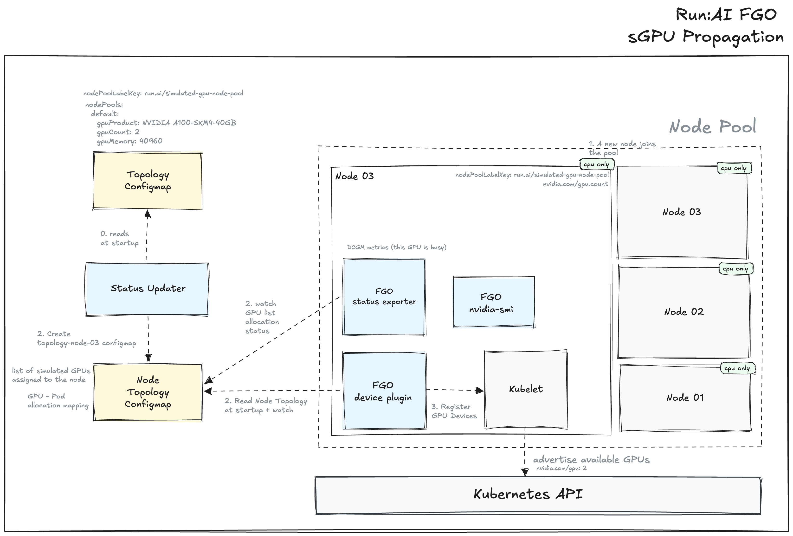
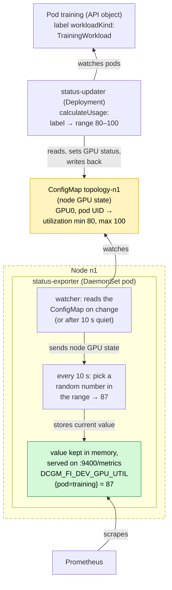

Author: [Roman Hlushko](https://github.com/roma-glushko)

<!-- toc -->
- [Summary](#summary)
- [Motivation](#motivation)
  - [Background](#background)
    - [The Run:ai Fake GPU Operator](#the-runai-fake-gpu-operator)
    - [What Mokka does today](#what-mokka-does-today)
    - [Limits of the current integration](#limits-of-the-current-integration)
  - [Goals](#goals)
  - [Non-Goals](#non-goals)
- [Proposal](#proposal)
  - [User Stories (Optional)](#user-stories-optional)
    - [Story 1 (Optional)](#story-1-optional)
    - [Story 2 (Optional)](#story-2-optional)
  - [Notes/Constraints/Caveats (Optional)](#notesconstraintscaveats-optional)
  - [Risks and Mitigations](#risks-and-mitigations)
- [Design Details](#design-details)
- [Drawbacks](#drawbacks)
- [Alternatives](#alternatives)
<!-- /toc -->

## Summary

The proposal explores how to incorporate the relevant portion of
[Run:AI Fake GPU Operator (FGO)](https://github.com/run-ai/fake-gpu-operator) functionality directly into Mokka.

## Motivation

The integration will enable Mokka to:
- consolidate Mokka and Run:AI team's effort in one single project. Save time and effort on FGO maintenance
- replace FGO in Run:AI and KAI Scheduler CI/CD pipelines.
- extend Mokka's functionality with optional KWOK (no kubelet, virtual nodes) support for cheap and massive load testing where accessing `nvidia-smi` and other on-host tools and libs are not needed.

### Background

[Fake GPU Operator (FGO)](https://github.com/run-ai/fake-gpu-operator) is a Kubernetes operator for testing Run:AI's GPU scheduling capabilities
without having real, expensive GPU wasted on that activity.

FGO supports two backends:

- `fake` - the primary FGO mode. It uses a custom, fake instances of nvidia-smi, device driver, DRA plugin, etc. in order to simulate presence of GPU devices on the node.
- `mock` - the prior integration with Mokka during the early days of the Mokka project.

#### Fake Backend

The idea behind the `fake` backend is to fake the NVIDIA GPU infrastructure in order to propagate simulated GPU to Kubernetes:

- FGO is deployed to `gpu-operator` namespace to mimic presence of real GPU operator
- FGO comes with a custom device plugin that propagates GPU capacity of the node
- FGO comes with the `status-exporter` deamonset that mimics DGCM metrics
- FGO installs a custom `nvidia-smi` binary that supports a subset of commands and flags of the original `nvidia-smi`.

This gives the Kubernetes API level GPU simulation.

##### Node Lifecycle



### Metrics

FGO supports utilization simulation via custom annotations:

```yaml
apiVersion: v1
kind: Pod
metadata:
  name: fixed-30
  namespace: fgo-lab-04
  annotations:
    run.ai/simulated-gpu-utilization: "30"
spec:
  terminationGracePeriodSeconds: 0
  containers:
    - name: main
      image: "ubuntu:22.04"
      command: ["sleep", "infinity"]
      resources: 
        limits: 
          nvidia.com/gpu: 1
```

The `run.ai/simulated-gpu-utilization` annotation can be:
- a fixed value like `30` which means 30% utilization
- a range like `30-60` so the actual value is sampled from the range

Apart from that there are few utilization pattern kinds:

- `workloadKind: train` - jitter in the 80-100 GPU utilization range
- `workloadKind: interactive` - 0 GPU utilization
- `workloadKind: inference` - 0 GPU utilization

Memory utilization is reported based on `GPU memory x GPU fraction` where [GPU fraction](#resource-reservation---gpu-fractions) is another custom annotation:

```yaml
annotations:
  gpu-fraction: "0.25"
  run.ai/simulated-gpu-utilization: "50"
```

The `status-exporter` runs on the node and responsible for simulation and submitting utilization metrics via a well-known DCGM port `9400`:



The metric looks like this in raw Prometheus (less labels than real DCGM sends):

```prometheus
DCGM_FI_DEV_GPU_UTIL{Hostname="nvidia-dcgm-exporter-ce3313",UUID="GPU-299e8440-...",container="main",
  device="nvidia2",gpu="2",modelName="NVIDIA A100-SXM4-40GB",namespace="fgo-lab-04",pod="ranged-20-60"} 59
```

### Resource Reservation & GPU Fractions

Run:ai and KAI share one physical GPU between several workloads without any real GPU partitioning. This is an optimization to bind one GPU to multiple low GPU consumption pods that do need real GPU resource without underutilizating the whole GPU device.

They park a reservation pod that holds the whole GPU device through the ordinary `nvidia.com/gpu` resource,
then place fractional pods that request no GPU resource at all and just point at the reservation. The kubelet only knows about the reservation pod.

```yaml
apiVersion: v1
kind: Pod
metadata:
  name: reservation-g1
  namespace: runai-reservation # a namespace for placing reservation pods
  labels:
    runai-gpu-group: g1 # the pod group that is then being turned into GPU assignment annotation by FGO e.g. run.ai/reserve_for_gpu_index: GPU-775135a6-f582-540e-84df-8f4e9a049910
spec:
  terminationGracePeriodSeconds: 0
  containers:
    - name: reserve
      image: ubuntu:22.04
      command: ["sleep", "infinity"]
      resources:
        limits:
          nvidia.com/gpu: 1 # requests GPU device
```

Then, the fractional pod looks like this:

```yaml
apiVersion: v1
kind: Pod
metadata:
  name: frac-a
  namespace: fgo-lab-05
  labels:
    runai-gpu-group: g1 # the same gpu group reference
  annotations:
    gpu-fraction: "0.5" # the gpu fraction is set
    run.ai/simulated-gpu-utilization: "30-40"
spec:
  terminationGracePeriodSeconds: 0
  affinity:
    podAffinity: # podAffinity places the fractional pod on the same node as the reservation pod
      requiredDuringSchedulingIgnoredDuringExecution:
        - topologyKey: kubernetes.io/hostname
          namespaces: ["runai-reservation"]
          labelSelector:
            matchLabels:
              runai-gpu-group: g1
  containers:
    - name: main
      image: ubuntu:22.04
      command: ["sleep", "infinity"]
      env:
        - name: NODE_NAME
          valueFrom: {fieldRef: {fieldPath: spec.nodeName}}
        - name: POD_UUID
          valueFrom: {fieldRef: {fieldPath: metadata.uid}}
        - name: RUNAI_NUM_OF_GPUS
          value: "0.5"
      volumeMounts:
        - name: smi
          mountPath: /bin/nvidia-smi # nvidia-smi is how Run:AI bridge no GPU pod to a GPU
  volumes:
    - name: smi
      hostPath:
        path: /var/lib/runai/bin/nvidia-smi
        type: File

  # Note that it requests no GPU by itself
```

The fractional pods get access to GPU device via shared `nvidia-smi` CLI mounted from a GPU-enabled node.

The `status-exporter` also leaves a few files intended for Run:AI container toolkit on the node filesystem:

- `/var/lib/runai/proc/pod/<pod UID>/metrics/gpu/<GPU index>/utilization.sm` - e.g. "34" percent
- `/var/lib/runai/proc/pod/<pod UID>/metrics/gpu/<GPU index>/memory.allocated` - e.g. "20480000000" bytes
- `/var/lib/runai/proc/events/` - created, always empty

#### NUMA-aware Scheduling

NUMA-aware schedulers (KAI, the Kubernetes scheduler-plugins) place GPU pods by reading one `NodeResourceTopology` (NRT) object per node:

```
Name:         fgo-lab-worker
Namespace:    
Labels:       <none>
Annotations:  <none>
API Version:  topology.node.k8s.io/v1alpha2
Attributes:
  Name:   topologyManagerPolicy
  Value:  single-numa-node
  Name:   topologyManagerScope
  Value:  container
Kind:     NodeResourceTopology
Metadata:
  Creation Timestamp:  2026-10-28T17:05:25Z
  Generation:          1
  Owner References:
    API Version:     v1
    Kind:            Node
    Name:            fgo-lab-worker
    UID:             0ec5ff95-72a6-4db8-a9ff-d41c3fffcb38
  Resource Version:  922551
  UID:               01ea8497-64d0-4cd6-9fb0-6a91591e38f5
Topology Policies:
  SingleNUMANodeContainerLevel
Zones:
  Costs:
    Name:   node-0
    Value:  10
    Name:   node-1
    Value:  21
  Name:     node-0
  Resources:
    Allocatable:  4
    Available:    4
    Capacity:     4
    Name:         nvidia.com/gpu
    Allocatable:  9
    Available:    9
    Capacity:     9
    Name:         cpu
    Allocatable:  8211190Ki
    Available:    8211190Ki
    Capacity:     8211190Ki
    Name:         memory
  Type:           Node
  Costs:
    Name:   node-0
    Value:  21
    Name:   node-1
    Value:  10
  Name:     node-1
  Resources:
    Allocatable:  4
    Available:    4
    Capacity:     4
    Name:         nvidia.com/gpu
    Allocatable:  9
    Available:    9
    Capacity:     9
    Name:         cpu
    Allocatable:  8211190Ki
    Available:    8211190Ki
    Capacity:     8211190Ki
    Name:         memory
  Type:           Node
Events:           <none>
```

FGO can fabricate those from a `numa` block in a pool.

On the real node though, NFD should create NRT resources. This is roughly the information considered by NFD:

| Path on the node                                                           | Used for                                                                                                                                                               |
|----------------------------------------------------------------------------|------------------------------------------------------------------------------------------------------------------------------------------------------------------------|
| `/sys/devices/system/node/node<N>/` (the directory list)                   | **Which zones exist.** Each `node<N>` becomes zone `node-<N>`                                                                                                          |
| `/sys/devices/system/node/node<N>/cpu<M>/` and `…/cpu<M>/topology/core_id` | **Which CPUs belong to which zone.** Maps CPU IDs to zones. CPUs the kubelet doesn't list as allocatable count as reserved and are added to that zone's CPU *capacity* |
| `/sys/devices/system/node/node<N>/distance`                                | Zone **costs** (e.g. `10 21`)                                                                                                                                          |
| `/sys/bus/node/devices/node<N>/meminfo` (`MemTotal` line)                  | **Memory capacity** per zone                                                                                                                                           |
| `/sys/bus/node/devices/node<N>/hugepages/hugepages-<size>kB/nr_hugepages`  | **Hugepages capacity** per zone (`hugepages-2Mi`, `hugepages-1Gi`)                                                                                                     |
| `/sys/devices/cpu_*/cpus`                                                  | `cpu_core` / `cpu_atom` attributes, only on hybrid CPUs                                                                                                                |

#### KWOK

FGO reaches fleet scale with [KWOK](https://kwok.sigs.k8s.io/) (Kubernetes
WithOut Kubelet), which creates Node objects and drives the lifecycle of the
pods bound to them, with no kubelet and no containers behind either. 

KWOK resources are just `Node` resources:

```yaml
apiVersion: v1
kind: Node
metadata:
  name: knok-node-1
  annotations:
    kwok.x-k8s.io/node: fake
    node.alpha.kubernetes.io/ttl: "0"
  labels:
    fgo-lab/managed: "true"
    kubernetes.io/role: worker
    node.kubernetes.io/instance-type: gpu-node
    run.ai/simulated-gpu-node-pool: g1
    type: kwok # KWOK label
spec:
  taints: 
    - effect: NoSchedule
      key: kwok.x-k8s.io/node # regular pods won't be scheduled on kwok nodes
      value: fake
status:
  allocatable:
    cpu: "32"
    memory: 128Gi
    pods: "110"
  capacity:
    cpu: "32"
    memory: 128Gi
    pods: "110"
  nodeInfo:
    architecture: amd64
    containerRuntimeVersion: fake
    kernelVersion: fake
    kubeProxyVersion: fake
    kubeletVersion: fake
    operatingSystem: linux
    osImage: fake
```

Then, a test workload looks like this:

```yaml
apiVersion: v1
kind: Pod
metadata:
  name: kwok-pod
  namespace: fgo-lab-07
  annotations:
    run.ai/simulated-gpu-utilization: "40"
spec:
  nodeSelector:
    type: kwok
  tolerations:
    - key: kwok.x-k8s.io/node
      operator: Equal
      value: fake
      effect: NoSchedule
  containers:
    - name: main
      image: ubuntu:22.04
      command: ["sleep", "infinity"]
      resources:
        limits:
          nvidia.com/gpu: 2
```

FGO comes with a few KWOK plugins that are deployed as a Deployment per cluster:

| Deployment                                           | On by default                                 | Watches                                                                       | Writes                                                                                                            | Replaces                                              | Lab |
|------------------------------------------------------|-----------------------------------------------|-------------------------------------------------------------------------------|-------------------------------------------------------------------------------------------------------------------|-------------------------------------------------------|-----|
| `kwok-gpu-device-plugin`                             | yes                                           | Nodes' GPU state ConfigMaps (`topology-<node>`), **only when one is created** | Merge-patch of `Node.status` capacity and allocatable: `nvidia.com/gpu` = number of GPUs, plus any `otherDevices` | device-plugin DaemonSet, which reports to the kubelet | 07  |
| `nvidia-dcgm-exporter-kwok` (`status-exporter-kwok`) | yes, whenever `statusExporter.enabled` is set | Nodes' GPU state ConfigMaps: add, update, delete                              | One `:9400` for every KWOK node, `nvidia.com/gpu.*` node labels, and an NRT if enabled                            | per-node exporter DaemonSet                           | 07  |
| `kwok-dra-plugin`                                    | no                                            | Nodes' GPU state ConfigMaps: add, update, delete                              | ResourceSlice `kwok-<node>-gpu`, driver `gpu.nvidia.com`, one device per GPU (UUID, model, memory)                | `dra-plugin-gpu` DaemonSet                            | 08  |
| `kwok-compute-domain-dra-plugin`                     | no                                            | **Nodes**, not ConfigMaps                                                     | ResourceSlice `kwok-<node>-compute-domain-channel` with one device, `channel-0`                                   | compute-domain kubelet plugin                         | 09  |

KWOK's node topology `ConfigMaps` are no different to the normal CPU nodes.

The KWOK plugins are nothing else but servers that does some manipulations with Kubernetes API based on FGO's node topology `ConfigMaps`.

FGO doesn't use any experimental KWOK CRDs lik `ClusterExec`, `ClusterAttach`, `ClusterLogs`, etc.

#### Run:AI x Mokka Integration (Mock Backend)

FGO creates Mokka's profiles as `ConfigMaps` and use some information from there in the `fake` backend mode like:

- Product name,
- memory,
- GPU count,
- driver and CUDA versions

When the node pool is defined to be `mock`, FGO actually deploys a Mokka instance on the nodes it manages:

```yaml
cluster:
  nodePoolLabelKey: run.ai/simulated-gpu-node-pool
  migStrategy: none
  nodePools:
    a100-pool:
      gpu:
        backend: mock
        profile: a100
        overrides:
          device_count: 2
```

On the Mokka end, with [integrations.fakeGpuOperator.enabled](../../../deployments/nvml-mock/helm/nvml-mock/templates/integrations-fgo.yaml),
the Mokka chart creates publishes one ConfigMap per Mokka GPU profile like `gb300`, `h100`, `a100`, etc. in a way that FGO expects
(e.g. named `gpu-profile-<profile>`, with the profile under the `profile.yaml` key, in `integrations.fakeGpuOperator.targetNamespace`).
That's the only place Mokka knows about FGO.

### NVIDIA Ecosystem Integrations

FGO mocks or uses the following NVIDIA components:

- device-plugin
- DRA
- compute domains
- nvidia-smi
- DCGM
- MIG Manager

### Goals

- Propose an actionable plan for FGO incorporation into Mokka
- Reach the feature parity required to migrate Run:AI and KAI Scheduler off FGO

### Non-Goals

- Mokka remains to be a generic project, so all functionality very specific to Run:ai and KAI are not going to be directly included.

## Proposal

Looking through the list of FGO features, there are three that Mokka should support:

- [KWOK Integration](#kwok-integration). Completely new functionality and the biggest piece of work.
- [Workload-aware dynamic metrics](#workload-aware-dynamic-metrics). Mokka supports dynamic metrics today with a couple of profile patterns (e.g. range, bust, idle, busy). That setting is on GPU level though, it's not workload-aware.
- [Numa Setup](#numa-setup). Mokka should simulate NUMA information according to the GPU rack profile that NFD uses for NRT resource creation.

The [NVIDIA component mocks](#nvidia-ecosystem-integrations) should be replaced by 
Mokka and the real NVIDIA components on top of it.

### User Stories (Optional)

<!--
Detail the things that people will be able to do if this MEP is implemented.
Include as much detail as possible so that people can understand the "how" of
the system. The goal here is to make this feel real for users without getting
bogged down.
-->

#### Story 1 (Optional)

#### Story 2 (Optional)

### Notes/Constraints/Caveats (Optional)

<!--
What are the caveats to the proposal?
What are some important details that didn't come across above?
Go in to as much detail as necessary here.
This might be a good place to talk about core concepts and how they relate.
-->

### Risks and Mitigations

<!--
What are the risks of this proposal, and how do we mitigate? Think broadly.
For example, consider operational overhead, resource consumption, and how
this will impact our users.
-->

## Design Details

### KWOK Integration

Mokka can frame KWOK support as an alternative provisionining path, so we will end up having two:

- `cpu` (default), the current deployment mode that expects real CPU nodes.
- `kwok`, the new deployment mode based on KWOK virtual nodes.

The backend is configured on the `SGPUInventory` level where you can configure both CPU and KWOK rack groups:

```yaml
apiVersion: mokka.nvidia.com/v1alpha1
kind: SGPUInventory
metadata:
  name: dev
spec:
  rackGroups:
    - id: training
      provision: cpu
      count: 10
      profileRef:
        name: gb300-nvl72

      placement:
        nodeSelector:
          matchLabels:
            mokka.nvidia.com/sgpu: training

    - id: ci
      provision: kwok
      count: 1000 # a thousand of gb300 racks
      profileRef:
        name: gb300-nvl72
```

The KWOK's `ci` will create `rackGroup.count` × `profile.nodesPerRack` (18000 virtual nodes in this example).

The Mokka Control Plane (MEP0001) watches `SGPUInventory` and creates `SGPURacks` as usually. For KWOK provisining, SGPURack would look like this:

```yaml
TBU
```

We will introduce a new component called Mokka KWOK Controller. The responsibility will be:

- watching `SGPURack` resources that belongs to KWOK provisioning
- creating KWOK `Node` resources like:

```yaml
TBU
```

- 

#### KWOK Installation

The KWOK functionality in Mokka should be disabled by default. 

The KWOK is assumed to be installed by cluster admins prior to enabling Mokka's KWOK functionality. That's gonna be documented.
It's not gonna be explicitly included into the Mokka helm chart.

Mokka helm chart will get a new flag `kwok.enabled`, based on which we will deploy or not Mokka's KWOK Controller service.

### Workload-aware Dynamic Metrics

TBU

### NUMA Setup

TBU

## Drawbacks

<!--
Why should this MEP _not_ be implemented?
-->

## Alternatives

<!--
What other approaches did you consider, and why did you rule them out? These do
not need to be as detailed as the proposal, but should include enough
information to express the idea and why it was not acceptable.
-->
