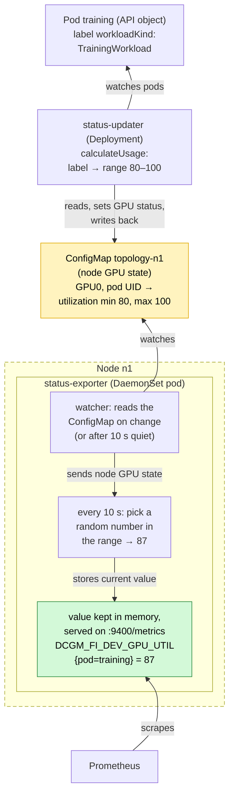
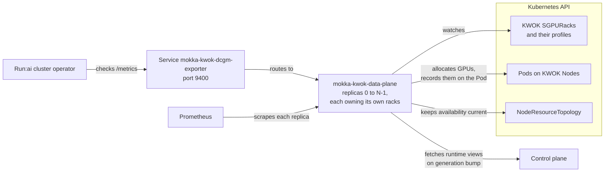
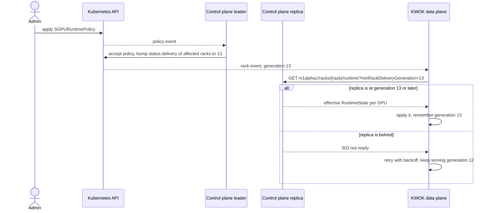
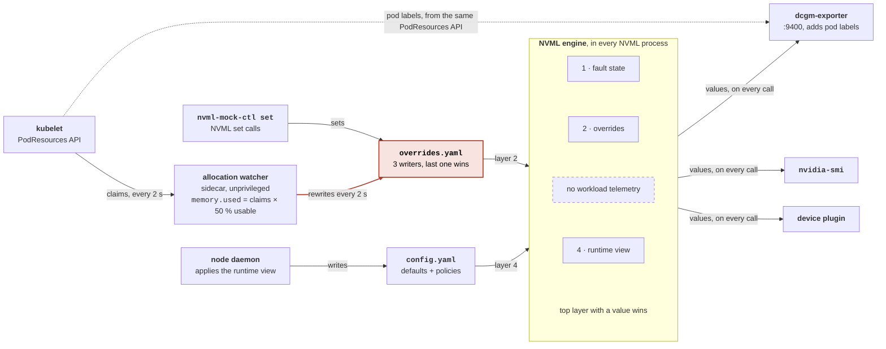
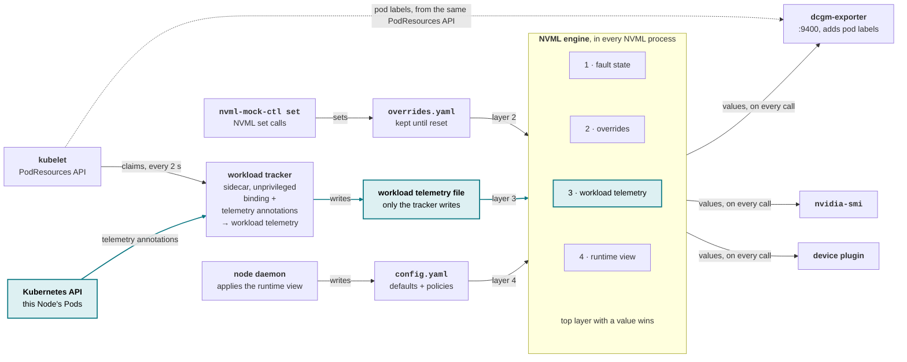
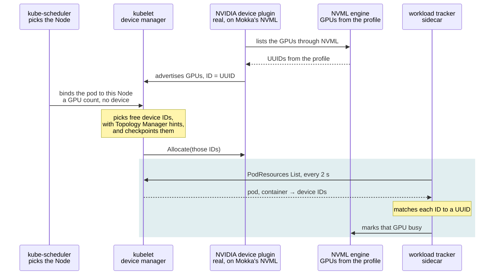
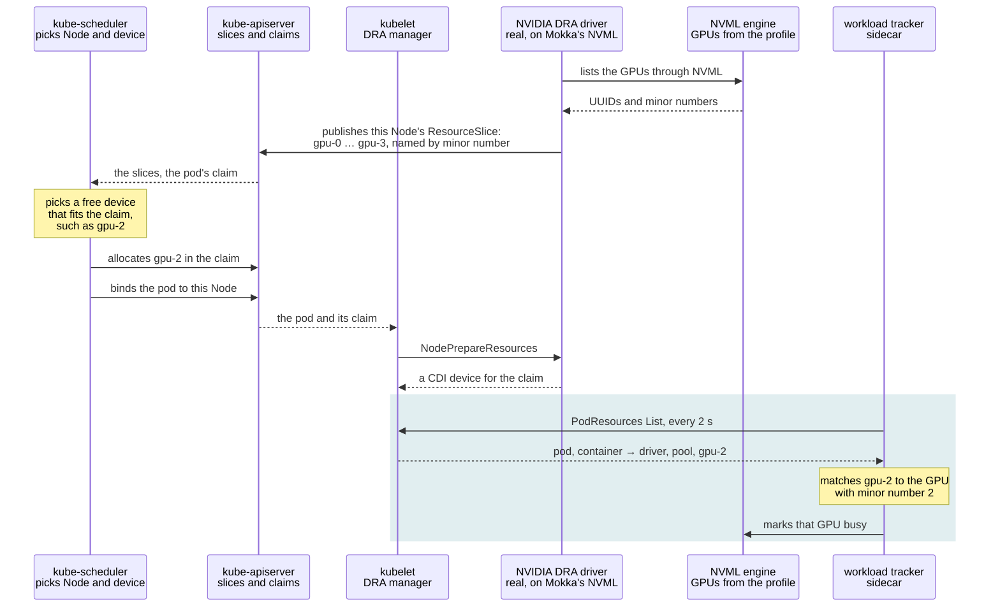
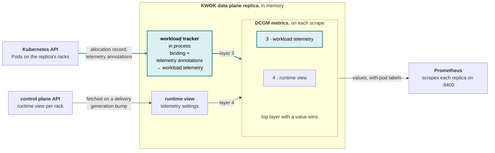
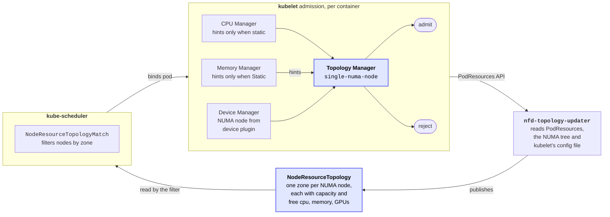
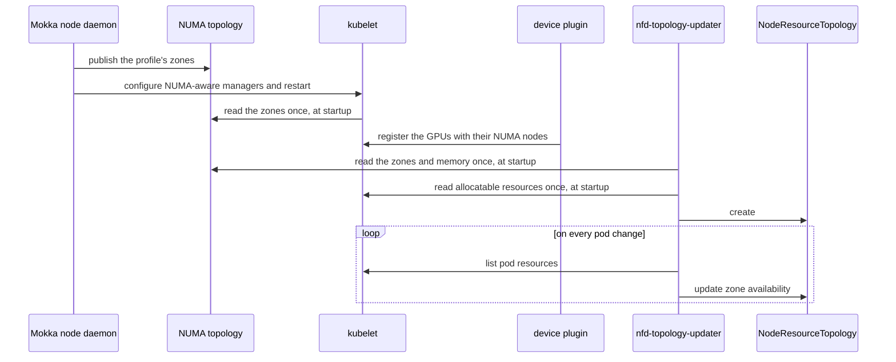

Author: [Roman Hlushko](https://github.com/roma-glushko)

<!-- toc -->
- [Summary](#summary)
- [Motivation](#motivation)
  - [Background](#background)
    - [The Run:ai Fake GPU Operator](#the-runai-fake-gpu-operator)
    - [What Mokka does today](#what-mokka-does-today)
    - [Limits of the current integration](#limits-of-the-current-integration)
  - [Goals](#goals)
  - [Non-Goals](#non-goals)
- [Proposal](#proposal)
  - [User Stories (Optional)](#user-stories-optional)
    - [Story 1 (Optional)](#story-1-optional)
    - [Story 2 (Optional)](#story-2-optional)
  - [Notes/Constraints/Caveats (Optional)](#notesconstraintscaveats-optional)
  - [Risks and Mitigations](#risks-and-mitigations)
- [Design Details](#design-details)
- [Drawbacks](#drawbacks)
- [Alternatives](#alternatives)
<!-- /toc -->

## Summary

The proposal explores how to incorporate the relevant portion of
[Run:AI Fake GPU Operator (FGO)](https://github.com/run-ai/fake-gpu-operator) functionality directly into Mokka.

## Motivation

The integration will enable Mokka to:
- consolidate Mokka and Run:AI team's effort in one single project. Save time and effort on FGO maintenance
- replace FGO in Run:AI and KAI Scheduler CI/CD pipelines.
- extend Mokka's functionality with optional KWOK (no kubelet, virtual nodes) support for cheap and massive load testing where accessing `nvidia-smi` and other on-host tools and libs are not needed.

### Background

[Fake GPU Operator (FGO)](https://github.com/run-ai/fake-gpu-operator) is a Kubernetes operator for testing Run:AI's GPU scheduling capabilities
without having real, expensive GPU wasted on that activity.

FGO supports two backends:

- `fake` - the primary FGO mode. It uses a custom, fake instances of nvidia-smi, device driver, DRA plugin, etc. in order to simulate presence of GPU devices on the node.
- `mock` - the prior integration with Mokka during the early days of the Mokka project.

#### Fake Backend

The idea behind the `fake` backend is to fake the NVIDIA GPU infrastructure in order to propagate simulated GPU to Kubernetes:

- FGO is deployed to `gpu-operator` namespace to mimic presence of real GPU operator
- FGO comes with a custom device plugin that propagates GPU capacity of the node
- FGO comes with the `status-exporter` deamonset that mimics DGCM metrics
- FGO installs a custom `nvidia-smi` binary that supports a subset of commands and flags of the original `nvidia-smi`.

This gives the Kubernetes API level GPU simulation.

##### Node Lifecycle


### Metrics

FGO supports utilization simulation via custom annotations:

```yaml
apiVersion: v1
kind: Pod
metadata:
  name: fixed-30
  namespace: fgo-lab-04
  annotations:
    run.ai/simulated-gpu-utilization: "30"
spec:
  terminationGracePeriodSeconds: 0
  containers:
    - name: main
      image: "ubuntu:22.04"
      command: ["sleep", "infinity"]
      resources: 
        limits: 
          nvidia.com/gpu: 1
```

The `run.ai/simulated-gpu-utilization` annotation can be:
- a fixed value like `30` which means 30% utilization
- a range like `30-60` so the actual value is sampled from the range

Apart from that there are few utilization pattern kinds:

- `workloadKind: train` - jitter in the 80-100 GPU utilization range
- `workloadKind: interactive` - 0 GPU utilization
- `workloadKind: inference` - 0 GPU utilization

Memory utilization is reported based on `GPU memory x GPU fraction` where [GPU fraction](#resource-reservation--gpu-fractions) is another custom annotation:

```yaml
annotations:
  gpu-fraction: "0.25"
  run.ai/simulated-gpu-utilization: "50"
```

The `status-exporter` runs on the node and responsible for simulation and submitting utilization metrics via a well-known DCGM port `9400`:



The metric looks like this in raw Prometheus (less labels than real DCGM sends):

```prometheus
DCGM_FI_DEV_GPU_UTIL{Hostname="nvidia-dcgm-exporter-ce3313",UUID="GPU-299e8440-...",container="main",
  device="nvidia2",gpu="2",modelName="NVIDIA A100-SXM4-40GB",namespace="fgo-lab-04",pod="ranged-20-60"} 59
```

### Resource Reservation & GPU Fractions

Run:ai and KAI share one physical GPU between several workloads without any real GPU partitioning. This is an optimization to bind one GPU to multiple low GPU consumption pods that do need real GPU resource without underutilizating the whole GPU device.

They park a reservation pod that holds the whole GPU device through the ordinary `nvidia.com/gpu` resource,
then place fractional pods that request no GPU resource at all and just point at the reservation. The kubelet only knows about the reservation pod.

```yaml
apiVersion: v1
kind: Pod
metadata:
  name: reservation-g1
  namespace: runai-reservation # a namespace for placing reservation pods
  labels:
    runai-gpu-group: g1 # the pod group that is then being turned into GPU assignment annotation by FGO e.g. run.ai/reserve_for_gpu_index: GPU-775135a6-f582-540e-84df-8f4e9a049910
spec:
  terminationGracePeriodSeconds: 0
  containers:
    - name: reserve
      image: ubuntu:22.04
      command: ["sleep", "infinity"]
      resources:
        limits:
          nvidia.com/gpu: 1 # requests GPU device
```

Then, the fractional pod looks like this:

```yaml
apiVersion: v1
kind: Pod
metadata:
  name: frac-a
  namespace: fgo-lab-05
  labels:
    runai-gpu-group: g1 # the same gpu group reference
  annotations:
    gpu-fraction: "0.5" # the gpu fraction is set
    run.ai/simulated-gpu-utilization: "30-40"
spec:
  terminationGracePeriodSeconds: 0
  affinity:
    podAffinity: # podAffinity places the fractional pod on the same node as the reservation pod
      requiredDuringSchedulingIgnoredDuringExecution:
        - topologyKey: kubernetes.io/hostname
          namespaces: ["runai-reservation"]
          labelSelector:
            matchLabels:
              runai-gpu-group: g1
  containers:
    - name: main
      image: ubuntu:22.04
      command: ["sleep", "infinity"]
      env:
        - name: NODE_NAME
          valueFrom: {fieldRef: {fieldPath: spec.nodeName}}
        - name: POD_UUID
          valueFrom: {fieldRef: {fieldPath: metadata.uid}}
        - name: RUNAI_NUM_OF_GPUS
          value: "0.5"
      volumeMounts:
        - name: smi
          mountPath: /bin/nvidia-smi # nvidia-smi is how Run:AI bridge no GPU pod to a GPU
  volumes:
    - name: smi
      hostPath:
        path: /var/lib/runai/bin/nvidia-smi
        type: File

  # Note that it requests no GPU by itself
```

The fractional pods get access to GPU device via shared `nvidia-smi` CLI mounted from a GPU-enabled node.

The `status-exporter` also leaves a few files intended for Run:AI container toolkit on the node filesystem:

- `/var/lib/runai/proc/pod/<pod UID>/metrics/gpu/<GPU index>/utilization.sm` - e.g. "34" percent
- `/var/lib/runai/proc/pod/<pod UID>/metrics/gpu/<GPU index>/memory.allocated` - e.g. "20480000000" bytes
- `/var/lib/runai/proc/events/` - created, always empty

#### NUMA-aware Scheduling

NUMA-aware schedulers (KAI, the Kubernetes scheduler-plugins) place GPU pods by reading one `NodeResourceTopology` (NRT) object per node:

```
Name:         fgo-lab-worker
Namespace:    
Labels:       <none>
Annotations:  <none>
API Version:  topology.node.k8s.io/v1alpha2
Attributes:
  Name:   topologyManagerPolicy
  Value:  single-numa-node
  Name:   topologyManagerScope
  Value:  container
Kind:     NodeResourceTopology
Metadata:
  Creation Timestamp:  2026-10-28T17:05:25Z
  Generation:          1
  Owner References:
    API Version:     v1
    Kind:            Node
    Name:            fgo-lab-worker
    UID:             0ec5ff95-72a6-4db8-a9ff-d41c3fffcb38
  Resource Version:  922551
  UID:               01ea8497-64d0-4cd6-9fb0-6a91591e38f5
Topology Policies:
  SingleNUMANodeContainerLevel
Zones:
  Costs:
    Name:   node-0
    Value:  10
    Name:   node-1
    Value:  21
  Name:     node-0
  Resources:
    Allocatable:  4
    Available:    4
    Capacity:     4
    Name:         nvidia.com/gpu
    Allocatable:  9
    Available:    9
    Capacity:     9
    Name:         cpu
    Allocatable:  8211190Ki
    Available:    8211190Ki
    Capacity:     8211190Ki
    Name:         memory
  Type:           Node
  Costs:
    Name:   node-0
    Value:  21
    Name:   node-1
    Value:  10
  Name:     node-1
  Resources:
    Allocatable:  4
    Available:    4
    Capacity:     4
    Name:         nvidia.com/gpu
    Allocatable:  9
    Available:    9
    Capacity:     9
    Name:         cpu
    Allocatable:  8211190Ki
    Available:    8211190Ki
    Capacity:     8211190Ki
    Name:         memory
  Type:           Node
Events:           <none>
```

FGO can fabricate those from a `numa` block in a pool.

On the real node though, NFD should create NRT resources. This is roughly the information considered by NFD:

| Path on the node                                                           | Used for                                                                                                                                                               |
|----------------------------------------------------------------------------|------------------------------------------------------------------------------------------------------------------------------------------------------------------------|
| `/sys/devices/system/node/node<N>/` (the directory list)                   | **Which zones exist.** Each `node<N>` becomes zone `node-<N>`                                                                                                          |
| `/sys/devices/system/node/node<N>/cpu<M>/` and `…/cpu<M>/topology/core_id` | **Which CPUs belong to which zone.** Maps CPU IDs to zones. CPUs the kubelet doesn't list as allocatable count as reserved and are added to that zone's CPU *capacity* |
| `/sys/devices/system/node/node<N>/distance`                                | Zone **costs** (e.g. `10 21`)                                                                                                                                          |
| `/sys/bus/node/devices/node<N>/meminfo` (`MemTotal` line)                  | **Memory capacity** per zone                                                                                                                                           |
| `/sys/bus/node/devices/node<N>/hugepages/hugepages-<size>kB/nr_hugepages`  | **Hugepages capacity** per zone (`hugepages-2Mi`, `hugepages-1Gi`)                                                                                                     |
| `/sys/devices/cpu_*/cpus`                                                  | `cpu_core` / `cpu_atom` attributes, only on hybrid CPUs                                                                                                                |

#### KWOK

FGO reaches fleet scale with [KWOK](https://kwok.sigs.k8s.io/) (Kubernetes
WithOut Kubelet), which creates Node objects and drives the lifecycle of the
pods bound to them, with no kubelet and no containers behind either. 

KWOK resources are just `Node` resources:

```yaml
apiVersion: v1
kind: Node
metadata:
  name: knok-node-1
  annotations:
    kwok.x-k8s.io/node: fake
    node.alpha.kubernetes.io/ttl: "0"
  labels:
    fgo-lab/managed: "true"
    kubernetes.io/role: worker
    node.kubernetes.io/instance-type: gpu-node
    run.ai/simulated-gpu-node-pool: g1
    type: kwok # KWOK label
spec:
  taints: 
    - effect: NoSchedule
      key: kwok.x-k8s.io/node # regular pods won't be scheduled on kwok nodes
      value: fake
status:
  allocatable:
    cpu: "32"
    memory: 128Gi
    pods: "110"
  capacity:
    cpu: "32"
    memory: 128Gi
    pods: "110"
  nodeInfo:
    architecture: amd64
    containerRuntimeVersion: fake
    kernelVersion: fake
    kubeProxyVersion: fake
    kubeletVersion: fake
    operatingSystem: linux
    osImage: fake
```

Then, a test workload looks like this:

```yaml
apiVersion: v1
kind: Pod
metadata:
  name: kwok-pod
  namespace: fgo-lab-07
  annotations:
    run.ai/simulated-gpu-utilization: "40"
spec:
  nodeSelector:
    type: kwok
  tolerations:
    - key: kwok.x-k8s.io/node
      operator: Equal
      value: fake
      effect: NoSchedule
  containers:
    - name: main
      image: ubuntu:22.04
      command: ["sleep", "infinity"]
      resources:
        limits:
          nvidia.com/gpu: 2
```

FGO comes with a few KWOK plugins that are deployed as a Deployment per cluster:

| Deployment                                           | On by default                                 | Watches                                                                       | Writes                                                                                                            | Replaces                                              | Lab |
|------------------------------------------------------|-----------------------------------------------|-------------------------------------------------------------------------------|-------------------------------------------------------------------------------------------------------------------|-------------------------------------------------------|-----|
| `kwok-gpu-device-plugin`                             | yes                                           | Nodes' GPU state ConfigMaps (`topology-<node>`), **only when one is created** | Merge-patch of `Node.status` capacity and allocatable: `nvidia.com/gpu` = number of GPUs, plus any `otherDevices` | device-plugin DaemonSet, which reports to the kubelet | 07  |
| `nvidia-dcgm-exporter-kwok` (`status-exporter-kwok`) | yes, whenever `statusExporter.enabled` is set | Nodes' GPU state ConfigMaps: add, update, delete                              | One `:9400` for every KWOK node, `nvidia.com/gpu.*` node labels, and an NRT if enabled                            | per-node exporter DaemonSet                           | 07  |
| `kwok-dra-plugin`                                    | no                                            | Nodes' GPU state ConfigMaps: add, update, delete                              | ResourceSlice `kwok-<node>-gpu`, driver `gpu.nvidia.com`, one device per GPU (UUID, model, memory)                | `dra-plugin-gpu` DaemonSet                            | 08  |
| `kwok-compute-domain-dra-plugin`                     | no                                            | **Nodes**, not ConfigMaps                                                     | ResourceSlice `kwok-<node>-compute-domain-channel` with one device, `channel-0`                                   | compute-domain kubelet plugin                         | 09  |

KWOK's node topology `ConfigMaps` are no different to the normal CPU nodes.

The KWOK plugins are nothing else but servers that does some manipulations with Kubernetes API based on FGO's node topology `ConfigMaps`.

FGO doesn't use any experimental KWOK CRDs lik `ClusterExec`, `ClusterAttach`, `ClusterLogs`, etc.

#### Run:AI x Mokka Integration (Mock Backend)

FGO creates Mokka's profiles as `ConfigMaps` and use some information from there in the `fake` backend mode like:

- Product name,
- memory,
- GPU count,
- driver and CUDA versions

When the node pool is defined to be `mock`, FGO actually deploys a Mokka instance on the nodes it manages:

```yaml
cluster:
  nodePoolLabelKey: run.ai/simulated-gpu-node-pool
  migStrategy: none
  nodePools:
    a100-pool:
      gpu:
        backend: mock
        profile: a100
        overrides:
          device_count: 2
```

On the Mokka end, with [integrations.fakeGpuOperator.enabled](../../../deployments/nvml-mock/helm/nvml-mock/templates/integrations-fgo.yaml),
the Mokka chart creates publishes one ConfigMap per Mokka GPU profile like `gb300`, `h100`, `a100`, etc. in a way that FGO expects
(e.g. named `gpu-profile-<profile>`, with the profile under the `profile.yaml` key, in `integrations.fakeGpuOperator.targetNamespace`).
That's the only place Mokka knows about FGO.

### NVIDIA Ecosystem Integrations

FGO mocks or uses the following NVIDIA components:

- device-plugin
- DRA
- compute domains
- nvidia-smi
- DCGM
- MIG Manager

### Goals

- Propose an actionable plan for FGO incorporation into Mokka
- Reach the feature parity required to migrate Run:AI and KAI Scheduler off FGO

### Non-Goals

- Mokka remains to be a generic project, so all functionality very specific to Run:ai and KAI are not going to be directly included.
- MIG support is out of scope for this MEP.
- Fault injection in KWOK mode is out of scope for this MEP.
- Making virtual pod (e.g. a pod scheduled to a KWOK virtual node) SSH work is out of scope of this MEP.

## Proposal

Looking through the list of FGO features, there are three that Mokka should support:

- [KWOK Integration](#kwok-integration). Completely new functionality and the biggest piece of work.
- [Workload-aware dynamic metrics](#workload-aware-dynamic-metrics). Mokka supports dynamic metrics today with a couple of profile patterns (e.g. range, bust, idle, busy). That setting is on GPU level though, it's not workload-aware.
- [Numa Setup](#numa-setup). Mokka should simulate NUMA information according to the GPU rack profile that NFD uses for NRT resource creation.

The [NVIDIA component mocks](#nvidia-ecosystem-integrations) should be replaced by 
Mokka and the real NVIDIA components on top of it.

### User Stories (Optional)

<!--
Detail the things that people will be able to do if this MEP is implemented.
Include as much detail as possible so that people can understand the "how" of
the system. The goal here is to make this feel real for users without getting
bogged down.
-->

#### Story 1 (Optional)

#### Story 2 (Optional)

### Notes/Constraints/Caveats (Optional)

<!--
What are the caveats to the proposal?
What are some important details that didn't come across above?
Go in to as much detail as necessary here.
This might be a good place to talk about core concepts and how they relate.
-->

### Risks and Mitigations

<!--
What are the risks of this proposal, and how do we mitigate? Think broadly.
For example, consider operational overhead, resource consumption, and how
this will impact our users.
-->

## Design Details

### KWOK Integration

Mokka can frame KWOK support as an alternative provisioning path for sGPU nodes, so we will end up having two modes:

- `CPU` (default), the current deployment mode that expects real CPU nodes. The control plane binds racks to existing CPU nodes, and the node daemon simulates the GPUs on them.
- `KWOK`, the new deployment mode based on KWOK virtual nodes. The KWOK provisioner creates a virtual Node for each logical rack Node, the KWOK data plane simulates what runs on it, and the GPUs exist only in the Kubernetes API.

The provisioner is set per rack group in `SGPUInventory`, so one inventory can mix CPU and KWOK rack groups:

```yaml
apiVersion: mokka.nvidia.com/v1alpha1
kind: SGPUInventory
metadata:
  name: dev
spec:
  rackGroups:
    - id: training
      provisioner: CPU # the default
      count: 10
      profileRef:
        name: gb300-nvl72

      placement: # CPU only: the existing Nodes that may host the racks
        nodeSelector:
          matchLabels:
            mokka.nvidia.com/sgpu: training

    - id: ci
      provisioner: KWOK
      count: 1000 # a thousand of gb300 racks
      profileRef:
        name: gb300-nvl72

      kwok: # KWOK only: settings for the Nodes the KWOK provisioner creates
        kubelet: # the configuration of the kubelet the Nodes simulate
          maxPods: 250
        nodeTemplate:
          labels:
            run.ai/simulated-gpu-node-pool: ci
          taints:
            - key: kwok.x-k8s.io/node # keeps regular pods off the virtual Nodes
              value: fake
              effect: NoSchedule
```

The KWOK's `ci` will create `rackGroup.count` × `profile.nodesPerRack` (18000 virtual nodes in this example).

There's no kubelet on a KWOK Node, so the KWOK provisioner reports what one would. `kwok.kubelet` holds the configuration it simulates, starting with `maxPods`, which sets each Node's pod capacity. These settings stay out of the profile because the same profile also backs CPU groups, where the real kubelet decides them.

The CRD validation enforces these rules on a rack group:

- `provisioner` is `CPU` or `KWOK`, defaults to `CPU`, and can't change, so a rack is handled by the same service for its whole life. To change a group's provisioner, replace the group with one under a new `id`.
- `placement` is allowed only on `CPU` groups, and `kwok` only on `KWOK` groups.
- `kwok.nodeTemplate.labels` can't set `mokka.nvidia.com/sgpu-node`, which would make the virtual Nodes eligible for CPU racks, or `mokka.nvidia.com/provisioner`, which Mokka sets itself.
- `kwok.kubelet.maxPods` is at least 1 and defaults to 110, the kubelet's default.

The Mokka Control Plane ([MEP0001](../0001-mokka-control-plane/README.md)) watches `SGPUInventory` and creates `SGPURacks` as usual. It copies `provisioner` and the `kwok` block from the rack group into each rack, and mirrors `provisioner` into a label (see [Separating CPU and KWOK Racks](#separating-cpu-and-kwok-racks)). 

For KWOK provisioning, `SGPURack` would look like this:

```yaml
apiVersion: mokka.nvidia.com/v1alpha1
kind: SGPURack
metadata:
  name: dev-ci-0-3f9c2a17b04e
  labels:
    mokka.nvidia.com/inventory: dev
    mokka.nvidia.com/rack-group: ci
    mokka.nvidia.com/rack-index: "0"
    mokka.nvidia.com/provisioner: KWOK # new: mirrors spec.provisioner
  annotations:
    mokka.nvidia.com/inventory-uid: <inventory UID>
  finalizers:
    - mokka.nvidia.com/rack-cleanup
  ownerReferences:
    - apiVersion: mokka.nvidia.com/v1alpha1
      kind: SGPUInventory
      name: dev
      uid: <inventory UID>
      controller: true
      blockOwnerDeletion: false
spec:
  provisioner: KWOK # new: copied from the rack group
  kwok: # new: copied from the rack group
    kubelet:
      maxPods: 250
    nodeTemplate:
      labels:
        run.ai/simulated-gpu-node-pool: ci
      taints:
        - key: kwok.x-k8s.io/node
          value: fake
          effect: NoSchedule
  inventoryRef:
    name: dev
    uid: <inventory UID>
  profileRef:
    name: gb300-nvl72
    uid: <profile UID>
    generation: 1
    revision: <profile revision>
  identity:
    rackGroup: ci
    rackIndex: 0
    fabricUUID: <fabric UUID>
    cliqueID: 0
  nodes:
    - index: 0 # no nodeRef: KWOK racks are never bound to existing Nodes
      gpus:
        - index: 0
          uuid: GPU-<UUID>
          serial: "<serial>"
          minorNumber: 0
          pciAddress: "0008:01:00.0"
          rootComplex: pci0008:00
          numaNode: 0
          hostProcessorIndex: 0
        # GPUs 1-3
    # Nodes 1-17
```

KWOK racks are rendered exactly like CPU racks, so their simulated GPUs keep stable UUIDs, serials, PCI addresses, and NUMA placement. 
Because the `kwok` block is in the rack, [the KWOK provisioner](#kwok-provisioner) doesn't need to watch inventories: a change to it re-renders the racks, and the provisioner sees the rack updates.

#### KWOK Components

KWOK mode adds two components, split by whether what they simulate is fixed for a Node's life or changes while the Node runs:


|               | [KWOK provisioner](#kwok-provisioner)                     | [KWOK data plane](#kwok-data-plane)                                                         |
|---------------|-----------------------------------------------------------|---------------------------------------------------------------------------------------------|
| Owns          | what's fixed for a Node's life, derived from its rack     | what changes while the Node runs                                                            |
| Writes        | Nodes (labels, taints, capacity) and their ResourceSlices | GPU allocation on Pods, NodeResourceTopology                                                |
| Serves        | nothing                                                   | DCGM metrics                                                                                |
| Load follows  | rack and profile changes                                  | Pods, scrapes and runtime views                                                             |
| Runs as       | `Deployment` with leader election                         | `StatefulSet` sharded by rack                                                               |
| Stands in for | Node registration                                         | the per-Node agents: the kubelet's device manager, NFD's topology updater and dcgm-exporter |

The split follows load and ownership:

- **Load.** The provisioner's work follows racks and profiles, which change rarely, so one replica under leader election is enough. The data plane's work grows with the test: an allocation and a NodeResourceTopology update for every GPU Pod, and 216,000 metric series for the example inventory's 72,000 GPUs. It scales by sharding racks across replicas.
- **Ownership.** Per-Node state needs one writer per Node, not one for the whole cluster. Sharding gives each Node exactly one owning replica, as a real cluster runs one kubelet and one topology updater per Node, so only cluster-wide work needs a leader.
- **Failures.** A Pod burst or a slow scrape can't stall Node creation, and a provisioner failover doesn't interrupt allocation or metrics.
- **Future surfaces.** GPU health, MIG reconfiguration, ComputeDomain readiness and InfiniBand counters all change while a Node runs, so they'll join the data plane instead of adding components.

#### KWOK Provisioner

We will introduce a new component called the KWOK provisioner as an optional `Deployment` named `mokka-kwok-provisioner`.

The responsibility will be:

- watching `SGPURack` resources that belong to KWOK provisioning
- creating KWOK `Node` resources like:

```yaml
apiVersion: v1
kind: Node
metadata:
  name: dev-ci-0-0 # format: {inventory_name}-{rack_group_id}-{rack_index}-{node_index}
  annotations:
    kwok.x-k8s.io/node: fake # matched by KWOK's default annotation selector
  labels:
    kubernetes.io/hostname: dev-ci-0-0
    kubernetes.io/os: linux
    kubernetes.io/arch: arm64 # from profile node.host.cpu.architecture
    mokka.nvidia.com/provisioner: KWOK
    mokka.nvidia.com/inventory: dev
    mokka.nvidia.com/rack-group: ci
    mokka.nvidia.com/rack-index: "0"
    mokka.nvidia.com/node-index: "0"
    nvidia.com/gpu.clique: <fabric UUID> # the value the control plane distributes
    run.ai/simulated-gpu-node-pool: ci # from spec.kwok.nodeTemplate
    nvidia.com/gpu.deploy.operands: false # prevents GPU Operator to try to schedule daemonsets on virtual node
    # Plus, NFD/GFD labels
    # ...
  ownerReferences:
    - apiVersion: mokka.nvidia.com/v1alpha1
      kind: SGPURack
      name: dev-ci-0-3f9c2a17b04e
      uid: <rack UID>
      controller: true
      blockOwnerDeletion: false
spec:
  taints:
    - key: kwok.x-k8s.io/node
      value: fake
      effect: NoSchedule
status:
  capacity:
    cpu: "144" # from profile node.host.cpu.cores
    memory: 960Gi # from profile node.host.memory.capacity
    pods: "250" # from spec.kwok.kubelet.maxPods
    nvidia.com/gpu: "4" # from profile node.gpus.count
  allocatable:
    cpu: "144"
    memory: 960Gi
    pods: "250"
    nvidia.com/gpu: "4"
  nodeInfo:
    architecture: arm64
    operatingSystem: linux
    kubeletVersion: fake
```

- creating each Node's DRA `ResourceSlice`, owned by the Node, with one device per GPU in the rack
- leaving Node deletion to the Kubernetes garbage collector: each Node is owned by its `SGPURack`, so the Nodes go away with the rack.

Node names are the rack coordinates joined by hyphens, `<inventory>-<rack group>-<rack index>-<node index>`, as in `dev-ci-0-0`:

```
dev-ci-0-0
│   │  │ └─ node index within the rack (0–17 for an 18-Node rack)
│   │  └─── rack index within the group (0–999 in this example)
│   └────── rack group ID
└────────── inventory name
```

Unlike rack names, Node names carry no hash suffix: users see them in `kubectl get nodes` and scheduler logs, and tests can pin a pod with `kubernetes.io/hostname: dev-ci-0-0` without looking anything up. Three rules keep the names valid and unique:

- **Length.** The name is also the `kubernetes.io/hostname` label, which the fractional-GPU `podAffinity` in [Resource Reservation & GPU Fractions](#resource-reservation--gpu-fractions) uses as its topology key, so it must fit in 63 characters. Rack indexes have at most 5 digits and node indexes at most 4, so the CRD rejects a KWOK group whose inventory name and group ID together exceed 51 characters.
- **Uniqueness.** The control plane rejects a KWOK group whose `<inventory>-<rack group>` matches that of another KWOK group in any inventory, as `dev` with group `ci-x` and `dev-ci` with group `x` would. The last two parts of every name are numbers, so different prefixes always give different names.
- **Replacement.** If a Node with the name already exists and isn't owned by the rack, the KWOK provisioner waits for it to be deleted. That happens when an inventory is recreated under the same name before its old Nodes are gone. The provisioner never takes over a Node it didn't create, such as a real Node with the same name, and emits an Event on the rack instead.

Because inventory names and group IDs can contain hyphens, tools identify a Node by its `mokka.nvidia.com/*` labels or its owner reference rather than by parsing the name.

Capacity comes from SGPURackProfile's `node.host`, so the profile of a KWOK group must define the host CPU cores and memory.
`allocatable` stays at the total as pods come and go: the scheduler subtracts pod requests itself, so lowering it would count them twice.

#### KWOK Data Plane

We will introduce a second component, the KWOK data plane, as an optional `StatefulSet` named `mokka-kwok-data-plane`. It simulates what runs on a KWOK Node for as long as the Node exists: it allocates GPUs to the Pods bound to the Node, keeps the Node's NodeResourceTopology current, and serves DCGM metrics for its GPUs. It takes over FGO's `nvidia-dcgm-exporter-kwok`, which serves these metrics and writes NodeResourceTopology; the `nvidia.com/gpu.*` labels that exporter also writes come from the [KWOK provisioner](#kwok-provisioner). Each replica owns a share of the racks, as [Sharding](#sharding) describes.



##### GPU Allocation

There's no kubelet on a KWOK Node, so the data plane allocates GPUs to the Pods bound to the Nodes of its racks, as the kubelet's device manager would, and records the allocation on the Pod:

```yaml
apiVersion: v1
kind: Pod
metadata:
  name: train-0
  namespace: team-a
  annotations:
    mokka.nvidia.com/gpu-allocation: '{"main":["GPU-<UUID>","GPU-<UUID>"]}' # GPU UUIDs per container
spec:
  nodeName: dev-ci-0-0
```

`NodeResourceTopology` availability and the `pod` labels on DCGM metrics both come from this record. It covers `nvidia.com/gpu` requests and DRA claims alike, as the kubelet's PodResources API does: for a DRA claim, the data plane copies the devices the scheduler allocated. The record lives on the Pod rather than in memory, so a replica that restarts or takes over a rack reads the allocations back instead of recomputing them, which could move a running Pod to another GPU once earlier Pods are gone.

##### NodeResourceTopology

The data plane creates a `NodeResourceTopology` for each Node of its racks and keeps each zone's available GPUs current from the allocations, as NFD's topology updater does on a real Node. Zones and their capacity come from the rack's NUMA placement and the profile, so they match what NFD reports for a CPU Node with the same profile ([NUMA Setup](#numa-setup)).

##### Runtime State

The data plane applies the effective runtime view, as the node daemon does on CPU racks, but it doesn't compute it. The effective runtime view is a GPU's profile defaults with the accepted `SGPURuntimePolicy` overrides applied. [MEP0001](../0001-mokka-control-plane/README.md#runtime-view-computation-and-delivery) gives policy acceptance and this computation to the control plane, which computes the view on request and never stores it. The data plane reads the view for telemetry settings now, and for GPU health once fault injection is in scope. The provisioner never needs it: nothing it writes depends on runtime state.

The data plane takes each input from where it's published:

- **Stored state comes from Kubernetes.** Racks, including their delivery status, and the profiles they use arrive through the watches listed in [Separating CPU and KWOK Racks](#separating-cpu-and-kwok-racks). Profiles contribute static facts such as GPU model and memory, never `defaults.runtime`.
- **The effective runtime view comes from the control plane API**, one rack at a time.
- **Policy objects aren't watched.** No KWOK component watches `SGPUInventory` or `SGPURuntimePolicy`. The data plane could compile policies with `internal/sgpu/policy`, which makes no API calls, but it would then be a second component deciding which policies apply. While the two caches disagree, it could apply a policy the control plane reports as rejected, or one already deleted.

The control plane API serves the view per rack:

```http
GET /v1alpha1/racks/{rackName}/runtime?rackUID=<rack UID>&minRackDeliveryGeneration=13
```

```json
{
  "apiVersion": "v1alpha1",
  "rack": {"name": "dev-ci-0-3f9c2a17b04e", "uid": "<rack UID>"},
  "rackDeliveryGeneration": 13,
  "nodes": [
    {
      "index": 0,
      "gpus": [
        {
          "index": 0,
          "runtime": {
            "deviceState": "Healthy",
            "telemetry": {
              "utilization": {
                "mode": "Pattern",
                "pattern": {"type": "Bursty", "gpuPercent": {"minimum": 20, "maximum": 90}}
              }
            }
          }
        }
      ]
    }
  ]
}
```

The response holds the effective `RuntimeState` of every GPU in the rack, grouped by logical Node (one of each is shown), and the delivery generation it was computed from. The data plane passes the generation it last saw on the rack as the minimum. A replica whose cache is behind returns not-ready (`503`), and the data plane retries with backoff while it keeps the values it applied last. This is MEP0001's publication-floor check, applied per rack. KWOK racks are never bound to a Node, so the request carries no assignment revision. For the same reason, the per-Node endpoint the node daemon polls doesn't fit: it serves Nodes the control plane has assigned, and a KWOK Node never has an assignment.

The rack tells the data plane when to fetch. The control plane leader bumps a rack's delivery generation whenever anything feeding its effective view changes: a policy that selects the rack is added, edited or deleted, the set of accepted policies changes, or the profile's runtime defaults change. For each rack UID, the data plane keeps the generation it last applied and fetches the rack whenever the generation in Kubernetes is ahead. The check compares two numbers, so a missed watch event only delays a fetch, and after a restart a replica fetches each of its racks once. A rack recreated under the same name has a new UID and starts a new generation sequence, so it counts as a new rack.



Values that change on their own never trigger a fetch. The view carries settings, such as a `Bursty` utilization pattern and its range, and [DCGM Metrics](#dcgm-metrics) describes how the data plane turns them into values.

This puts two requirements on the control plane:

- **Delivery status covers KWOK racks.** The control plane drops KWOK groups before allocation, but it still maintains `status.delivery` on their racks. Without the generation bump, the data plane has no trigger and would have to poll.
- **A per-rack endpoint** next to the per-Node one. Both serve views from the same computation.

Policy-driven telemetry depends on that endpoint. Node creation, labels, ResourceSlices, GPU allocation and NodeResourceTopology need no runtime state and don't wait for it.

##### DCGM Metrics

The data plane serves DCGM metrics for the GPUs of its racks through a `Service` named `mokka-kwok-dcgm-exporter` on port `9400`. The Service keeps a DCGM exporter's name because consumers look for one, as the [Run:ai cluster operator](#kai-use-cases) does. The metrics are the three fields that check needs:

| Metric                 | Value                                                                   |
|------------------------|-------------------------------------------------------------------------|
| `DCGM_FI_DEV_GPU_UTIL` | GPU utilization in percent, generated from the GPU's telemetry settings |
| `DCGM_FI_DEV_FB_USED`  | Frame buffer memory in use, in MiB                                      |
| `DCGM_FI_DEV_FB_FREE`  | Frame buffer memory free, in MiB                                        |

Each series carries the labels dcgm-exporter uses. `gpu`, `UUID`, `device`, `pci_bus_id` and `modelName` come from the rack and its profile, `Hostname` from the KWOK Node, and `namespace`, `pod` and `container` from the [GPU allocation](#gpu-allocation) while a Pod holds the GPU:

```prometheus
DCGM_FI_DEV_GPU_UTIL{gpu="0",UUID="GPU-<UUID>",device="nvidia0",pci_bus_id="00000008:01:00.0",modelName="NVIDIA GB300 NVL",Hostname="dev-ci-0-0",namespace="team-a",pod="train-0",container="main"} 87
```

`Hostname` is the GPU's KWOK Node name. On a GPU Node, all series from one dcgm-exporter instance share a `Hostname`, because the instance serves only that Node. The data plane serves many Nodes, so it keeps one value per Node by using the Node name. The chart's optional `ServiceMonitor` also sets `instance` from `Hostname`, which gives each KWOK Node its own `instance`, as with per-Node exporters.

`DCGM_FI_DEV_GPU_UTIL` follows the GPU's telemetry settings from the [runtime view](#runtime-state). The settings say how the value moves, such as a `Bursty` pattern between 20 and 90 percent, and the data plane's metrics generator turns them into values, as the NVML engine does on CPU Nodes. Both use one generator package, so a policy produces the same series on both kinds of Node. Today the generator is internal to `pkg/gpu/mocknvml/engine`, which uses cgo, and it implements `steady`, `idle`, `busy` and `burst` rather than the `Steady`, `Bursty` and `Wave` patterns the CRD defines. Moving it into its own package, with the CRD's patterns, is part of this work.

TODO: Is the current way we simulate dynamic metrics flexible/extensible enough to build upon it?

`DCGM_FI_DEV_FB_USED` and `DCGM_FI_DEV_FB_FREE` split the GPU memory in the profile and stay constant, as on CPU Nodes, where the NVML engine reports the profile's memory figures unchanged. The data plane generates values for every GPU, with or without a Pod, as the NVML engine does. [Workload-aware Dynamic Metrics](#workload-aware-dynamic-metrics) covers values that follow the Pod.

The data plane computes values when it's scraped, at most once per 10-second (a helm chart value configuration) step, much as `dcgm-exporter` serves its last 30-second sample to every scrape. A replica keeps each series' labels and the frame-buffer lines rendered, since those change only when a `Pod's` allocation or workload telemetry does. The first scrape in a step computes `DCGM_FI_DEV_GPU_UTIL` for the replica's GPUs, compresses the response once and caches it for the rest of the step, and nothing runs while nobody scrapes. Compressing the text is the main cost: about 6 MB per replica with eight replicas, or 50 MB for one replica serving all 72,000 GPUs, so large inventories need more replicas.

**Open question: one DCGM exporter Service.** The Run:ai cluster operator expects exactly one DCGM exporter Service. An inventory that mixes CPU and KWOK racks has two: the GPU Operator's for CPU Nodes and this one.

##### Sharding

Each rack has exactly one owning replica, so the data plane needs no leader election even though it writes. Each replica works out its own share of racks, as kube-state-metrics does for its automated sharding:

- A replica takes its ordinal from its Pod name and the replica count from its `StatefulSet`'s `spec.replicas`, which it watches, so `kubectl scale` reshards without a restart.
- For each rack, a replica computes `hash(rack UID, ordinal)` for every ordinal and owns the rack if its own ordinal scores highest. Adding a replica moves only the racks the new one wins, about 1/N of them, where `hash mod N` would move most, and each moved rack costs a runtime fetch.
- It drops other replicas' racks, Pods and claims in its list-watch, before they reach its cache, and fetches runtime views only for its own racks.
- `podManagementPolicy: Parallel` starts all replicas together.

The rack is the shard unit because it's also the unit of the runtime fetch and the delivery generation, so everything about a rack stays in one replica. With eight replicas, each owns 2,250 Nodes and 9,000 GPUs of the example inventory and serves 27,000 series.

The scheme accepts three limits:

- **Overlap while scaling.** Replicas see a new count at slightly different moments, so a few racks are briefly owned twice or not at all. Two owners could both allocate GPUs to a new Pod, so the data plane writes an allocation only if the Pod has none, with the Pod's `resourceVersion` as a precondition: the first write wins. `NodeResourceTopology` is recomputed from the allocations, so it converges.
- **Gaps on restart.** While a replica restarts, new Pods on its racks wait for an allocation, their NodeResourceTopology goes stale, and their GPUs have no metrics, as on a real Node whose kubelet, topology updater or dcgm-exporter restarts.
- **No empty replicas.** A replica without racks serves no DCGM series, and a Run:ai check that reaches it through the `Service` fails. The chart defaults to one replica, and the count should stay well below the number of racks.

#### Separating CPU and KWOK Racks

Each service lists and watches only the objects it needs, and the API server applies the selectors, so little else reaches the service's cache. The KWOK data plane's Pod watch is the exception: a field selector matches one Node name, not a set. The control plane's filters exist today; those of the KWOK components are new:

| Service          | Resource                                       | Server-side selector                  | Result                                                    |
|------------------|------------------------------------------------|---------------------------------------|-----------------------------------------------------------|
| Control plane    | `SGPUInventory`, `SGPURackProfile`, `SGPURack` | none                                  | creates and retires every rack                            |
| Control plane    | `Node`                                         | `mokka.nvidia.com/sgpu-node=true`     | never receives KWOK Nodes, which never carry the label    |
| KWOK provisioner | `SGPURack`                                     | `mokka.nvidia.com/provisioner=KWOK`   | never receives CPU racks                                  |
| KWOK provisioner | `Node`                                         | `mokka.nvidia.com/provisioner=KWOK`   | receives only the Nodes it created                        |
| KWOK provisioner | `SGPURackProfile`                              | none                                  | a handful of small objects                                |
| KWOK data plane  | `SGPURack`                                     | `mokka.nvidia.com/provisioner=KWOK`   | keeps the racks it owns                                   |
| KWOK data plane  | `SGPURackProfile`                              | none                                  | a handful of small objects                                |
| KWOK data plane  | `Pod`                                          | `spec.nodeName!=`                     | receives every bound Pod, keeps those on its racks' Nodes |
| KWOK data plane  | `ResourceClaim`                                | none                                  | keeps the claims allocated on its racks' Nodes            |
| KWOK data plane  | `StatefulSet`                                  | `metadata.name=mokka-kwok-data-plane` | reads its own replica count                               |

- **The label mirrors the spec.** `spec.provisioner` is the source of truth. The control plane copies it to the `mokka.nvidia.com/provisioner` label on every rack and restores the label if someone edits it. The KWOK provisioner skips a rack whose spec says otherwise and ignores racks that leave its watch, since only the garbage collector deletes Nodes.
- **Each object has one writer.** The control plane writes `SGPURack`, including its status. The KWOK provisioner writes the Nodes and ResourceSlices it creates. The KWOK data plane writes the GPU allocation on Pods and the NodeResourceTopology of the Nodes in its racks.
- **KWOK groups skip placement.** A group without `placement` matches every eligible Node, so the control plane drops KWOK groups before allocation, Node event routing, and usage reporting. They still count towards capacity and the rack group limit.
- **The node daemon stays off KWOK Nodes.** Its DaemonSet tolerates every taint, so the chart adds the node affinity `mokka.nvidia.com/provisioner NotIn [KWOK]`, which unlabeled CPU nodes still match.

A CRD field selector on `spec.provisioner` (`selectableFields`) would make the label unnecessary, but field selectors on custom resources are on by default only from Kubernetes 1.31, while the Mokka CRDs support 1.28. Once Mokka's minimum reaches 1.32, where the feature is GA, the label can go.

#### GPU Footprint in KWOK Virtual Nodes

KWOK nodes are completely virtual entities. The real NVIDIA components can run or interact with in most cases.
Still we would like to simulate a few surfaces based on `SGPURackProfile` information to make them look like a real GPU nodes from outside:

- Add NFD/GFD labels e.g. `nvidia.com/gpu.*`, `nvidia.com/mig.strategy`, `feature.node.kubernetes.io/pci-10de.present`
- DRA ResourceSlices resources
- NodeResourceTopology resources for NUMA-aware workload placing
- DCGM metrics

The KWOK provisioner creates the labels and ResourceSlices with each Node, since they're fixed for its life. The [KWOK data plane](#kwok-data-plane) creates the NodeResourceTopology resources and serves the DCGM metrics, since both change while the Node runs.

We should put generation of CRs under feature gates, 
so cluster admins don't need to install all CRDs just to try out KWOK integration.

#### KWOK Installation

The KWOK functionality in Mokka should be disabled by default.
Mokka helm chart will get a new flag `kwok.enabled`, based on which we will deploy or not the KWOK provisioner and the [KWOK data plane](#kwok-data-plane). `kwok.dataPlane.enabled: false` leaves the data plane out, so KWOK Nodes carry only their fixed footprint. `kwok.dataPlane.replicas` sets its number of [shards](#sharding), and `kwok.dataPlane.serviceMonitor.enabled` adds a Prometheus Operator `ServiceMonitor` for its DCGM metrics.

The KWOK is assumed to be installed by cluster admins prior to enabling Mokka's KWOK functionality. That's gonna be documented.
KWOK chart is not gonna be explicitly included into the Mokka helm chart.

#### KAI Use Cases

| Consumer                | Required resources or behavior                                                                                                                                                                                                                       | How Mokka Can Help?                                                                                                                       |
|-------------------------|------------------------------------------------------------------------------------------------------------------------------------------------------------------------------------------------------------------------------------------------------|-------------------------------------------------------------------------------------------------------------------------------------------|
| Run:ai installer        | The `clusterpolicies.nvidia.com` CRD and a `gpu.*operator` Deployment in `gpu-operator`. No `ClusterPolicy` instance is necessary.                                                                                                                   | ✅KAI Test Setup should install GPU Operator CRD                                                                                           |
| Run:ai cluster operator | Exactly one DCGM exporter Service. Its `/metrics` must contain `DCGM_FI_DEV_GPU_UTIL`, `DCGM_FI_DEV_FB_USED`, and `DCGM_FI_DEV_FB_FREE`. A failed check sets `DependenciesFulfilled=False`. This does not apply when dependency checks are disabled. | In KWOK mode, the [KWOK data plane](#kwok-data-plane)'s DCGM exporter Service. A mixed CPU and KWOK inventory has two (open question)     |
| KAI whole-GPU           | `nvidia.com/gpu` and the node labels `nvidia.com/gpu.count` and `nvidia.com/gpu.memory`                                                                                                                                                              | Mokka + real device plugin and GFD. In KWOK mode, the KWOK provisioner sets the `nvidia.com/gpu` capacity and the labels from the profile |
| KAI fractions           | A GPU UUID in `run.ai/reserve_for_gpu_index` on each reservation pod. `NvFractions` mode also requires a ready `GpuFractioningConfig` named `default` (fractional GPU documentation).                                                                | ✅Should work with Mokka out of the box                                                                                                    |
| KAI NUMA                | A current `NodeResourceTopology` for each node. It contains policy, scope, zones, and per-zone availability. Availability changes with allocation and release.                                                                                       | Mokka node daemon does [NUMA setup](#numa-setup) + real NFD deployment. In KWOK mode, the KWOK data plane creates NRT resources           |
| DRA                     | Claims with the same behavior on KWOK nodes and nodes that use the GPU Operator's DRA driver.                                                                                                                                                        | Mokka + real DRA deployment. In KWOK mode, the KWOK provisioner creates `ResourceSlice` resources                                         |

### Workload-aware Dynamic Metrics

As of today, Mokka allocation-watcher just sets 50% memory usage based on the resource requests.
We should extend that to make it much more flexible and FGO's approach is a good example to follow.

> [!NOTE]
> We plan to rename the allocation watcher to the **workload tracker**. In the target shape it tracks which workloads hold each GPU and what they declare, and keeps each GPU's workload telemetry current for the NVML engine, so a name about watching allocations no longer fits. The rename covers the `allocationWatcher` Helm values, the `allocation-watcher` container and the `nvml-mock-ctl watch-allocations` command. The rest of this document uses the new name, except where it describes how the allocation watcher works today.

The general idea is to use:
- On CPU nodes, the workload tracker, which extends the existing allocation watcher to fetch `Pod` metadata, `PodResources` from kubelet (what we are doing today) and translate that into metrics override for NVML mock library.
- On KWOK nodes, the KWOK data plane, which already allocates GPUs to Pods and watches them, turns the same Pod metadata into each GPU's workload telemetry in memory and generates the metrics on each scrape.

The values of metrics like utilization, memory, etc. should be taken from the Pod annotations:

| Annotation                              | Value                                                                                                             | Without it                                 |
|-----------------------------------------|-------------------------------------------------------------------------------------------------------------------|--------------------------------------------|
| `mokka.nvidia.com/gpu-utilization`      | GPU utilization, in percent: a fixed value, such as `30`, or a range, such as `80-100`                            | the runtime view's utilization             |
| `mokka.nvidia.com/gpu-utilization-type` | how utilization moves within the range: `Steady`, `Bursty` or `Wave`, as in the runtime view's telemetry settings | `Steady`                                   |
| `mokka.nvidia.com/gpu-memory-used`      | memory in use on each GPU, in percent of its usable memory: a fixed value, such as `25`                           | `50`, as the allocation watcher sets today |

- The rest of this section calls them telemetry annotations. Each applies to every GPU the Pod holds.
- They're annotations, not labels, because they configure the workload rather than identify it.
- When several Pods share a GPU, their percentages add up, to at most 100.
- A value Mokka can't parse counts as absent and is logged.

#### CPU Nodes: Workload Tracker

Today the allocation watcher turns the kubelet's `PodResources` claims into memory use, half of a GPU's usable memory per claim, and rewrites it into `overrides.yaml` every 2 seconds. 
`nvml-mock-ctl` and NVML set calls write the same file, so the last writer wins. 
The NVML engine has no layer for workload telemetry, and each NVML process runs the generator on its own clock. 
Red marks the parts the target shape changes:



In the target shape, the workload tracker also reads this Node's Pods from the Kubernetes API. It turns binding and telemetry annotations into each GPU's workload telemetry and writes it to a file that only it writes. Like the runtime view's telemetry settings, it says how values move, such as utilization between 80 and 100 percent with half the memory used, not the values themselves. The engine reads that file as layer 3, between manual overrides and the runtime view. The generator counts time from a shared epoch, so every NVML process reports the same series. Teal marks what's new or changed:



#### Pod-to-GPU Binding

On a CPU Node, the workload tracker never decides which GPU a pod gets. It reads the decision back from the kubelet's PodResources API every 2 seconds. On a KWOK Node, the data plane's [allocation record](#gpu-allocation) gives the same binding. In the diagrams below, the shaded steps are the workload tracker's.

With the device plugin, the scheduler only picks the Node, and the kubelet's device manager picks the device. Under the device plugin's default `deviceIDStrategy: uuid`, each device ID is a GPU UUID, which the plugin read from Mokka's NVML and Mokka took from the profile. So the tracker only has to match IDs to UUIDs:



With DRA, the scheduler picks the device as well as the Node and records it in the ResourceClaim. PodResources reports the device by driver, pool and name, by default from Kubernetes 1.34. The NVIDIA DRA driver names a GPU `gpu-<minor>`, using the minor number Mokka's NVML reports for it, so the tracker matches the number in the name to the GPU with that minor number. It needs no access to the DRA API. Today the allocation watcher reads only device-plugin devices, so reading DRA claims is new:



#### KWOK Nodes: Data Plane

A KWOK Node has no kubelet, NVML engine or processes, so the [KWOK data plane](#kwok-data-plane) replica that owns the rack does every step in memory. It runs the workload tracker in process instead of as a sidecar, with the same code as on CPU Nodes, so a Pod's telemetry annotations mean the same on both kinds of Node. Teal marks what workload awareness adds to the data plane:



- **Binding** comes from the [GPU allocation](#gpu-allocation) record the data plane writes on each Pod, for `nvidia.com/gpu` requests and DRA claims alike. The data plane knows a binding as soon as it writes the record, so nothing is polled.
- **Telemetry annotations** come from the [Pod watch](#separating-cpu-and-kwok-racks) the data plane already has, so it needs no new API access.
- **Workload telemetry** stays in the replica's memory, since nothing outside the replica reads it. The replica recomputes a GPU's workload telemetry when a Pod on it is allocated, changes or goes away.
- **Values** are computed on scrape, at most once per 10-second step, as [DCGM Metrics](#dcgm-metrics) describes. When a GPU has workload telemetry, `DCGM_FI_DEV_GPU_UTIL` follows it instead of the runtime view, `DCGM_FI_DEV_FB_USED` follows its memory share, and `DCGM_FI_DEV_FB_FREE` is the rest. A GPU without Pods keeps following the runtime view.
- **Only layers 3 and 4 exist.** There's no NVML for `nvml-mock-ctl` to override, and fault injection in KWOK mode is a [non-goal](#non-goals).
- **Workload telemetry and values aren't persisted.** Values depend only on telemetry settings and time, counted from an epoch every replica shares, such as the Unix epoch. A replica that restarts, or takes over a rack after a [reshard](#sharding), rebuilds the workload telemetry from the allocation records and continues the same series without a jump.

### NUMA Setup

On a CPU Node, Mokka doesn't create the `NodeResourceTopology`. 
The node daemon gives the Node the NUMA layout of its GPU profile, and the real kubelet and NFD topology updater produce the NRT from it. 



[Jonathan Rosenboim](https://github.com/JRosenboimNVIDIA) has prototyped this idea in ([#1147](https://github.com/NVIDIA/k8s-test-infra/pull/1147), [#1148](https://github.com/NVIDIA/k8s-test-infra/pull/1148)).

Each part of the NRT traces back to something Mokka has to put in place on the Node:

| In the NRT                                                    | NFD reads it from                                                                                             | Mokka provides                                                                                                                                          |
|---------------------------------------------------------------|---------------------------------------------------------------------------------------------------------------|---------------------------------------------------------------------------------------------------------------------------------------------------------|
| Zones and their costs                                         | The NUMA tree, `/sys/devices/system/node`                                                                     | A zone for each NUMA node of the profile's PCIe root complexes, numbered from 0. Distance 10 within a zone and 21 between zones                         |
| `nvidia.com/gpu` per zone                                     | PodResources. The kubelet takes each GPU's zone from the device plugin, which reads the GPU's PCI `numa_node` | Each GPU's `numa_node` set to its root complex's zone. Its `local_cpulist` and NVML CPU affinity name that zone's CPUs                                  |
| `cpu` per zone                                                | PodResources, only under the static CPU Manager. The NUMA tree maps CPU IDs to zones                          | The Node's real CPU IDs, split across zones without separating a core's hyperthreads, or the profile's per-zone lists. The kubelet's static CPU Manager |
| `memory` per zone                                             | PodResources, only under the static Memory Manager. Capacity comes from `/sys/bus/node`                       | Host memory, split evenly across zones. The kubelet's static Memory Manager, and the memory-binding rewrite below                                       |
| `topologyManagerPolicy` and `topologyManagerScope` attributes | The kubelet's config file                                                                                     | The policy, e.g. `single-numa-node`, and the scope, set on the kubelet                                                                                  |
| Availability                                                  | PodResources, rescanned on pod changes                                                                        | Nothing. It's the kubelet's real allocations                                                                                                            |

The NUMA trees look like this for a two-zone profile with GPU 0 in zone 0, on a host with 8 cores and 2 hyperthreads per core (CPUs *N* and *N*+8 are siblings). Like a real kernel's, they include files that neither the kubelet nor NFD reads. `[Mokka]` marks what the node daemon adds, `[existing]` what Mokka already serves, and `[kernel]` what stays as the kernel has it:

```text
/sys
├── devices/system/
│   ├── node/                                   [Mokka] replaces the kernel's directory
│   │   ├── online, possible, has_cpu, …        0-1
│   │   ├── node0/                              zone 0
│   │   │   ├── cpu0 → ../../cpu/cpu0           CPUs 0-3 and their hyperthreads 8-11 (1)
│   │   │   ├── …
│   │   │   ├── cpulist                         0-3,8-11, read by KAI
│   │   │   ├── cpumap                          the same CPUs as a hex mask
│   │   │   ├── distance                        10 21, the zone's NRT costs (2)
│   │   │   ├── meminfo                         Node 0 MemTotal: host's ÷ 2 (2)
│   │   │   ├── memory0 → ../../memory/memory0  half the real blocks
│   │   │   ├── …
│   │   │   └── hugepages/                      empty (2)
│   │   └── node1/                              zone 1: CPUs 4-7,12-15, distance 21 10
│   ├── cpu/                                    [kernel] what the cpu<K> links point at (3)
│   └── memory/                                 [kernel] what the memory<M> links point at
└── bus/
    ├── node/devices/                           [Mokka] (4)
    │   ├── node0 → ../../../devices/system/node/node0
    │   └── node1 → ../../../devices/system/node/node1
    └── pci/devices/0000:18:00.0/               [existing] GPU 0
        ├── numa_node                           0
        └── local_cpulist                       0-3,8-11

/proc
├── meminfo                                     [kernel] MemTotal, split across the zones
└── <pid>/status                                [kernel] Mems_allowed_list
```

1. The links point at the real CPU directories, so `online`, `core_id`, `physical_package_id` and the caches stay the kernel's. The kubelet and NFD build cores from `core_id`, so a core's hyperthreads have to stay in one zone. Otherwise the kubelet counts that core as two.
2. Every zone needs `distance`, `meminfo` with a `MemTotal` line, and a `hugepages/` directory, even an empty one. If a zone lacks one, NFD stops reading zones there and publishes only the ones before it, without an error. The kubelet tolerates a missing file, and that zone just loses the data. But if it can't parse a file, it can't detect the Node's CPUs and doesn't start.
3. The kernel's own `cpu<K>/node<N>` links stay and point at the real zones. A tool that looks up a CPU's zone from the CPU side gets the kernel's answer, not Mokka's. The kubelet and NFD only look from the zone side.
4. These links point into the tree above, as on a real kernel, so NFD reads memory capacity from the same `meminfo` and `hugepages/`. Without them, NFD sees only the kernel's own NUMA nodes, usually just `node0`. Those resolve into Mokka's tree, so only they get the simulated capacity, and the other zones fall back to their allocatable. On kernels without NUMA support this directory doesn't exist, and NFD's topology updater exits at startup.

The kubelet and NFD each read the layout only once, when they start, so the order matters:



So a NUMA layout change means restarting the kubelet, and any NUMA layout or GPU change means restarting NFD.

Two constraints shape how Mokka does this:

- **The NUMA topology live in the Node's mount namespace.** The node daemon mounts them there, read-only. The kubelet reads them directly, and NFD reads them through its hostPath mount of `/sys`, so the kubelet and the NRT agree. A pod sees them only if it mounts the Node's `/sys`. They must not leak to other Kind Nodes on the same kernel.
- **Memory binding falls back to the kernel's real memory nodes.** The static Memory Manager binds containers to the memory of zones the kernel doesn't have, and such containers fail to start. Mokka's NRI plugin rewrites the binding to the memory nodes the kernel allows. The kubelet's memory placement is simulated; physical memory locality isn't.

NUMA setup changes the Node itself: 
- its `sysfs` topology 
- and the kubelet configuration. 

So it's opt-in and meant for disposable test Nodes. How the kubelet treats its state decides what changing the setup involves:

- **Kubelet Checkpoints.** Kubelet keeps CPU and Memory Manager checkpoints in `/var/lib/kubelet` and checks them against its policy and the layout it reads. So every policy or NUMA topology change deletes them.
- **A restarted kubelet admits every Pod again.** With the checkpoints gone, the kubelet managers allocate CPUs and memory to running `Pods` as if they were new, and the CPU Manager moves their containers onto the new CPUs. A Pod the new policy can't fit is marked `Failed` and stopped. Draining the Node first avoids that.

Each step follows from these:

- **Apply.** When the node daemon starts and doesn't find the setup in place, it mounts the NUMA topology, configures the kubelet managers, deletes the checkpoints, and restarts the kubelet and NFD.
- **Restart the node daemon.** When its Pod stops, the node daemon reverts the rest of what it set up on the Node, but leaves this setup in place, because undoing it restarts the kubelet. The new Pod finds the setup in place and doesn't apply it again.
- **Node Reboot.** The `/sys` mounts are gone, but the kubelet configuration and checkpoints remain. A custom `systemd` unit, installed with the Mokka node daemon setup, runs before the kubelet. It restores the kubelet configuration Mokka found and deletes the checkpoints, so the kubelet starts with the kernel's layout. As with the rest of Mokka's Node state, the node daemon applies the setup again when it starts.
- **Change the NUMA layout.** Undo the setup, then apply the new layout.
- **Revert.** The node daemon unmounts the NUMA topology, removes the `systemd` unit, restores the kubelet configuration, deletes the checkpoints, and restarts the kubelet and NFD.

In KWOK mode, KWOK virtual nodes have no kubelet or NFD. 
The [KWOK data plane](#noderesourcetopology) writes their NRT from the same layout, taking each GPU's NUMA node from the rack.

## Drawbacks

- **NUMA setup is invasive.** It changes the Node itself, not only what Mokka simulates on it. As [NUMA Setup](#numa-setup) describes, the node daemon rewrites the kubelet configuration, deletes the kubelet's checkpoints, restarts the kubelet and NFD, and installs a `systemd` unit that runs before the kubelet on every boot. The restarted kubelet admits every running Pod again and marks any Pod the new policy can't fit as `Failed`, and a NUMA file it can't parse keeps it from starting at all. The setup also relies on how the kubelet and NFD read the NUMA tree today, such as NFD silently dropping every zone from the first one that lacks a file, and either project can change that in a release. So it suits only Nodes that Mokka is free to reconfigure, such as Kind Nodes, and it depends on Mokka's NRI plugin to rewrite containers' memory binding.
- **Components need wider permissions.** Today the allocation watcher is an unprivileged container that reads only the kubelet's PodResources socket. The [workload tracker](#cpu-nodes-workload-tracker) also reads Pods from the Kubernetes API. RBAC can't limit a DaemonSet to the Pods of its own Node, so every Node's tracker can read every Pod in the cluster, plain-text environment variables included. In KWOK mode, the [data plane](#kwok-data-plane) needs permission to patch any Pod to record its GPU allocation, and the [provisioner](#kwok-provisioner) to create Nodes.

## Alternatives

**Look up the GPU's UUID in the Node's ResourceSlice.** With DRA, PodResources tells the workload tracker which device a Pod got by its name, such as `gpu-2`, not by its UUID, and [Pod-to-GPU Binding](#pod-to-gpu-binding) reads the minor number from that name. Instead, the tracker could find the device in the ResourceSlice that the NVIDIA DRA driver publishes for the Node and take its `uuid` attribute, as dcgm-exporter does with `--kubernetes-enable-dra`. That would keep working if a driver release stopped naming GPUs after their minor numbers, a change that would make the minor-number match pick the wrong GPU or none. The MEP doesn't use it because the tracker would then depend on the DRA API: it would watch ResourceSlices and need permission to read them, while the minor-number match needs only PodResources and Pods.
