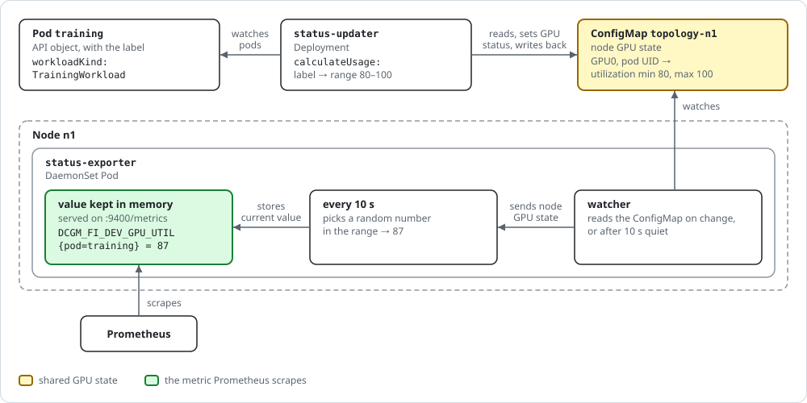
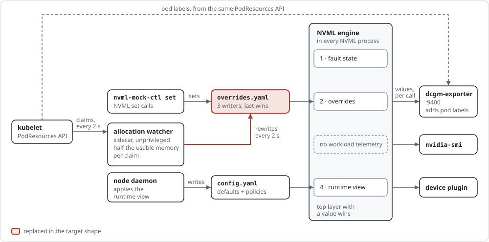
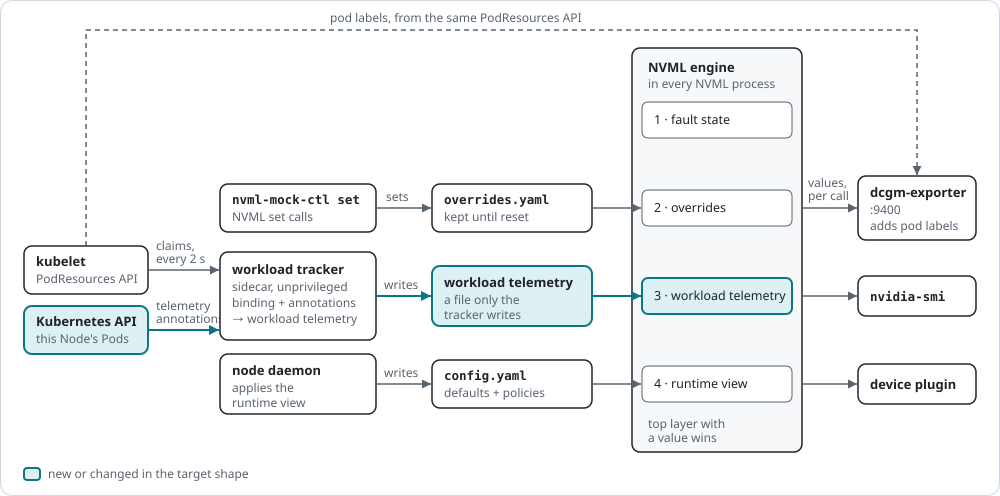
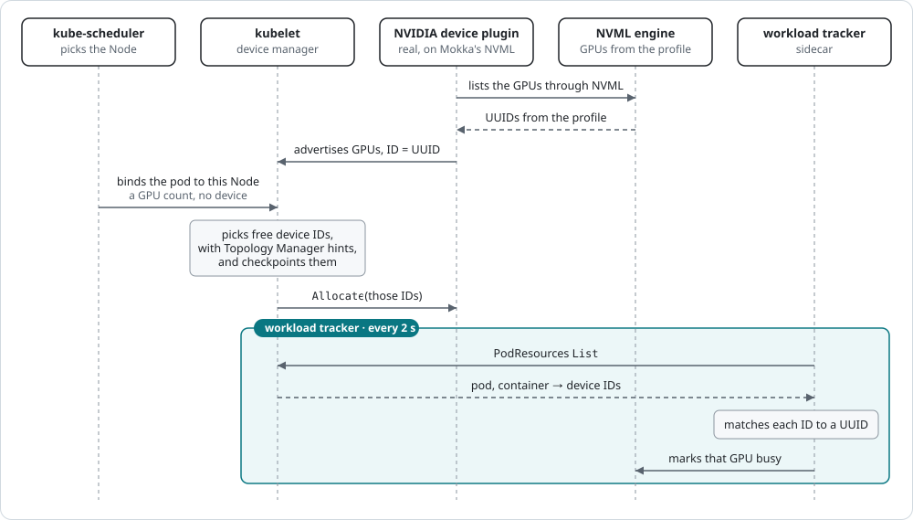
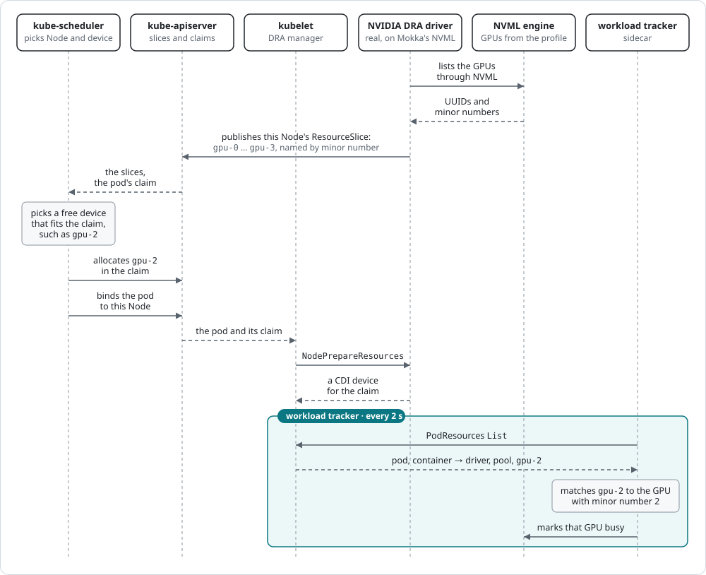
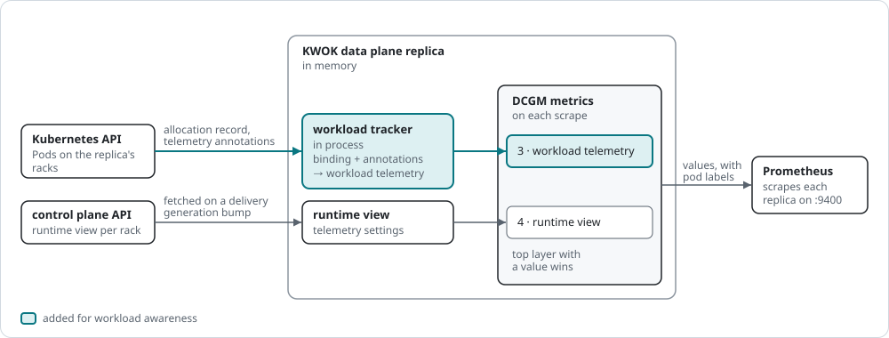
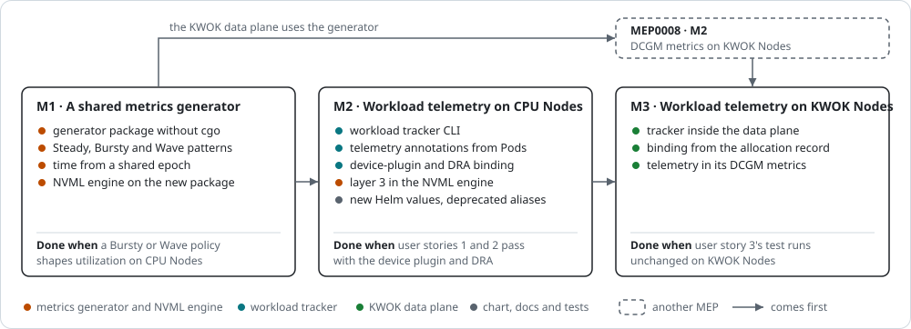

# MEP-0009: Workload-aware Dynamic Metrics

Author: [Roman Hlushko](https://github.com/roma-glushko)

<!-- toc -->
- [Summary](#summary)
- [Motivation](#motivation)
  - [Background](#background)
    - [Metrics](#metrics)
    - [Resource Reservation & GPU Fractions](#resource-reservation--gpu-fractions)
  - [Goals](#goals)
  - [Non-Goals](#non-goals)
- [Proposal](#proposal)
  - [User Stories](#user-stories)
  - [Risks and Mitigations](#risks-and-mitigations)
- [Design Details](#design-details)
  - [Workload-aware Dynamic Metrics](#workload-aware-dynamic-metrics)
    - [CPU Nodes: Workload Tracker](#cpu-nodes-workload-tracker)
    - [Pod-to-GPU Binding](#pod-to-gpu-binding)
    - [KWOK Nodes: Data Plane](#kwok-nodes-data-plane)
  - [Milestones](#milestones)
- [Drawbacks](#drawbacks)
- [Alternatives](#alternatives)
- [Decisions](#decisions)
- [Open Questions](#open-questions)
<!-- /toc -->

## Summary

This MEP makes simulated GPU metrics follow the Pods that use each GPU. A Pod sets its GPUs' utilization and memory use through annotations.

- **CPU Nodes:** the workload tracker, today's allocation watcher, matches Pods to GPUs and turns their annotations into settings for the NVML engine, which dcgm-exporter, `nvidia-smi` and other NVML clients read.
- **KWOK Nodes:** the [KWOK data plane](../0008-fgo-integration/README.md#kwok-data-plane) of MEP0008 does the same in memory and serves the values as DCGM metrics.

This proposal is a part of [Run:ai Fake GPU Operator (FGO) incorporation](../0008-fgo-integration/README.md).

## Motivation

We would like to be able to specify metric simulation information on the level of individual Pods in order to make it more realistic to simulate utilization and other metrics.
This is also needed to close a feature gap with [Run:ai Fake GPU Operator (FGO)](../0008-fgo-integration/README.md#background), which we plan to incorporate into Mokka.

### Background

#### Metrics

FGO supports utilization simulation via custom annotations:

```yaml
apiVersion: v1
kind: Pod
metadata:
  name: fixed-30
  namespace: fgo-lab-04
  annotations:
    run.ai/simulated-gpu-utilization: "30"
spec:
  terminationGracePeriodSeconds: 0
  containers:
    - name: main
      image: "ubuntu:22.04"
      command: ["sleep", "infinity"]
      resources: 
        limits: 
          nvidia.com/gpu: 1
```

The `run.ai/simulated-gpu-utilization` annotation can be:
- a fixed value like `30` which means 30% utilization
- a range like `30-60` so the actual value is sampled from the range

Apart from that, there are a few utilization patterns, chosen by the `workloadKind` label:

- `workloadKind: TrainingWorkload` - jitter in the 80-100 GPU utilization range
- `workloadKind: InteractiveWorkload` - 0 GPU utilization
- `workloadKind: InferenceWorkload` - 0 GPU utilization

Memory utilization is reported based on `GPU memory x GPU fraction`, where [GPU fraction](#resource-reservation--gpu-fractions) is another custom annotation:

```yaml
annotations:
  gpu-fraction: "0.25"
  run.ai/simulated-gpu-utilization: "50"
```

The `status-exporter` runs on each node and is responsible for simulating utilization and serving it as metrics on the well-known DCGM port `9400`:



The metric looks like this in raw Prometheus, with fewer labels than the real dcgm-exporter adds:

```prometheus
DCGM_FI_DEV_GPU_UTIL{Hostname="nvidia-dcgm-exporter-ce3313",UUID="GPU-299e8440-...",container="main",
  device="nvidia2",gpu="2",modelName="NVIDIA A100-SXM4-40GB",namespace="fgo-lab-04",pod="ranged-20-60"} 59
```

#### Resource Reservation & GPU Fractions

Run:ai and KAI share one physical GPU between several workloads without any real GPU partitioning. This is an optimization that binds one GPU to multiple pods with low GPU consumption that do need a real GPU, without underutilizing the whole GPU device.

They park a reservation pod that holds the whole GPU device through the ordinary `nvidia.com/gpu` resource,
then place fractional pods that request no GPU resource at all and just point at the reservation. The kubelet only knows about the reservation pod.

```yaml
apiVersion: v1
kind: Pod
metadata:
  name: reservation-g1
  namespace: runai-reservation # a namespace for placing reservation pods
  labels:
    runai-gpu-group: g1 # the pod group that is then being turned into GPU assignment annotation by FGO e.g. run.ai/reserve_for_gpu_index: GPU-775135a6-f582-540e-84df-8f4e9a049910
spec:
  terminationGracePeriodSeconds: 0
  containers:
    - name: reserve
      image: ubuntu:22.04
      command: ["sleep", "infinity"]
      resources:
        limits:
          nvidia.com/gpu: 1 # requests GPU device
```

Then, the fractional pod looks like this:

```yaml
apiVersion: v1
kind: Pod
metadata:
  name: frac-a
  namespace: fgo-lab-05
  labels:
    runai-gpu-group: g1 # the same gpu group reference
  annotations:
    gpu-fraction: "0.5" # the gpu fraction is set
    run.ai/simulated-gpu-utilization: "30-40"
spec:
  terminationGracePeriodSeconds: 0
  affinity:
    podAffinity: # podAffinity places the fractional pod on the same node as the reservation pod
      requiredDuringSchedulingIgnoredDuringExecution:
        - topologyKey: kubernetes.io/hostname
          namespaces: ["runai-reservation"]
          labelSelector:
            matchLabels:
              runai-gpu-group: g1
  containers:
    - name: main
      image: ubuntu:22.04
      command: ["sleep", "infinity"]
      env:
        - name: NODE_NAME
          valueFrom: {fieldRef: {fieldPath: spec.nodeName}}
        - name: POD_UUID
          valueFrom: {fieldRef: {fieldPath: metadata.uid}}
        - name: RUNAI_NUM_OF_GPUS
          value: "0.5"
      volumeMounts:
        - name: smi
          mountPath: /bin/nvidia-smi # nvidia-smi is how Run:ai bridges a pod without a GPU request to a GPU
  volumes:
    - name: smi
      hostPath:
        path: /var/lib/runai/bin/nvidia-smi
        type: File

  # Note that it requests no GPU by itself
```

The fractional pods get access to the GPU device through a shared `nvidia-smi` CLI mounted from the GPU-enabled node.

The `status-exporter` also leaves a few files intended for the Run:ai container toolkit on the node filesystem:

- `/var/lib/runai/proc/pod/<pod UID>/metrics/gpu/<GPU index>/utilization.sm` - e.g. "34" percent
- `/var/lib/runai/proc/pod/<pod UID>/metrics/gpu/<GPU index>/memory.allocated` - e.g. "20480000000" bytes
- `/var/lib/runai/proc/events/` - created, always empty

### Goals

- Let a Pod set the utilization and memory use of the GPUs it holds through annotations, whether the device plugin or DRA allocated them.
- Give an annotation the same meaning on CPU Nodes and KWOK Nodes.
- Keep GPUs without Pods on the values their profile and runtime policies give them.
- Support the fixed values and ranges that tests set with FGO's `run.ai/simulated-gpu-utilization` annotation.

### Non-Goals

- Metrics that reflect real work. Values follow what a Pod declares, not what it runs.
- Run:ai-specific behavior: FGO's `run.ai/*` annotations, the `workloadKind` patterns and the Run:ai container toolkit files. Tests use Mokka's annotations instead.
- Metrics for Pods that hold no GPU themselves, such as [fractional Pods](#resource-reservation--gpu-fractions). A GPU's metrics follow the Pods it's allocated to.
- Showing a Pod's containers as GPU processes, such as in `nvidia-smi`'s process list.

## Proposal

Mokka supports dynamic metrics today with a few profile patterns (`idle`, `busy`, `burst` and `steady`). That setting is on the GPU level, though; it's not workload-aware.

### User Stories

1. **A busy and an idle workload on one Node.** A test runs a training Pod annotated with `mokka.nvidia.com/gpu-utilization: "80-100"` and a notebook Pod with `"0"` on the same Node. dcgm-exporter reports 80-100% for the training Pod's GPUs and 0% for the notebook's, each series labeled with its Pod, and `nvidia-smi` reports the same values.
2. **A workload goes idle.** A test checks an idle-GPU alert. It annotates a running Pod with `mokka.nvidia.com/gpu-utilization: "0"`, the Pod's GPUs drop to 0%, and the alert fires.
3. **The same test on KWOK Nodes.** Scheduled to KWOK Nodes, the Pods from the first story get the same values from the KWOK data plane's DCGM metrics, so the test runs unchanged on thousands of virtual Nodes.

### Risks and Mitigations

- **The removal of `nvml-mock-ctl watch-allocations`.** The `nvml-mock-ctl watch-allocations` command gets removed. The allocation watcher's container and Helm values get new names. The old Helm values and command stay as deprecated aliases for a release, and the changelog marks the command removal and container rename as breaking.
- **Every CPU Node adds a Pod watch.** At the 100k Nodes Mokka targets, that's 100k more watches on the API server, one next to each kubelet's. The tracker stays opt-in, as the allocation watcher is today, and watches only its Node's Pods and only their metadata, which holds the telemetry annotations.

## Design Details

### Workload-aware Dynamic Metrics

As of today, Mokka's allocation watcher just sets static 50% memory usage on each GPU allocated to a Pod.
We should extend that to make it much more flexible, and FGO's approach is a good example to follow.

> [!NOTE]
> We plan to rename the allocation watcher to the **workload tracker** and split it out of `nvml-mock-ctl` into a separate CLI application, deployed with the Mokka node daemon as it is today. In the target shape it tracks which workloads hold each GPU and what they declare, and keeps each GPU's workload telemetry current for the NVML engine, so a name about watching allocations no longer fits. The rename covers the `allocationWatcher` Helm values, the `allocation-watcher` container and the `nvml-mock-ctl watch-allocations` command. The rest of this document uses the new name, except where it describes how the allocation watcher works today.

The general idea is to use:
- On CPU nodes, the workload tracker, which extends the existing allocation watcher to fetch `Pod` metadata and `PodResources` from the kubelet (what we are doing today) and translate them into workload telemetry for the NVML engine.
- On KWOK nodes, the KWOK data plane, which already allocates GPUs to Pods and watches them, turns the same Pod metadata into each GPU's workload telemetry in memory and generates the metrics on each scrape.

The values of metrics like utilization, memory, etc. should be taken from the workload Pod annotations:

| Annotation                              | Value                                                                                                             | Without it                                 |
|-----------------------------------------|-------------------------------------------------------------------------------------------------------------------|--------------------------------------------|
| `mokka.nvidia.com/gpu-utilization`      | GPU utilization, in percent: a fixed value, such as `30`, or a range, such as `80-100`                            | the runtime view's utilization             |
| `mokka.nvidia.com/gpu-utilization-type` | how utilization moves within the range: `Steady`, `Bursty` or `Wave`, as in the runtime view's telemetry settings | `Steady`                                   |
| `mokka.nvidia.com/gpu-memory-used`      | memory in use on each GPU, in percent of its usable memory: a fixed value, such as `25`                           | `50`, as the allocation watcher sets today |

- The rest of this section calls them telemetry annotations. Each applies to every GPU the Pod holds.
- They're annotations, not labels, because they configure the workload rather than identify it.
- When several Pods share a GPU, their percentages add up, to at most 100.
- A value Mokka can't parse counts as absent and is logged.

#### CPU Nodes: Workload Tracker

Today the allocation watcher turns the kubelet's `PodResources` claims into memory use, half of a GPU's usable memory per claim, and rewrites it into `overrides.yaml` every 2 seconds.
`nvml-mock-ctl` and NVML set calls write the same file, so the last writer wins.
The NVML engine has no layer for workload telemetry, and each NVML process runs the generator on its own clock.
Red marks the parts the target shape changes:



In the target shape, the workload tracker also reads this Node's Pods from the Kubernetes API. It turns binding and telemetry annotations into each GPU's workload telemetry and writes it to a file that only it writes. Like the runtime view's telemetry settings, it says how values move, such as utilization between 80 and 100 percent with half the memory used, not the values themselves. The engine reads that file as layer 3, between manual overrides and the runtime view. The generator counts time from a shared epoch, so every NVML process reports the same series. Teal marks what's new or changed:



#### Pod-to-GPU Binding

On a CPU Node, the workload tracker never decides which GPU a pod gets. It reads the decision back from the kubelet's PodResources API every 2 seconds. On a KWOK Node, the data plane's [allocation record](../0008-fgo-integration/README.md#gpu-allocation) gives the same binding. In the diagrams below, teal marks the workload tracker's steps.

With the device plugin, the scheduler only picks the Node, and the kubelet's device manager picks the device. Under the device plugin's default `deviceIDStrategy: uuid`, each device ID is a GPU UUID, which the plugin read from Mokka's NVML and Mokka took from the profile. So the tracker only has to match IDs to UUIDs:



With DRA, the scheduler picks the device as well as the Node and records it in the ResourceClaim. PodResources reports the device by driver, pool and name, by default from Kubernetes 1.34. The NVIDIA DRA driver names a GPU `gpu-<minor>`, using the minor number Mokka's NVML reports for it, so the tracker matches the number in the name to the GPU with that minor number. It needs no access to the DRA API. Today the allocation watcher reads only device-plugin devices, so reading DRA claims is new:



#### KWOK Nodes: Data Plane

A KWOK Node has no kubelet, NVML engine or processes, so the [KWOK data plane](../0008-fgo-integration/README.md#kwok-data-plane) replica that owns the rack does every step in memory. It runs the workload tracker in process instead of as a sidecar, with the same code as on CPU Nodes, so a Pod's telemetry annotations mean the same on both kinds of Node. Teal marks what workload awareness adds to the data plane:



- **Binding** comes from the [GPU allocation](../0008-fgo-integration/README.md#gpu-allocation) record the data plane keeps for each rack, with a copy on each Pod, for `nvidia.com/gpu` requests and DRA claims alike. The data plane knows a binding as soon as it writes the record, so nothing is polled.
- **Telemetry annotations** come from the [Pod watch](../0008-fgo-integration/README.md#separating-cpu-and-kwok-racks) the data plane already has, so it needs no new API access.
- **Workload telemetry** stays in the replica's memory, since nothing outside the replica reads it. The replica recomputes a GPU's workload telemetry when a Pod on it is allocated, changes or goes away.
- **Values** are computed on scrape, at most once per 10-second step, as [DCGM Metrics](#dcgm-metrics) describes. When a GPU has workload telemetry, `DCGM_FI_DEV_GPU_UTIL` follows it instead of the runtime view, `DCGM_FI_DEV_FB_USED` follows its memory share, and `DCGM_FI_DEV_FB_FREE` is the rest. A GPU without Pods keeps following the runtime view.
- **Only layers 3 and 4 exist.** There's no NVML for `nvml-mock-ctl` to override, and fault injection in KWOK mode is a [non-goal of MEP0008](../0008-fgo-integration/README.md#non-goals).
- **Workload telemetry and values aren't persisted.** Values depend only on telemetry settings and time, counted from an epoch every replica shares, such as the Unix epoch. A replica that restarts, or takes over a rack after a [reshard](../0008-fgo-integration/README.md#sharding), rebuilds the workload telemetry from the allocation records and continues the same series without a jump.

##### DCGM Metrics

Each data plane replica serves DCGM metrics on port `9400` for the GPUs of its own racks, behind a `Service` named `mokka-kwok-dcgm-exporter`, like FGO's `nvidia-dcgm-exporter-kwok`. The [Run:ai cluster operator](../0008-fgo-integration/README.md#kai-use-cases) health-checks that Service. The Service sends each request to one replica, so Prometheus scrapes every replica through the chart's optional [`ServiceMonitor`](../0008-fgo-integration/README.md#kwok-installation), which targets each endpoint behind the Service rather than the Service itself. The metrics are the three fields the health check reads:

| Metric                 | Value                                                                   |
|------------------------|-------------------------------------------------------------------------|
| `DCGM_FI_DEV_GPU_UTIL` | GPU utilization in percent, generated from the GPU's telemetry settings |
| `DCGM_FI_DEV_FB_USED`  | Frame buffer memory in use, in MiB                                      |
| `DCGM_FI_DEV_FB_FREE`  | Frame buffer memory free, in MiB                                        |

Each series carries the labels dcgm-exporter uses. `gpu`, `UUID`, `device`, `pci_bus_id` and `modelName` come from the [rack state](../0008-fgo-integration/README.md#rack-state), `Hostname` from the KWOK Node, and `namespace`, `pod` and `container` from the [GPU allocation](../0008-fgo-integration/README.md#gpu-allocation) while a Pod holds the GPU:

```prometheus
DCGM_FI_DEV_GPU_UTIL{gpu="0",UUID="GPU-<UUID>",device="nvidia0",pci_bus_id="00000008:01:00.0",modelName="NVIDIA GB300 NVL",Hostname="kwok-node-17",namespace="team-a",pod="train-0",container="main"} 87
```

`Hostname` is the GPU's KWOK Node name. On a GPU Node, all series from one dcgm-exporter instance share a `Hostname`, because the instance serves only that Node. The data plane serves many Nodes, so it keeps one value per Node by using the Node name. The `ServiceMonitor` also sets `instance` from `Hostname`, which gives each KWOK Node its own `instance`, as with per-Node exporters.

`DCGM_FI_DEV_GPU_UTIL` follows the GPU's telemetry settings from the [rack state](../0008-fgo-integration/README.md#rack-state). The settings say how the value moves, such as a `Bursty` pattern between 20 and 90 percent, and the data plane's metrics generator turns them into values, as the NVML engine does on CPU Nodes. Both use one generator package, so a policy produces the same series on both kinds of Node. Today the generator is internal to [`pkg/gpu/mocknvml/engine`](../../../pkg/gpu/mocknvml/engine), which uses cgo, and it implements `steady`, `idle`, `busy` and `burst` rather than the `Steady`, `Bursty` and `Wave` patterns the CRD defines. Moving it into its own package, with the CRD's patterns, is part of this work. Whether the generator is flexible and extensible enough to build on is an open question ([Q1](#open-questions)).

`DCGM_FI_DEV_FB_USED` and `DCGM_FI_DEV_FB_FREE` split the GPU's memory and stay constant, as on CPU Nodes, where the NVML engine reports the profile's memory figures unchanged. The data plane generates values for every GPU, with or without a Pod, as the NVML engine does. On a GPU that Pods hold, workload telemetry replaces the utilization and memory values, as [KWOK Nodes: Data Plane](#kwok-nodes-data-plane) describes.

The data plane computes values when it's scraped, at most once per 10-second step, configurable in the Helm chart, much as `dcgm-exporter` serves its last 30-second sample to every scrape. A replica keeps each series' labels and the frame-buffer lines rendered, since those change only when a Pod's allocation or workload telemetry does. The first scrape in a step computes `DCGM_FI_DEV_GPU_UTIL` for the replica's GPUs, compresses the response once and caches it for the rest of the step, and nothing runs while nobody scrapes. Compressing the text is the main cost: about 6 MB per replica with eight replicas, or 50 MB for one replica serving all 72,000 GPUs, so large inventories need more replicas.

### Milestones

We propose one milestone for CPU Nodes, ending with something users can run:



- **M1: Workload telemetry on CPU Nodes.** First, the generator moves out of [`pkg/gpu/mocknvml/engine`](../../../pkg/gpu/mocknvml/engine) into a package of its own without cgo, with the CRD's `Steady`, `Bursty` and `Wave` patterns and time counted from a shared epoch, and the NVML engine switches to it. That settles [Q1](#open-questions) before the tracker or the KWOK data plane builds on the generator. Then the allocation watcher becomes the [workload tracker](#cpu-nodes-workload-tracker), a CLI of its own deployed with the node daemon, under new Helm values and a new container name, with the old ones kept as deprecated aliases for a release. It reads its Node's Pods for the [telemetry annotations](#workload-aware-dynamic-metrics), takes the [binding](#pod-to-gpu-binding) from PodResources for device-plugin and DRA allocations alike, and writes the workload telemetry the NVML engine reads as layer 3. Done when a runtime policy's `Bursty` or `Wave` pattern shapes the utilization dcgm-exporter and `nvidia-smi` report on CPU Nodes, and the first two [user stories](#user-stories) pass with the device plugin and with NVIDIA's DRA driver.

KWOK Nodes get the same telemetry in [MEP0008's M3](../0008-fgo-integration/README.md#milestones), where the [KWOK data plane](#kwok-nodes-data-plane) runs M1's generator and tracker and applies the telemetry to its [DCGM metrics](#dcgm-metrics). [MEP0008's Milestones](../0008-fgo-integration/README.md#milestones) put M1 together with MEP0008's and MEP0010's milestones in one plan.

## Drawbacks

- **The workload tracker needs wider permissions.** Today the allocation watcher is an unprivileged container that reads only the kubelet's PodResources socket. The [workload tracker](#cpu-nodes-workload-tracker) also reads Pods from the Kubernetes API. RBAC can't limit a DaemonSet to the Pods of its own Node, so every Node's tracker can read every Pod in the cluster, plain-text environment variables included.

## Alternatives

**Look up the GPU's UUID in the Node's ResourceSlice.** With DRA, PodResources tells the workload tracker which device a Pod got by its name, such as `gpu-2`, not by its UUID, and [Pod-to-GPU Binding](#pod-to-gpu-binding) reads the minor number from that name. Instead, the tracker could find the device in the ResourceSlice that the NVIDIA DRA driver publishes for the Node and take its `uuid` attribute, as dcgm-exporter does with `--kubernetes-enable-dra`. That would keep working if a driver release stopped naming GPUs after their minor numbers, a change that would make the minor-number match pick the wrong GPU or none. The MEP doesn't use it because the tracker would then depend on the DRA API: it would watch ResourceSlices and need permission to read them, while the minor-number match needs only PodResources and Pods.

## Decisions

The main decisions this MEP makes, numbered for review. Each links to the sections that explain it and the smaller choices that follow from it.

| ID | Decision                                                                                                                                                                                  | Rather than                                                            | Why                                                                                                                                                                                           | See                                                                                                                |
|----|-------------------------------------------------------------------------------------------------------------------------------------------------------------------------------------------|------------------------------------------------------------------------|-----------------------------------------------------------------------------------------------------------------------------------------------------------------------------------------------|--------------------------------------------------------------------------------------------------------------------|
| D1 | Let a Pod set its GPUs' utilization and memory use with Mokka's own telemetry annotations, which take the same fixed values and ranges as FGO's                                           | FGO's `run.ai/*` annotations and `workloadKind` label patterns         | Tests move over by renaming the annotation, Run:ai-specific behavior stays out of Mokka, and annotations configure a workload rather than identify it                                         | [Workload-aware Dynamic Metrics](#workload-aware-dynamic-metrics), [Non-Goals](#non-goals)                         |
| D2 | Turn the allocation watcher into the workload tracker, a CLI of its own deployed with the node daemon                                                                                     | extending `nvml-mock-ctl watch-allocations`                            | It now tracks which workloads hold each GPU and what they declare, which a command for watching allocations no longer describes. The old Helm values stay as deprecated aliases for a release | [Workload-aware Dynamic Metrics](#workload-aware-dynamic-metrics), [Risks and Mitigations](#risks-and-mitigations) |
| D3 | Give workload telemetry its own layer in the NVML engine, between manual overrides and the runtime view, in a file only the workload tracker writes                                       | writing it into `overrides.yaml`, as the allocation watcher does today | `nvml-mock-ctl` and NVML set calls write `overrides.yaml` too, so the last writer wins. With its own layer, overrides still beat workloads, and workloads beat policies                       | [CPU Nodes: Workload Tracker](#cpu-nodes-workload-tracker)                                                         |
| D4 | Describe a workload as a pattern and a range, as the runtime view does, and turn it into values with one cgo-free generator that counts time from a shared epoch                          | each NVML process running its own generator on its own clock, as today | Every NVML process and KWOK data plane replica reports the same series for the same settings, and a restarted replica continues without a jump                                                | [CPU Nodes: Workload Tracker](#cpu-nodes-workload-tracker), [DCGM Metrics](#dcgm-metrics)                          |
| D5 | Read each Pod's GPUs back from the kubelet's PodResources API: device-plugin IDs are GPU UUIDs, and DRA device names `gpu-<minor>` carry the minor number                                 | looking up each DRA device's UUID in the Node's ResourceSlice          | The tracker needs only PodResources and Pods, with no access to the DRA API, for device-plugin and DRA allocations alike                                                                      | [Pod-to-GPU Binding](#pod-to-gpu-binding), [Alternatives](#alternatives)                                           |
| D6 | On KWOK Nodes, run the same tracker code inside the KWOK data plane, with the binding from its allocation record and workload telemetry kept in memory                                    | —                                                                      | Annotations mean the same on both kinds of Node, nothing is polled, and a replica that restarts or takes over a rack rebuilds the telemetry from the allocation records                       | [KWOK Nodes: Data Plane](#kwok-nodes-data-plane)                                                                   |
| D7 | Serve KWOK Nodes' DCGM metrics from every data plane replica behind a `mokka-kwok-dcgm-exporter` Service, with dcgm-exporter's names and labels and each KWOK Node's name as `Hostname`   | a `PodMonitor` with no Service                                         | The Run:ai cluster operator health-checks a DCGM exporter Service, the chart's `ServiceMonitor` still scrapes every replica behind it, and each KWOK Node keeps its own series                | [DCGM Metrics](#dcgm-metrics)                                                                                      |

## Open Questions

Questions this MEP leaves open, numbered for review:

- **Q1. The metrics generator.** Is the current way we simulate dynamic metrics flexible and extensible enough to build upon? The KWOK data plane shares the NVML engine's generator ([DCGM Metrics](#dcgm-metrics)).
