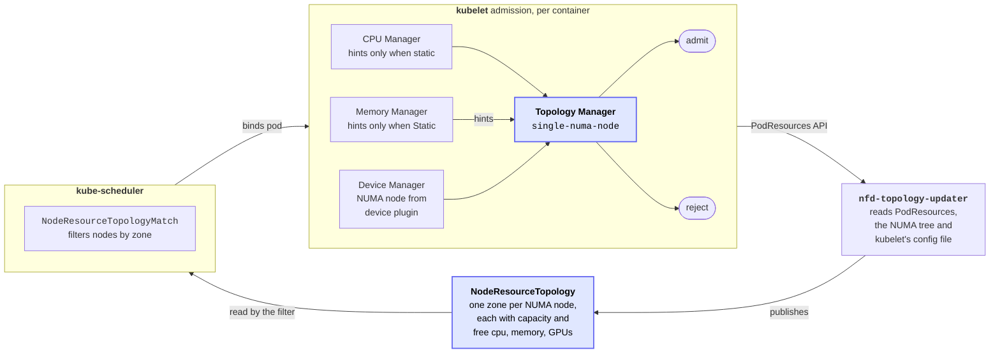
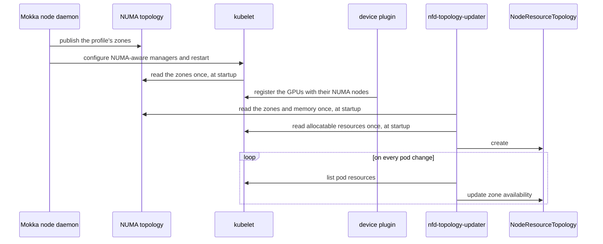

# MEP-0010: NUMA-aware Scheduling

Author: [Roman Hlushko](https://github.com/roma-glushko)

<!-- toc -->
- [Summary](#summary)
- [Motivation](#motivation)
  - [Background](#background)
  - [Goals](#goals)
  - [Non-Goals](#non-goals)
- [Proposal](#proposal)
  - [User Stories](#user-stories)
  - [Notes/Constraints/Caveats (Optional)](#notesconstraintscaveats-optional)
  - [Risks and Mitigations](#risks-and-mitigations)
- [Design Details](#design-details)
  - [NUMA Setup](#numa-setup)
- [Drawbacks](#drawbacks)
- [Alternatives](#alternatives)
<!-- /toc -->

## Summary

NUMA-aware schedulers, such as KAI Scheduler, place GPU Pods using each Node's `NodeResourceTopology` (NRT). The [Run:ai Fake GPU Operator (FGO)](../0008-fgo-integration/README.md#background) fabricates that object. This MEP instead simulates the Node's NUMA layout from its GPU profile, so the real kubelet and Node Feature Discovery (NFD) produce the NRT.

- **CPU Nodes:** the node daemon mounts the profile's NUMA zones into `/sys` and configures the kubelet's NUMA-aware managers. This changes the Node itself and restarts the kubelet and NFD, so it's opt-in and meant for disposable test Nodes, such as Kind Nodes.
- **KWOK Nodes:** the [KWOK data plane](../0008-fgo-integration/README.md#noderesourcetopology) of MEP0008 writes the NRT from the same layout.

This proposal is a part of [Run:ai Fake GPU Operator (FGO) incorporation](../0008-fgo-integration/README.md).

## Motivation

Many schedulers, including [KAI Scheduler](https://github.com/kai-scheduler/KAI-Scheduler/blob/4261bdf0d6bb4304e281ddca6317ff5871338546/docs/numa/README.md), need to consider NUMA topology for workload placement.

This is also needed to incorporate Run:ai FGO functionality into Mokka.

### Background

NUMA-aware schedulers (KAI, the Kubernetes scheduler-plugins) place GPU pods by reading one `NodeResourceTopology` (NRT) object per node:

```
Name:         fgo-lab-worker
Namespace:    
Labels:       <none>
Annotations:  <none>
API Version:  topology.node.k8s.io/v1alpha2
Attributes:
  Name:   topologyManagerPolicy
  Value:  single-numa-node
  Name:   topologyManagerScope
  Value:  container
Kind:     NodeResourceTopology
Metadata:
  Creation Timestamp:  2026-10-28T17:05:25Z
  Generation:          1
  Owner References:
    API Version:     v1
    Kind:            Node
    Name:            fgo-lab-worker
    UID:             0ec5ff95-72a6-4db8-a9ff-d41c3fffcb38
  Resource Version:  922551
  UID:               01ea8497-64d0-4cd6-9fb0-6a91591e38f5
Topology Policies:
  SingleNUMANodeContainerLevel
Zones:
  Costs:
    Name:   node-0
    Value:  10
    Name:   node-1
    Value:  21
  Name:     node-0
  Resources:
    Allocatable:  4
    Available:    4
    Capacity:     4
    Name:         nvidia.com/gpu
    Allocatable:  9
    Available:    9
    Capacity:     9
    Name:         cpu
    Allocatable:  8211190Ki
    Available:    8211190Ki
    Capacity:     8211190Ki
    Name:         memory
  Type:           Node
  Costs:
    Name:   node-0
    Value:  21
    Name:   node-1
    Value:  10
  Name:     node-1
  Resources:
    Allocatable:  4
    Available:    4
    Capacity:     4
    Name:         nvidia.com/gpu
    Allocatable:  9
    Available:    9
    Capacity:     9
    Name:         cpu
    Allocatable:  8211190Ki
    Available:    8211190Ki
    Capacity:     8211190Ki
    Name:         memory
  Type:           Node
Events:           <none>
```

FGO can fabricate those from a `numa` block in a pool.

On a real node, though, NFD creates the NRT resources. This is roughly the information NFD considers:

| Path on the node                                                           | Used for                                                                                                                                                               |
|----------------------------------------------------------------------------|------------------------------------------------------------------------------------------------------------------------------------------------------------------------|
| `/sys/devices/system/node/node<N>/` (the directory list)                   | **Which zones exist.** Each `node<N>` becomes zone `node-<N>`                                                                                                          |
| `/sys/devices/system/node/node<N>/cpu<M>/` and `…/cpu<M>/topology/core_id` | **Which CPUs belong to which zone.** Maps CPU IDs to zones. CPUs the kubelet doesn't list as allocatable count as reserved and are added to that zone's CPU *capacity* |
| `/sys/devices/system/node/node<N>/distance`                                | Zone **costs** (e.g. `10 21`)                                                                                                                                          |
| `/sys/bus/node/devices/node<N>/meminfo` (`MemTotal` line)                  | **Memory capacity** per zone                                                                                                                                           |
| `/sys/bus/node/devices/node<N>/hugepages/hugepages-<size>kB/nr_hugepages`  | **Hugepages capacity** per zone (`hugepages-2Mi`, `hugepages-1Gi`)                                                                                                     |
| `/sys/devices/cpu_*/cpus`                                                  | `cpu_core` / `cpu_atom` attributes, only on hybrid CPUs                                                                                                                |

### Goals

- Give a Node the NUMA layout of its GPU profile, so the real kubelet admits and places Pods by it and NFD publishes the matching NRT.
- Give KWOK Nodes the same NRT as CPU Nodes with the same profile.
- Make the setup opt-in and reversible, and keep it across node daemon restarts and Node reboots.
- Let NUMA-aware schedulers, such as KAI Scheduler, run on Mokka Nodes unchanged. KAI's NUMA e2e suite passes with Mokka instead of FGO.

### Non-Goals

- Physical locality. The kubelet places Pods by the simulated zones, but their CPUs and memory keep the host's real locality.
- Sizing zones independently of the host, as FGO's `cpuPerZone` and `memPerZone` settings do. Zones split the host's real CPUs and memory.
- Changing a Node's NUMA layout or kubelet policy without disrupting the Pods on it.

## Proposal

Mokka should simulate NUMA information according to the GPU rack profile that NFD uses for NRT resource creation.

### User Stories

1. **KAI's NUMA suite on Kind.** The KAI team installs Mokka with the `a100` profile and NUMA setup under the `single-numa-node` policy, then NFD's topology updater and KAI as on real GPU Nodes. NFD publishes an NRT with two zones of four GPUs each, and KAI runs a four-GPU Pod in one zone and leaves a five-GPU Pod Pending.
2. **A placement a real Node would reject.** Under `single-numa-node`, a scheduler places a Guaranteed Pod that needs more CPUs than any zone of its Node has. The kubelet rejects it with `TopologyAffinityError`, as a real Node would, so the test catches the bad placement.
3. **NUMA-aware scheduling at scale.** A KWOK rack group with the same profile gets NRTs from the KWOK data plane that match the CPU Nodes', so KAI's NUMA plugin can be load-tested on thousands of virtual Nodes.

### Notes/Constraints/Caveats (Optional)

<!--
What are the caveats to the proposal?
What are some important details that didn't come across above?
Go in to as much detail as necessary here.
This might be a good place to talk about core concepts and how they relate.
-->

### Risks and Mitigations

- **A bad setup keeps the kubelet down**, as [Drawbacks](#drawbacks) describes. The node daemon's container outlives the kubelet's restart, so it reverts the setup if the kubelet doesn't come back healthy. A reboot also restores the kubelet configuration Mokka found.
- **Guaranteed Pods fail to start without Mokka's NRI plugin**, which rewrites their memory binding ([NUMA Setup](#numa-setup)). The chart refuses NUMA setup while `nri.enabled` is off.
- **Kubelet or NFD releases can change how they read the NUMA tree.** An e2e scenario checks the NRT that NFD publishes, so bumping either version in CI catches the change.
- **KAI's NUMA tests may rely on FGO's zone sizes.** KAI's FGO values give each zone 1 CPU and 2Gi, while Mokka's zones split the Kind host. Profile CPU lists and kubelet reservations can shrink a zone, and tests that still need fixed sizes get adjusted with the KAI team.

## Design Details

### NUMA Setup

On a CPU Node, Mokka doesn't create the `NodeResourceTopology`.
The node daemon gives the Node the NUMA layout of its GPU profile, and the real kubelet and NFD topology updater produce the NRT from it.



[Jonathan Rosenboim](https://github.com/JRosenboimNVIDIA) has prototyped this idea in [#1147](https://github.com/NVIDIA/k8s-test-infra/pull/1147) and [#1148](https://github.com/NVIDIA/k8s-test-infra/pull/1148).

Each part of the NRT traces back to something Mokka has to put in place on the Node:

| In the NRT                                                    | NFD reads it from                                                                                             | Mokka provides                                                                                                                                          |
|---------------------------------------------------------------|---------------------------------------------------------------------------------------------------------------|---------------------------------------------------------------------------------------------------------------------------------------------------------|
| Zones and their costs                                         | The NUMA tree, `/sys/devices/system/node`                                                                     | A zone for each NUMA node of the profile's PCIe root complexes, numbered from 0. Distance 10 within a zone and 21 between zones                         |
| `nvidia.com/gpu` per zone                                     | PodResources. The kubelet takes each GPU's zone from the device plugin, which reads the GPU's PCI `numa_node` | Each GPU's `numa_node` set to its root complex's zone. Its `local_cpulist` and NVML CPU affinity name that zone's CPUs                                  |
| `cpu` per zone                                                | PodResources, only under the static CPU Manager. The NUMA tree maps CPU IDs to zones                          | The Node's real CPU IDs, split across zones without separating a core's hyperthreads, or the profile's per-zone lists. The kubelet's static CPU Manager |
| `memory` per zone                                             | PodResources, only under the static Memory Manager. Capacity comes from `/sys/bus/node`                       | Host memory, split evenly across zones. The kubelet's static Memory Manager, and the memory-binding rewrite below                                       |
| `topologyManagerPolicy` and `topologyManagerScope` attributes | The kubelet's config file                                                                                     | The policy, e.g. `single-numa-node`, and the scope, set on the kubelet                                                                                  |
| Availability                                                  | PodResources, rescanned on pod changes                                                                        | Nothing. It's the kubelet's real allocations                                                                                                            |

The NUMA trees look like this for a two-zone profile with GPU 0 in zone 0, on a host with 8 cores and 2 hyperthreads per core (CPUs *N* and *N*+8 are siblings). Like a real kernel's, they include files that neither the kubelet nor NFD reads. `[Mokka]` marks what the node daemon adds, `[existing]` what Mokka already serves, and `[kernel]` what stays as the kernel has it:

```text
/sys
├── devices/system/
│   ├── node/                                   [Mokka] replaces the kernel's directory
│   │   ├── online, possible, has_cpu, …        0-1
│   │   ├── node0/                              zone 0
│   │   │   ├── cpu0 → ../../cpu/cpu0           CPUs 0-3 and their hyperthreads 8-11 (1)
│   │   │   ├── …
│   │   │   ├── cpulist                         0-3,8-11, read by KAI
│   │   │   ├── cpumap                          the same CPUs as a hex mask
│   │   │   ├── distance                        10 21, the zone's NRT costs (2)
│   │   │   ├── meminfo                         Node 0 MemTotal: host's ÷ 2 (2)
│   │   │   ├── memory0 → ../../memory/memory0  half the real blocks
│   │   │   ├── …
│   │   │   └── hugepages/                      empty (2)
│   │   └── node1/                              zone 1: CPUs 4-7,12-15, distance 21 10
│   ├── cpu/                                    [kernel] what the cpu<K> links point at (3)
│   └── memory/                                 [kernel] what the memory<M> links point at
└── bus/
    ├── node/devices/                           [Mokka] (4)
    │   ├── node0 → ../../../devices/system/node/node0
    │   └── node1 → ../../../devices/system/node/node1
    └── pci/devices/0000:18:00.0/               [existing] GPU 0
        ├── numa_node                           0
        └── local_cpulist                       0-3,8-11

/proc
├── meminfo                                     [kernel] MemTotal, split across the zones
└── <pid>/status                                [kernel] Mems_allowed_list
```

1. The links point at the real CPU directories, so `online`, `core_id`, `physical_package_id` and the caches stay the kernel's. The kubelet and NFD build cores from `core_id`, so a core's hyperthreads have to stay in one zone. Otherwise the kubelet counts that core as two.
2. Every zone needs `distance`, `meminfo` with a `MemTotal` line, and a `hugepages/` directory, even an empty one. If a zone lacks one, NFD stops reading zones there and publishes only the ones before it, without an error. The kubelet tolerates a missing file, and that zone just loses the data. But if it can't parse a file, it can't detect the Node's CPUs and doesn't start.
3. The kernel's own `cpu<K>/node<N>` links stay and point at the real zones. A tool that looks up a CPU's zone from the CPU side gets the kernel's answer, not Mokka's. The kubelet and NFD only look from the zone side.
4. These links point into the tree above, as on a real kernel, so NFD reads memory capacity from the same `meminfo` and `hugepages/`. Without them, NFD sees only the kernel's own NUMA nodes, usually just `node0`. Those resolve into Mokka's tree, so only they get the simulated capacity, and the other zones fall back to their allocatable. On kernels without NUMA support this directory doesn't exist, and NFD's topology updater exits at startup.

The kubelet and NFD each read the layout only once, when they start, so the order matters:



So a NUMA layout change means restarting the kubelet, and any NUMA layout or GPU change means restarting NFD.

Two constraints shape how Mokka does this:

- **The NUMA topology lives in the Node's mount namespace.** The node daemon mounts it there, read-only. The kubelet reads it directly, and NFD reads it through its hostPath mount of `/sys`, so the kubelet and the NRT agree. A pod sees it only if it mounts the Node's `/sys`. It must not leak to other Kind Nodes on the same kernel.
- **Memory binding falls back to the kernel's real memory nodes.** The static Memory Manager binds containers to the memory of zones the kernel doesn't have, and such containers fail to start. Mokka's NRI plugin rewrites the binding to the memory nodes the kernel allows. The kubelet's memory placement is simulated; physical memory locality isn't.

NUMA setup changes the Node itself:
- its `sysfs` topology
- its kubelet configuration

So it's opt-in and meant for disposable test Nodes. How the kubelet treats its state decides what changing the setup involves:

- **Kubelet checkpoints.** The kubelet keeps CPU and Memory Manager checkpoints in `/var/lib/kubelet` and checks them against its policy and the layout it reads. So every policy or NUMA topology change deletes them.
- **A restarted kubelet admits every Pod again.** With the checkpoints gone, the kubelet managers allocate CPUs and memory to running Pods as if they were new, and the CPU Manager moves their containers onto the new CPUs. A Pod the new policy can't fit is marked `Failed` and stopped. Draining the Node first avoids that.

Each step follows from these:

- **Apply.** When the node daemon starts and doesn't find the setup in place, it mounts the NUMA topology, configures the kubelet managers, deletes the checkpoints, and restarts the kubelet and NFD.
- **Restart the node daemon.** When its Pod stops, the node daemon reverts the rest of what it set up on the Node, but leaves this setup in place, because undoing it restarts the kubelet. The new Pod finds the setup in place and doesn't apply it again.
- **Reboot the Node.** The `/sys` mounts are gone, but the kubelet configuration and checkpoints remain. A custom `systemd` unit, installed with the Mokka node daemon setup, runs before the kubelet. It restores the kubelet configuration Mokka found and deletes the checkpoints, so the kubelet starts with the kernel's layout. As with the rest of Mokka's Node state, the node daemon applies the setup again when it starts.
- **Change the NUMA layout.** Undo the setup, then apply the new layout.
- **Revert.** The node daemon unmounts the NUMA topology, removes the `systemd` unit, restores the kubelet configuration, deletes the checkpoints, and restarts the kubelet and NFD.

In KWOK mode, KWOK virtual nodes have no kubelet or NFD.
The [KWOK data plane](../0008-fgo-integration/README.md#noderesourcetopology) writes their NRT from the same layout, taking each GPU's NUMA node from the rack.

## Drawbacks

- **NUMA setup is invasive.** It changes the Node itself, not only what Mokka simulates on it. As [NUMA Setup](#numa-setup) describes, the node daemon rewrites the kubelet configuration, deletes the kubelet's checkpoints, restarts the kubelet and NFD, and installs a `systemd` unit that runs before the kubelet on every boot. The restarted kubelet admits every running Pod again and marks any Pod the new policy can't fit as `Failed`, and a NUMA file it can't parse keeps it from starting at all. The setup also relies on how the kubelet and NFD read the NUMA tree today, such as NFD silently dropping every zone from the first one that lacks a file, and either project can change that in a release. So it suits only Nodes that Mokka is free to reconfigure, such as Kind Nodes, and it depends on Mokka's NRI plugin to rewrite containers' memory binding.

## Alternatives

<!--
What other approaches did you consider, and why did you rule them out? These do
not need to be as detailed as the proposal, but should include enough
information to express the idea and why it was not acceptable.
-->
