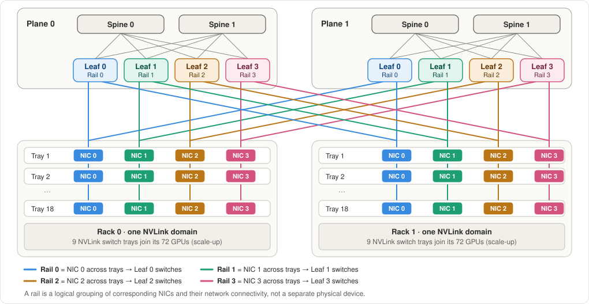
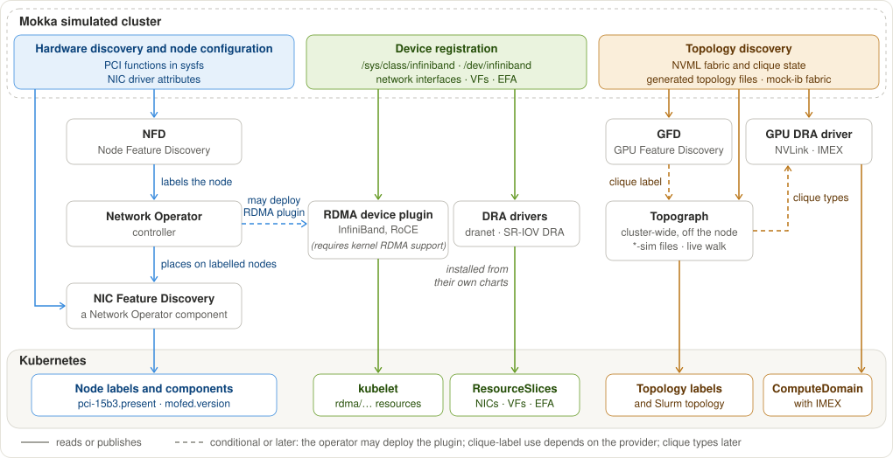
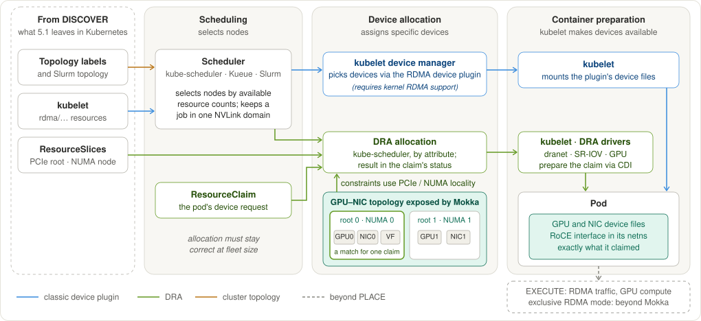
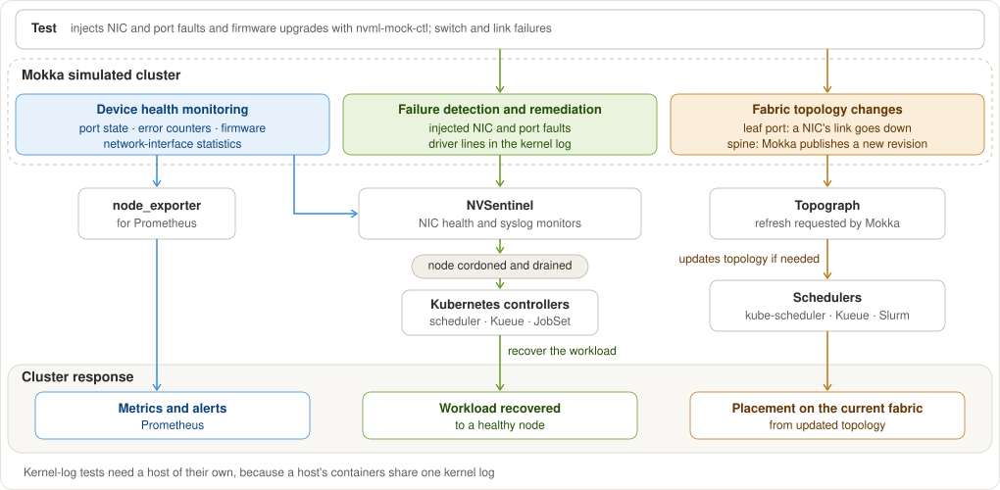
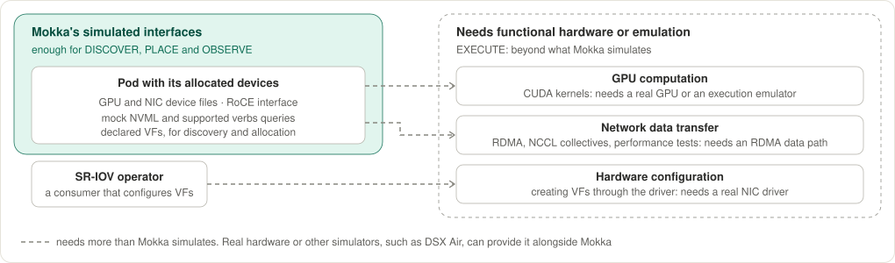

# MEP-0014: Network Simulation in Mokka

Author: [Oleg Leizerov](https://github.com/olegleyz)

## 1. Summary

*Question: why should a reader care, and what do we propose?*

GPUs are only part of an AI cluster. Multi-node training and inference depend
just as much on the network. AI cloud providers race to turn new capacity into running workloads, yet topology and
integration problems often surface only after the hardware arrives.

Simulating the cluster before the hardware lands gives internal NVIDIA teams,
NCPs and their customers a head start. They can validate that the target
hardware is discovered correctly, workloads are placed on the right resources,
and failures are observed and handled as expected. Real capacity can then be
used for workloads rather than integration debugging. This is particularly
valuable for new hardware generations such as Vera Rubin, before infrastructure
teams have access to the hardware.

Mokka simulates the devices and interfaces normally found in DSX OS
clusters on ordinary CPU nodes, allowing infrastructure software to be tested
without access to the actual hardware. Today, Mokka provides this capability
for GPUs. We propose extending it to networking, focusing on discovery,
placement, and failure observation. The proposal builds on three principles:

| Principle | Proposal | See |
|---|---|---|
| **Model** | Extend Mokka's cluster model to declare NICs and the fabric connecting them, alongside the GPUs it already declares | [4.2](#42-cluster-configuration-and-topology) |
| **Interfaces** | Reproduce the software-visible interfaces used by infrastructure components, deriving node-local and fabric-wide representations from the same model | [4.3](#43-device-and-interface-simulation) |
| **Reuse** | Reuse and extend Mokka's existing control plane, node agent, NRI plugin, mock libraries, and runtime overrides wherever practical | [4.1](#41-architecture-overview) |

Delivery is organised into three epics that can progress in parallel where
dependencies permit: cluster declaration and fabric topology, node-local
network simulation, and network health and failures
([Chapter 6](#6-implementation-strategy-and-roadmap)).

## 2. Scope and Design Goals

*Question: what do we validate, what do we leave out, and what must the design
preserve?*

We focus on GPU-to-GPU compute networking and on the interfaces needed for discovery,
placement and observation, not on actual data movement. The solution must
preserve fidelity, extensibility and scalability.

### 2.1 What Mokka is

On each Kubernetes node, Mokka presents the software interfaces that would
normally be available with physical NVIDIA devices, such as NVML, sysfs
(`/sys`) and device files (`/dev`). It also controls their state, including
failures. Infrastructure software runs unmodified against them: operators,
discovery and topology tools, and schedulers. Workloads can be scheduled onto
the simulated devices and see them.

Unlike an emulator, Mokka doesn't reproduce a device's ability to perform
actual work. It simulates device state and behaviour, but has no data path:
nothing computes and no data moves.

### 2.2 What Mokka lets teams validate

| Capability | Question it answers | In scope |
|---|---|---|
| DISCOVER | Does software see the expected devices, capabilities and topology? | Yes |
| PLACE | Are workloads scheduled onto the right resources, allocated the right devices, and given access to them? | Yes |
| OBSERVE | Are runtime state changes and failures visible, and can the software stack react to them? | Yes |
| EXECUTE | Can the workload actually use those devices and paths to perform work and move data? | No: throughput, latency, NCCL behaviour and congestion need emulation, traffic simulation or real hardware |

These are the kinds of validation Mokka enables. They frame the validation
scenarios in [chapter 5](#5-network-simulation-use-cases).

### 2.3 Which network

This proposal focuses on GPU compute networking, primarily scale-out. It
builds on Mokka's existing NVLink simulation, adding GPU-to-NIC relationships
without extending NVLink capabilities. New scale-up architectures, such as
NVL576 with multi-rack NVLink domains, dynamic partition management, and
additional NVLink failure injection are out of scope. A follow-up MEP can
address these capabilities once the relevant reference architectures and
validation requirements are available
([#1150](https://github.com/NVIDIA/k8s-test-infra/issues/1150)). Storage and
management networks are
outside the initial scope
([#1163](https://github.com/NVIDIA/k8s-test-infra/issues/1163)).
[Appendix B](#b-the-four-fabrics-in-detail) describes the four fabrics in more
detail.

| Fabric | Carries | In scope |
|---|---|---|
| Compute: scale-up | GPU-to-GPU traffic inside an NVLink domain | Existing simulation; no new NVLink capabilities |
| Compute: scale-out | GPU-to-GPU traffic between domains (InfiniBand, RoCE, CSP-specific fabrics such as AWS EFA) | Yes |
| Storage | File systems, checkpoints, I/O | No, for now |
| In-band management | Cluster management, user and repository access | No, for now |
| Out-of-band management | Power control, serial console, recovery | No: StratumSim simulates it |

### 2.4 Design goals

| Goal | What it means | How we check it |
|---|---|---|
| **Fidelity** | Mokka reproduces network device attributes, interfaces, topology and state accurately enough for meaningful infrastructure validation | Unmodified consumers produce the expected labels, resources, allocations and events for the declared hardware configuration |
| **Extensibility** | New hardware generations and configurations need no fundamental change to existing simulation mechanisms, as long as their interface contracts stay supported | Demonstrate that different hardware generations can reuse the same simulation mechanisms, with changes localised to profiles or new interface support; the follow-up low-level design (MEP-0015) will show what changes in the declaration |
| **Scalability** | Network simulation keeps Mokka usable on large clusters without disproportionate overhead | Validate topology generation at scale and measure the incremental CPU, memory and start-up overhead of network simulation |

### 2.5 Where Mokka runs

| Environment | What is real | What Mokka provides | Constraint |
|---|---|---|---|
| **Standalone:** Kind on a laptop, CI, shared CPU clusters | Nothing | Every GPU and network surface; topology from the declaration | Simulated nodes on one host share its kernel |
| **With DSX Air** | Real switch software on VMs; hardware emulators (SystemSim, ChipSim, SimX) | Only the devices no real or emulated driver provides, and the GPU side of the topology | Mokka must stay in sync with the rest of the DSX Air environment: the same devices, topology and state. Emulators add real network-side failures, and real driver output to check Mokka against |
| **NCP or CSP infrastructure** | CPU nodes, managed Kubernetes, the CNI; sometimes real GPU nodes | Simulated GPUs and NICs, alone or next to real nodes | Managed clusters may forbid the privileges Mokka needs; some NICs aren't NVIDIA's (AWS EFA) |

These environments introduce different requirements rather than separate
implementation commitments. Mokka must coexist with real or emulated devices
without overriding them. Integration with external simulators such as DSX Air
requires a shared declaration and fault-injection model and is deferred to a
separate proposal ([#1166](https://github.com/NVIDIA/k8s-test-infra/issues/1166)).
Cloud-specific device simulation, including AWS EFA adapters, is within this
proposal's scope. Cloud topology is exposed through the same generic topology
interface as other fabrics ([4.3.3](#433-fabric-topology-discovery));
simulating a provider's topology API, such as EC2's, is a later extension.

## 3. Network Devices and Software Surfaces

*Question: what does real network hardware expose to infrastructure software,
and so what must Mokka represent?*

Real networking hardware exposes several different interfaces to
infrastructure software. These interfaces define what Mokka needs to
reproduce. This chapter walks through the hardware that makes up a GPU compute
network and names what each part adds;
[chapter 4](#4-proposed-design) says how Mokka reproduces it. Terms are defined
in [Appendix D](#d-glossary).

### 3.1 The GPU-to-GPU compute network

**Scale-up.** NVLink connects GPUs within a high-bandwidth domain, potentially
spanning multiple compute nodes. NVSwitch extends this connectivity beyond a
single server. For example, both GB300 and Vera Rubin NVL72 racks connect 72
GPUs across 18 compute nodes through NVLink.

**Scale-out.** Each node has network adapters (NICs), typically NVIDIA
ConnectX, which connect to leaf switches, then to spine and sometimes core
switches. In a rail-optimised fabric, corresponding NICs across nodes (e.g.,
NIC 0 on each node) connect to the same group of leaf switches, forming a rail.
This reduces the number of switch hops between the GPUs associated with those
NICs. A fabric may also have multiple independent planes, each with its own
switches and links, providing separate paths for network traffic. The network
supports RDMA over InfiniBand or RoCE over Ethernet; some clouds use
alternatives such as AWS EFA.



*Figure: Example of a dual-plane, rail-optimised GPU compute fabric connecting
two GB300 NVL72 racks. Based on NVIDIA's
[NVL72 AI Factory Network Logical Architecture](https://docs.nvidia.com/enterprise-reference-architectures/nvl72-ai-factory/latest/network-logical-architecture.html).*

Software sees the two differently. Scale-up topology and state are primarily
exposed to node software through NVML, while scale-out networking also exposes
NICs, their ports, and fabric connectivity through several different
interfaces.

### 3.2 Scale-up: what software sees of NVLink

| What software learns | Where it reads it | Read by |
|---|---|---|
| Which GPUs are linked, and each link's state, rate and errors | NVML, `nvidia-smi` | DCGM, NCCL, NVSentinel |
| Which NVLink domain and partition a GPU belongs to (ClusterUUID and CliqueID) | NVML fabric information | GPU Feature Discovery (GFD) publishes this information as the `nvidia.com/gpu.clique` node label through NFD. The GPU DRA driver can also publish the label directly, while Topograph can consume it for topology-aware placement. |
| Whether the GPU has registered with the NVLink fabric, and the fabric's health | NVML (`nvidia-smi -q`) | GPU Operator validator, DCGM / NVSentinel |
| Available IMEX channels for cross-node GPU memory access | `/dev/nvidia-caps-imex-channels/`, `/proc/devices` | GPU DRA driver's ComputeDomains; workloads requesting IMEX channels |

**How a domain comes up.** On rack-scale NVLink systems, fabric management
establishes the domain and makes its state available to the GPUs. Mokka
presents the resulting software-visible state rather than reproducing the
fabric initialisation process.

### 3.3 Scale-out: what software sees

#### 3.3.1 On the node

When a NIC is installed in a server, it becomes visible to software through
several layers. PCIe describes the device's identity and location relative to
GPUs and CPUs. The driver exposes network and RDMA interfaces, including their
capabilities and state. These interfaces don't necessarily correspond
one-to-one to physical NICs or network connections.

Infrastructure software uses this information to discover devices, determine
GPU-to-NIC locality, allocate resources, and monitor network health.

| What software learns | Where it reads it | Read by |
|---|---|---|
| PCI vendor/device identity, address, and position relative to GPUs through root complexes and PCIe switches | PCI sysfs (`/sys/bus/pci/devices/`), `/sys/devices/`, `lspci` | NFD, dranet, SR-IOV DRA driver |
| Which CPU NUMA node a device is associated with | `numa_node` in PCI sysfs | dranet, for claims that pair a GPU with a nearby NIC |
| RDMA device (HCA) identity, firmware, capabilities, and ports; applies to InfiniBand and RoCE, with provider-specific differences for EFA | `/sys/class/infiniband/`, RDMA netlink, `ibv_devinfo` | RDMA device plugin, dranet, NVSentinel |
| Character devices that userspace RDMA libraries open | `/dev/infiniband/` (`uverbs*`, `umad*`, `issm*`, `rdma_cm`) | RDMA device plugin and DRA drivers, which expose them to pods; RDMA libraries in workloads |
| Ethernet interface identity, operational state, and counters | `/sys/class/net/`, rtnetlink | dranet, node_exporter |
| Which NIC is associated with a GPU, including cases where PCIe proximity alone is insufficient | PCIe topology, NVML topology, device-specific metadata such as PCI VPD ([Appendix H.2](#h2-gpu-to-nic-association-cannot-always-be-inferred-from-pcie-locality)) | DRA drivers pairing GPUs with NICs; NVSentinel, through `nvidia-smi topo -m`; topology tools such as `rdma_topo` |
| Port link state, speed, errors, and counters | RDMA sysfs, network sysfs, netlink | NVSentinel, node_exporter |
| Loaded NIC drivers and module parameters | `/sys/module/`, `/proc/modules` | NFD, NIC Feature Discovery |

A physical NIC may expose multiple PCI functions and RDMA interfaces. For
example, a GB300 InfiniBand configuration exposes primary RDMA devices and
additional SMI devices (`smiN`) with plane-specific ports
([Appendix H.1](#h1-rdma-devices-and-network-planes-are-not-one-to-one)).
GPU-to-NIC association may also involve Data Direct PCI functions rather than
following PCIe proximity alone
([Appendix H.2](#h2-gpu-to-nic-association-cannot-always-be-inferred-from-pcie-locality)).
These distinctions matter because infrastructure software observes the
resulting interfaces, not just the physical NIC.

#### 3.3.2 Beyond the node

Beyond the server, infrastructure software needs to understand how NICs connect
through the fabric. This includes which switches and ports they connect to, how
switches are arranged into tiers, and how the network is organised into rails
and planes.

| What software learns | Where it reads it | Read by |
|---|---|---|
| InfiniBand switches, ports and links | Subnet Administration queries; directed-route management queries where supported | Topograph's InfiniBand provider |
| Fabric topology and state from external topology services | Fabric management APIs (e.g., NVIDIA Minerva for Spectrum-X), cloud-provider topology APIs where available, or topology files | Topograph's fabric and cloud providers |

Topograph uses fabric information to publish node topology labels and Slurm
topology. Schedulers and placement systems can then use this information to
keep related workloads close together.

These surfaces are separate interfaces, even when they describe the same NIC:
reproducing a sysfs file does not reproduce the matching device node or RDMA
netlink answer. [Appendix C](#c-software-visible-network-interfaces-and-acceptance-criteria) lists
the surfaces the use cases need, the behaviour each must expose, and how to
check it.

## 4. Proposed Design

*Question: without physical devices or a real fabric, how does Mokka create
that consistent representation?*

We extend Mokka's existing cluster model to describe network devices and
topology, then simulate the interfaces through which infrastructure software
discovers and interacts with them.

### 4.1 Architecture overview

Without physical hardware, Mokka needs a description of the devices, their
attributes, and connections. The test author provides this through a cluster
declaration covering GPUs, NICs, and network topology. Mokka uses the
declaration to produce two views: node-local devices and interfaces, and
cluster-wide network topology. Both derive from the same hardware and fabric
resources ([4.2](#42-cluster-configuration-and-topology)).

The control plane will resolve the declared hardware and fabric resources into
consistent node-local and cluster-wide views. It delivers node-visible
configuration through `SGPURack`. Node agents render the simulated interfaces,
while the resolved fabric topology is exposed to cluster-wide consumers such as
Topograph. Changes affecting both views must remain consistent. For example, a
NIC discovered through PCI/sysfs must have the same identity and connectivity
in the fabric topology.

The diagram below illustrates how Mokka turns the cluster declaration into
these interfaces. [Section 4.3](#43-device-and-interface-simulation) explains
how Mokka simulates the interfaces without physical network hardware.

![Architecture: a test author declares the cluster with SGPURackProfile, SGPUInventory, SFabricProfile and SFabricInventory, and sets runtime policies, SGPURuntimePolicy for devices and SFabricRuntimePolicy for fabrics; Mokka's control plane resolves the cluster model, delivers each node's effective view through the controller-owned SGPURack to the node-local components, and exposes the generated topology through a generic topology interface to Topograph; node-local consumers read the simulated interfaces, and schedulers consume Topograph's topology information](img/architecture.svg)

*Figure: From cluster declaration to node-local interfaces and fabric topology.*

### 4.2 Cluster configuration and topology

We propose extending Mokka's existing profile-and-inventory model to describe
NICs, their relationships to GPUs, and the network fabric connecting them.

The declaration separates hardware configuration from fabric topology and
membership:

| Resource | Responsibility |
|---|---|
| `SGPURackProfile` | GPU and NIC hardware, PCIe/NUMA placement, and GPU-to-NIC relationships |
| `SGPUInventory` | Compute racks, nodes, and hardware population |
| `SFabricProfile` | Reusable network topology and attachment rules |
| `SFabricInventory` | Fabric instances, participating racks, and connectivity deviations |

Mokka will resolve these resources into node-local hardware configurations and
a canonical network topology. Fabrics may span multiple hardware inventories,
and racks may participate in multiple fabrics.

NIC models describe device capabilities independently of network purpose.
Fabric profiles select compatible endpoints, while fabric inventories determine
which racks participate. This allows the same NIC hardware to serve different
network purposes without assigning it a fixed role.

We represent PCI functions, GPU associations, RDMA interfaces, and fabric
endpoints separately because their relationships are not always one-to-one.
For example, a NIC may expose multiple PCI functions and RDMA interfaces
([Appendix H.1](#h1-rdma-devices-and-network-planes-are-not-one-to-one)),
while on GB300, the Data Direct and network functions of an associated NIC may
reside under different PCIe roots
([Appendix H.2](#h2-gpu-to-nic-association-cannot-always-be-inferred-from-pcie-locality)).

The follow-up low-level design, MEP-0015, will specify the canonical model,
declaration schema, deterministic generation rules, structural deltas, and
fabric runtime policies. How the declared NIC relationships are rendered as
PCIe, sysfs, RDMA, and other node-local interfaces remains part of this
proposal ([4.3](#43-device-and-interface-simulation)).

The control plane owns device identities and relationships that must agree
across the cluster. The node agent applies the declared configuration while
resolving conflicts with genuine devices, which take precedence over simulated
ones. This includes PCI addresses and device numbers. Any local adjustment must
preserve the device's logical identity and remain consistent across its
software-visible interfaces. When the adjustment affects information used by
cluster-wide consumers, the agent reports the resolved attributes to the
control plane.

### 4.3 Device and interface simulation

The cluster model defines which devices exist, their relationships, and their
state. Mokka must reproduce the interfaces through which infrastructure
software observes them. As described in
[Chapter 3](#3-network-devices-and-software-surfaces), these range from files
and library calls to kernel objects and fabric topology sources. Each requires
a different simulation mechanism, with different implications for where Mokka
can run. The table summarises the proposed simulation mechanisms and their
limitations.

| Kind of interface | Examples | How Mokka provides it | Where it works |
|---|---|---|---|
| **Files and library answers** | `cat /sys/class/infiniband/mlx5_0/ports/1/state`; `nvidia-smi topo -m`; `ibv_devinfo` | Renders sysfs and provides mock NVML and supported userspace verbs responses | Anywhere for supported mock-library operations |
| **Kernel-visible objects** | `ls -l /dev/infiniband/`; `ip link show` | Creates character-device nodes and Linux network interfaces | Anywhere |
| **Kernel RDMA subsystem** | `rdma link show` | Uses genuine host RDMA kernel capabilities where available; Mokka does not fabricate arbitrary per-device RDMA netlink responses | Not on Mac with Docker Desktop; requires suitable Linux kernel support |
| **Fabric topology sources** | `ibnetdiscover`; AWS EC2 API; Ethernet fabric-management APIs | Exposes the generated topology through a generic interface; adapters for specific sources when needed | Anywhere |

"Anywhere" means wherever Mokka runs, including Kind on a Mac. Mokka requires a
privileged node agent. Managed Kubernetes environments that prohibit privileged
workloads cannot support the proposed simulation mechanisms.
[Appendix C](#c-software-visible-network-interfaces-and-acceptance-criteria) defines the expected
software-visible behaviour of the proposed simulation mechanisms.

#### 4.3.1 Filesystem and library interfaces

Mokka's node agent renders the declared PCI and RDMA devices as a kernel-shaped
sysfs tree, including device identities, PCIe relationships, driver links, and
RDMA attributes. The NRI plugin exposes this tree to containers while
preserving genuine devices: the host's own `/sys` is never modified, and real
devices take precedence over simulated ones. Mokka checks which devices a
real or emulated driver provides and simulates only what is missing, so it can
run next to DSX Air's emulators and on clusters with real GPU nodes. Mock NVML
provides the
corresponding GPU and GPU-to-NIC topology information, including the
relationships used by `nvidia-smi topo -m`.

The rendered PCIe tree must preserve the declared root complexes, switches,
physical and virtual functions, and GPU-to-NIC associations. Consumers such as
`rdma_topo` must observe a consistent topology, including cases where a NIC's
Data Direct and network functions reside under different PCIe roots
([#995](https://github.com/NVIDIA/k8s-test-infra/issues/995),
[Appendix H.2](#h2-gpu-to-nic-association-cannot-always-be-inferred-from-pcie-locality)).

This extends Mokka's existing sysfs mechanism (MEP-0005) in two important ways.
First, some consumers, including NFD, node_exporter, and NVSentinel, read the
host's `/sys` through a hostPath mount, while others inspect their container's
own `/sys`. Mokka must support both. Second, simulated entries must coexist
with genuine sysfs entries rather than replace them. The
prototypes showed that replacing
the entire view removed NFD's host labels and broke node_exporter's CPU
collector. The proposed NRI mechanism merges both views for each consumer
without modifying the host filesystem. This changes MEP-0005's existing sysfs
approach to support per-container merged views through NRI.

Network interfaces require special handling because their visibility depends
on the consumer's network namespace. Mokka must render `/sys/class/net`
consistently with the interfaces visible in that namespace, including when an
interface is moved into a pod. The NRI integration must therefore account for
namespace-specific views rather than exposing the node's network interfaces
unchanged to every container.

Until NFD can discover the simulated NICs directly, Mokka can also publish
`pci-15b3.present` through its existing NFD feature file. This allows the
Network Operator to place its components on simulated NIC nodes, as
demonstrated by a prototype.

#### 4.3.2 Kernel-visible interfaces

Beyond reading sysfs, some consumers open device nodes under
`/dev/infiniband/`, query Linux network interfaces, or call RDMA libraries and
kernel interfaces. Mokka handles each through a different mechanism, so what a
consumer can do on Mokka depends on the exact interfaces it uses, not simply on
whether it performs discovery, allocation, or execution.

| Interface | Proposed mechanism | What it enables | Where it works |
|---|---|---|---|
| **Device nodes** | Create character-device nodes under `/dev/infiniband/` with non-conflicting device numbers | Device-node discovery and allocation through CDI and kubelet | Anywhere |
| **Linux network interfaces** | Create dummy interfaces with declared MAC addresses and link state | Network-interface discovery through sysfs and rtnetlink | Anywhere |
| **RDMA userspace and kernel interfaces** | Mock userspace verbs responses through `libibmockverbs.so`; the host's RDMA subsystem where the kernel supports it | Device queries such as `ibv_devinfo`; on suitable hosts, some discovery and allocation workflows | Mock verbs: anywhere. Kernel RDMA subsystem: not on Mac with Docker Desktop |

Mokka creates `/dev/infiniband/*` character-device nodes for consumers that
inspect or allocate them, but creating these nodes does not register
functioning RDMA hardware with the kernel. Dummy interfaces, by contrast, are
genuine kernel network interfaces that respond to sysfs and rtnetlink queries.
They have no underlying PCI device, so Mokka provides the corresponding PCI
relationship through its simulated sysfs view when consumers require it.

Mokka can also intercept selected userspace RDMA operations through
`libibmockverbs.so`, allowing tools such as `ibv_devinfo` to query simulated
devices without a functioning RDMA driver. This does not register those
devices with the kernel or enable RDMA data transfer. Consumers querying RDMA
netlink still see only devices registered with the host kernel. On hosts with
suitable RDMA kernel support, some discovery and allocation workflows can also
use the host's RDMA subsystem, but moving from Docker Desktop to another Linux
environment does not by itself make every RDMA operation work.

[Chapter 5](#5-network-simulation-use-cases) evaluates these limitations
against specific consumer use cases, identifying which workflows Mokka can
validate with unmodified infrastructure software.

#### 4.3.3 Fabric topology discovery

Infrastructure software discovers network topology through different
mechanisms, including InfiniBand management queries, Ethernet
fabric-management services, and cloud APIs.

We propose exposing the generated topology and its effective runtime state
through a generic interface. Topograph, currently the only identified consumer
of fabric-wide topology, can consume it through a provider without requiring
Mokka to emulate the underlying discovery protocols. The follow-up low-level
design (MEP-0015) will describe the canonical model and interface contract.

Consumer-specific adapters may be added when needed, such as
`ibnetdiscover`-compatible output or cloud topology API simulation. These are
extensions rather than initial implementation requirements. Prototypes showed
that they are feasible: `mock-ib` answered a live `ibnetdiscover` walk of a
generated fabric, and API stand-ins served Topograph's production `aws` and
`netq` providers ([Appendix F](#f-prototypes)).

This approach validates topology processing and the resulting
scheduler-visible information. Testing a consumer's production discovery
protocol requires an additional adapter or simulation mechanism.

#### 4.3.4 Runtime state and failures

Mokka simulates NIC operational state through its existing node-local
mechanisms, including runtime overrides. Changes must be reflected
consistently across the software-visible interfaces that expose them, such as
RDMA sysfs, network interfaces, counters, and library responses.

The existing `nvml-mock-ctl` override mechanism provides the initial path for
injecting NIC failures. Prototypes demonstrated
failures involving port state, device disappearance, missing device files,
counters, and firmware attributes, observed by unmodified NVSentinel and
node_exporter consumers. Fleet-wide faults would later use the control plane
and the planned fault-injection CRD
([#533](https://github.com/NVIDIA/k8s-test-infra/issues/533)).

We propose managing fabric failures independently of GPU runtime policies,
through fabric runtime policies (`SFabricRuntimePolicy`). The control plane
will compute their effects on the resolved topology and propagate node-visible
changes through the affected `SGPURack` resources. For example, a failed leaf
port may bring down the connected NIC port, while a spine failure may change
cluster-wide connectivity without changing node-local link state. The
follow-up low-level design will specify fabric-policy resources and targeting.

For consumers that detect NIC failures through kernel logs, we propose
emitting driver-like messages associated with simulated faults. Because the
kernel log is shared by containers on the same host, these tests require an
isolated execution environment.

**Agent restarts.** MEP-0014 keeps Mokka's existing node-agent lifecycle
(MEP-0003): the agent tears down simulated surfaces when it stops and resets
node-local runtime overrides when it starts. An agent restart can therefore
briefly remove simulated NICs and clear faults injected through
`nvml-mock-ctl`, which consumers may report as a hardware failure or a
recovery. This applies to every Mokka simulator, not only networking, so
restart and uninstall behaviour will be decided for all of Mokka in
[#1167](https://github.com/NVIDIA/k8s-test-infra/issues/1167).

#### 4.3.5 Alternatives and trade-offs

We considered three approaches to exposing simulated hardware interfaces to
unmodified consumers. The main trade-off is between fidelity to the Linux
kernel and portability across development environments, particularly Mac with
Docker Desktop.

| Approach | Advantages | Limitations |
|---|---|---|
| **NRI-mounted filesystem views** (proposed) | Preserves genuine devices without modifying the host's `/sys`; works on Docker Desktop + Kind; supported by prototypes | Requires NRI integration; the cost of its mounts at pod start is unmeasured; containers started while NRI is unavailable may miss simulated devices; does not provide kernel RDMA devices or APIs; requires complementary mechanisms for consumers that use them |
| **FUSE filesystem** | Can combine genuine and simulated files into a single filesystem view | Adds a daemon to filesystem reads; daemon failures affect consumers; requires FUSE support in the host environment |
| **Kernel-backed emulation or syscall interception** | Can provide genuine kernel-visible devices and APIs, potentially supporting consumers that require RDMA kernel operations; seccomp-based interception could answer selected kernel calls without custom kernel modules | Significantly more complex; kernel modules require compatible kernel support and may not work on Docker Desktop or managed Kubernetes clusters; syscall interception must reproduce kernel behaviour for every call it answers |

We propose NRI-mounted filesystem views, combined with complementary
mechanisms rather than competing alternatives: mock libraries for NVML and
supported userspace RDMA interfaces; character-device nodes and dummy network
interfaces where consumers require kernel-visible objects; and a generic
topology interface for cluster-wide consumers such as Topograph. Together they
preserve
Mokka's ability to run on ordinary CPU infrastructure, including Docker
Desktop + Kind, without requiring custom kernel modules.

The trade-off is that Mokka does not simulate the kernel's RDMA subsystem per
device, and the generic topology interface does not exercise live fabric
discovery. Kernel-backed emulation, syscall interception, and live protocol
simulation are additional capabilities to introduce when specific consumer
requirements justify their complexity.
[Chapter 5](#5-network-simulation-use-cases) evaluates the coverage and
limitations of the proposed approach against actual consumers.

## 5. Network Simulation Use Cases

*Question: what network simulation use cases does Mokka enable, and what are
their limitations?*

Mokka aims to enable infrastructure teams to validate how their software
discovers, allocates, and monitors network devices and fabric topology without
requiring physical networking hardware. This chapter describes the use cases
across the DISCOVER, PLACE, and OBSERVE capabilities introduced in
[Chapter 2](#2-scope-and-design-goals), along with the boundaries of EXECUTE.

The diagrams show how infrastructure components interact, while the tables
summarise the validation use cases.
[Chapter 6](#6-implementation-strategy-and-roadmap) covers the proposed delivery
sequence, and the [appendices](#appendices) provide supporting evidence and
use-case traceability.

Unless otherwise noted, the proposed use cases can run anywhere Mokka's
privileged node agent is supported, including Mac with Docker Desktop and Kind.
Each subsection identifies workflows that require a different environment or
are outside Mokka's scope.

### 5.1 DISCOVER

DISCOVER covers the interfaces and workflows through which infrastructure
software identifies simulated devices, configures the node, and registers
available resources with Kubernetes. Mokka exposes the declared hardware and
topology through the same interfaces these components use on real clusters,
allowing their discovery and initialisation paths to be validated without
physical NICs.

The discovery workflow has three complementary paths:

| Path | Validation use cases | Consumers |
|---|---|---|
| **Hardware discovery and node configuration** | Discover PCI NICs, identify compatible nodes, deploy networking components, and report driver attributes | NFD, Network Operator, NIC Feature Discovery |
| **Device registration** | Discover InfiniBand/RoCE NICs, SR-IOV VFs, and EFA devices; advertise available resources to Kubernetes | RDMA device plugin, dranet, SR-IOV DRA driver |
| **Topology discovery** | Discover NVLink domains, GPU/NIC relationships, scale-out switch topology, and cloud placement | GFD, GPU DRA, Topograph |



These discovery paths are not necessarily sequential. For example, device
plugins and DRA drivers may discover devices independently of NFD, while
Topograph processes fabric topology separately. Together, they validate the
discovery lifecycle from simulated hardware visibility to Kubernetes resource
and topology awareness.

Most discovery workflows can run anywhere Mokka runs, including Mac with
Docker Desktop and Kind. Some consumers, such as the RDMA device plugin, require
kernel RDMA support and cannot complete their discovery and registration
workflows on Docker Desktop using the proposed mechanisms. Fabric topology
processing uses Mokka's generic topology interface and a Topograph provider.
Simulating individual discovery protocols requires additional adapters. These
workflows have been exercised with unmodified infrastructure components, with
results and remaining limitations documented in [Appendix F](#f-prototypes).

### 5.2 PLACE

PLACE covers how infrastructure software selects nodes and allocates devices to
workloads using the resources and topology discovered in the previous phase.
Mokka allows teams to validate these decisions with simulated GPUs and NICs,
including device availability, GPU/NIC locality, and cluster-wide
connectivity, without requiring workloads to perform actual GPU computation or
RDMA communication.

The placement workflow has three complementary paths:

| Path | Validation use cases | Consumers |
|---|---|---|
| **Resource allocation** | Allocate GPUs, NICs, and SR-IOV VFs through device plugins or DRA; expose allocated devices to containers | Kubelet, RDMA device plugin, DRA drivers, CDI |
| **Node-local topology-aware allocation** | Select compatible GPU/NIC combinations using PCIe locality, NUMA, and device relationships | GPU DRA, dranet, SR-IOV DRA |
| **Cluster-wide topology-aware placement** | Place workloads according to NVLink domains and scale-out fabric connectivity | Kubernetes schedulers, Slurm, Topograph |



Scheduling and device allocation are separate decisions. Classic device
plugins allocate devices through kubelet, while DRA coordinates device
selection using ResourceClaims and ResourceSlices. Both paths can use Mokka's
simulated device attributes, while topology-aware scheduling also uses
cluster-wide information published by components such as Topograph.

PLACE ends when the workload receives its allocated resources; actual GPU
computation and network data transfer belong to EXECUTE. Device allocation
through CDI and supported DRA drivers can be validated on Docker Desktop, while
allocation workflows that depend on the kernel RDMA subsystem require a
suitable Linux environment. Topology-aware placement can be validated using the
topology information exposed by Mokka and Topograph, subject to the interfaces
supported by each consumer. [Appendix F](#f-prototypes) contains the supporting
evidence and limitations.

### 5.3 OBSERVE

OBSERVE covers how infrastructure software monitors network devices and fabric
health, detects failures, and responds to changes in their state. Mokka allows
teams to inject simulated device and fabric failures and validate how
monitoring and remediation systems respond, without requiring physical
hardware failures.

The observation workflow has three complementary paths:

| Path | Validation use cases | Consumers |
|---|---|---|
| **Device health monitoring** | Monitor NIC state, port status, error counters, firmware attributes, and network-interface metrics | NVSentinel, node_exporter, monitoring agents |
| **Failure detection and remediation** | Detect NIC failures through device attributes and kernel logs; trigger node cordoning, remediation, and workload recovery | NVSentinel, Kubernetes controllers, Kueue, JobSet |
| **Fabric topology changes** | Detect changes in effective scale-out connectivity caused by switch or link failures; update scheduler-visible topology where necessary | Topograph, Kubernetes schedulers, Slurm |



Device and fabric failures can affect different software-visible interfaces.
Device faults use node-local runtime overrides, while fabric faults are
declared through fabric runtime policies (`SFabricRuntimePolicy`,
[4.3.4](#434-runtime-state-and-failures)). For example, a failed leaf-switch port may change the link state of a
connected NIC, while a spine failure may disrupt connectivity between racks
without changing their local NIC link states. Mokka determines the affected
representations and updates node-local interfaces or the topology exposed to
Topograph. Monitoring and remediation components then decide how to respond.

Mokka can also simulate the software-visible effects of network upgrades, such
as temporary NIC disappearance, recovery, firmware-version changes, and counter
resets. This allows infrastructure teams to validate monitoring and
remediation behaviour during upgrades without executing the actual driver or
firmware upgrade. Comparing device interfaces across software versions may
later be supported through versioned profiles.

Device-state monitoring and fault injection can run anywhere Mokka runs,
including Docker Desktop. Kernel-log-based fault detection requires an isolated
Linux host because containers on the same host share the kernel log. NIC
failure detection, node cordoning, and workload recovery have been demonstrated
with unmodified infrastructure software. Fabric-wide fault propagation and
subsequent Topograph updates remain proposed capabilities.
[Appendix F](#f-prototypes) contains the supporting evidence and limitations.

### 5.4 EXECUTE

EXECUTE covers workloads that actively use GPUs and network devices for
computation or data transfer. Mokka can expose simulated devices for discovery
and allocation, but actual GPU computation, RDMA data transfer, and hardware
configuration require real devices or additional emulation and remain outside
this proposal's scope.

| Path | Validation use cases | Mokka support |
|---|---|---|
| **GPU computation** | Execute CUDA kernels and GPU workloads | Out of scope; requires real GPUs or a compatible execution emulator |
| **Network data transfer** | Perform RDMA communication, NCCL collectives, and network performance tests | Out of scope; simulated NIC interfaces do not provide an RDMA data path |
| **Hardware configuration** | Dynamically create SR-IOV VFs or configure NIC hardware through kernel drivers | Not supported by the proposed mechanisms; declared VFs can still be simulated for discovery and allocation |



Mokka may run alongside real hardware or other simulators that implement these
operations, as discussed in [Chapter 4](#4-proposed-design). Such integrations
could extend validation beyond Mokka's current scope, but their design requires
agreement on device identities, state ownership, and interaction between
simulators.

## 6. Implementation Strategy and Roadmap

*Question: how do we deliver the proposed architecture incrementally, and which
capabilities depend on one another?*

We propose organising network simulation development into three epics: cluster
declaration and fabric topology, node-local network simulation, and network
health and failures. Each epic delivers capabilities incrementally, allowing
work to proceed in parallel where dependencies permit. Dependencies exist between specific
deliverables rather than entire epics, so work in one area does not need to
finish before another begins.

The cluster model described in [4.2](#42-cluster-configuration-and-topology)
provides the shared foundation. Once the relevant NIC and fabric schemas are
established, topology generation, node-local device simulation, and
runtime-state support can progress independently.

### 6.1 Delivery epics

| Epic | Objective | Incremental deliverables |
|---|---|---|
| **T. Cluster declaration and fabric topology** | Define the simulated cluster and expose its network topology | T1 Define the NIC and fabric declaration in MEP-0015 → T2 Implement deterministic topology generation → T3 Integrate with Topograph |
| **N. Node-local network simulation** | Expose simulated NICs to infrastructure software | N1 NIC rendering → N2 NFD/Network Operator → N3 device plugins and DRA |
| **H. Network health and failures** | Simulate dynamic device and fabric behaviour | H1 NIC state and faults → H2 monitoring/remediation → H3 fabric failure propagation |


Each epic delivers the software-visible interfaces required by its use cases,
with acceptance criteria defined in
[Appendix C](#c-software-visible-network-interfaces-and-acceptance-criteria).

### 6.2 Scope and sequencing

Once T1 defines the NIC schema, topology generation (T2), node-local NIC
rendering (N1) and NIC runtime state (H1) can proceed in parallel. A schema
dependency does not require the whole cluster declaration to be implemented:
N1 can begin against a stable NIC schema or a local profile before the control
plane's reconciliation is complete, and H1 can build on Mokka's existing NIC
simulation and run-time override mechanisms. Topograph integration (T3) does
not block node-local work. NVSentinel monitoring and remediation (H2) does not
depend on completing node discovery and allocation integrations (N2–N3). Some
device plugins in N3 also
need kernel RDMA interfaces. Fabric failure propagation (H3) brings two epics
together: it needs fabric topology from T2 and runtime state from H1.

The epics are not commitments to complete implementations. Each starts with
the deliverables above, which establish useful validation capabilities, and
can grow as consumer requirements emerge: more reference architecture
profiles, live InfiniBand discovery, fabric-management API simulation, and
kernel-backed RDMA interfaces. Versioned device profiles and fleet-wide upgrade
simulation may be introduced as additional consumer requirements emerge. GPU
computation and network data movement remain outside Mokka's scope.

## 7. Review Decisions

*Question: what do we need reviewers to decide, and what do we need from
consumers and partners?*

This chapter summarises the architectural decisions proposed for review, the
consumer requirements that need confirmation, and the dependencies on existing
Mokka components and partner integrations. The decisions reflect the proposed
design in [Chapter 4](#4-proposed-design); reviewer feedback may refine their
implementation and scope.
[Appendix A](#a-tracked-issues-and-design-coverage) lists the tracked
issues behind them.

### 7.1 Architectural decisions

The architecture proposes the following decisions for review. Reviewers are
invited to challenge the proposed approaches, their trade-offs, and the
assumptions behind them.

| Decision | Proposed approach | Review focus |
|---|---|---|
| [Cluster declaration](#42-cluster-configuration-and-topology) | Extend `SGPURackProfile` with NICs, and declare fabrics in separate `SFabricProfile` and `SFabricInventory` resources. MEP-0015 will specify the schema. | Does this fit MEP-0001's resource ownership and lifecycle model? |
| [Topology generation](#42-cluster-configuration-and-topology) | Generate switches, links, and identities deterministically from reusable fabric profiles and fabric membership. MEP-0015 will specify the generation rules. | Are the attachment and scaling rules sufficient for the intended network architectures? |
| [Node-local interfaces](#43-device-and-interface-simulation) | Use NRI-mounted merged sysfs views, mock libraries, and kernel-visible objects where required, preserving genuine devices. | Are the proposed mechanisms and their deployment constraints acceptable? |
| [Runtime state](#434-runtime-state-and-failures) | Derive effective NIC, port, and fabric state from the declaration and runtime policies, propagating changes to affected node-local interfaces and Topograph. | Are state ownership, consistency, and propagation responsibilities appropriate? |
| [Fabric topology integration](#433-fabric-topology-discovery) | Expose the canonical topology through a generic interface, with optional consumer-specific adapters. MEP-0015 will specify the interface contract. | Does this provide sufficient initial validation coverage for Topograph and other consumers? |

### 7.2 Consumer confirmations

| Consumer | Confirmation needed |
|---|---|
| Topograph | Confirm that a provider reading Mokka's generic topology interface provides sufficient initial validation coverage, and which topology sources need adapters, considering the ongoing Minerva-based provider development for Spectrum-X. |
| NVSentinel | Confirm which NIC and fabric fault signals are required for monitoring and remediation, including kernel logs and per-port state. |
| NVKE / topology-aware schedulers | Confirm the required combinations of GPU generations, NVLink domains, and scale-out fabric relationships for placement validation. |
| AICR | Confirm required NIC discovery interfaces, Network Operator policies, device-plugin resources, EFA support, and fabric-specific NCCL template selection. |

### 7.3 Integration dependencies

| Dependency | Owner / integration | Needed for |
|---|---|---|
| Control-plane integration | Mokka / MEP-0001 | NIC identities, inventory relationships, and delivery of consistent GPU and NVLink domain identities to node agents |
| Runtime state and delivery generations | Mokka / MEP-0001 and MEP-0015 | Reuse node-local runtime mechanisms, introduce fabric-owned policies, and propagate node-visible changes through `SGPURack` delivery generations |
| NRI and sysfs integration | Mokka / MEP-0005 | Merged device views, network namespace handling, and coexistence with genuine hardware |
| Topograph integration | Topograph team | A provider for Mokka's generic topology interface, topology refresh, large-scale processing, and alignment with the Minerva-based Spectrum-X provider |
| Kernel RDMA limitations | Mokka and relevant consumer teams | Identifying discovery and allocation workflows that require additional kernel support |

### 7.4 Separate follow-ups

While working on MEP-0014, we identified several topics to track separately:

1. **NVLink simulation:** Extend Mokka's NVLink support to multi-rack NVL576
   domains and additional NVLink capabilities
   ([#1150](https://github.com/NVIDIA/k8s-test-infra/issues/1150); see [2.3](#23-which-network)).
2. **Storage and management networks:** Extend network simulation beyond GPU
   compute fabrics, including BlueField DPU simulation
   ([#1163](https://github.com/NVIDIA/k8s-test-infra/issues/1163); see [2.3](#23-which-network)).
3. **DSX Air interoperability:** Explore how Mokka can coexist and coordinate
   with other NVIDIA simulators and emulators, including shared declarations,
   topology, and failure injection
   ([#1166](https://github.com/NVIDIA/k8s-test-infra/issues/1166); see [2.5](#25-where-mokka-runs),
   [5.4](#54-execute) and [Appendix G](#g-validation-matrix)).
4. **KWOK integration:** Extend Mokka's network simulation capabilities to
   KWOK-based virtual clusters
   ([#1168](https://github.com/NVIDIA/k8s-test-infra/issues/1168)).
5. **Mokka lifecycle:** Evaluate restart and uninstall behaviour across Mokka,
   including the impact on simulated devices and consumers, and determine
   whether MEP-0003 needs changes
   ([#1167](https://github.com/NVIDIA/k8s-test-infra/issues/1167); see
   [4.3.4](#434-runtime-state-and-failures)).

## Appendices

### A. Tracked issues and design coverage

[back to [7. Review Decisions](#7-review-decisions)]

This appendix maps existing Mokka networking issues to the relevant sections of
MEP-0014. It tracks where each concern is addressed in the proposed design,
not whether the corresponding implementation is complete.

| Issue | What it asks | Where MEP-0014 addresses it |
|---|---|---|
| [#609](https://github.com/NVIDIA/k8s-test-infra/issues/609) Cross-rack topology | Simulate realistic cross-rack connectivity and topology processing at scale | [4.2](#42-cluster-configuration-and-topology), [4.3.3](#433-fabric-topology-discovery), [5.1](#51-discover), [6.1](#61-delivery-epics); detailed design in the follow-up MEP-0015 |
| [#923](https://github.com/NVIDIA/k8s-test-infra/issues/923) NIC health and faults | Simulate NIC state, counters, faults, and their observation | [4.3.4](#434-runtime-state-and-failures), [5.3](#53-observe), [6.1](#61-delivery-epics) |
| [#925](https://github.com/NVIDIA/k8s-test-infra/issues/925) Control-plane networking | Integrate network simulation into Mokka's control-plane model | [4.2](#42-cluster-configuration-and-topology), [7.1](#71-architectural-decisions); detailed design in the follow-up MEP-0015 |
| [#595](https://github.com/NVIDIA/k8s-test-infra/issues/595) Cross-rack topology declaration | Define realistic fabric topology without requiring administrators to specify every switch and cable | [4.2](#42-cluster-configuration-and-topology), [4.3.3](#433-fabric-topology-discovery); detailed design in the follow-up MEP-0015 |
| [#419](https://github.com/NVIDIA/k8s-test-infra/issues/419) Synthetic InfiniBand switches | Represent simulated switches and support InfiniBand fabric discovery | [4.2](#42-cluster-configuration-and-topology), [4.3.3](#433-fabric-topology-discovery); detailed design in the follow-up MEP-0015 |
| [#478](https://github.com/NVIDIA/k8s-test-infra/issues/478) Node-level NIC visibility | Expose simulated NICs to node-level infrastructure consumers | [4.3.1](#431-filesystem-and-library-interfaces)–[4.3.2](#432-kernel-visible-interfaces), [5.1](#51-discover) |
| [#926](https://github.com/NVIDIA/k8s-test-infra/issues/926) Control-plane InfiniBand integration | Declare fabric membership and relationships through the control plane | [4.2](#42-cluster-configuration-and-topology); detailed design in the follow-up MEP-0015 |
| [#626](https://github.com/NVIDIA/k8s-test-infra/issues/626) `mock-ib` CPU usage | Reduce the cost of large-scale fabric simulation | [4.3.3](#433-fabric-topology-discovery), [6.1](#61-delivery-epics); detailed design in the follow-up MEP-0015 |

The issues tracking topics that MEP-0014 leaves for follow-up work are listed
in [7.4 Separate follow-ups](#74-separate-follow-ups).

### B. The four fabrics in detail

[back to [2.3 Which network](#23-which-network), [3.1 The GPU-to-GPU compute network](#31-the-gpu-to-gpu-compute-network)]

NVIDIA's reference architectures describe four fabrics.
They are roles rather than separate sets of cables and switches: depending on
the system, storage and in-band traffic can share one Ethernet fabric.

**Compute: scale-up (NVLink).** Inside a server, GPUs talk to each other over
NVLink, a direct GPU-to-GPU link, instead of going through the PCIe bus.
NVLink Switches extend this to more GPUs and, in rack-scale systems, across
servers: a GB300 NVL72 rack joins 72 GPUs in 18 compute trays into one NVLink
domain within the rack, and Vera Rubin Ultra NVL576 stretches one domain of
576 GPUs across 8 racks. GPUs in the same domain are much closer to each other
than to GPUs outside it, so schedulers try to keep a job inside one domain.
NVLink is not RDMA: a GPU reaches another GPU's memory directly, without a
network card, and across nodes IMEX shares that memory.

**Compute: scale-out (InfiniBand or RoCE).** Each node has network cards
(NICs), typically NVIDIA ConnectX, often one per GPU, wired to a hierarchy of
leaf and spine switches. The traffic uses RDMA (Remote Direct Memory Access):
the NIC moves data between machines' memory without the CPU, and with
GPUDirect RDMA it reads and writes GPU memory directly. Two technologies carry
RDMA. InfiniBand is a network built for it, with NVIDIA Quantum switches and a
subnet manager that configures the fabric. RoCE (RDMA over Converged Ethernet)
brings it to Ethernet, on NVIDIA Spectrum-X switches tuned for AI traffic.
Some clouds use their own fabric instead, such as AWS EFA.

**Storage.** Connects nodes to storage appliances for file systems,
checkpoints and I/O, kept apart from compute traffic, over InfiniBand or
Ethernet depending on the design.

**In-band management.** Carries the cluster's control-plane traffic, such as
SSH, DNS, job scheduling and the Kubernetes control plane, and access to code
and container repositories. It is an Ethernet leaf-spine network, with
traffic separated by VLAN, VXLAN or EVPN.

**Out-of-band management.** Reaches BMCs and switch management ports through
separate ports and low-speed switches. It provides power control and serial
consoles even when servers are off: it is how hardware is brought up before any
cluster exists, and recovered when in-band management is down. StratumSim
simulates it.

### C. Software-visible network interfaces and acceptance criteria

[back to [3.3 Scale-out: what software sees](#33-scale-out-what-software-sees), [4.3 Device and interface simulation](#43-device-and-interface-simulation), [6.1 Delivery epics](#61-delivery-epics)]

This appendix defines the software-visible interfaces required to support the
network simulation use cases in [Chapter 5](#5-network-simulation-use-cases).
It is intended as an implementation and acceptance checklist, not an
exhaustive specification of networking hardware or kernel APIs. Interfaces
outside the proposed scope are identified explicitly.

Every row names an observable interface and a testable condition. Each
acceptance criterion describes target behaviour, not the state of today's
implementation. Scope is **Initial** when the interface is part of a
deliverable that [Chapter 6](#6-implementation-strategy-and-roadmap)
identifies, named in brackets; **Later** when it waits on a consumer, an API
or another capability; and **Out of scope** when the proposed mechanisms do
not provide it. Mokka's existing NVLink simulation, including topology, link
state, fabric health, and IMEX channels, is preserved. This appendix covers
the new scale-out interfaces and their integration with the existing GPU
topology.

**Filesystem and library interfaces** ([4.3.1](#431-filesystem-and-library-interfaces))

| Surface | Expected behaviour | Acceptance criterion | Scope |
|---|---|---|---|
| **PCI function**: `/sys/bus/pci/devices/<bdf>/` | Each declared NIC slot appears as a PCI function with its declared identity at its resolved local address | At the resolved address, every consumer's view reads the declared `vendor`, `device`, `class` and `numa_node` and the `driver` link; NFD's own PCI scan lists the NIC | Initial (N1) |
| **NFD feature label**: `pci-15b3.present` | Nodes with declared NICs carry NFD's NIC label before NFD can find the NICs itself | NFD labels every node whose profile declares NICs, and no other node | Initial (N2) |
| **SR-IOV functions**: `sriov_numvfs`, `physfn`, `virtfn*` | Declared virtual functions appear with their relationship to the physical function | Each declared VF has a PCI function whose `physfn` points to its PF, the PF's `sriov_numvfs` matches the declaration, and the PF's `virtfn*` links resolve to the corresponding VFs. Topology-inspection tools resolve these relationships consistently ([#995](https://github.com/NVIDIA/k8s-test-infra/issues/995)) | Later |
| **EFA adapters** | Declared EFA adapters appear as EC2 presents them | dranet in AWS mode publishes each declared adapter with the attributes EC2 shows | Initial (N1) |
| **Kernel modules**: `/sys/module/mlx5_core/`, `/sys/module/mlx5_ib/` | Driver modules appear as the profile's driver would load them | `/sys/module/mlx5_core/version` reads the profile's driver version | Later |
| **RDMA device**: `/sys/class/infiniband/<dev>/` | Each declared NIC has an RDMA device with its model's attributes | `hca_type`, `fw_ver` and `node_guid` read each NIC's declared values, not one value per node | Initial (N1) |
| **Port identity**: `/sys/class/infiniband/<dev>/ports/<n>/`: `lid`, `sm_lid`, `gids/`, `link_layer` | Each port exposes its addresses and link layer | Assigned port identities and addresses are unique within their required scope and remain stable across reconciles that do not change their allocation; `link_layer` matches the declared technology | Initial (N1) |
| **RoCE GID attributes**: `ports/<n>/gid_attrs/` | RoCE ports expose their GID type and network device | `gid_attrs/ndevs` names each RoCE port's network interface; InfiniBand ports report no RoCE GID type | Initial (N1) |
| **GPU–NIC locality**: PCI path and `numa_node` | Each NIC sits where its slot declares, relative to its associated GPU | The NIC's PCI path and NUMA attributes match the declared layout, and topology-inspection tools such as `rdma_topo` resolve the expected GPU/NIC relationships without missing or inconsistent links ([#995](https://github.com/NVIDIA/k8s-test-infra/issues/995)) | Initial (N1) |
| **NVML topology**: `nvidia-smi topo -m` | NVML answers GPU–NIC pairwise topology from the declared layout | NIC columns appear, and each GPU–NIC cell reads the relationship the declared layout implies (`PIX`, `PXB`, `NODE` or `SYS`) | Initial (N1) |
| **Mock verbs**: `ibv_devinfo`, `ibstat` | Supported userspace verbs queries see the declared devices | `ibv_devinfo` lists each declared device with its ports and attributes | Initial (N1) |
| **RoCE QoS**: traffic class, PFC, ECN | — | Not provided: workloads read them at run time, which is EXECUTE | Out of scope |
| **Driver and firmware tools**: `ethtool -i`, `devlink` | — | Not provided: these query the driver directly | Out of scope |

**Kernel-visible interfaces** ([4.3.2](#432-kernel-visible-interfaces))

| Surface | Expected behaviour | Acceptance criterion | Scope |
|---|---|---|---|
| **RDMA device nodes**: `/dev/infiniband/`: `uverbsN`, `umadN`, `issmN`, `rdma_cm` | Character-device nodes exist for each declared RDMA device | Declared device nodes have valid character-device numbers, do not conflict with genuine devices, and are visible to workloads that claim them; a pod that claims a NIC sees only that NIC's nodes. Opening the nodes for RDMA operations is not required | Initial (N3) |
| **Linux network interfaces**: `ip link`, `/sys/class/net/<if>/` | Each declared RoCE NIC has a network interface with its declared MAC | `ip link show <if>` reports the declared MAC and operational state; a pod in its own network namespace reads its own interfaces, not the node's | Initial (N1) |
| **Link events**: netdev events | Port state changes on RoCE interfaces raise netdev events | Taking a RoCE port down changes its interface's `carrier` and emits a link event that netlink listeners receive | Initial (H1) |
| **RDMA netlink**: `rdma link show`, RDMA events | — | Not provided: it reports only devices the host kernel registers | Out of scope |

**Fabric topology** ([4.3.3](#433-fabric-topology-discovery))

| Surface | Expected behaviour | Acceptance criterion | Scope |
|---|---|---|---|
| **Generic fabric topology** | The resolved fabric and its effective runtime state through one interface | A consumer retrieves the resolved devices, ports, links, groups, stable identities, and effective runtime state for a consistent topology revision | Initial (T2) |
| **Topograph integration** | Topograph builds node labels and scheduler topology from the generic interface | Topograph consumes the generic topology and publishes the expected node labels and scheduler-visible topology. Changes converge to the latest revision without applying stale results | Initial (T3) |
| **Live InfiniBand discovery**: `ibnetdiscover`, `iblinkinfo` | An adapter such as `mock-ib` answers management queries for the declared fabric | `ibnetdiscover` walks the same switches and links that the generic interface describes | Later |
| **Subnet-manager queries and remote counters**: `saquery`, `perfquery` | — | Not provided: diagnostics only; no use case reads them | Out of scope |
| **Ethernet neighbours**: LLDP | — | Not provided: no use case reads them | Out of scope |
| **Fabric-management and cloud topology APIs**: UFM, NetQ, cloud topology APIs such as EC2's | An adapter answers the provider's API from the generated topology | The consumer's production integration reads the same topology that the generic interface describes | Later |
| **NVLink partition management**: NMX | — | Not provided: dynamic partition management is outside this proposal ([2.3](#23-which-network)) | Out of scope |

**Runtime state and failures** ([4.3.4](#434-runtime-state-and-failures))

| Surface | Expected behaviour | Acceptance criterion | Scope |
|---|---|---|---|
| **Port state**: `ports/<n>/`: `state`, `phys_state`, `rate` | Each port exposes its effective state | After a port-down override, `state` and `phys_state` read DOWN for that port only, and return to their declared values when it is cleared | Initial (H1) |
| **Port counters**: `counters/`, `hw_counters/` | Counters expose declared values and injected changes | Counters expose the declared values and injected changes consistently, without partial updates | Initial (H1) |
| **Device presence and firmware** | A NIC can leave the bus and return, with new firmware | Removing a NIC removes its PCI, RDMA and network entries together; restoring it with new firmware changes `fw_ver` and resets its counters | Initial (H1) |
| **Fault consistency** | One effective state per port across every interface that shows it | A port-down override shows at the same time in the port's RDMA sysfs and in its RoCE interface's `operstate` and `carrier` | Initial (H1) |
| **Agent restarts** | — | Not part of MEP-0014: [#1167](https://github.com/NVIDIA/k8s-test-infra/issues/1167) decides restart and uninstall behaviour for all of Mokka | Out of scope |
| **Fabric failure propagation** | Fabric failures change the NIC states and topology they affect | A leaf-port failure takes the connected NIC's port down on its node; a spine failure produces a new topology revision without changing node-local NIC state | Initial (H3) |
| **Driver and firmware versions** | Device profiles can declare different driver or firmware attributes | Given two declared device profiles with different firmware or driver attributes, consumers observe the corresponding values when each profile is applied | Later |
| **Kernel log**: `mlx5_core` lines | Faults produce the driver's kernel-log lines | On an isolated host, an injected cable, module or firmware fault writes the matching `mlx5_core` line naming the NIC's PCI address | Later |

### D. Glossary

[back to [3. Network Devices and Software Surfaces](#3-network-devices-and-software-surfaces)]

**Hardware and networking**

| Term | Meaning |
|---|---|
| BMC | Baseboard Management Controller: a small computer on each server that the out-of-band network reaches for power control, serial console and firmware, even when the server is off. |
| ConnectX | NVIDIA's family of network cards (NICs) for InfiniBand and Ethernet. |
| EFA | Elastic Fabric Adapter: AWS's own network interface for high-performance traffic between instances. |
| GID, GUID, LID | InfiniBand addresses. A GUID is a device's fixed identity; a LID is the local address the subnet manager assigns; a GID is the global address, which RoCE uses in place of a LID. |
| GPUDirect RDMA | Lets a NIC read and write GPU memory directly, without copying through CPU memory. |
| HCA | Host Channel Adapter: InfiniBand's name for a network card. |
| IMEX | The service that lets GPUs in one multi-node NVLink domain share memory across nodes. |
| InfiniBand (IB) | A network technology built for RDMA, with its own switches and a subnet manager. |
| LLDP | Link Layer Discovery Protocol: Ethernet switches announce their name and port to the devices plugged into them. |
| NIC | Network Interface Card. |
| NVLink | NVIDIA's direct GPU-to-GPU interconnect. |
| NVLink domain | A group of GPUs joined by NVLink that behaves like one machine: one server, one rack, or several racks. |
| NVLink Switch | The switch that extends NVLink beyond one server. |
| NVLink clique | The GPUs that can reach each other with a given NVLink capability, such as multicast. A GPU can belong to several cliques, and membership changes as links degrade. |
| PCI function | One device as the PCI bus presents it; a network card can expose several. |
| PCIe | The server's general-purpose bus between the CPU and devices such as GPUs and NICs. |
| Quantum, Spectrum-X | NVIDIA's InfiniBand switches and AI Ethernet platform, respectively. |
| RDMA | Remote Direct Memory Access: the NIC moves data between machines' memory without the CPU. |
| RoCE | RDMA over Converged Ethernet. |
| Scale-up, scale-out | The two layers of the compute fabric: GPUs joined into an NVLink domain, and domains connected to each other over InfiniBand or RoCE. |
| SR-IOV | Single Root I/O Virtualization: splits one NIC into several virtual functions that can be given to different pods or VMs. |
| Subnet manager | The InfiniBand service that discovers the fabric, assigns addresses (LIDs) and brings ports to ACTIVE. |
| sysfs | The Linux `/sys` file system, where the kernel shows devices and their state. |
| UFM, NetQ | Fabric-management software for InfiniBand (UFM) and Ethernet (NetQ); both expose the fabric's topology through APIs. |

**Kubernetes and software**

| Term | Meaning |
|---|---|
| CNI | Container Network Interface: the plugin that gives pods their network. |
| DRA | Dynamic Resource Allocation: the Kubernetes API for requesting and allocating devices such as GPUs and NICs. |
| Dynamo | NVIDIA's inference-serving framework; places related workers close together. |
| Grove, KAI, Kueue | Kubernetes schedulers and queueing systems that can place pods by topology. |
| `ibnetdiscover` | The InfiniBand tool that maps the fabric by querying it from a node. |
| Kind | Kubernetes in Docker: a local cluster whose nodes are containers. |
| KWOK | Kubernetes WithOut Kubelet: simulates nodes and pods at the Kubernetes API level only. |
| NCCL | NVIDIA Collective Communications Library: the library that moves data between GPUs during training and inference. |
| NFD | Node Feature Discovery: labels Kubernetes nodes with the hardware they have. |
| Network Operator | NVIDIA's Kubernetes operator that installs and configures the NIC software stack and advertises network devices to pods. |
| NVML | NVIDIA Management Library: the driver interface tools use to read GPU state. |
| NVSentinel | NVIDIA's tool that detects GPU and node faults and drains or remediates the affected nodes. |
| Topograph | NVIDIA's tool that discovers cluster topology and passes it to schedulers as node labels or a Slurm topology file. |

**NVIDIA programmes and teams**

| Term | Meaning |
|---|---|
| CSP | Cloud service provider, such as AWS, Google Cloud, Azure or OCI. |
| DSX | NVIDIA's AI-factory platform; DSX Sim is its simulation area. |
| DSX Air | DSX Sim's network and compute simulation platform, on fleets of virtual machines. |
| HLD, MEP | High-level design; Mokka Enhancement Proposal, the format for Mokka's low-level designs. |
| NCP | NVIDIA Cloud Partner: a cloud provider building on NVIDIA reference architectures. |
| NICo | NVIDIA's bare-metal infrastructure controller in DSX OS, which turns machines into tenant nodes. |
| NKE, NVKE | NVIDIA Kubernetes Engine (NVKE is the current name). |
| SimX, ChipSim, SystemSim | NVIDIA hardware emulators on DSX Air: NICs and DPUs; switch chips and NVLink switch trays; compute trays. |
| StratumSim | NVIDIA's simulator of the equipment management plane: BMCs, switch management, power and cooling. |
| Cumulus VX | A virtual build of Cumulus Linux, NVIDIA's Ethernet switch OS, that runs in a VM. |

### E. Problems found before the hardware

[back to [5.2 PLACE](#52-place)]

As an illustration, the problems below were noticed in other components on a
simulated cluster, only while working on this document. Each component ran
unmodified, with no NVIDIA hardware. They are here as evidence that Mokka can
help teams test before the real hardware lands.

| Component | What happened | Why it matters | Found by | Status |
|---|---|---|---|---|
| Kubernetes scheduler (1.35.0, DRA) | Twice in 644 claims, two claims created in the same wave were given the same exclusive GPU and the same NIC on one node. The GPU DRA driver refused the second claim; dranet prepared both | Two pods could get the same NIC's device files. The scheduler's own log shows the double allocation; the likely cause is a short window in which a just-written allocation is counted neither as in flight nor as cached | P6, scale test on 2–5 nodes | To be reported upstream; evidence ready |
| Kubernetes, DRA | A device freed by a force-deleted pod was handed to a new claim before the node had released it. The GPU driver refused it, so the new pod started about 80 s late; dranet did not refuse | Pods start late, or two pods briefly share a NIC | P6 | Known upstream: [kubernetes/kubernetes#141471](https://github.com/kubernetes/kubernetes/issues/141471) |
| Topograph, label writes | Labels are written one node at a time, at 5 requests per second by default: 33 min for 10,008 nodes, against 50 s with one Helm value raised | At fleet size, topology is half an hour stale after every change | D11b, 10,008 API-only nodes | Raise the rate in Mokka's guide; ask Topograph to change the default |
| Topograph, `infiniband-k8s` provider | It looks for a broker pod on every node, two API calls each at 5 per second, ignoring its client settings: 31 min on 10,010 nodes before a one-minute walk | The live InfiniBand path is slow on API-only nodes | D11a | Issue draft, not posted |
| Topograph, `infiniband-k8s` provider | When every `ibnetdiscover` fails, the request still succeeds and removes every node's switch-tier labels | One bad discovery run wipes the fleet's topology | D11a | Issue draft, not posted |
| Topograph, `infiniband-k8s` provider | `ibnetdiscover` runs without a container name, so it fails on a broker pod that has a sidecar | Breaks the live path on any pod with a second container | D11a | Issue draft, not posted |
| Topograph, rediscovery | It rediscovers only when a node is added or deleted. A rewired fabric went unnoticed for 3 min and a clique split for 34 | After a link failure or a clique change, schedulers keep placing jobs on the old topology | D10, D11b, O5 | Issue draft, not posted |
| Topograph, Helm chart | The chart's values schema rejects the `infiniband-sim` provider, and its client settings don't reach the `infiniband-k8s` provider | The offline provider can't be installed from the chart as documented | D11b | Issue draft, not posted |
| NVSentinel | During a NIC firmware upgrade the NIC disappears for a while, and NVSentinel cordons and drains the node as for a hardware failure | The cordon is expected in maintenance, and NVSentinel leaves a cordon it didn't set in place. What remains: the upgrade is recorded and alerted as a hardware failure, and NVSentinel drains the node itself. Labelling the node `ManagedByNVSentinel=false` first keeps the events but skips the cordon and drain | O6a | Guidance for upgrade workflows |
| NVSentinel | It reads the NIC topology once, at start-up | A change to a node's NICs needs NVSentinel's metadata collector and NIC monitor restarted | O2 | For the NVSentinel team |
| NVSentinel | After a NIC fault reported through the kernel log, it never lifts its cordon: the driver's recovery lines match nothing, and the healthy event after a reboot carries component class `GPU` while the NIC events carry `NIC`, so the two never match | A transient cable or firmware fault keeps the node out of service until someone uncordons it by hand | O4 | For the NVSentinel team: a bug |
| NVSentinel | On RoCE, `operstate` going down on its own raises no event: the check keys on the port's state | A failure that shows only on the network interface goes unreported | O3 | Probably by design; to confirm with the NVSentinel team |
| dranet, install manifest | Its quick start pins the `stable` image, a 2025-11 build that publishes no RDMA device and only its own `dra.net/numaNode`; its chart sets the image from a value | Following the docs, a GPU and the NIC next to it can't be matched by NUMA node across dranet and the GPU DRA driver | P3 | For the dranet maintainers |
| SR-IOV DRA driver | It publishes NUMA as `dra.net/numaNode`, not `resource.kubernetes.io/numaNode` | A GPU and a VF can be aligned by PCIe root but not by NUMA node across the two drivers | P5 | For the SR-IOV DRA driver team |
| Prometheus alert rules | When a NIC's counters reset during an upgrade, a `delta() < 0` rule fired falsely for about 25 s; `rate()` and `increase()` rules stayed quiet | A common alert pattern pages people during every firmware upgrade | O6a | Guidance for teams that write alert rules |

### F. Prototypes

[back to [5. Network Simulation Use Cases](#5-network-simulation-use-cases)]

The following prototypes evaluated Mokka's network simulation mechanisms with
unmodified infrastructure software. Most ran on Kind with Docker Desktop;
experiments requiring kernel RDMA support or isolated kernel logs used Linux
hosts. These results demonstrate feasibility, not functionality already
integrated into Mokka. Some prototypes used mechanisms that this proposal
leaves to later extensions, such as files generated for Topograph's offline
providers and delivered through a ConfigMap, or a live `mock-ib` walk; they
remain here as evidence, not as committed deliverables.

| Prototype | Use cases | Where it ran | What it showed |
|---|---|---|---|
| NFD and NIC detection, with two follow-ups | D1, O1 | Kind; x86 checked on EC2 | NFD labels only the nodes with simulated NICs and keeps every host label. A kernel-shaped `/sys/class` lets node_exporter report port state and counters, and see a port go down without a restart |
| Network Operator placement | D2, D3 | Kind | The operator deploys its components only to labelled nodes, and removes them when the label goes. NIC Feature Discovery finds nothing yet, because it reads the node's real `/sys`. With one line in Mokka's NFD feature file, NFD sets the NIC label itself, and the RDMA plugin lands only on the NIC node; NFD's PCI scan still lists no NIC |
| RDMA device plugin, with a RoCE follow-up | D4, P2 | EC2 Ubuntu and a GitHub-hosted runner | The unmodified plugin advertises `rdma/…` from InfiniBand and RoCE NICs on the Mokka node only, and a pod starts with its device files. On Docker Desktop the plugin stops at its kernel check |
| NIC columns in `nvidia-smi topo -m` | O2 | Kind | The NIC columns appear once NICs sit in the PCI tree; their values need Mokka's NVML to answer one private topology query |
| DRA network drivers, with an EFA capture and replay and a scale test | D5, D6, D7, P3, P4, P5, P6 | Kind; the EFA capture on one EC2 instance for 17 minutes | dranet and the SR-IOV DRA driver publish Mokka's NICs and VFs; a claim gets a GPU and the NIC next to it; EFA replays identically to EC2; cost per node stays flat from 2 to 5 nodes. The drivers ran unmodified, but their DaemonSets were patched by hand; the re-run below removed the patches |
| DRA network drivers, unpatched, 24 October | D5, D6, P3, P4, P5 | Kind | dranet, the SR-IOV DRA driver and the GPU DRA kubelet plugin, installed from their released charts with no patches, were served by a prototype of Mokka's NRI plugin that layers each container's own `/sys`. All five rows passed; each pod got exactly its NIC's real device files. D7 wasn't re-run: it needs EFA rendering |
| NIC health and failures | O2, O3, O5, O6a | Kind | NVSentinel's NIC monitor runs with its shipped configuration, sees and clears nine fault types, and cordons a node 1.3 s after a port goes down, and the replacement is Ready at 7.6 s; a NIC firmware upgrade is observable end to end |
| NIC health follow-up, 23 October | S1, O6a | Kind | A two-node JobSet under Kueue's topology-aware scheduling lost a node to a port-down. NVSentinel drained it at 2.1 s, Kueue swapped the node out of the placement at 3.8 s, and both ranks ran again on healthy nodes at 6.5 s; the job completed. NVSentinel left a maintenance cordon it hadn't set in place |
| NIC faults in the kernel log, 24 October | O4 | A GitHub-hosted runner, a fresh VM with its own kernel log | Mokka's cable, module and firmware faults on a NIC printed the real driver's `mlx5_core` lines; unmodified NVSentinel's syslog monitor raised the matching events, naming the right NIC, 8–13 s after each fault, with no double reporting |
| Checks on `main`, 23 October | D8, P1, D10 | Kind | Unmodified GFD labels each node with its NVLink domain's clique. Kueue keeps a two-node job inside one domain and leaves it pending when none has room. Topograph skips API-only nodes that lack its two identity annotations, though they carry the clique label |
| Switch tiers from generated files, 23 October | D11b, D12c, D12d | Kind with 720 API-only nodes | `infiniband-sim` read a generated capture from a ConfigMap and labelled leaf, spine and core on every node, with domains from the clique label. An `aws-sim` model from the same declaration gave tiers and NVLink domains. Topograph's real `aws` provider also read a local EC2 stand-in, so D12d is feasible |
| Fabric topology for Topograph | D10, D11a, D11b, D12a | Laptop; a Kind cluster with 10,008 API-only nodes | `mock-ib` answers a live `ibnetdiscover` walk of a 45,000-NIC generated fabric in 117 s; unmodified Topograph builds correct switch tiers from it, from a capture and from a NetQ stand-in |

These prototypes demonstrate substantial coverage of the use cases in
[Appendix G](#g-validation-matrix), while leaving some capabilities unvalidated or dependent on
additional kernel support. Prototype success does not imply that the
corresponding functionality is available in Mokka's main branch.

### G. Validation matrix

[back to [5. Network Simulation Use Cases](#5-network-simulation-use-cases)]

This matrix provides detailed traceability for the network simulation use
cases summarised in [Chapter 5](#5-network-simulation-use-cases). It identifies the consumers, required
simulation mechanisms, execution environments, and proposed delivery scope.
The matrix includes capabilities covered by the proposed architecture as well
as use cases intentionally deferred or excluded. "Asked in" links where a
consumer asked in writing; a row without one is unconfirmed. "Work needed"
names the mechanisms each use case needs, linked to [Chapter 4](#4-proposed-design).

"Delivery / Scope" takes these values:

- **Epic T, N or H**: planned within that epic of [Chapter 6](#6-implementation-strategy-and-roadmap).
- **Later**: deferred beyond the initial deliverables.
- **Out**: outside Mokka's proposed scope.
- **Done**: already available on Mokka's `main` branch.
- **Needs a user**: requires a confirmed consumer before committing to implementation.

"Environment" says where a use case can run:

| Value | Meaning |
|---|---|
| Any | Includes Mac with Docker Desktop + Kind, assuming Mokka's privileged node agent can run |
| RDMA | Requires a Linux host with kernel RDMA support; not Mac with Docker Desktop |
| Own host | Requires an isolated kernel log |
| Beyond Mokka | Requires functional hardware or additional emulation outside the proposal |

#### DISCOVER

| # | Use case | Enables, blocks, workaround | Users | Asked in | Work needed | Environment | Delivery / Scope |
|---|---|---|---|---|---|---|---|
| D1 | NFD inspects the node's PCI devices and labels the node with the hardware it finds, such as `pci-15b3.present`, so that the Network Operator knows where the NICs are | **Enables:** NFD testing<br>**Blocks:** NodeFeatureRules that match NIC PCI features, such as the Network Operator's `rdma.capable`<br>**Workaround:** Mokka's NFD feature file (D2) sets the label, but NFD's PCI scan still finds no NIC | NVKE release engineering, NKE node management, DSX OS bring-up, NCP staging | [#478](https://github.com/NVIDIA/k8s-test-infra/issues/478) | [Merged sysfs views](#431-filesystem-and-library-interfaces), [NIC rendering](#431-filesystem-and-library-interfaces) | Any | Epic N |
| D2 | The Network Operator places its components on the nodes NFD labelled. | **Enables:** testing the Network Operator's placement<br>**Blocks:** D3, D4<br>**Workaround:** deploy those without the operator | NKE scale, Network Operator team, NVKE release engineering | [#595](https://github.com/NVIDIA/k8s-test-infra/issues/595) | One line: `pci-15b3.present` in Mokka's NFD feature file, as for GPUs | Any | Epic N, quick win |
| D3 | NIC Feature Discovery, one of those components, labels the node with the loaded NIC driver's version (`nvidia.com/mofed.version`) | **Enables:** NIC Feature Discovery testing<br>**Blocks:** —<br>**Workaround:** a hand-set version label | Network Operator team | — | [Merged sysfs views](#431-filesystem-and-library-interfaces), [NIC rendering](#431-filesystem-and-library-interfaces) | Any | Needs a user: the Network Operator team or NKE scale needing the operator's NIC components |
| D4 | The RDMA device plugin reports the node's InfiniBand and RoCE NICs to the kubelet as allocatable `rdma/…` resources, so that a workload pod can request them | **Enables:** RDMA device plugin testing<br>**Blocks:** P2<br>**Workaround:** none | NVKE release engineering, DSX OS bring-up, Network Operator team | [#478](https://github.com/NVIDIA/k8s-test-infra/issues/478) | [Merged sysfs views](#431-filesystem-and-library-interfaces), [NIC rendering](#431-filesystem-and-library-interfaces), [device nodes](#432-kernel-visible-interfaces), [network interfaces](#432-kernel-visible-interfaces) | RDMA | Epic N |
| D5 | dranet publishes each InfiniBand or RoCE NIC as a device in a ResourceSlice, with its RDMA, PCI address, NUMA node and PCIe root, so that a pod can claim a NIC next to its GPU | **Enables:** dranet testing<br>**Blocks:** P3, P4, P6, D7<br>**Workaround:** none | dranet maintainers, NVKE release engineering, NCP staging | — | [Merged sysfs views](#431-filesystem-and-library-interfaces), [NIC rendering](#431-filesystem-and-library-interfaces), [network interfaces](#432-kernel-visible-interfaces) | Any | Epic N |
| D6 | The SR-IOV DRA driver publishes each NIC's virtual functions as devices, so that a pod can claim a slice of a card | **Enables:** SR-IOV DRA driver testing<br>**Blocks:** P5<br>**Workaround:** none | None named | — | [Merged sysfs views](#431-filesystem-and-library-interfaces), [NIC rendering](#431-filesystem-and-library-interfaces) | Any | Needs a user: an NCP that slices NICs for VMs |
| D7 | dranet, in its AWS mode, publishes EFA adapters the same way, for NVIDIA clusters on AWS | **Enables:** EFA testing without AWS<br>**Blocks:** —<br>**Workaround:** real EC2 instances with EFA | AWS clusters; no team named | — | [Merged sysfs views](#431-filesystem-and-library-interfaces), [NIC rendering](#431-filesystem-and-library-interfaces), [device nodes](#432-kernel-visible-interfaces) | Any | Epic N |
| D8 | Once the NVLink fabric is initialised, NVML reports each node's fabric and clique state, and GPU Feature Discovery, part of the GPU Operator, labels the node with `nvidia.com/gpu.clique` | **Enables:** GPU Feature Discovery testing<br>**Blocks:** P1<br>**Workaround:** hand-set clique labels | GPU Operator team | — | None | Any | Done |
| D9 | The GPU DRA driver brings up a ComputeDomain across a multi-node NVLink domain, with IMEX sharing memory between its nodes | **Enables:** ComputeDomain testing<br>**Blocks:** —<br>**Workaround:** real multi-node NVLink hardware | GPU DRA driver users | — | None | Any | Done |
| D10 | Topograph groups nodes by NVLink domain from each GPU's clique and labels them, so that schedulers can keep a job inside one domain | **Enables:** testing Topograph's NVLink domains<br>**Blocks:** P1<br>**Workaround:** hand-set domain labels | NKE scale, Topograph | [#595](https://github.com/NVIDIA/k8s-test-infra/issues/595), [#1085](https://github.com/NVIDIA/k8s-test-infra/issues/1085) | [Topology generation](#42-cluster-configuration-and-topology) | Any | Done; API-only nodes: Epic T |
| D11 | Topograph reads the topology Mokka generates through its generic topology interface, labels each node's leaf, spine and core switches, and writes Slurm blocks ordered by switch | **Enables:** testing Topograph's topology processing<br>**Blocks:** S2, O5<br>**Workaround:** hand-written labels or Slurm topology | NKE scale, Topograph | [#595](https://github.com/NVIDIA/k8s-test-infra/issues/595), [#609](https://github.com/NVIDIA/k8s-test-infra/issues/609) | [Cluster declaration](#42-cluster-configuration-and-topology), [topology interface](#433-fabric-topology-discovery) | Any | Epic T |
| D11a | Topograph's live InfiniBand provider walks the fabric with `ibnetdiscover` and labels the same tiers as D11 | **Enables:** testing Topograph's live InfiniBand provider<br>**Blocks:** —<br>**Workaround:** the generic topology interface (D11) | NKE scale, Topograph | [#595](https://github.com/NVIDIA/k8s-test-infra/issues/595), [#419](https://github.com/NVIDIA/k8s-test-infra/issues/419) | [Cluster declaration](#42-cluster-configuration-and-topology), [topology adapter](#433-fabric-topology-discovery) | Any | Later |
| D11b | Topograph's `infiniband-sim` provider reads an `ibnetdiscover` capture that Mokka generates from its inventory, labels each node's leaf, spine and core switches, and writes Slurm blocks ordered by switch | **Enables:** testing Topograph's `infiniband-sim` provider<br>**Blocks:** —<br>**Workaround:** the generic topology interface (D11) | NKE scale, Topograph | [#595](https://github.com/NVIDIA/k8s-test-infra/issues/595), [#609](https://github.com/NVIDIA/k8s-test-infra/issues/609) | [Cluster declaration](#42-cluster-configuration-and-topology), [topology adapter](#433-fabric-topology-discovery) | Any | Later; needs consumer confirmation |
| D12a | Topograph reads switch tiers from NetQ and NVLink domains from NMX, for Ethernet fabrics | **Enables:** testing Topograph's NetQ provider<br>**Blocks:** —<br>**Workaround:** a real NetQ and NMX | None named | — | None | Any | Out |
| D12c | Topograph's cloud `*-sim` providers read a topology model that Mokka generates from its inventory, and label nodes by the cloud's placement | **Enables:** testing Topograph's cloud providers<br>**Blocks:** —<br>**Workaround:** hand-written models for `*-sim` providers | Topograph | — | [Cluster declaration](#42-cluster-configuration-and-topology), [topology adapter](#433-fabric-topology-discovery) | Any | Later; needs consumer confirmation |
| D12d | Topograph's production `aws` provider reads a local stand-in for the EC2 topology API, and labels nodes by the cloud's placement | **Enables:** testing Topograph's real AWS provider<br>**Blocks:** —<br>**Workaround:** the generated model for `aws-sim` (D12c) | Topograph | — | [Topology adapter](#433-fabric-topology-discovery) | Any | Later |
| D13 | Topograph follows several clique types per GPU as they change, and publishes them for the GPU DRA driver | **Enables:** testing Topograph's clique types<br>**Blocks:** —<br>**Workaround:** none until the NVML API exists | Topograph | [FSD: Multiple Accelerator Clique Support](https://docs.google.com/document/d/1iZUAzVxkx2JMurjpHm4sxvsM-15FJkpRfp1EUeYDRAs) | [Topology generation](#42-cluster-configuration-and-topology) | Any | Later |

#### PLACE

| # | Use case | Users | Asked in | Work needed | Environment | Delivery / Scope |
|---|---|---|---|---|---|---|
| P1 | A topology-aware scheduler such as Kueue keeps a job's pods inside one NVLink domain, on nodes with free GPUs and RDMA devices | NKE scale, NCP staging; Dynamo, Slurm, Kueue, Grove, KAI | [#1001](https://github.com/NVIDIA/k8s-test-infra/issues/1001), [#1014](https://github.com/NVIDIA/k8s-test-infra/issues/1014) | None | Any | Done; RDMA devices: Epic N |
| P2 | A pod that requests `rdma/…` starts with its NIC's device files, which the kubelet mounts | As D4 | [#478](https://github.com/NVIDIA/k8s-test-infra/issues/478) | [Merged sysfs views](#431-filesystem-and-library-interfaces), [device nodes](#432-kernel-visible-interfaces) | RDMA | Epic N |
| P3 | One DRA claim gets a GPU and the NIC next to it, matched on PCIe root or NUMA node | NVKE release engineering, NCP staging, Dynamo, dranet maintainers | [#265](https://github.com/NVIDIA/k8s-test-infra/issues/265) | [Merged sysfs views](#431-filesystem-and-library-interfaces), [NIC rendering](#431-filesystem-and-library-interfaces), [GPU–NIC pairing](#431-filesystem-and-library-interfaces) | Any | Epic N |
| P4 | The DRA driver hands the pod exactly the NIC it claimed: its device files and, on RoCE, its network interface | As P3 | — | [Merged sysfs views](#431-filesystem-and-library-interfaces), [device nodes](#432-kernel-visible-interfaces), [network interfaces](#432-kernel-visible-interfaces) | Any | Epic N |
| P5 | One claim gets a GPU and a virtual function on the same PCIe root | None named | [#265](https://github.com/NVIDIA/k8s-test-infra/issues/265) | [Merged sysfs views](#431-filesystem-and-library-interfaces), [NIC rendering](#431-filesystem-and-library-interfaces), [GPU–NIC pairing](#431-filesystem-and-library-interfaces) | Any | Needs a user: an NCP that slices NICs for VMs |
| P6 | GPU and NIC allocation stays correct as the cluster grows to fleet size | NKE scale, NCP staging | — | [Merged sysfs views](#431-filesystem-and-library-interfaces), [NIC rendering](#431-filesystem-and-library-interfaces), [GPU–NIC pairing](#431-filesystem-and-library-interfaces) | Any | Later |
| P7 | Exclusive RDMA mode moves an RDMA device into the pod's network namespace | — | — | None | Beyond Mokka | Out |

#### OBSERVE

| # | Use case | Users | Asked in | Work needed | Environment | Delivery / Scope |
|---|---|---|---|---|---|---|
| O1 | node_exporter reports each NIC's port state and counters to Prometheus | NVSentinel, telemetry teams | [#923](https://github.com/NVIDIA/k8s-test-infra/issues/923) | [Merged sysfs views](#431-filesystem-and-library-interfaces), [NIC rendering](#431-filesystem-and-library-interfaces), [network interfaces](#432-kernel-visible-interfaces), [restart behaviour](https://github.com/NVIDIA/k8s-test-infra/issues/1167) | Any | Epic H |
| O2 | NVSentinel's NIC monitor starts with its shipped configuration, watches device, port and link state, and gives each NIC its role from `nvidia-smi topo -m` | NVSentinel | [#923](https://github.com/NVIDIA/k8s-test-infra/issues/923) | [Merged sysfs views](#431-filesystem-and-library-interfaces), [NIC rendering](#431-filesystem-and-library-interfaces), [runtime NIC state and faults](#434-runtime-state-and-failures), [GPU–NIC pairing](#431-filesystem-and-library-interfaces), [restart behaviour](https://github.com/NVIDIA/k8s-test-infra/issues/1167) | Any | Epic H |
| O3 | When one NIC or port fails, NVSentinel and node_exporter see the fault, and clear it when the port recovers | NVSentinel | [#923](https://github.com/NVIDIA/k8s-test-infra/issues/923) | [Merged sysfs views](#431-filesystem-and-library-interfaces), [network interfaces](#432-kernel-visible-interfaces), [runtime NIC state and faults](#434-runtime-state-and-failures), [restart behaviour](https://github.com/NVIDIA/k8s-test-infra/issues/1167) | Any | Epic H |
| O4 | Cable, module and firmware faults on a NIC also appear as the `mlx5_core` lines the real driver prints in the kernel log, which NVSentinel's syslog monitor reads. Port-down and a NIC off the bus print nothing it matches, on hardware too | NVSentinel (optional in [#923](https://github.com/NVIDIA/k8s-test-infra/issues/923)) | [#923](https://github.com/NVIDIA/k8s-test-infra/issues/923) | [Runtime NIC state and faults](#434-runtime-state-and-failures) | Own host | Later |
| O5 | On a link failure, NVSentinel cordons and drains the node, and the scheduler places the workload on a healthy node | NVSentinel; NCP enablement | — | [Merged sysfs views](#431-filesystem-and-library-interfaces), [runtime NIC state and faults](#434-runtime-state-and-failures), [restart behaviour](https://github.com/NVIDIA/k8s-test-infra/issues/1167) | Any | Epic H |
| O6a | A NIC firmware upgrade on a node (the NIC disappears, returns with new firmware, its counters reset) shows correctly in telemetry and alerts | NCP enablement, NVSentinel, telemetry teams | — | [Merged sysfs views](#431-filesystem-and-library-interfaces), [runtime NIC state and faults](#434-runtime-state-and-failures), [restart behaviour](https://github.com/NVIDIA/k8s-test-infra/issues/1167) | Any | Epic H |
| O6b | Mokka presents what two driver or firmware versions expose, such as a renamed sysfs counter or a renumbered NVML field, so that consumers such as the GPU Operator catch the change in a test before it reaches a cluster | GPU Operator team (for GPUs) | — | [Cluster declaration](#42-cluster-configuration-and-topology), [NIC rendering](#431-filesystem-and-library-interfaces) | Any | Later |
| O6c | A rolling NIC firmware upgrade across a fleet drains and returns every node | NKE, NCPs | — | [Runtime NIC state and faults](#434-runtime-state-and-failures) | Any | Later |

#### EXECUTE

| # | Use case | Work needed | Environment | Delivery / Scope |
|---|---|---|---|---|
| X1 | Workloads such as NCCL move data between pods over RDMA | None | Beyond Mokka | Out |
| X2 | The SR-IOV operator creates virtual functions over netlink | None | Beyond Mokka | Out |

#### End-to-end scenarios

The following scenarios combine multiple network simulation capabilities.
Some can run on Mokka alone, while others require integration with external
simulators such as DSX Air or StratumSim. Those integrations are outside the
initial proposal and require agreement on device identities, topology, and
state ownership.

| # | Scenario | Users | Asked in | Work needed | Delivery / Scope |
|---|---|---|---|---|---|
| S1 | A multi-node job recovers from a link failure (not the slowdown) | NCP enablement, NCP customers | — | [Merged sysfs views](#431-filesystem-and-library-interfaces), [runtime NIC state and faults](#434-runtime-state-and-failures), [restart behaviour](https://github.com/NVIDIA/k8s-test-infra/issues/1167) | After epic H |
| S2 | A full site with StratumSim: one failure seen at every layer | DSX Sim, NKE, NCPs | — | [Cluster declaration](#42-cluster-configuration-and-topology), [topology generation](#42-cluster-configuration-and-topology) | Later |
| S3 | Mokka checked against real drivers on DSX Air | DSX Air, Mokka team | — | None | Later |

### H. Hardware evidence for the network model

[back to [3.3.1 On the node](#331-on-the-node), [4.2 Cluster configuration and topology](#42-cluster-configuration-and-topology)]

The following observations were collected on 7 October 2026 from GB300
InfiniBand and AWS GB300 RoCE clusters. They illustrate why Mokka's cluster
model must distinguish PCI functions, RDMA devices, GPU-to-NIC associations,
and fabric connectivity. Commands and output are copied from the captures.
Identifiers such as GUIDs, host names and vendor-unique IDs are anonymised, and
omitted lines are marked with `...`.

These observations inform the abstractions proposed in
[4.2](#42-cluster-configuration-and-topology). They are not intended to define a
universal hardware configuration.

#### H.1 RDMA devices and network planes are not one-to-one

[back to [3.3.1 On the node](#331-on-the-node), [4.2 Cluster configuration and topology](#42-cluster-configuration-and-topology)]

**Design implication:** Fabric-facing connections must be represented
independently of software-visible RDMA ports.

On a production GB300 InfiniBand node, Linux exposes four primary compute HCAs
(`mlx5_0` through `mlx5_3`) and four additional SMI devices (`smi0` through
`smi3`), next to two BlueField-3 Ethernet devices (`mlx5_4`, `mlx5_5`). The
primary HCAs expose one RDMA port each. Each SMI device exposes four ports.

```text
$ rdma dev show
0: mlx5_0: node_type ca fw 40.47.3576 node_guid aaaa:bbbb:cccc:ab7c sys_image_guid aaaa:bbbb:cccc:ab7c
1: mlx5_1: node_type ca fw 40.47.3576 node_guid aaaa:bbbb:cccc:abac sys_image_guid aaaa:bbbb:cccc:ab9c
2: mlx5_2: node_type ca fw 40.47.3576 node_guid aaaa:bbbb:cccc:a47c sys_image_guid aaaa:bbbb:cccc:a47c
3: mlx5_3: node_type ca fw 40.47.3576 node_guid aaaa:bbbb:cccc:a4ac sys_image_guid aaaa:bbbb:cccc:a49c
4: mlx5_4: node_type ca fw 32.47.3576 node_guid dddd:eeee:ffff:33ac sys_image_guid dddd:eeee:ffff:33ac
5: mlx5_5: node_type ca fw 32.47.3576 node_guid dddd:eeee:ffff:33ad sys_image_guid dddd:eeee:ffff:33ac
6: smi0: node_type ca fw 40.47.3576 node_guid aaaa:bbbb:cccc:ab7c sys_image_guid aaaa:bbbb:cccc:ab7c
7: smi1: node_type ca fw 40.47.3576 node_guid aaaa:bbbb:cccc:abac sys_image_guid aaaa:bbbb:cccc:ab9c
8: smi2: node_type ca fw 40.47.3576 node_guid aaaa:bbbb:cccc:a47c sys_image_guid aaaa:bbbb:cccc:a47c
9: smi3: node_type ca fw 40.47.3576 node_guid aaaa:bbbb:cccc:a4ac sys_image_guid aaaa:bbbb:cccc:a49c
```

```text
$ rdma link show
link mlx5_0/1 subnet_prefix fe80:0000:0000:0000 lid 5690 sm_lid 1 lmc 0 state ACTIVE physical_state LINK_UP
link mlx5_1/1 subnet_prefix fe80:0000:0000:0000 lid 6072 sm_lid 1 lmc 0 state ACTIVE physical_state LINK_UP
link mlx5_2/1 subnet_prefix fe80:0000:0000:0000 lid 6811 sm_lid 1 lmc 0 state ACTIVE physical_state LINK_UP
link mlx5_3/1 subnet_prefix fe80:0000:0000:0000 lid 6152 sm_lid 1 lmc 0 state ACTIVE physical_state LINK_UP
link mlx5_4/1 state ACTIVE physical_state LINK_UP netdev enP22s22f0np0
link mlx5_5/1 state ACTIVE physical_state LINK_UP netdev enP22s22f1np1
link smi0/1 state ACTIVE physical_state LINK_UP
link smi0/2 state ACTIVE physical_state LINK_UP
link smi0/3 state ACTIVE physical_state LINK_UP
link smi0/4 state ACTIVE physical_state LINK_UP
... (12 more lines: smi1 to smi3, ports 1 to 4)
```

The remaining SMI devices expose the same four-port structure.

**Conclusion:** The model cannot assume that each physical fabric connection
corresponds to a primary RDMA port. A hardware profile must describe how
physical connections are represented through RDMA interfaces.

#### H.2 GPU-to-NIC association cannot always be inferred from PCIe locality

[back to [3.3.1 On the node](#331-on-the-node), [4.2 Cluster configuration and topology](#42-cluster-configuration-and-topology), [4.3.1 Filesystem and library interfaces](#431-filesystem-and-library-interfaces)]

**Design implication:** Model PCIe placement and GPU-to-NIC association as
separate relationships.

On a production GB300 InfiniBand node, GPU and Data Direct functions share PCIe
roots, while the associated NIC network functions reside under different roots.
In the listing, class `0x030200` is a GPU, `0x080100` a Data Direct function and
`0x020700` an InfiniBand network function.

```text
$ for d in /sys/bus/pci/devices/*; do v=$(cat $d/vendor); c=$(cat $d/class); case $v$c in 0x10de0x0302*|0x15b30x0207*|0x15b30x0200*|0x15b30x0801*) echo "$(basename $d) vendor=$v class=$c root=$(readlink -f $d | cut -d/ -f4)";; esac; done
0000:03:00.0 vendor=0x15b3 class=0x020700 root=pci0000:00
0002:03:00.0 vendor=0x15b3 class=0x020700 root=pci0002:00
0008:03:00.0 vendor=0x15b3 class=0x080100 root=pci0008:00
0008:06:00.0 vendor=0x10de class=0x030200 root=pci0008:00
0009:03:00.0 vendor=0x15b3 class=0x080100 root=pci0009:00
0009:06:00.0 vendor=0x10de class=0x030200 root=pci0009:00
0010:03:00.0 vendor=0x15b3 class=0x020700 root=pci0010:00
0012:03:00.0 vendor=0x15b3 class=0x020700 root=pci0012:00
... (3 lines: the BlueField-3 functions under pci0016:00)
0018:03:00.0 vendor=0x15b3 class=0x080100 root=pci0018:00
0018:06:00.0 vendor=0x10de class=0x030200 root=pci0018:00
0019:03:00.0 vendor=0x15b3 class=0x080100 root=pci0019:00
0019:06:00.0 vendor=0x10de class=0x030200 root=pci0019:00
```

The Data Direct function identifies itself as a DMA controller rather than an
RDMA network device:

```text
$ lspci -D -nn -s 0008:03:00.0
0008:03:00.0 DMA controller [0801]: Mellanox Technologies Device [15b3:2100]
```

The device also does not expose its own RDMA device:

```text
$ ls /sys/bus/pci/devices/0008:03:00.0/infiniband* 2>&1 | head
ls: cannot access '/sys/bus/pci/devices/0008:03:00.0/infiniband*': No such file or directory
```

The PCI functions' VPD data provides the association between Data Direct and
network functions:

```text
$ for d in <Data Direct and NIC functions>; do cat /sys/bus/pci/devices/$d/vpd | tr -c '[:print:]' ' ' | grep -oE 'PN… |VU…'; done   # Network Operator driver pod; IDs replaced, equal IDs keep equal labels
0008:03:00.0: PN 900-9X86E-00CX-ST0 VUM <vuid-A> MLNXDDIS0D0F0RV
0009:03:00.0: PN 900-9X86E-00CX-ST0 VUM <vuid-B> MLNXDDIS0D0F0RV
0018:03:00.0: PN 900-9X86E-00CX-ST0 VUM <vuid-C> MLNXDDIS0D0F0RV
0019:03:00.0: PN 900-9X86E-00CX-ST0 VUM <vuid-D> MLNXDDIS0D0F0RV
0000:03:00.0: PN 900-9X86E-00CX-ST0 VUJ <vuid-A> MLNXS0D0F0RV
0002:03:00.0: PN 900-9X86E-00CX-ST0 VUJ <vuid-B> MLNXS0D0F0RV
0010:03:00.0: PN 900-9X86E-00CX-ST0 VUJ <vuid-C> MLNXS0D0F0RV
0012:03:00.0: PN 900-9X86E-00CX-ST0 VUJ <vuid-D> MLNXS0D0F0RV
```

The matching redacted identifiers establish the Data Direct/network-function
pairing: for example, `<vuid-A>` pairs `0008:03:00.0` with `0000:03:00.0`, the
function behind `mlx5_0`.

**Conclusion:** A NIC's GPU association is not necessarily determined by the
PCIe root of its network function. The declaration should represent PCI
functions and their associations explicitly.

#### H.3 Fabric discovery can expose individual switch ASICs

[back to [4.2 Cluster configuration and topology](#42-cluster-configuration-and-topology)]

**Design implication:** The fabric model must not assume one physical switch
enclosure equals one discoverable switching element.

The production InfiniBand fabric exposes switches with identifiers
corresponding to individual ASICs within switch enclosures. The following
output was generated offline from the subnet manager's node and link records:

```text
$ python3 fabric.py   # anonymised output
node records 7860 link records 131770
types [(('Channel Adapter', '0x1023', '4'), 7058), (('Switch', '0xD2F4', '149'), 800), (('Channel Adapter', '0x1023', '1'), 2)]
switch desc samples ['MF0;leafgrp9-leaf07:Q3400_RA/U4', 'MF0;leafgrp10-leaf05:Q3400_RA/U1', 'MF0;leafgrp11-leaf15:Q3400_RA/U1', 'MF0;leafgrp9-leaf08:Q3400_RA/U1', 'MF0;leafgrp12-leaf07:Q3400_RA/U1', 'MF0;leafgrp11-leaf16:Q3400_RA/U1', 'MF0;leafgrp10-leaf16:Q3400_RA/U1', 'MF0;leafgrp9-leaf09:Q3400_RA/U1']
... (1 line)
switch tiers Counter({1: 512, 2: 288}) unreached switches 0
switch components [800]
```

The `/U1` through `/U4` suffixes identify distinct switching elements
associated with the physical switch boxes.

**Conclusion:** The topology model should represent discoverable switching
elements and optionally associate them with a common physical enclosure.

#### H.4 Fabric planes are visible through endpoint-to-switch connectivity

**Design implication:** Plane membership should be derived from, or explicitly
represented by, fabric endpoint connectivity, rather than assumed from a NIC's
primary RDMA port number.

The production InfiniBand fabric exposes four plane-specific SMI ports for each
compute HCA. The following output, from the same analysis of the subnet
manager's records, shows one host:

```text
sample host host-p14-r02-t01
   ('smi0', 1) -> leaf lid 9951 port 19 comp 0 leafdesc MF0;leafgrp14-leaf01:Q3400_RA/U1
   ('smi0', 2) -> leaf lid 9960 port 19 comp 0 leafdesc MF0;leafgrp14-leaf01:Q3400_RA/U2
   ('smi0', 3) -> leaf lid 9966 port 19 comp 0 leafdesc MF0;leafgrp14-leaf01:Q3400_RA/U3
   ('smi0', 4) -> leaf lid 9975 port 19 comp 0 leafdesc MF0;leafgrp14-leaf01:Q3400_RA/U4
... (12 more lines: smi1 to smi3, on leaf02 to leaf04)
```

Here, the same HCA's four SMI ports connect to four distinct switch ASICs.

**Conclusion:** Fabric endpoints, planes, and software-visible RDMA ports are
related but should not be represented as interchangeable concepts.

#### H.5 Fabric discovery mechanisms are not universally available

**Design implication:** Mokka's authoritative topology should be independent of
any particular discovery protocol.

On the production InfiniBand cluster, directed-route discovery fails:

```text
$ ibnetdiscover -C smi0 -P 1
ibwarn: [2783192] _do_madrpc: send failed; Invalid argument
ibwarn: [2783192] mad_rpc: _do_madrpc failed; dport (DR path slid 0; dlid 0; 0)
./libibnetdisc/ibnetdisc.c:807; Failed to resolve self
ibnetdiscover: iberror: failed: discover failed

command terminated with exit code 255
```

The captured diagnostic output also includes:

```text
$ sminfo -C mlx5_0 -P 1   # same for mlx5_1..3
mlx5_0: ibwarn: [2782261] mad_rpc_open_port: client_register for mgmt 1 failed
sminfo: iberror: failed: Failed to open 'mlx5_0' port '1'
... (6 more lines)
```

However, Subnet Administration queries succeed:

```text
$ saquery -C mlx5_0 -P 1 -s   # SMInfo
IsSM ports
PortInfoRecord dump:
		EndPortLid..............1
		PortNum.................1
		base_lid................1
		master_sm_base_lid......1
		capability_mask.........0xA751E84A

IsSMdisabled ports
```

The subnet manager also returns node records:

```text
$ saquery -C mlx5_0 -P 1 NR > sa-nr.txt   # 4.3 MB; first record (an HCA plane device)
NodeRecord dump:
		lid.....................3127
		reserved................0x0
		base_version............0x1
		class_version...........0x1
		node_type...............Channel Adapter
		num_ports...............4
		sys_guid................0x<guid>
		node_guid...............0x<guid>
		port_guid...............0x<guid>
		partition_cap...........0x80
		device_id...............0x1023
		revision................0x0
		port_num................1
		vendor_id...............0x2C9
		NodeDescription.........host-p11-r01-t13 smi2
... (125744 more lines)
```

**Conclusion:** The topology declaration should describe the network
independently of how a particular consumer discovers it. Mokka can then
generate the appropriate representation for supported discovery interfaces.

#### H.6 Different GB300 deployments expose different RDMA configurations

**Design implication:** Device and fabric profiles must be deployment-specific
rather than assuming one universal GB300 NIC configuration.

An AWS GB300 RoCE node exposes RDMA devices backed by ConnectX virtual
functions. An excerpt from the captured sysfs inspection:

```text
$ for i in /sys/class/infiniband/*; do … ; done   # first device of 8
== rocep161s0 node_type=1: CA hca_type=MT4126 fw=40.47.1088 board=<board> vendor=0x15b3 devid=0x101e numa=0 devpath=/sys/devices/pci0000:9e/0000:9e:00.0/0000:9f:00.0/0000:a0:00.0/0000:a1:00.0
   netdevs:
   port 1: state=4: ACTIVE phys=5: LinkUp rate=400 Gb/sec (4X NDR) link_layer=Ethernet lid=0x0 sm_lid=0x0
     gid[0]=fe80:0000:0000:0000:<if-id> type=IB/RoCE v1 ndev=ens159
     gid[1]=fe80:0000:0000:0000:<if-id> type=RoCE v2 ndev=ens159
... (59 more lines)
```

Compare this with the production InfiniBand node, where the primary compute
HCAs expose 800 Gb/s InfiniBand ports and additional SMI devices.

**Conclusion:** The hardware profile must determine the software-visible device
configuration. The topology model should not infer that configuration solely
from the GPU generation.

#### H.7 Real consumers distinguish primary and auxiliary RDMA devices

**Design implication:** Accurate device enumeration matters even when Mokka
does not execute RDMA workloads.

A NIC auto-configuration script (`enroot_ib_env.sh`, shipped with the AWS
clusters' Slurm deployment) was replayed against the production node's
captured `ibstat` output:

```text
$ printf '#!/bin/sh\ncat ibstat.txt\n' > bin/ibstat; chmod +x bin/ibstat
$ grep -E "^CA|Rate|Link layer" ibstat.txt | paste - - - | awk '{{print $2,$4,$7}}'
'mlx5_0' 800 InfiniBand
'mlx5_1' 800 InfiniBand
'mlx5_2' 800 InfiniBand
'mlx5_3' 800 InfiniBand
'mlx5_4' 400 Ethernet
'mlx5_5' 400 Ethernet
'smi0' 200 InfiniBand
'smi1' 200 InfiniBand
'smi2' 200 InfiniBand
'smi3' 200 InfiniBand
$ PATH=$PWD/bin:/usr/bin:/bin ENROOT_INFINIBAND_SYSFS_ROOT=./none \
    ENROOT_NETWORKING_ENV_FILE=./none.env ENROOT_INFINIBAND_ENV_FILE=./out/99-infiniband.env \
    bash enroot_ib_env.sh
Configuring enroot networking for native NCCL verbs/RoCE/InfiniBand
$ cat out/99-infiniband.env
NCCL_IB_HCA==mlx5_0,mlx5_1,mlx5_2,mlx5_3
UCX_NET_DEVICES=mlx5_0:1,mlx5_1:1,mlx5_2:1,mlx5_3:1
```

The consumer selected the four primary InfiniBand HCAs, excluding the
lower-rate SMI devices and Ethernet interfaces.

**Conclusion:** Mokka must reproduce the distinctions consumers rely on when
discovering and selecting network devices, even though actual RDMA
communication remains out of scope.
