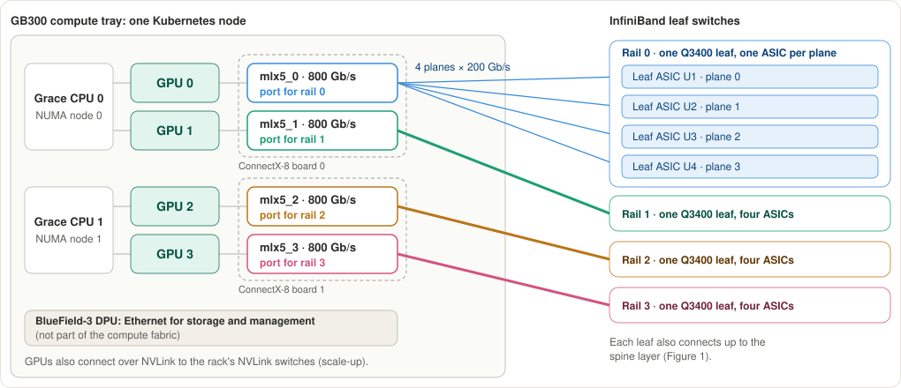

# MEP-0015: Network Topology Modeling and Generation

Author: [Oleg Leizerov](https://github.com/olegleyz)

## 1. Summary

This MEP proposes how Mokka models network topology and allows users to declare large, potentially irregular networks without specifying every device and connection.

The design introduces a canonical resolved topology model, concise network declarations, deterministic topology generation, structural deltas, and runtime failure injection. A generic interface exposes the resulting topology and effective runtime state to consumers, while optional adapters can support additional discovery interfaces when needed.

## 2. Network topologies considered

HPC and AI clusters use different network topologies depending on scale, bandwidth, and cost. **Fat-tree/Clos [[1]](#ref-1)**, widely used in NVIDIA's GPU scale-out architectures, connects nodes through leaf, spine, and optionally core switches, providing multiple high-bandwidth paths at the cost of extensive switching and cabling. **Dragonfly+ [[2]](#ref-2)** instead connects local leaf-spine groups through global links rather than a shared core tier, introducing connections outside a hierarchical switching structure. Other HPC topologies, such as torus, mesh, and HyperX, use different connectivity patterns but should be representable using the same device, port, link, and grouping abstractions. We therefore don't examine them separately.

Beyond the switching topology itself, networks vary in **NIC attachment** (rail-optimized, rack-local, or dual-top-of-rack (ToR)), **planes** (independent connectivity domains), **oversubscription** (different upstream and downstream bandwidth), **physical switch packaging** (multiple ASICs per enclosure), and **topology irregularities and partial population** (missing links, nonstandard cabling, or unpopulated racks and trays).

Neither Clos nor Dragonfly+ is a tree: switches can have multiple connections to other switches, creating multiple paths between nodes. Mokka therefore represents topology as a graph of devices connected through their ports, preserving physical connectivity without assuming a hierarchy.

## 3. Network topology representation


*Figure 1: Four GB300 NVL72 racks in one leaf group of the rail-optimized, two-tier Quantum-X800 InfiniBand compute fabric of NVIDIA's [DGX SuperPOD GB300 reference architecture](https://docs.nvidia.com/pdf/dgx-spod-gb300-ra.pdf). A scalable unit (SU) contains eight racks. Each leaf serves four racks; racks 4–7 of the scalable unit use leaf group 1. Only plane 0 is shown in detail. The four planes and the four ASICs per switch come from a production GB300 InfiniBand capture (MEP-0014, Appendix H), not from the reference architecture.*



*Figure 2: One GB300 compute tray. Each GPU has an 800 Gb/s NIC port on its rail, split into four 200 Gb/s planes, each connected to its own ASIC in the rail's leaf switch.*

### 3.1 Existing representations

The network architectures described in [§2](#2-network-topologies-considered) require representing both physical connectivity and logical relationships, such as rails, planes, and switching tiers. Existing topology representations capture different parts of this information:

| Representation | What it provides | Limitation for Mokka |
|---|---|---|
| [`ibnetdiscover`](https://github.com/linux-rdma/rdma-core/blob/master/infiniband-diags/man/ibnetdiscover.8.in.rst) | Discovered InfiniBand devices, ports, identities, and links | Does not explicitly represent rails, planes, switching tiers, or GPU-to-NIC associations |
| [IBDM `.topo`](https://linux.die.net/man/1/ibdm-topo-file) / [IBNL](https://linux.die.net/man/1/ibdm-ibnl-file) | Expected port-to-port cabling and reusable physical switch-system definitions | Does not describe all logical network relationships or simulation state |
| [RFC 8345](https://www.rfc-editor.org/rfc/rfc8345) | Technology-independent nodes, termination points, links, and supporting relationships | Requires additional semantics for Mokka's hardware and simulation behavior |

Consider the GB300 fabric illustrated in Figures 1 and 2. Each compute tray has four GPU-associated NIC connections, with each NIC exposing ports across four network planes. The racks connect through rail-optimized leaf-spine switches.

**`ibnetdiscover`** describes discovered connections between InfiniBand devices. For example, a NIC port connected to a leaf ASIC:

```text
Switch 149 "S-0000000000000001" # "leafgroup0/rail0/U1"
[19] "H-0000000000000011"[1] # "rack1/tray0/nic0"
```

**RFC 8345** represents connectivity using nodes, termination points, and links:

```json
{
  "node": [
    {"node-id": "rack1/tray0/nic0", "termination-point": [{"tp-id": "1"}]},
    {"node-id": "leafgroup0/rail0/U1", "termination-point": [{"tp-id": "19"}]}
  ],
  "link": [
    {
      "link-id": "rack1/tray0/nic0:1-leafgroup0/rail0/U1:19",
      "source": {"source-node": "rack1/tray0/nic0", "source-tp": "1"},
      "destination": {"dest-node": "leafgroup0/rail0/U1", "dest-tp": "19"}
    }
  ]
}
```

*The excerpts are illustrative, not complete syntax-validated files. Identifiers follow Mokka's naming convention; the four-ASIC enclosure and the port-19 connection follow the production capture.*

Mokka therefore needs a canonical model that combines port-level connectivity with physical device relationships and logical topology information.

### 3.2 Canonical resolved topology

Mokka represents network topology as a graph of devices connected through numbered ports, enriched with physical and logical relationships. The canonical model serves as the common source for simulated topology interfaces, independently of how the network was declared or generated.

The model consists of:

| Entity | What it represents |
|---|---|
| Fabric | A network and its technology, such as InfiniBand or RoCE |
| Plane | An independent connectivity domain within a fabric |
| Host | A compute node and its rack association |
| Device | A network endpoint (Channel Adapter, CA) or switching ASIC, including identity and attributes |
| Port | A numbered device port, including capabilities and plane membership |
| Link | A connection between two device ports, including configured bandwidth, lane count, and other link attributes |
| Enclosure | A physical NIC board or switch enclosure containing one or more devices; membership comes from the hardware model |
| Group | Logical relationships such as rails, switching tiers, scalable units, and pods; members are devices, enclosures, or hosts |

Planes are modeled explicitly for now; whether generic groups can represent them without losing information remains open.

#### Example: GB300 InfiniBand fabric

Using the GB300 topology in Figures 1 and 2, we demonstrate three relationships the canonical model must preserve:

**Rail optimization.** NICs associated with the same GPU position across trays connect to the corresponding rail's leaf switches. Within each plane, a leaf group contains one leaf per rail and serves up to four racks. Racks 0–3 use leaf group 0; racks 4–7 use leaf group 1.

**Multiple planes.** Each GPU-associated NIC port has four 200 Gb/s fabric endpoints, one per plane. The model associates the endpoints and switching ASICs with their respective planes.

**Multi-ASIC switches.** Four plane-specific leaf ASICs (U1–U4) share one physical switch enclosure. Their connectivity is independent, but they share a physical failure domain.

A physical NIC board may expose multiple channel adapters (CAs), each with its own identity and ports. The canonical model represents the CAs as devices and their physical board as an enclosure.

The following excerpt represents rack 1, tray 0, rail 0, connected to leaf group 0:

```yaml
fabric:
  id: compute
  technology: ib

planes:
  - {id: 0}
  - {id: 1}
  - {id: 2}
  - {id: 3}

hosts:
  - {id: rack1/tray0, rack: 1, tray: 0}

enclosures:
  - {id: rack1/tray0/cx8-0, kind: NIC}
  - {id: leafgroup0/rail0, kind: Switch, model: Q3400}

devices:
  - id: rack1/tray0/nic0
    kind: CA
    host: rack1/tray0
    enclosure: rack1/tray0/cx8-0
  - {id: leafgroup0/rail0/U1, kind: Switch, plane: 0, enclosure: leafgroup0/rail0}
  - {id: leafgroup0/rail0/U2, kind: Switch, plane: 1, enclosure: leafgroup0/rail0}
  - {id: leafgroup0/rail0/U3, kind: Switch, plane: 2, enclosure: leafgroup0/rail0}
  - {id: leafgroup0/rail0/U4, kind: Switch, plane: 3, enclosure: leafgroup0/rail0}

ports:
  - {device: rack1/tray0/nic0, number: 1, plane: 0, maxRateGbps: 200}
  - {device: rack1/tray0/nic0, number: 2, plane: 1, maxRateGbps: 200}
  - {device: rack1/tray0/nic0, number: 3, plane: 2, maxRateGbps: 200}
  - {device: rack1/tray0/nic0, number: 4, plane: 3, maxRateGbps: 200}
  - {device: leafgroup0/rail0/U1, number: 19, plane: 0, maxRateGbps: 200}
  - {device: leafgroup0/rail0/U2, number: 19, plane: 1, maxRateGbps: 200}
  - {device: leafgroup0/rail0/U3, number: 19, plane: 2, maxRateGbps: 200}
  - {device: leafgroup0/rail0/U4, number: 19, plane: 3, maxRateGbps: 200}

links:
  - {a: "rack1/tray0/nic0:1", b: "leafgroup0/rail0/U1:19", rateGbps: 200}
  - {a: "rack1/tray0/nic0:2", b: "leafgroup0/rail0/U2:19", rateGbps: 200}
  - {a: "rack1/tray0/nic0:3", b: "leafgroup0/rail0/U3:19", rateGbps: 200}
  - {a: "rack1/tray0/nic0:4", b: "leafgroup0/rail0/U4:19", rateGbps: 200}

groups:
  - id: rail0
    kind: Rail
    members:
      - rack1/tray0/nic0
      - leafgroup0/rail0/U1
      - leafgroup0/rail0/U2
      - leafgroup0/rail0/U3
      - leafgroup0/rail0/U4
  - id: leaf-tier
    kind: Tier
    members:
      - leafgroup0/rail0/U1
      - leafgroup0/rail0/U2
      - leafgroup0/rail0/U3
      - leafgroup0/rail0/U4
```

*Canonical-model excerpt with unrelated attributes omitted; groups list only the members shown. Link endpoints use `device:port` notation for brevity.*

[§4](#4-network-declaration-and-topology-generation) shows how Mokka generates this topology from a declaration.

The same graph abstractions can represent Dragonfly+ networks: groups identify local leaf-spine structures, while links connect switches across groups without requiring a global switching hierarchy.

The canonical model captures network connectivity, device relationships, and attributes needed for simulation, but does not model packet forwarding or data transfer.

## 4. Network declaration and topology generation

A resolved topology may contain thousands of devices and links. Rather than declaring each connection, users describe the hardware, network design, and participating racks. Mokka generates the canonical topology using reusable profiles and deterministic generation rules.

### 4.1 Network declaration

We propose four declaration resources:

| Resource | Responsibility |
|---|---|
| `SGPURackProfile` | Defines rack hardware, including nodes, GPUs, NICs, and their physical relationships |
| `SGPUInventory` | Declares rack instances and their populated hardware positions |
| `SFabricProfile` | Defines reusable network designs, including switching topology, attachment, and capacity rules |
| `SFabricInventory` | Declares fabric instances, participating racks and NIC endpoints, and site-specific topology deviations |

A fabric may span multiple hardware inventories, and a rack may participate in multiple fabrics. Built-in profiles let users select reference architectures without defining individual switches or connections.

`SFabricProfile.spec.technology` identifies the network technology, distinct from the fabric instance declared in `SFabricInventory`. We use the values `ib`, `roce`, `efa`, and `tcpxo`, aligned with AICR's fabric vocabulary. Support for a technology's discovery interfaces and runtime behavior is defined separately from its topology representation.

#### Example: GB300 InfiniBand declaration

The following resources describe the GB300 fabric from [§3](#3-network-topology-representation). Hardware attributes unrelated to topology are omitted.

**Hardware profile.** A GB300 rack contains 18 trays. Each tray has four ConnectX-8 channel adapters (CAs) on two physical boards, with four fabric endpoints per CA.

```yaml
kind: SGPURackProfile
metadata:
  name: gb300-nvl72
spec:
  trays: 18
  node:
    nics:
      models:
        - name: cx8-four-plane
          fabricEndpoints:
            - {id: p0, rateGbps: 200}
            - {id: p1, rateGbps: 200}
            - {id: p2, rateGbps: 200}
            - {id: p3, rateGbps: 200}
      boards:
        - {index: 0, model: cx8-mezzanine}
        - {index: 1, model: cx8-mezzanine}
      slots:
        - {index: 0, model: cx8-four-plane, board: 0}
        - {index: 1, model: cx8-four-plane, board: 0}
        - {index: 2, model: cx8-four-plane, board: 1}
        - {index: 3, model: cx8-four-plane, board: 1}
```

**Hardware inventory.** Four GB300 racks are present.

```yaml
kind: SGPUInventory
metadata:
  name: gb300-site
spec:
  coordinateBase: 0
  rackGroups:
    - {id: training, count: 4, profileRef: {name: gb300-nvl72}}
  nodeName: "rack{rack}/tray{tray}"
```

**Fabric profile.** The network uses a two-tier Clos topology, rail-optimized attachment, and Q3400 switches. Switch capabilities come from a hardware catalog. Spine counts and parallel links are derived from capacity, with explicit overrides available.

```yaml
kind: SFabricProfile
metadata:
  name: dgx-superpod-gb300
spec:
  technology: ib
  switch: {model: Q3400}
  topology:
    type: clos
    tiers: [leaf, spine]
    spinesPerLeaf: auto
    oversubscription: "1:1"
  attachment:
    strategy: railOptimized
    racksPerLeafGroup: 4
```

**Fabric inventory.** One compute fabric has capacity for eight racks, with four currently present. Only leaves serving populated racks are generated.

```yaml
kind: SFabricInventory
metadata:
  name: compute-network
spec:
  fabrics:
    - id: compute
      profileRef: {name: dgx-superpod-gb300}
      capacity: {racks: 8}
      members:
        - {inventoryRef: gb300-site, rackGroup: training, nicSlots: [0, 1, 2, 3]}
      buildLeaves: Populated
```

*Proposed declaration schema. The prototype validates these declarations, including switch lookup from a built-in hardware catalog, against multiple network configurations.*

### 4.2 Topology generation

Mokka resolves the declaration into the canonical graph from [§3.2](#32-canonical-resolved-topology) by identifying participating NIC endpoints, generating the switching hierarchy, attaching endpoints to switches, and assigning stable device and port identities.

For Clos networks, Mokka uses Parallel Ports Generalized Fat Tree (PGFT) generation rules to derive switching tiers, switch-to-switch connections, and parallel links from the declared topology and capacity. The GB300 example below demonstrates the resulting connections; see [Appendix: PGFT generation](#appendix-pgft-generation) for the algorithm and references. The fabric profile describes the network in terms of tiers, bandwidth, and attachment; users do not need to specify PGFT parameters.

For one eight-rack GB300 scalable unit, the generator creates eight Q3400 leaves (one per rail in each of two leaf groups) and four spines. Each switch contains four plane-specific ASICs. Each leaf ASIC uses 72 ports for NIC connections and 72 for uplinks, distributed as 18 links to each of the four spine ASICs in the same plane. These counts follow from the declared rack capacity, 1:1 oversubscription, and switch capabilities.

Rail-optimized attachment maps each NIC's plane endpoints to the corresponding leaf ASICs. For rack 1, tray 0, NIC 0, this produces:

```text
rack1/tray0/nic0:1 → leafgroup0/rail0/U1:19
rack1/tray0/nic0:2 → leafgroup0/rail0/U2:19
rack1/tray0/nic0:3 → leafgroup0/rail0/U3:19
rack1/tray0/nic0:4 → leafgroup0/rail0/U4:19
```

This reproduces the canonical excerpt in [§3.2](#32-canonical-resolved-topology).

Device identities derive from stable fabric and hardware coordinates, including rack, tray, NIC slot, plane, tier, and switch position. Port identities derive from their owning devices and port numbers; links are identified by their endpoint pairs. These identities do not depend on discovery or population order. Adding hardware within reserved capacity preserves existing identities and connections, while changes to switching capacity or topology rules may require new port assignments and protocol-specific addresses.

Generation is deterministic: the same declarations, hardware catalog, and generator version produce the same topology and identities. Mokka validates port capacities, link endpoints, and topology constraints before publishing the result.

### 4.3 Changes to declarations

Changes to inventories or profiles trigger topology regeneration. Within declared capacity, adding hardware preserves existing identities, ports, and connections.

For example, rack 1 may initially contain trays 0–11 and 14–17. Adding trays 12–13 connects them to reserved leaf ports 31–32 without changing existing connections or fault targets. The generator assigns identities and port positions from stable hardware coordinates rather than population order.

Changes beyond declared capacity or to switching rules may require rewiring and a new topology revision. Runtime failures are applied separately from the generated physical topology.

### 4.4 Supporting different network designs

| Network design | Declaration differences |
|---|---|
| GB300 rail-optimized Clos | Two tiers, `railOptimized` attachment, four racks per leaf group, four planes |
| Conventional rack-local Clos | Two tiers, `rackLocal` attachment, one rack per leaf group |
| Dual-homed ToR | `rackLocal` attachment with `leafHoming: 2` |
| Three-tier Clos | Add a core tier, spine/core connectivity, and pod grouping |
| Oversubscribed Clos | Specify a downstream-to-upstream bandwidth ratio, such as `2:1` |

These variations use the same declaration resources and canonical model. Other topology families, such as Dragonfly+, require different generation rules. Supporting validation is summarized in [Appendix: Design validation](#appendix-design-validation).

## 5. Topology deviations and runtime failures

The generator produces the intended network topology, but real clusters may have missing hardware, nonstandard cabling, or failed devices. Mokka handles these through two mechanisms: structural deltas, which modify the canonical topology, and runtime policies, which change operational state without modifying physical connectivity.

### 5.1 Structural deltas

Structural deltas describe how a particular fabric differs from its generated design. They are persisted in `SFabricInventory` and applied after generation, before the canonical topology is published.

For example, suppose the connection from rack 1, tray 0 to its plane-0 leaf is physically absent:

```yaml
kind: SFabricInventory
metadata:
  name: compute-network
spec:
  fabrics:
    - id: compute
      profileRef: {name: dgx-superpod-gb300}
      deltas:
        absentLinks:
          - {a: "rack1/tray0/nic0:1", b: "leafgroup0/rail0/U1:19"}
```

Mokka removes the specified link while preserving its endpoint ports and all unaffected devices and connections. Deltas can also remove switches or add nonstandard connections. The resulting graph is validated for missing endpoints, conflicting port assignments, and duplicate identities.

### 5.2 Runtime failures

Runtime failures change the operational state of devices and links that remain physically present. Because fabrics and compute inventories have independent ownership and lifecycles, we propose `SFabricRuntimePolicy` to manage network failures separately from GPU runtime policies.

For example, a test may disable the same plane-0 leaf port:

```yaml
kind: SFabricRuntimePolicy
metadata:
  name: disable-leaf-port
spec:
  targetRef:
    fabricInventoryRef: compute-network
    fabric: compute
    device: leafgroup0/rail0/U1
    port: 19
  runtime:
    operationalState: Down
```

Unlike the structural delta, the port and its connection remain in the canonical topology. The runtime policy changes their effective state, which the generic topology interface exposes to consumers.

Fabric runtime policies are persisted independently of compute inventories. The control plane derives their effects on the resolved topology and propagates node-visible changes through affected `SGPURack` resources and their delivery generations. Fabric-wide changes are exposed through the generic topology interface. Failures that do not change node-visible NIC state do not require rack updates.

Policies may target individual ports, links, ASICs, or physical enclosures. For example, failing one Q3400 ASIC affects its plane, while failing the enclosure affects all four ASICs.

A port failure remains valid when its cable is disconnected; a link failure targets a specific connection and becomes invalid if that connection is removed.

Fault targets use stable canonical identities. When the topology changes, Mokka reapplies runtime policies to matching objects and reports targets that no longer exist rather than silently reassigning them.

## 6. Topology interfaces and adapters

### 6.1 Generic topology interface

Mokka exposes the resolved topology and effective runtime state through one generic interface. Consumers, including Topograph, can retrieve devices, ports, links, logical groups, and stable identities without requiring Mokka to emulate their discovery mechanisms. The transport and Topograph integration details will be determined during implementation.

### 6.2 Topology adapters

The design also defines **topology adapters**: a generic mechanism that renders the canonical view, including effective runtime state, in the form a particular topology source produces. When a consumer must be tested against the source it uses in production, an adapter generates that source's content from the canonical model. For example, an InfiniBand adapter could produce `ibnetdiscover` output, and a cloud adapter could answer AWS `DescribeInstanceTopology` requests.

Every adapter reads the same canonical model and runtime state, so all simulated sources describe one consistent network. An adapter may omit information its source cannot express, such as rail membership in `ibnetdiscover`, but must preserve the identities and connectivity that the source does carry. Adding an adapter changes neither the canonical model nor the generator.

No adapter is part of the initial implementation. Adapters are added when there is a requirement to simulate a specific topology source.

## 7. Design decisions and limitations

### 7.1 Declaration alternatives

MEP-0014 initially proposed declaring fabric instances within `SGPUInventory`, keeping rack hardware and network configuration together. Review feedback raised concerns about independent ownership and fabrics spanning multiple inventories.

We considered two approaches:

| Approach | Advantages | Trade-offs |
|---|---|---|
| **Fabric in `SGPUInventory`** | Fewer resources; straightforward for self-contained clusters | Couples fabric and rack lifecycles; complicates fabrics shared across inventories |
| **Separate `SFabricInventory` (chosen)** | Independent ownership and lifecycle; supports fabrics spanning multiple inventories and racks participating in multiple fabrics | Adds a resource and requires cross-resource references |

We chose `SFabricInventory` because network fabrics are not necessarily owned or managed alongside compute racks. `SGPUInventory` remains responsible for hardware population, while `SFabricInventory` declares fabric membership and site-specific connectivity.

The canonical topology, generation rules, and runtime-state model are defined in this MEP; MEP-0014 retains the higher-level network simulation architecture.

### 7.2 Limitations and deferred capabilities

| Area | Boundary |
|---|---|
| Topology generation | Initial generator supports Clos variants. Dragonfly+ and other topology families require additional generators. |
| Heterogeneous fabrics | Mixed rack types, different switch models per tier, and different topology shapes per plane need further design. |
| Irregular connectivity | Structural deltas support individual deviations; arbitrary irregular networks may require direct graph declarations or additional generation rules. |
| Network simulation | Packet forwarding, bandwidth contention, latency, and data transfer are outside the scope of this MEP. |
| Integration transport | The mechanism used to deliver topology to Topograph and other consumers is determined during implementation. |

Hardware catalog entries must be versioned and validated against reference architectures or captured hardware to prevent changes in device capabilities from silently altering generated topologies.

The canonical model is intended to accommodate more network structures than the initial generator can produce. Support for a topology therefore has three distinct levels: **representable in the canonical graph, generatable from a declaration, and exposed through a consumer interface**.

## 8. Validation criteria

The implementation is considered ready when:

1. **Topology correctness:** GB300 and representative two- and three-tier Clos declarations generate the expected devices, ports, links, and identities.
2. **Determinism:** Identical declarations, hardware catalog versions, and generator versions produce identical canonical graphs.
3. **Stable growth:** Adding hardware within reserved capacity preserves existing identities, connections, and fault targets.
4. **Deviation handling:** Structural deltas affect only their specified targets; removing a link preserves its endpoint ports, while runtime failures change operational state without modifying physical connectivity.
5. **Consumer consistency:** The generic interface exposes a consistent topology revision and effective runtime state.

Supporting prototype experiments and their limitations are documented in [Appendix: Design validation](#appendix-design-validation).

---

## Appendix: PGFT generation

**Parallel Ports Generalized Fat Tree (PGFT)** extends generalized fat-tree models by allowing multiple parallel links between switches. Its parameters describe switching levels, connections between levels, and the number of parallel links. See Zahavi, [*Fat-tree routing and node ordering providing contention free traffic for MPI global collectives*](https://doi.org/10.1016/j.jpdc.2012.01.018) (Journal of Parallel and Distributed Computing, 2012) for the formal model, and Zahavi et al., [*Quasi Fat Trees for HPC Clouds and Their Fault-Resilient Closed-Form Routing*](https://www.ee.technion.ac.il/~isaac/p/hoti14_qft.pdf) for examples.

Mokka translates the user-facing Clos declaration into PGFT parameters, then generates the switching graph. Endpoint attachment, physical ASIC packaging, deterministic port numbering, and device identities are handled by Mokka's additional generation rules.

For GB300, the resulting PGFT structure connects each leaf to four spines through 18 parallel links per leaf-spine ASIC pair, while the rail-optimized attachment rules connect NIC endpoints to the appropriate leaves.

The proposed translation has been evaluated against GB300 and other two- and three-tier Clos networks; see [Appendix: Design validation](#appendix-design-validation).

## Appendix: Design validation

A research prototype evaluated the proposed declaration and generator against GB300, two real InfiniBand captures (R1 and R2), rack-local Clos, and dual-homed ToR fabrics. Equivalent declarations produced identical canonical graphs for GB300, R1, and R2, and matching devices, ports, and links for the other two configurations.

Additional tests covered rack sizes, NIC counts, switch capacities, oversubscription, partial population, and structural deviations. Adding missing GB300 trays preserved existing identities, connections, and fault targets.

Not yet validated: Dragonfly+ generation, mixed rack types within one fabric, heterogeneous switch models across tiers, and Topograph consumer integration.

## Appendix: Network topology references

1. <a id="ref-1"></a>**Fat-tree/Clos:** [Cumulus Linux 4.1: Network Topology](https://docs.nvidia.com/networking-ethernet-software/cumulus-linux-41/Layer-3/Network-Topology/) · [Back to Chapter 2](#2-network-topologies-considered)

2. <a id="ref-2"></a>**Dragonfly+:** [Dragonfly+ topology](https://doi.org/10.1109/HiPINEB.2017.11) · [Back to Chapter 2](#2-network-topologies-considered)
