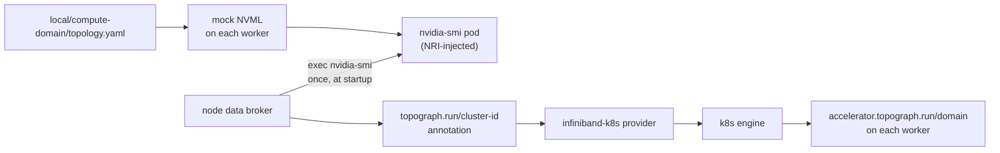

# Topograph

[Topograph](https://github.com/dsx-ai-factory/topograph) reads the NVLink
clique of every simulated-GPU worker and labels each one with its accelerator
domain, the label topology-aware schedulers (KAI, Kueue TAS) consume. This
directory is the `--topograph` Tilt consumer. For what the integration shows
and how to run it without a checkout, see the
[Topograph guide](../../docs/guides/topograph/README.md).

## Run

```bash
make cluster-create PROFILE=compute-domain
tilt up -- --topograph
```

`--topograph` implies `--compute-domain`: the cliques only exist on the
`compute-domain` cluster. Neither `--dra` nor `--gpu-operator` is needed.

Tilt deploys to the current kubectl context; `--k8s-context` only allows a
context, it does not select one. To run this next to another cluster without
switching contexts, select it with Tilt's own `--context` flag, and give the
second Tilt its own UI port:

```bash
tilt up --context kind-mokka-compute-domain --port 10351 -- --topograph
```

## What lands in the cluster

| Release / resource      | Namespace   | Notes                                                              |
|-------------------------|-------------|--------------------------------------------------------------------|
| `topograph`             | `topograph` | API server, node observer, and the node data broker DaemonSet      |
| `topograph-nvidia-smi`  | `topograph` | The `nvidia-smi` DaemonSet the broker execs into, one pod per worker |
| `nvml-mock`             | `default`   | The compute-domain release: gb200 profile plus the NVLink topology |

## Data path



No node carries a clique label; the mock driver is the only source. The
cluster has two NVLink domains, each with one clique of two workers, so
topograph reports two two-node domains:

| Node     | `topograph.run/cluster-id` and `accelerator.topograph.run/domain` |
|----------|-------------------------------------------------------------------|
| worker-0 | `…ab.0`                                                           |
| worker-1 | `…ab.0`                                                           |
| worker-2 | `…cd.0`                                                           |
| worker-3 | `…cd.0`                                                           |

The node observer regenerates the topology whenever a
`mokka.nvidia.com/type=sgpu` node joins or leaves.

## Files

| File                    | Purpose                                                                 |
|-------------------------|-------------------------------------------------------------------------|
| `topograph.tiltfile`    | Applies the `nvidia-smi` DaemonSet, then installs the pinned topograph chart from the dsx-ai-factory Helm repo |
| `topograph.values.yaml` | `infiniband-k8s` provider with the `nvidia-smi` accelerator source, `k8s` engine, worker-only node selection |
| `nvidia-smi.k8s.yaml`   | The `topograph` namespace and the annotated `nvidia-smi` DaemonSet       |

## Couplings that fail silently

1. **The exec target.** Topograph's exec names no container. Pointed at the
   `nvml-mock` DaemonSet, it lands in the NRI plugin container, which has no
   mock driver, and every node gets `topograph.run/cluster-id: [N/A].[N/A]`,
   which the k8s engine then fails to write as a label. `nvidia-smi.k8s.yaml`
   must stay a single-container pod, annotated
   `nvml-mock.nvidia.com/devices: "true"`, outside the `default` and
   `kube-system` namespaces the compute-domain release excludes from
   injection.
2. **Start order.** The broker queries `nvidia-smi` once, when it starts. A
   node whose `nvidia-smi` pod is not running by then gets no annotation and
   no label until the broker restarts. `topograph.tiltfile` orders the two;
   outside Tilt, run
   `kubectl -n topograph rollout restart ds/topograph-node-data-broker`.
3. **The chart version and the values layout.** Chart 1.0.0 reads top-level
   `provider` and `engine`, and ignores keys it does not know, such as the
   `global.provider` this file used before. Values it ignores leave it on its
   default `test` provider, with no error. `_CHART_VERSION` in
   `topograph.tiltfile` pins the two together; bump them in the same commit.
4. **The `mokka.nvidia.com/type=sgpu` selector.** The `nvidia-smi` DaemonSet,
   the provider and the node observer all select on it. A worker without the
   label is never labelled and never triggers a regeneration.

## Troubleshooting

No `accelerator.topograph.run/domain` label? Check what the broker recorded,
then what topograph did with it:

```bash
kubectl get nodes \
  -o custom-columns='NODE:.metadata.name,CLUSTER-ID:.metadata.annotations.topograph\.run/cluster-id'
kubectl -n topograph logs deploy/topograph | grep -E 'Creating topology config|Updating topology labels|Invalid value'
```

A missing annotation is coupling 2; `[N/A].[N/A]` is coupling 1.
`provider="infiniband-k8s" engine="k8s"` on the `Creating topology config`
line confirms the values were read; `provider="test"` means the chart ignored
them (coupling 3).

Two warnings are expected. `failed to run ibnetdiscover`, once per node: the
provider also looks for InfiniBand switches from the broker pod, which has no
mock InfiniBand, so the topology carries the NVLink domains only. A missing
`topograph.run/instance` annotation on the control plane: the broker does not
run there.
